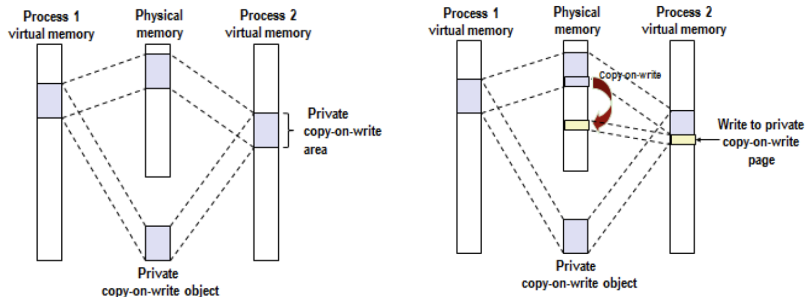
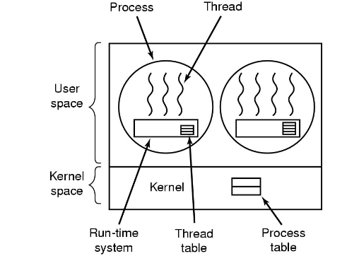
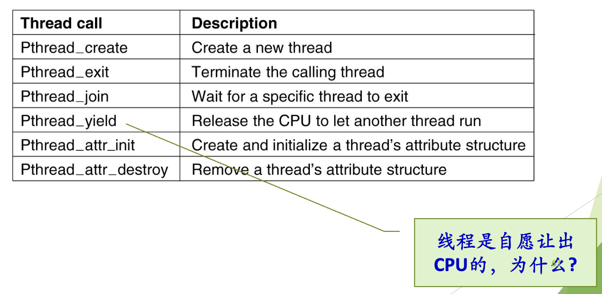
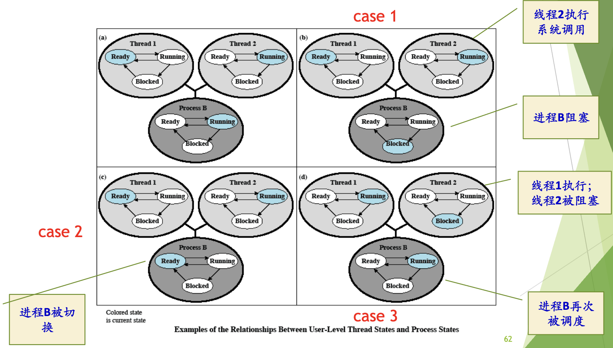

# 操作系统 课程笔记

> 北京大学《操作系统原理》· 陈向群 · 2026 秋
> 参考书：OSTEP（《操作系统导论》）、MOS（Tanenbaum《现代操作系统》）、CSAPP；实验基于 RISC-V（xv6-riscv / 操作系统大赛内核赛）

## 目录

- [第 0 章 课程简介与导论](#第-0-章-课程简介与导论)
  - 0.0 课前问题 · 0.1 为什么学 OS · 0.2 课程信息与实验 · 0.3 OS 做了什么：以 hello world 为例 · 0.4 典型 OS 架构 · 0.5 重识 OS · 0.6 OS 引导启动（xv6-riscv）
- [第 1 章 操作系统概述](#第-1-章-操作系统概述)
  - 1.0 课前问题 · 1.1 OS 的定义 · 1.2 三种观点 · 1.3 OS 的特征 · 1.4 发展历史 · 1.5 OS 分类
- [第 2 章 操作系统运行环境和运行机制](#第-2-章-操作系统运行环境和运行机制)
  - 2.0 课前问题 · 2.1 处理器与特权级 · 2.2 中断/异常机制 · 2.3 IA32 的中断支持 · 2.4 系统调用 · 2.5 Linux 系统调用实现（x86） · 2.6 机制与策略 · 2.7 xv6 源码阅读题
- [第 3 章 进程线程模型](#第-3-章-进程线程模型)
  - 3.0 课前问题 · 3.1 基本概念 · 3.2 进程模型 · 3.3 进程控制 · 3.4 线程模型 · 3.5 协程 · 3.6 重点小结与 xv6 源码阅读题

---

# 第 0 章 课程简介与导论

## 0.0 课前问题

本课件开头没有成组的"问题"页，但正文中散落了几个思考题（❓/🔗/📃），集中在这里作答，正文相应处会回链。

### Q0-1 hello world 程序执行时第一条指令是什么？是 `main` 里的代码吗？

**不是。** 以 Linux x86-64、动态链接的 `hello` 为例，从内核交出控制权开始：

```
execve("./hello")                       ← 内核：解析 ELF、建立地址空间
   │  ELF 里有 PT_INTERP 段 = /lib64/ld-linux-x86-64.so.2
   ▼
ld-linux.so 的 _start                   ← 用户态第一条指令在动态链接器里！
   │  装载 libc.so、做重定位
   ▼
hello 的 _start   (来自 crt1.o)         ← ELF header 里的 Entry point
   ▼
__libc_start_main(main, argc, argv, …)  ← 初始化 libc、调用构造函数、注册 atexit
   ▼
main()                                   ← 我们写的代码
   ▼
exit(main 的返回值) → 刷新 stdio 缓冲 → _exit 系统调用
```

动手验证（CSAPP 第 7 章"链接"的内容）：

```bash
gcc hello.c -o hello
readelf -h hello | grep Entry      # Entry point address: 0x1060  ← 是 _start，不是 main
objdump -d hello | grep -A5 '<_start>'
readelf -l hello | grep interpreter   # [Requesting program interpreter: /lib64/ld-linux-x86-64.so.2]
gcc -static hello.c -o hello_s        # 静态链接则没有 interpreter，第一条就是 _start
```

所以"第一条指令"取决于链接方式：动态链接时是动态链接器的入口，静态链接时是 `_start`；无论哪种都**不是** `main`。

### Q0-2 可执行文件如何"映射"到进程？

`execve` 并不把整个文件读进内存，而是**建立映射关系**：

1. 读 ELF header 和 program header table；
2. 对每个 `PT_LOAD` 段（代码段 `r-x`、数据段 `rw-`）在进程地址空间里建一个区域（Linux 叫 `vm_area_struct`，VMA），记录"这段虚拟地址对应文件的哪个偏移、什么权限"；
3. `.bss`、堆、栈建立为匿名映射（不对应文件，初值为 0）；
4. 设置好用户栈（argv、envp、auxv），把 PC 设为入口地址。

此时页表里几乎什么都没有。**第一次执行入口指令就会触发缺页异常（page fault）**，内核根据 VMA 发现这是文件映射，于是分配物理页、从磁盘读入、填页表，然后重新执行那条指令——这正是课件里"执行 helloworld 程序的第一条指令，发生缺页异常"那一步。这就是**按需调页（demand paging）**，也是 CSAPP 9.8 "内存映射"讲的机制。第 3 章的 `/proc/PID/maps` 能直接看到这些映射。

### Q0-3 XV6 和 Linux 内核模块/分层的异同


|            | xv6                                                                                                | Linux                                         |
| ---------- | -------------------------------------------------------------------------------------------------- | --------------------------------------------- |
| 内核类型   | 宏内核（monolithic），所有子系统在 S 模式同一地址空间                                              | 宏内核                                        |
| 可加载模块 | 无，一次编译成一个`kernel` 文件                                                                    | 有 LKM（`insmod`/`modprobe`），驱动可动态加载 |
| 文件系统   | 单一 FS，但内部**严格分层**：磁盘 → buffer cache → 日志 → inode → 目录 → 路径名 → 文件描述符 | 多一层 VFS 抽象，下挂 ext4/xfs/btrfs/…       |
| 规模       | 约 1 万行                                                                                          | 数千万行                                      |
| 共同点     | 都是 UNIX 风格：进程、fork/exec、"一切皆文件"的 fd 接口、系统调用作为唯一入口                      |                                               |

结论：两者在"结构类型"上相同（都是宏内核），差别主要在**规模与可扩展性**：Linux 多了模块机制和 VFS 等抽象层。

### Q0-4 多核下各 CPU 核心的栈怎么排列？（xv6-riscv `entry.S`）

```asm
# kernel.ld: ENTRY(_entry)，内核被放在 0x80000000
_entry:
        la   sp, stack0          # sp = stack0 的起始地址
        li   a0, 1024*4          # a0 = 4096
        csrr a1, mhartid         # a1 = 当前核编号 hartid
        addi a1, a1, 1
        mul  a0, a0, a1          # a0 = 4096 * (hartid + 1)
        add  sp, sp, a0          # sp = stack0 + 4096*(hartid+1)
        call start
```

`start.c` 里定义了 `char stack0[4096 * NCPU]`，所以：

```
低地址                                                          高地址
stack0 ├── hart0 的栈 ──┤── hart1 的栈 ──┤── hart2 的栈 ──┤ …
       0              4096            8192            12288
                      ▲ hart0 的初始 sp  ▲ hart1 的初始 sp  ▲ hart2 的初始 sp
```

每个核一个 4KB 栈，**连续排列**；栈向低地址增长，所以初始 sp 指向各自区域的**顶端**（高地址）。这里 `+1` 的原因就是这个。

对比实验代码库 `xv6-k210/kernel/entry_qemu.S`：由 SBI 把 hartid 放在 `a0` 传进来，`sp = boot_stack + (hartid+1) << 14`，即每核 16KB，思路完全相同。

### Q0-5 `start` 函数运行在什么模式？

**机器模式（M 模式）。** QEMU 上电后所有核都在 M 模式执行 `_entry` → `start`。`start` 的任务就是"为降到 S 模式做准备"，最后用 `mret` 完成降级（详见 0.6）。提示中的关键：`mret` 会跳到 `mepc` 保存的地址，并把特权级设为 `mstatus.MPP` 里的值——`start` 事先把 `mepc` 设成 `main`、`MPP` 设成 S，于是 `mret` 一执行，CPU 就"返回"到了 S 模式下的 `main`。这是**用"假装从异常返回"来降低特权级**的技巧。

### Q0-6 总结 XV6-RISCV 的多核启动流程

见 0.6.3 小节。

---

## 0.1 为什么学操作系统

课件从"AI 时代需要什么能力"切入，核心论点是：**系统能力**（systems thinking）是 AI 无法替代的底层能力。几个案例串起来看：


| 案例                      | 说明了什么                                                                                                                           | 和 OS 的关系                                                                                                   |
| ------------------------- | ------------------------------------------------------------------------------------------------------------------------------------ | -------------------------------------------------------------------------------------------------------------- |
| **DeepSeek**              | 在有限算力下靠工程取胜：FP8 混合精度、PTX 汇编级优化、DualPipe 流水并行、负载均衡                                                    | 训练数据加载用`io_uring` 异步 I/O + `mmap` 减少内核态/用户态拷贝——这些都是 OS 课的内容（I/O 管理、内存映射） |
| **12306**                 | 高并发下的系统设计：异步排队、读写分离、削峰、动态负载均衡                                                                           | "请求入队 + 异步处理 + 按后端能力调速" 本质上就是 OS 里的缓冲、队列、调度思想（对比 1.4 的 SPOOLing）          |
| **后摩尔时代**            | "There's Plenty of Room at the Top"：4K×4K 矩阵乘，Python → C → 多核 → 存储优化（分块，利用 cache 局部性）→ SIMD，总加速 6 万倍 | 多核 = 进程/线程与调度；存储优化 = 存储层次与局部性（CSAPP 第 6 章）                                           |
| **CPU:GPU 从 1:8 到 1:1** | 推理/Agent 场景下，GPU 利用率常 < 40%，瓶颈在数据流动、任务调度、内存管理、I/O、网络——都是 CPU 侧的系统工作                        | 调度、内存管理、I/O 协同正是 OS 的职责                                                                         |
| **具身智能**              | 机器人的"身体"依赖 OS：实时调度、资源隔离、IPC、同步互斥、设备驱动                                                                   | 几乎覆盖整门课的主题（见下表）                                                                                 |

具身智能与 OS 能力的对应（很好的"全课程地图"）：


| 机器人需求                                            | OS 机制                                                          | 对应章节         |
| ----------------------------------------------------- | ---------------------------------------------------------------- | ---------------- |
| "抓杯子"时关节控制必须硬实时，大模型推理可以慢几百 ms | 实时调度；可能用"双 OS"：Linux 跑 AI + RTOS 跑控制，共享内存通信 | 调度             |
| 资源受限设备上同时跑推理和控制                        | CPU/内存/IO 隔离、优先级                                         | 进程、调度、内存 |
| 传感器 1kHz 采样，数据要低延迟送达                    | 共享内存、消息队列（ROS2 建在 OS 通信原语之上）                  | IPC              |
| 一个线程写关节角度、另一个读来做碰撞检测              | 锁/信号量/RCU；中断上下文只能用自旋锁；无锁队列（CAS）；读写锁   | 同步互斥         |
| 五花八门的传感器、执行器                              | 设备驱动抽象；关键路径用`mmap` 映射 DMA 缓冲区零拷贝             | I/O              |

**低延迟的四种来源**（后面各章都会遇到）：


| 延迟           | 含义                                     | 典型来源                  |
| -------------- | ---------------------------------------- | ------------------------- |
| 中断延迟       | 硬件中断发生 → CPU 开始执行中断处理程序 | 关中断、高优先级中断      |
| 调度延迟       | 任务就绪 → 真正拿到 CPU                 | 调度策略、优先级          |
| 上下文切换时间 | 保存旧任务、恢复新任务                   | 寄存器保存/恢复、TLB 刷新 |
| 通信延迟       | 数据从一个任务到另一个任务               | 拷贝、协议栈、核间通信    |

## 0.2 课程信息与实验

### ICS 里已经学过的基础

存储层次与局部性、异常控制流（中断/陷阱/故障/系统调用/用户态内核态）、进程与线程、信号、虚存（页表/TLB/地址翻译/内存映射）、并发（信号量、PV、死锁）。OS 课是在这些"使用者视角"的知识上，转到**设计者视角**：不是"如何使用 OS"，而是"OS 如何工作"——内部机制、数据结构与算法、设计中的权衡（trade-off）。

### 课程安排

- 形式：课堂讲授 + 课程实验 + 讨论课 + xv6-riscv 源码阅读
- 教材：**OSTEP**（难度低，课前读）、**MOS**（设计方案与权衡多，课后读，配合其 Linux/Windows 案例章）、CSAPP（回顾）
- 成绩：平时 50%（实验 40% + 课堂 10%）、期中 10%、期末闭卷 40%；加分 2–10 分（笔记、poster、拓展题）
- 期末：2027 年 1 月 4 日下午
- 课堂派加课码 LHMBC4；课程邮箱 pkuos2026@163.com（只用于提问）

### 课程实验：操作系统大赛内核赛初赛

用 C 或 Rust 写一个基于 RISC-V 的内核，在 QEMU 上跑通约 32 个系统调用测试。流程：推送到 GitLab → 评测机在 Docker 中 `make` 生成 `os.bin` → 启动 QEMU → 读串口输出判分。


| Part | 内容                           | 类型     |
| ---- | ------------------------------ | -------- |
| 0    | 环境配置与平台提交（DDL 9/18） | 准备     |
| 1    | 关机与简单调用                 | 系统调用 |
| 2    | 内存分配管理                   | 系统调用 |
| 3    | 进程管理                       | 系统调用 |
| 4    | 进程调度算法                   | 功能     |
| 5    | 懒分配与私有写时复制（COW）    | 功能     |
| 6    | 页面替换算法                   | 功能     |
| 7    | 文件系统                       | 系统调用 |
| 8    | IPC 信号量                     | 功能     |

逾期扣 10%–20%。实验记录/报告（5 分）期末提交，要体现阶段性过程和对局部（数据结构/算法）与整体的思考。

课件还介绍了其他教学 OS（了解即可）：MIT **xv6**（Lab: util, syscall, pgtbl, traps, lazy, cow, thread, lock, fs, mmap, net）、Stanford **PintOS**（x86，threads/userprog/vm/fs）、MIT **JOS**（x86，从 bootloader 到网络）、Berkeley **Nachos**（MIPS 模拟器上跑的"OS 进程"）、**XINU**（层次结构清晰、真用于商业产品）。

### 学习方法：三层结构

课件建议围绕"**基本概念 → 典型流程 → 关键技术**"组织知识，并反复追踪几条**典型处理流程**——这几条流程串起了全课：

1. 执行 HelloWorld 的流程（本章 0.3）
2. `fork()`、`exec()` 的处理流程（第 3 章）
3. Page Fault 的处理流程（内存管理）
4. 打开文件的流程（文件系统）
5. 一次 I/O 请求完成的流程（设备管理）

## 0.3 操作系统做了什么：以 hello world 为例

```c
#include <stdio.h>
int main(int argc, char *argv[]) {
    puts("hello world");
    return 0;
}
```

从敲下 `./hello` 到屏幕出现文字，OS 参与的每一步：


| 步 | 谁            | 做什么                                                                          | 涉及的 OS 模块      |
| -- | ------------- | ------------------------------------------------------------------------------- | ------------------- |
| 1  | 用户 → shell | 在 shell 输入命令（shell 自己也是个进程，通过`fork`+`exec` 告知 OS）            | 进程管理            |
| 2  | OS            | 找到`hello` 文件，检查是否可执行，读程序头，确定代码/数据在文件中的位置与磁盘块 | 文件系统            |
| 3  | OS            | 创建新进程，把可执行文件**映射**到进程地址空间（Q0-2）                          | 进程管理 + 内存管理 |
| 4  | OS            | 设置 CPU 上下文（PC、SP 等），调度器选中它后跳到程序入口                        | 调度                |
| 5  | 硬件 → OS    | 执行第一条指令即**缺页异常**                                                    | 中断/异常           |
| 6  | OS            | 分配物理页，从磁盘读入代码，更新页表，返回重新执行                              | 内存管理 + I/O      |
| 7  | 用户程序      | `puts` → libc → `write` **系统调用**                                          | 系统调用            |
| 8  | OS            | 找到输出设备（终端/显示），把字符串交给驱动或负责显示的进程                     | 设备管理            |
| 9  | 驱动/显示进程 | 字符 → 像素，写入帧缓冲区（frame buffer）                                      | 设备管理            |
| 10 | 硬件          | 显卡把像素转为视频信号，显示器按刷新率点亮 LED                                  | —                  |

**结论**：一个最简单的程序，执行过程其实是"**用户程序 ↔ OS 功能调用 ↔ 调度**"不断交替：

```
用户程序 ──OS功能调用──▶ OS:进程管理 ──调度──▶ 用户程序 ──OS功能调用──▶ OS:内存管理 ──调度──▶ 用户程序 ──▶ OS:文件系统 …
```

OS 做了三类事：**功能支持**（进程、内存、文件、设备管理）、**提供服务**（系统调用接口）、**状态切换**（用户态 ↔ 内核态，这是第 2 章的主题）。

## 0.4 典型操作系统架构


| 系统            | 结构要点                                                                                                                                                                                    |
| --------------- | ------------------------------------------------------------------------------------------------------------------------------------------------------------------------------------------- |
| **Windows**     | 用户态：系统进程、服务进程、用户进程、环境子系统、DLL；内核态：系统服务分发器 → 执行体（Executive）→ 内核 + 设备驱动 + 图形窗口 →**硬件抽象层 HAL** → 硬件。HAL 把硬件差异挡在最底层    |
| **UNIX**        | 经典"洋葱"层次：硬件 → 内核 → 系统调用 → shell/库 → 应用                                                                                                                                |
| **Linux**       | 宏内核：进程管理、内存管理、VFS/文件系统、网络协议栈、设备驱动、架构相关代码都在内核态；支持可加载模块                                                                                      |
| **xv6**         | 教学版 UNIX 宏内核，见 Q0-3                                                                                                                                                                 |
| **Android**     | 四层：应用 → 应用程序框架（视图、内容提供者、资源管理器）→ 库（libc、SQLite、媒体、3D）+ 运行时 →**Linux 内核**                                                                          |
| **OpenHarmony** | 应用层 → 框架层（ArkUI、Ability、方舟编译器）→ 系统服务层（分布式软总线、分布式数据/任务调度）→ 内核层（**多内核**：标准系统 Linux，小型系统 LiteOS-A，轻量系统 LiteOS-M；HDF 驱动框架） |
| **openEuler**   | 华为 EulerOS 于 2019 年开源而来，服务器 OS，支持 x86/ARM/RISC-V；配套 StratoVirt 轻量虚拟机、iSula 容器、A-Tune 智能调优、secGear 机密计算等                                                |

共同的抽象都是同一张图：

```
终端用户 / 应用软件设计者
        应用程序
     ──────────────  系统功能调用（系统调用）
        操作系统         ← 操作系统设计者
     ──────────────
        计算机硬件
```

## 0.5 重识操作系统

**名称演化**：监控程序 Monitor → 执行系统 Executive → 控制系统 Control → 管理程序 Supervisor → 核心 Kernel → 操作系统 Operating System。"Supervisor" 这个名字留在了今天的硬件里：RISC-V 的 **S 模式**（Supervisor mode）就是跑内核的特权级。

**OS 的主要工作**：

1. 程序的执行：启动、执行、结束；
2. **个性**的工作——与硬件相关；
3. **共性**的工作——易用、基本服务、统一性；
4. 性能、安全、健壮性。

### 个性：硬件相关

没有 OS 时，程序员得直接对二进制操作、从发光二极管读答案。硬件相关的代码复杂、繁琐、不通用。

**例子：软盘控制器 NEC PD765**——16 条命令，每条命令要向设备寄存器写 1–9 字节；光一个 READ 就有 13 个参数（块地址、每磁道扇区数、记录格式、扇区间隙、对已删除数据标识的处理……），完成后控制器在 7 个字节里返回 23 个状态和错误字段，程序员还要自己关注步进电机开关状态。

对比两种需求：**"从文件读一个数据块"** vs **"移动磁头、等待落下、读扇区……"**——前者就是 OS 提供的抽象。OS 把硬件相关操作**屏蔽并统一**。

### 共性：与具体应用无关的公共工作

任何程序都需要的、工作过程相同的事——抽象、简化、服务、方便、标准化。

所以 OS 是"应用软件与现实硬件之间的软件"，提供：

- **硬件抽象**，带来可移植性；
- **有限变"无限"**（近似）：CPU 数有限 → 每个进程好像独占一个 CPU；内存有限 → 每个进程好像有巨大的地址空间；
- **保护**；
- 一台**等价的扩展机器（虚拟机）**，比底层硬件更容易编程。

## 0.6 操作系统引导启动

### 0.6.1 核心概念与总体流程

两个根本问题：**内核文件怎么运行？如何找到内核文件并从起始点开始运行？**

```
BIOS/固件 ──加载──▶ bootloader ──把 kernel.bin 从磁盘读到内存──▶ 跳到内核入口
```

典型流程：上电 → ROM 代码 → bootloader → 加载内核 → 内核初始化 → 启动 init 进程 → shell。

xv6 的"四步闭环"：


| 步                | 做什么                                                                                       |
| ----------------- | -------------------------------------------------------------------------------------------- |
| 01 引导加载       | 固件/bootloader 初始化硬件，把内核加载到内存（QEMU 的`-kernel` 直接把内核放到 `0x80000000`） |
| 02 内核初始化     | `main` 依次初始化子系统：物理内存分配器、页表、进程表、中断处理、控制台等设备                |
| 03 创建 init 进程 | `userinit` 创建第一个用户进程，执行 `/init`，打开控制台、启动 shell                          |
| 04 启动调度器     | 每个核调用`scheduler()` 进入无限循环，从此系统进入多任务并发状态                             |

### 0.6.2 RISC-V 特权级与 SBI

RISC-V 三种特权模式（第 2 章 2.1 详述）：**M**（Machine，最高，固件）> **S**（Supervisor，内核）> **U**（User，应用）。

- x86 PC 上：BIOS/UEFI 是固件，提供中断服务给 bootloader。
- RISC-V 上：M 模式固件通过 **SBI（Supervisor Binary Interface）** 给 S 模式内核提供服务（如设置定时器、核间中断、关机、串口输出）。S 模式内核用 `ecall` 调用 SBI，就像用户程序用 `ecall` 调用内核——**同一套陷入机制在两层之间复用**。常见实现：OpenSBI、RustSBI。

```
U 模式: 应用程序
   │ ecall (系统调用)
S 模式: 内核  (xv6 / Linux)
   │ ecall (SBI 调用)
M 模式: SBI 固件 (OpenSBI / RustSBI)
   │
硬件
```

> **实验代码注意**：上游 xv6-riscv 没有 SBI，内核自己从 M 模式启动（有 `start.c`）；而实验用的 `xv6-k210` 由 RustSBI 先在 M 模式完成初始化，再把控制权交给内核，**内核一开始就在 S 模式**，所以没有 `start.c`，关机等操作要调 SBI（Part 1 的"关机"就是这个）。

### 0.6.3 xv6-riscv 启动代码走读：`_entry` → `start` → `main`

源文件：`kernel/kernel.ld`、`kernel/entry.S`、`kernel/start.c`、`kernel/main.c`；xv6-book 2.6 节。

**① `kernel.ld` + `entry.S`（M 模式）**
链接脚本 `ENTRY(_entry)` 指定入口，`. = 0x80000000` 让内核从 QEMU 放置内核的位置开始。`_entry` 为每个核设置栈（见 Q0-4），然后 `call start`。此时还没有栈就不能调用 C 函数，所以这几行必须用汇编。

**② `start.c`（M 模式 → S 模式）**

```c
void start() {
  // 1. 设置 mstatus.MPP = S：让 mret "返回" 到 S 模式
  unsigned long x = r_mstatus();
  x &= ~MSTATUS_MPP_MASK;
  x |= MSTATUS_MPP_S;
  w_mstatus(x);
  // 2. mepc = main：mret 之后从 main 开始执行
  w_mepc((uint64)main);
  // 3. 暂时关闭分页
  w_satp(0);
  // 4. 把所有异常和中断委托给 S 模式处理
  w_medeleg(0xffff);
  w_mideleg(0xffff);
  w_sie(r_sie() | SIE_SEIE | SIE_STIE | SIE_SSIE);
  // 5. 配置 PMP，允许 S 模式访问全部物理内存
  w_pmpaddr0(0x3fffffffffffffull);
  w_pmpcfg0(0xf);
  // 6. 初始化时钟中断
  timerinit();
  // 7. 把 hartid 存进 tp 寄存器，之后 cpuid() 读 tp
  int id = r_mhartid();
  w_tp(id);
  // 8. 切换到 S 模式，跳到 main
  asm volatile("mret");
}
```

关键点：M 模式下有些事只有 M 模式能做（委托、PMP、定时器底层设置），所以 `start` 先把这些做完再"放权"。`timerinit` 在较老版本里是在 M 模式设置 CLINT 的 `mtimecmp` 并装一个 M 模式的 `timervec`；新版本利用 Sstc 扩展，让 S 模式可以直接写 `stimecmp`。不同版本细节略有差异。

**③ `main.c`（S 模式）**

```c
volatile static int started = 0;

void main() {
  if(cpuid() == 0){           // 只有 hart 0 做全局初始化
    consoleinit(); printfinit();
    kinit();         // 物理页分配器
    kvminit();       // 创建内核页表
    kvminithart();   // 打开分页
    procinit();      // 进程表
    trapinit();      // trap 向量
    trapinithart();  // 安装内核 trap 向量 (stvec = kernelvec)
    plicinit();      // 中断控制器 PLIC
    plicinithart();  // 让本核接收设备中断
    binit();         // buffer cache
    iinit();         // inode 表
    fileinit();      // 文件表
    virtio_disk_init();
    userinit();      // 第一个用户进程
    __sync_synchronize();
    started = 1;     // 通知其他核
  } else {
    while(started == 0) ;     // 其他核忙等
    __sync_synchronize();
    kvminithart();   // 只做"每核"的初始化：打开本核分页
    trapinithart();  //                      安装本核 trap 向量
    plicinithart();  //                      本核接收设备中断
  }
  scheduler();       // 所有核都进入调度循环，永不返回
}
```

**多核启动流程总结（📃 思考题答案）**：

1. 所有 hart 同时从 `_entry` 开始，在 M 模式下各自设置独立的栈；
2. 每个 hart 执行 `start`，完成 M 模式专属配置，通过 `mret` 进入 S 模式的 `main`；
3. hart 0 负责**全局一次性**初始化（内存分配器、页表、进程表、设备、文件系统、第一个进程），完成后置 `started = 1`；
4. 其他 hart 自旋等待 `started`，之后只做**每核**初始化（本核开分页、装 trap 向量、开 PLIC）；
5. `__sync_synchronize()` 是内存屏障，保证 hart 0 的初始化写入对其他核可见后才读到 `started=1`（并发一章会细讲）；
6. 所有 hart 进入 `scheduler()`，开始挑选 RUNNABLE 进程运行——第一个被选中的就是 `userinit` 创建的 initcode 进程，它 `exec("/init")`，`/init` 再 `fork`+`exec` 出 `sh`。

对比 `xv6-k210/kernel/main.c`：同样是 hart 0 做全局初始化，但通知其他核用的是 `sbi_send_ipi`（通过 SBI 发核间中断），因为它运行在 SBI 之上。

**特权模式转换路线**：`_entry`(M) → `start`(M) → **`mret`** → `main`(S) → `scheduler` → `swtch` → … → `usertrapret` → **`sret`** → initcode(U)。

### 0.6.4 拓展：真实 Linux（PC）启动


| 阶段       | 说明                                                                                                   |
| ---------- | ------------------------------------------------------------------------------------------------------ |
| 固件       | 在 ROM 上，上电自检（POST），加载 bootloader。**BIOS**：老，支持 MBR 分区；**UEFI**：新，支持 GPT 分区 |
| MBR        | 可启动磁盘 0 号扇区，512 字节，含引导代码和分区表                                                      |
| bootloader | 如**GRUB**：可引导多种 OS，加载内核镜像（和 initramfs）到内存并跳转                                    |
| 内核       | 解压、初始化各子系统、挂载根文件系统                                                                   |
| init       | 用户态第一个进程（PID 1，现代发行版是 systemd），拉起各服务和登录 shell                                |

RISC-V Linux 板子上的对应链条一般是：ROM 中的零级引导 → 一级 bootloader → OpenSBI（M 模式）→ U-Boot（S 模式）→ Linux 内核（S 模式）。

### 本章小结

```
为什么学 OS：系统能力 ← DeepSeek/12306/矩阵乘/CPU:GPU/具身智能
OS 做了什么：hello world 流程 = 用户程序 ↔ 系统调用 ↔ OS 各模块 ↔ 调度
OS 的位置：应用 / 系统调用 / OS / 硬件；个性(屏蔽硬件) + 共性(公共服务)
OS 架构：Windows(HAL) / UNIX / Linux(宏内核+模块) / Android / OpenHarmony(多内核)
OS 启动：固件 → bootloader → 内核初始化 → init → shell
          xv6: _entry(M,设栈) → start(M,委托/PMP/时钟, mret) → main(S, hart0 全局初始化) → scheduler
```

---

# 第 1 章 操作系统概述

## 1.0 课前问题

### Q1-1 UNIX 名字的来历（猜测）？

UNIX 是对 **MULTICS**（MULTiplexed Information and Computing Service）的戏仿。MULTICS 是 MIT、贝尔实验室、GE 联合开发的大型分时系统，目标宏大但进度一再拖延（1963 年开始，1969 年才发布），贝尔实验室退出。Ken Thompson 在一台没人用的 PDP-7 上写了一个小系统，Brian Kernighan 开玩笑叫它 **UNICS**（UNiplexed Information and Computing Service）——"Multi" 对 "Uni"：MULTICS 追求"多路复用、什么都做"，它只求"单一、简单"，后来拼写成 UNIX。

这个名字本身就是一种设计哲学的宣言：**简单、小而精**。课件把 OS/360（带着 1000 个已知错误发布，Brooks 由此写出《人月神话》）和 MULTICS 作为"首次面对重大失败"，把 UNIX 作为"成功案例"对比，就是这个意思。

### Q1-2 单道批处理和多道批处理的区别？


|                 | 单道批处理             | 多道批处理                                                       |
| --------------- | ---------------------- | ---------------------------------------------------------------- |
| 内存中的作业数  | **1 个**               | **多个**同时驻留                                                 |
| 作业遇到 I/O 时 | CPU 空等               | CPU 切去运行另一个作业                                           |
| 需要的硬件支持  | 基本不需要             | 中断、通道（I/O 与计算并行）、**存储保护**                       |
| 需要的 OS 功能  | 作业顺序转接           | 作业调度、内存分配、保护——OS 从此变复杂                        |
| 特点            | 顺序、封闭、结果可再现 | 并发、资源利用率高、吞吐量大，但单个作业周转时间可能变长，无交互 |

**例子（课件表格，出自 Stallings）**：三个作业


|      | JOB1     | JOB2             | JOB3                    |
| ---- | -------- | ---------------- | ----------------------- |
| 类型 | 计算密集 | I/O 密集（终端） | I/O 密集（磁盘+打印机） |
| 时长 | 5 min    | 15 min           | 10 min                  |

- 单道：顺序执行 5+15+10 = **30 min**；完成时刻 5、20、30，平均响应时间 (5+20+30)/3 ≈ **18 min**；吞吐 3 个/30 min = 6 jobs/hr。
- 多道：三个作业用的资源几乎不冲突（CPU / 终端 / 磁盘+打印机），可以同时推进，总时间 ≈ 最长的那个 = **15 min**；平均响应 (5+15+10)/3 = **10 min**；吞吐 12 jobs/hr。CPU、内存、磁盘、打印机利用率都约翻倍。

直觉：多道程序设计就是**用"别人的 I/O 时间"来跑自己的计算**，让所有部件都忙起来。

### Q1-3 SPOOLing 的工作原理？现代 OS 中还用吗？

**背景**：卡片机、打印机这类外设极慢，且是**独占设备**（一台打印机同一时刻只能给一个作业用）。早期用"卫星机"脱机完成输入输出（卡片→磁带），主机只读写磁带。SPOOLing（Simultaneous Peripheral Operation On-Line，**假脱机**，1961 年曼彻斯特大学 Atlas 机）用**主机上的进程 + 磁盘**来代替卫星机，实现"联机的脱机"。

**原理**：

```
卡片机 ──输入进程──▶ [磁盘: 输入井] ──作业调度──▶ 内存中运行 ──▶ [磁盘: 输出井] ──输出进程──▶ 打印机
        (慢)          (快)                                    (快)             (慢)
```

1. 输入进程把作业从慢速输入设备读到磁盘的**输入井**；
2. 作业调度按策略从输入井挑几个"搭配得当"的作业调入内存；
3. 作业运行时"打印"实际是写到磁盘的**输出井**；
4. 输出进程在后台把输出井里的结果送到打印机。

**三个效果**：

1. **提高 I/O 速度**：作业面对的是磁盘而不是慢外设，缓和 CPU 与慢速设备的速度矛盾；
2. **独占设备变共享设备**：并没有把打印机分配给任何进程，而是在输出井里给每个进程分一块区域、建一张 I/O 请求表；
3. **虚拟设备**：每个进程都以为自己独占一台打印机。这是 1.3 节"虚拟"特征的典型实例。

**现代还在用，而且到处都是**：

- **打印队列**：Linux 的 CUPS、Windows 的 Print Spooler 服务，打印文件先进 `/var/spool/cups`，由打印守护进程（daemon）逐个送打印机——课件"以 SPOOLing 方式使用外设"那张图就是它；
- `/var/spool/` 目录下的邮件队列（`/var/spool/mail`）、定时任务（`/var/spool/cron`）；
- 思想上的推广："**快速缓冲 + 队列 + 后台慢慢消费**"——12306 的异步排队、消息队列（Kafka/RabbitMQ）、网络中路由器的输出队列、日志异步落盘，都是同一种模式。

### Q1-4 传统的分时系统在今天有什么意义？

分时系统（1961 年 MIT CTSS）的核心思想：**把 CPU 时间切成时间片，轮流服务多个交互用户，以牺牲一些 CPU 效率换取响应时间**，用户感觉自己独占机器。

今天的意义：

1. **时间片轮转已成为所有通用 OS 调度的基础**：你的笔记本上同时开着浏览器、IDE、音乐播放器，就是分时的直接后代——只不过"多个用户"变成了"一个用户的多个进程"；
2. **多用户服务器依然是分时的**：学校的计算集群、`ssh` 登录的 Linux 服务器，多人同时在线；
3. **云计算是分时思想的回归**：多个租户共享数据中心硬件，按使用付费——课件 1.4 "概念的重用、回归"里说的"计算服务（MULTICS）→ 云计算"；
4. **"响应时间"成为衡量交互系统的核心指标**，今天的 GPU 推理服务也在对 GPU 做时间片共享；
5. 分时带来的问题（用户多了响应变差、抖动）至今仍是调度研究的主题。

### Q1-5 OS 的主要作用？与其他软件相比，OS 的典型特征？

**主要作用**（1.1、1.2 详述）：

1. **资源管理者**：有效、合理地管理 CPU、内存、设备、文件；
2. **服务提供者/扩展机器**：通过系统调用提供抽象（进程、地址空间、文件），方便使用；
3. **应用隔离**：给每个应用一个相互隔离的运行沙箱。

**特征**（1.3 详述）：**并发、共享、虚拟、随机（异步/不确定性）**。其中并发和共享是最基本的，二者互为前提。

与一般应用软件对比：


|                | 一般应用                | 操作系统                                                                  |
| -------------- | ----------------------- | ------------------------------------------------------------------------- |
| 运行特权       | 用户态                  | 核心部分在内核态，可执行特权指令、直接操纵硬件                            |
| 控制流         | 从`main` 顺序执行到结束 | **事件驱动**：由中断/异常/系统调用驱动（第 2 章），启动后常驻、永不"结束" |
| 面对的环境     | 基本确定                | 事件以不可预测的次序到来（随机性），错误难以重现                          |
| 服务对象       | 用户                    | 所有其他软件                                                              |
| 对错误的容忍度 | 崩溃影响自己            | 崩溃影响整个系统，必须高可靠                                              |

## 1.1 操作系统的定义

> 操作系统是计算机系统中的一个**系统软件**，是一些程序模块的集合——它们能以尽量**有效、合理**的方式组织和管理计算机的软硬件资源，合理地组织计算机的工作流程，控制程序的执行并向用户提供各种服务功能，使得用户能够**灵活、方便**地使用计算机，使整个计算机系统能**高效**地运行。

拆开看，定义里有三个角色：

- **资源的管理者**——有效、合理；
- **服务的提供者**——方便使用；
- **机器能力的扩展**——易于扩展。

### 三个强调：硬件抽象、提供服务、应用隔离


|              | 含义                                                             | xv6 中的体现                                                      |
| ------------ | ---------------------------------------------------------------- | ----------------------------------------------------------------- |
| **硬件抽象** | 屏蔽硬件差异，提供统一接口。如把磁盘、键盘、显示器都抽象成"文件" | 统一的文件描述符：`read(fd, …)` 读文件、读控制台、读管道写法一样 |
| **提供服务** | 系统调用提供进程调度、内存管理、文件、网络等基础设施             | 约 21 个系统调用                                                  |
| **应用隔离** | 虚拟内存 + 独立进程，每个应用一个沙箱，错误不扩散                | 每个进程独立页表；用户态程序访问内核内存会触发异常被杀            |

**OSTEP 的说法**（三个关键词）：

- **虚拟化 → 虚拟机**：把物理资源（CPU、内存、磁盘）转换成更通用、更强大、更易用的虚拟形式；
- **APIs**：提供系统调用和标准库，让用户使用虚拟机的能力；
- **资源管理器**：虚拟化让多个程序共享 CPU、内存、设备，OS 负责管理。

动手感受（`ostep-code/intro`）：

```bash
./cpu A & ./cpu B & ./cpu C & ./cpu D &   # 单核机器上 4 个程序"同时"打印 → CPU 虚拟化
./mem 0 & ./mem 5 &                       # 关闭 ASLR 后两个进程打印同一个地址、不同的值 → 内存虚拟化（第 3 章 myval 例子）
```

### 设计与实现目标

- **抽象**：模块化；使用高级语言（C）而不是汇编
- **性能**：最小化额外时间（指令）和空间（内存/磁盘）开销
- **保护**：应用之间、OS 与应用之间——隔离进程
- **可靠性**
- **节能**
- **安全性**（保护的扩展）：防止恶意入侵，尤其在网络化时代
- **移动性**：能运行在越来越小的设备上

这些目标之间常有冲突：例如保护要求每次系统调用都切换特权级（慢），性能则希望少切换——这就是后面反复出现的"权衡"。

## 1.2 从三种角度认知操作系统

### 1. 资源管理的观点（自底向上）

OS 是**资源的管理者**。

- 硬件资源：CPU、内存、设备（I/O 设备、磁盘、时钟、网络接口）
- 软件资源：磁盘上的文件、信息
- 目的：**资源共享、提高利用率**
- 两种复用方式：**时间复用**（CPU 轮流给不同进程用）和**空间复用**（内存分成多块给不同进程）

**怎样管理资源 = 数据结构 + 算法**：

1. **跟踪记录**资源使用状况：哪些空闲、是否完好、被谁用、用多久（例：空闲内存页链表、进程表、打开文件表）；
2. **分配和回收**：静态分配（运行前一次分配完）vs **动态分配**（按需分配，√ 利用率更高）；
3. 目标：提高利用率、使用时的保护、协调多个进程请求的冲突。

### 2. 进程的观点（动态地看）

OS 由**一些可同时、独立运行的进程**和**一个对这些进程进行协调的核心**组成。进程是程序的一次执行，是动态的、有生命的（诞生/消亡）。这个观点贯穿第 3 章。

### 3. 虚机器观点（从内部结构看）

把 OS 分成若干**层**，每层完成特定功能、构成一个虚机器、为上一层提供支持；逐层扩充，最后整个 OS 向用户提供一台功能完备的虚机器。例子：xv6 文件系统的分层（磁盘 → 缓存 → 日志 → inode → 目录 → 路径 → fd），每层只用下一层的接口。

还有其他比喻：服务提供者、魔术师（制造"独占"的假象）、历史教员、家长、政府、仲裁者（仲裁资源冲突）。

## 1.3 操作系统的特征

### 1. 并发（Concurrency）

处理多个**同时性**活动的能力。宏观上多个程序同时在执行；微观上单 CPU 任一时刻只有一个程序在执行，程序轮流使用 CPU。

**并发 vs 并行（Parallel）**：

```
并发（单核）:  CPU │A A│B B│A│C C│B│A A│   ← 同一时间段内都在推进，但同一时刻只有一个
并行（双核）:  核0 │A A A A A A A A│
               核1 │B B B B B B B B│         ← 同一时刻真正同时执行
```

并发是"**逻辑上**同时"（一个时间段内交替推进），并行是"**物理上**同时"（同一时刻多个硬件单元在工作）。并行一定并发，并发不一定并行。

并发引起的问题：**活动切换**（保存恢复上下文）、**保护**（互不干扰）、**同步**（相互依赖的活动如何协调）。

### 2. 共享（Sharing）

OS 与多个用户程序共同使用系统资源，资源在一段时间内交替被多个进程使用。

- **互斥共享**：打印机——同一时刻只能一个进程用（打印到一半被别人插进来就乱了）
- **同时共享**：可重入代码（多个进程同时执行同一份 libc 代码）、磁盘文件（多个进程同时读）

问题：资源分配难以最优；使用时需要保护。

并发和共享**互为存在条件**：没有并发就谈不上共享；没有共享（每个程序独占全部资源），并发也无从实现。

### 3. 虚拟（Virtual）

把一个物理实体映射为若干个对应的逻辑实体——靠**分时**或**分空间**实现。

- CPU → 每个进程一个"虚处理器"（分时）
- 存储器 → 每个进程一个独立的地址空间（代码+数据+堆+栈）（分空间）
- 显示设备 → 多窗口、虚拟终端
- 打印机 → SPOOLing 虚拟设备
- 整台机器 → **VMM（虚拟机监控器/hypervisor）**，在一台物理机上跑多个完整 OS

### 4. 随机性（不确定性 / 异步性）

OS 必须随时响应以**不可预测次序**发生的事件。

- 进程运行速度不可预知：多个进程并发执行，"走走停停"，无法预知谁推进得快；
- 难以重现系统在某个时刻的状态，包括重现错误。

例子：两个线程各对共享计数器 `count++` 一百万次，每次运行结果可能都不一样（CSAPP 12.5 的 `badcnt.c`）——这个 bug 可能测试 100 次都不出现，第 101 次才出现。

## 1.4 操作系统的发展历史

**启示：概念的重用与回归**——技术变化会让某些思想过时并迅速消失，但另一种技术变化可能让它们复活：

- 磁盘上的**连续文件分配**：被淘汰后，在 CD-ROM 文件系统里复活（只读介质，不需要动态增长）；
- **硬件保护**：PC 早期（8088/DOS）没有，后来又回来了；
- **动态链接**：MULTICS 首先提出，今天的 `.so`/`.dll`；
- **计算服务**（MULTICS 设想的"计算像水电一样"）→ 今天的**云计算**。

总体规律：OS 随**硬件技术、应用需求、软件新技术**而发展，目标始终是"**充分利用硬件、提供更好的服务**"。


| 阶段                     | 时代背景                               | 主要技术                                                                                                                                                                                                                                        | 核心矛盾/问题                       |
| ------------------------ | -------------------------------------- | ----------------------------------------------------------------------------------------------------------------------------------------------------------------------------------------------------------------------------------------------- | ----------------------------------- |
| **第 1 阶段 1948–1970** | 硬件昂贵、人工便宜 → 设法让硬件别闲着 | 控制台（一次一个用户独占）→ 批处理（无保护）→**数据通道、中断**（I/O 与计算重叠）→ **多道程序设计**（需要存储保护）→ **SPOOLing**                                                                                                           | 缺乏人机交互；OS 管理作业交接变复杂 |
| **第 2 阶段 1970–1985** | 硬件便宜、人工昂贵 → 设法让人别等着   | **交互、分时**：便宜终端，多用户同时交互，牺牲 CPU 时间换响应时间；CTSS（1961，IBM 7090，32 个用户，32K 内存系统用 5K）；Atlas（1962，第一个有虚拟存储和分页的机器）；OS/360 的失败；MULTICS；**UNIX**（1969，Thompson & Ritchie，1983 图灵奖） | 用户增加 → 响应时间变差、抖动      |
| **第 3 阶段 1981–**     | 硬件非常便宜、人工非常昂贵             | **个人计算机**：起初资源有限，一次一个程序，OS 退化为"例程库"（回归简单）；后来 PC 资源丰富，存储保护、多道程序又回来了                                                                                                                         | 如何充分发挥人的时间                |
| **第 4 阶段 1981–**     | 网络                                   | **分布式**：不同机器共享打印机、文件服务器、Web 服务器                                                                                                                                                                                          | 共享、安全                          |
| **第 5 阶段 1995–**     | 移动终端                               | 笔记本、手机、可穿戴                                                                                                                                                                                                                            | 小、便宜、能力有限（电量、内存）    |
| **第 6 阶段 2006–**     | 云计算                                 | **云 OS**：把一个数据中心的硬件在逻辑上整合成"一台服务器"；为云应用提供统一接口；管理海量任务和资源调配                                                                                                                                         | 大规模资源管理、虚拟化、调度        |
| **第 7 阶段 200?–**     | 泛在计算/物联网                        | 人-机-物融合，大量联网设备提供个性化服务                                                                                                                                                                                                        | 泛在操作系统                        |

读这张表的线索：**"什么贵就优化什么"**。硬件贵时追求硬件利用率（批处理、多道），人贵时追求响应时间（分时、PC 的 GUI），规模大时追求管理能力（云 OS）。

## 1.5 操作系统的分类

批处理、分时、实时三种合称"**传统基本类型**"；分时+批处理结合即**通用操作系统**。

### 1. 批处理操作系统

**工作方式**：用户把作业交给操作员 → 操作员把许多作业组成一"批"输入计算机，形成自动转接的连续作业流 → 启动 OS → 系统自动依次执行每个作业 → 操作员把结果交给用户。

"批"= 一次加载的磁带或磁盘，其中的作业使用同一组系统软件。

**作业 = 用户程序 + 数据 + 作业说明书（作业控制语言 JCL）**。FMS 作业卡片示例（一张卡片一行，从下往上叠）：

```
$JOB, 10,429754, Ned     ← 作业开始：最长运行时间、账号、用户名
$FORTRAN                 ← 装入 Fortran 编译器
  ...Fortran 程序...
$LOAD                    ← 装入编译好的目标程序
$RUN                     ← 运行
  ...程序数据...
$END                     ← 作业结束
```

这其实就是一个**原始的 shell 脚本**：`$FORTRAN` ≈ `gcc`，`$RUN` ≈ `./a.out < data`。

分为单道批处理和多道批处理（见 Q1-2）。批处理早期的问题是慢速 I/O 由主机直接完成，I/O 时 CPU 等待 → 先用**卫星机**脱机输入输出 → 再发展出 **SPOOLing**（见 Q1-3）。

### 2. 分时操作系统（Time-sharing）

- **时间片**（time slice）：CPU 时间划分成片段，OS 以时间片为单位轮流为每个终端用户服务，每次服务一个时间片。利用人的错觉，让人感觉不到轮换；
- **目标**：及时响应；
- **响应时间**：从终端发出命令到系统给予回答所经历的时间。

**通用操作系统**：分时 + 批处理，原则是"**分时优先，批处理在后**"——需频繁交互的作业在"前台"，时间要求不强的在"后台"。今天 shell 里的 `cmd &` 后台任务、`nice` 调低优先级，就是这个思想。

### 3. 实时操作系统（RTOS）

使计算机能**及时响应外部事件**的请求，在**规定的严格时间内**完成处理，并控制所有实时设备和实时任务协调一致地工作。

- 两类应用：**实时过程控制**（工业控制、军事控制）、**实时通信/信息处理**（电话交换、银行、订票、股市行情）
- 目标：在严格时间范围内作出反应；**高可靠性**
- 关键参数是**时间**：要的是"可预测"，而不是"平均快"


|            | 定义                                                       | 例子                                                                                    |
| ---------- | ---------------------------------------------------------- | --------------------------------------------------------------------------------------- |
| **硬实时** | 某个动作**绝对必须**在规定时刻或时间范围内完成，错过即失败 | 汽车安全气囊、ABS、心脏起搏器、飞控、汽车装配线上的焊接机器人、0.1 节"抓杯子"的关节控制 |
| **软实时** | 可以接受**偶尔**错过最终时限                               | 视频播放（偶尔丢帧）、在线游戏、网络语音通话、股票行情显示                              |

### 4. 个人计算机操作系统

某一时间内为单用户服务；目标：界面友好、使用方便、应用软件丰富。

### 5. 网络操作系统

基于计算机网络，在各种计算机 OS 上按网络体系结构协议标准开发的软件。功能：网络管理、通信、安全、资源共享；目标：相互通信、资源共享。用户**知道**资源在哪台机器上（如 `ssh`、`scp` 要写主机名）。

### 6. 分布式操作系统

处理和控制的**分散**，以网络为基础，所有系统任务可在任何处理机上运行，自动实现全系统范围的任务分配和负载调度。

特征：

1. **统一的操作系统**：多台计算机协作完成一个任务；
2. 资源进一步共享；
3. **透明性**：用户**不知道**资源分布在哪里——这是和网络 OS 的本质区别；
4. **自治性**：各主机地位平等，无主从关系；
5. 处理能力更强、速度更快、可靠性更高。

### 7. 嵌入式操作系统

嵌入式系统：嵌在某个大设备中完成特定功能的软硬件系统，这个大设备可以不是"计算机"（汽车、洗衣机、路由器），通常工作在反应式、对时间有严格要求的环境中。嵌入式 OS 负责统一协调、调度、控制其中的资源。例：Berkeley 为微型智能传感器研制的 **TinyOS**。

### Tanenbaum 的分类（MOS 1.4 节）

大型机 OS、服务器 OS、多处理机 OS、个人计算机 OS、掌上（移动）OS、嵌入式 OS、传感器节点 OS、实时 OS、**智能卡 OS**。

**智能卡 OS**：智能卡是含 CPU 芯片的信用卡大小的卡片，能耗和存储空间限制非常严格。有的只做一件事（电子支付）；有的面向 Java：ROM 里有 JVM 解释器，可下载多个 Java 小程序（applet）同时运行——于是又出现了**多道程序、调度、资源管理和保护**的问题。

读写器与卡之间用"**命令-响应对**"通信：读写器发命令 → 卡上 OS 解释命令、解密校验 → 调用程序处理 → 产生应答、加密后送回。

有意思的地方：即使在这么小的设备上，OS 的核心问题（多道、调度、保护）依然会出现——说明这些问题是**本质性的**，与规模无关。

### 本章小结

```
OS 是什么：资源管理者 + 服务提供者 + 机器扩展；硬件抽象 / 提供服务 / 应用隔离
认知角度：资源管理（数据结构+算法；时间/空间复用）
          进程观点（并发进程 + 协调核心）
          虚机器（分层）
四大特征：并发 ⇄ 共享（互为条件）、虚拟（分时/分空间）、随机（不可预测、难以重现）
发展主线：什么贵优化什么
          批处理 → 多道(中断/通道/存储保护) → SPOOLing → 分时(CTSS) → UNIX
          → PC → 分布式 → 移动 → 云 → 泛在；概念会回归（MULTICS 计算服务 → 云）
分类：批处理 / 分时 / 实时(硬/软) / PC / 网络(知道位置) / 分布式(透明) / 嵌入式；智能卡
关键技术：多道程序设计、中断、通道、SPOOLing
```

---

# 第 2 章 操作系统运行环境和运行机制

本章回答一个问题：**OS 设计者需要从硬件那里得到什么支持？** 也就是 OS 与硬件的接口——处理器模式、中断机制、存储、I/O、时钟；以及建立在这些之上的**运行机制**——系统调用。

核心线索是 CSAPP 第 8 章的 **ECF（异常控制流）**：理解了 ECF，就理解了应用如何与 OS 交互、并发如何产生、软件异常如何工作。

## 2.0 课前问题

### 问题 1

#### Q2-1.1 应用程序是如何与操作系统交互的？

应用程序**不能直接调用**内核函数（内核在另一个特权级、另一片受保护的内存），唯一的主动途径是**系统调用**：执行一条陷入指令（x86 的 `int $0x80`/`syscall`，RISC-V 的 `ecall`），由硬件把 CPU 切到内核态、跳到内核预先设定的入口。

完整地说，应用和 OS 之间有四种交互：


| 方向               | 方式                       | 例子                                                       |
| ------------------ | -------------------------- | ---------------------------------------------------------- |
| 应用 → OS（主动） | **系统调用**               | `write(1, "hi", 2)`                                        |
| 应用 → OS（被动） | **异常**                   | 访问尚未载入的页面 → 缺页；除以零 → 内核给进程发`SIGFPE` |
| 外部 → OS         | **中断**（与当前应用无关） | 定时器中断到来，内核决定换另一个进程运行                   |
| OS → 应用         | **信号**、系统调用返回值   | Ctrl-C →`SIGINT`；`read` 返回读到的字节数                 |

例子：`printf("hi\n")` → libc 把字符放到缓冲区 → 遇到 `\n` 调用 `write` → libc 的封装函数把参数放入寄存器、执行 `syscall` → 内核 `sys_write` → 返回用户态。可以用 `strace -e trace=write ./hello` 看到这次调用（2.4 节）。

#### Q2-1.2 怎样理解"操作系统是由中断/异常/事件驱动的"？

内核**不像普通程序那样从 main 一路跑到底**。启动完成后，大部分时间 CPU 在执行用户程序，内核"睡着"；内核只在以下时刻被"唤醒"获得控制权：

- **中断**：定时器到时、磁盘读完、网卡收到包、键盘按下；
- **异常**：缺页、非法指令、除零；
- **系统调用**：用户程序请求服务。

处理完事件，内核就返回到某个用户程序（不一定是原来那个）。所以内核的代码本质上是**一组事件处理程序**，整个 OS 的行为由事件序列驱动。

**时间线例子**：shell 里执行 `cat file.txt`

```
t0  cat 执行 read(fd, buf, n)       ─ 系统调用 → 内核发起磁盘读，cat 阻塞，切换到其他进程 P
t1  P 在用户态运行
t2  定时器中断                     ─ 中断 → 内核：P 的时间片用完，切到 Q
t3  磁盘读完成                     ─ 中断 → 内核：数据拷进 buf，cat 变为就绪
t4  定时器中断                     ─ 中断 → 内核：调度 cat
t5  cat 从 read 返回，继续执行 write ─ 系统调用 → …
```

每一次"内核在做事"都对应一个事件。xv6 里所有进入内核的路径最终都汇到 `usertrap()`/`kerneltrap()` 这两个函数，非常直观地体现了这一点。汽车发动机的比喻：中断机制之于 OS，就像发动机之于汽车。

#### Q2-1.3 中断/异常的来源有什么不同？处理方式一样吗？

**来源不同**：

- **中断（外中断）**：来自 CPU **外部**（I/O 设备、时钟、其他核），与当前执行的指令**无关**，**异步**发生；
- **异常（内中断）**：由**当前正在执行的指令**引起（系统调用、缺页、除零、非法指令），**同步**发生——同样的程序、同样的输入，异常每次都在同一条指令发生。

**处理方式——框架相同，细节不同**：

相同之处：都走同一套硬件机制——在指令边界（或出错指令处）停下、切换到内核态、保存 PC/状态、根据类型号查向量表跳到处理程序、处理完用特殊指令返回。RISC-V 甚至只有**一个入口**（`stvec`），靠 `scause` 区分。

不同之处：


|                  | 中断                                                                     | 异常                                                               |
| ---------------- | ------------------------------------------------------------------------ | ------------------------------------------------------------------ |
| 返回地址         | **下一条**指令（当前指令已执行完）                                       | 陷阱 → 下一条；故障 →**当前**这条（重新执行）；终止 → 不返回    |
| 与当前进程的关系 | 通常无关（磁盘中断可能是给另一个进程的数据），处理程序不应"怪罪"当前进程 | 就是当前进程引起的，处理结果作用于当前进程（如杀掉它、给它发信号） |
| 是否关中断       | x86 走中断门会自动关中断                                                 | x86 系统调用走陷阱门不关中断（2.5 节）                             |
| 是否有错误码     | 无                                                                       | 部分异常（如 x86 缺页）硬件会压入错误码                            |
| 处理要求         | 要快（Linux 分上半部/下半部，见 2.2）                                    | 可以较长（系统调用可能执行很久甚至阻塞）                           |

#### Q2-1.4 回顾：ICS 对异常的描述及分类

CSAPP 8.1 把"异常"作为总称，分为四类：


| 类别               | 原因                    | 同步/异步 | 返回行为                                     | 例子               |
| ------------------ | ----------------------- | --------- | -------------------------------------------- | ------------------ |
| **中断 Interrupt** | 来自 I/O 设备等外部硬件 | **异步**  | 总是返回到**下一条**指令                     | 时钟中断、网卡中断 |
| **陷阱 Trap**      | **有意**的异常          | 同步      | 返回到**下一条**指令                         | 系统调用、断点     |
| **故障 Fault**     | 潜在**可恢复**的错误    | 同步      | 修复成功则返回**当前**指令重新执行；否则终止 | 缺页               |
| **终止 Abort**     | **不可恢复**的错误      | 同步      | **不返回**                                   | 硬件奇偶校验错     |

课件另一种 2×2 划分方式更好记：


|                  | 意外发生（Unexpected） | 有意安排（Deliberate）                                           |
| ---------------- | ---------------------- | ---------------------------------------------------------------- |
| **同步**（异常） | fault（故障）          | syscall trap（系统调用）                                         |
| **异步**（中断） | interrupt（硬件中断）  | software interrupt（软件中断，如核间中断 IPI、Linux 的 softirq） |

术语注意：各教材用词不统一——Intel 手册里 "interrupt" 和 "exception" 分开；RISC-V 把所有这些统称 **trap**；xv6-book 也用 trap 统称。课件中文里：中断 = 外中断，异常 = 内中断 = 例外。

**为什么缺页要重新执行当前指令？** 例：`movl (%rax), %ebx` 访问的页不在内存 → 缺页 → 内核把页读进来 → 返回后**必须重新执行这条 mov**，否则 `%ebx` 里没有正确的值。而系统调用 `syscall` 如果返回到它自己，就会再调用一次——所以陷阱返回下一条。

#### Q2-1.5 中断/异常处理中，哪些工作是硬件负责的，哪些是软件负责的？


| 阶段 | 硬件（中断响应）                                                               | 软件（中断处理程序）                                                            |
| ---- | ------------------------------------------------------------------------------ | ------------------------------------------------------------------------------- |
| 发现 | 每条指令执行周期末尾检查中断信号；识别中断源，得到中断号/异常类型              | —                                                                              |
| 切换 | 切换到内核态；保存**最少**的现场（PC、PSW）；x86 还会切换栈（从 TSS 取内核栈） | —                                                                              |
| 跳转 | 按中断号查向量表，把处理程序入口装入 PC                                        | —                                                                              |
| 保存 | —                                                                             | 保存其余通用寄存器（x86`SAVE_ALL`，xv6 `uservec` 把 32 个寄存器存进 trapframe） |
| 处理 | —                                                                             | 分析原因（读`scause`/中断号），执行对应处理（驱动、系统调用、缺页处理）         |
| 调度 | —                                                                             | 可能调用调度程序选另一个进程                                                    |
| 恢复 | —                                                                             | 恢复寄存器                                                                      |
| 返回 | 执行`iret`/`sret`/`mret`：恢复 PC 和 PSW，切回原特权级                         | —                                                                              |

**分工原则**：硬件只做"**必须原子完成、软件做不了**"的事——在切换特权级的那一瞬间，必须同时改 PC 和模式位，否则要么用户代码拿到内核权限，要么内核代码在用户权限下运行。其他能交给软件的都交给软件（灵活、可以按 OS 需要定制）。RISC-V 在这方面比 x86 更"极简"：硬件**连栈都不换**，全交给软件（xv6 的 trampoline 自己换栈、换页表）。

#### Q2-1.6 从中断响应（硬件）到中断处理程序（软件）执行结束，经过了哪些流程？

以"打印机完成打印，发中断"为例（课件小结 + MOS 的 8 步）：

```
                     ┌─────────────────── 硬件 ───────────────────┐
① 打印机发中断信号 → ② CPU 执行完当前指令后检测到中断，识别来源、发确认
                  → ③ 切到内核态；在系统栈中保存被中断程序的 PC、PSW
                  → ④ 按中断码查中断向量表，把处理程序入口装入 PC
                     └──────────────────────────────────────────┘
                     ┌─────────────────── 软件 ───────────────────┐
                  → ⑤ 汇编代码保存其余寄存器，设置内核栈
                  → ⑥ C 语言中断服务程序：检查设备状态，在设备与内存间传数据，
                       唤醒等待打印完成的进程
                  → ⑦ 调度程序决定下一个运行哪个进程（可能不是原来那个！）
                  → ⑧ 返回汇编代码，恢复（新）进程的寄存器
                     └──────────────────────────────────────────┘
                  → ⑨ 执行中断返回指令：硬件恢复 PSW 和 PC，CPU 状态恢复，开始新的指令周期
```

注意第 ⑦ 步：**中断返回时回到的不一定是被中断的那个进程**——这正是进程切换发生的方式（第 3 章）。

#### Q2-1.7 操作系统初始化与中断/异常有哪些关联？

中断机制是"硬件 + 软件"配合的，硬件只负责查表跳转，**表是 OS 在初始化时填的**。所以 OS 初始化必须：

1. **建立中断向量表**：x86 填 IDT 并用 `lidt` 装入 IDTR；RISC-V 把处理程序地址写入 `stvec`（xv6 `trapinithart()`：`w_stvec((uint64)kernelvec)`）；
2. **编写并注册各类处理程序**：时钟、磁盘、串口、缺页、系统调用入口；
3. **建立系统调用表**（系统调用号 → 内核函数）；
4. **初始化中断控制器**：x86 的 PIC/APIC，RISC-V 的 PLIC（xv6 `plicinit`/`plicinithart`），设置各中断源的优先级和使能；
5. **设置时钟**，使定时器周期性产生中断（没有时钟中断就无法抢占，分时就无从谈起）；
6. **委托**（RISC-V 特有）：M 模式下用 `medeleg`/`mideleg` 把异常和中断委托给 S 模式（xv6 `start.c`）；
7. 以上都准备好之后，才**开中断**（xv6 在 `scheduler()` 里 `intr_on()`）。在此之前中断必须是关的——否则中断来了却找不到处理程序。

反过来，**OS 的启动也依赖中断**：第一个用户进程就是通过"伪造一次从中断返回"（`sret`）来进入用户态的（0.6.3）。

#### Q2-1.8 什么是软件异常？它是如何工作的？

这是 CSAPP 8 章开头提到的"理解 ECF 就能理解**软件异常**如何工作"。软件异常指 C++/Java/Python 等语言层面的 `try`/`catch`/`throw` 机制——它**不是**硬件异常，而是**在用户态由语言运行时实现的非本地跳转**：`throw` 时控制流不按正常的函数返回顺序，而是直接跳到外层的 `catch`，中间的栈帧被一次性丢弃。

在 C 里可以用 `setjmp`/`longjmp` 实现（CSAPP 8.6）：

```c
#include <setjmp.h>
jmp_buf env;

void deep_function(int x) {
    if (x < 0) longjmp(env, 1);          // "throw"：直接跳回 setjmp 处，返回值为 1
    /* ... */
}

int main() {
    if (setjmp(env) == 0) {              // "try"：第一次返回 0
        deep_function(-1);
    } else {                             // "catch"：从 longjmp 返回，值为 1
        printf("caught error\n");
    }
}
```

`setjmp` 把当前 PC、SP、callee-saved 寄存器存进 `env`；`longjmp` 恢复它们——**这和内核上下文切换保存/恢复寄存器的原理一模一样**（对比第 3 章 xv6 的 `swtch`）。C++ 的实现则是"零开销异常"：编译器生成展开表（`.eh_frame`），`throw` 时运行时库查表逐帧回退并调用析构函数。

与硬件异常的联系：硬件异常有时会**转化**成软件异常——例如除零触发硬件异常 → 内核给进程发 `SIGFPE` 信号 → 进程的信号处理函数里可以 `siglongjmp` 回到安全点（Java 的 `NullPointerException` 就有 JVM 利用 `SIGSEGV` 实现的版本）。所以 ECF 是分层的：硬件异常 → 内核 → 信号 → 用户态非本地跳转。

### 问题 2

#### Q2-2.1 x86 有哪些控制和状态寄存器？作用是什么？


| 寄存器                       | 作用                                                                                                                                                                       |
| ---------------------------- | -------------------------------------------------------------------------------------------------------------------------------------------------------------------------- |
| **EFLAGS**（64 位为 RFLAGS） | 程序状态字：条件码（CF/ZF/SF/OF…）+ 系统标志：**IF**（中断允许）、**TF**（单步陷阱，调试用）、**IOPL**（I/O 特权级，决定用户态能否执行 `in/out`）、VM（虚拟 8086 模式）等 |
| **EIP/RIP**                  | 程序计数器                                                                                                                                                                 |
| **CR0**                      | **PE**（开保护模式）、**PG**（开分页）、WP（内核是否遵守只读页——COW 要用）等                                                                                             |
| **CR2**                      | 发生缺页时，硬件把**出错的线性地址**放在这里，供缺页处理程序读取                                                                                                           |
| **CR3**                      | 页目录（顶级页表）的物理基址——切换进程地址空间 = 改 CR3（对应 RISC-V 的`satp`）                                                                                          |
| **CR4**                      | 扩展功能开关：PAE、PSE（大页）、SMEP/SMAP（防内核执行/访问用户页）等                                                                                                       |
| **GDTR / LDTR**              | 全局/局部描述符表的基址和界限                                                                                                                                              |
| **IDTR**                     | 中断描述符表 IDT 的基址和界限                                                                                                                                              |
| **TR**                       | 任务寄存器，指向 TSS；TSS 里保存各特权级的栈指针（中断时从这里取内核栈）                                                                                                   |
| **段寄存器 CS/SS…**         | CS 的低 2 位是**CPL**（当前特权级）                                                                                                                                        |
| **MSR**（模型特定寄存器）    | 用`rdmsr/wrmsr` 访问：EFER（开 64 位模式）、`IA32_SYSENTER_*`、`LSTAR`（`syscall` 入口）等                                                                                 |
| **DR0–DR7**                 | 调试寄存器，硬件断点                                                                                                                                                       |

这些寄存器的修改指令（`mov cr3`、`lidt`、`lgdt`、`wrmsr`）都是**特权指令**。

#### Q2-2.2 为什么 Pentium II 之后提供 `sysenter/sysexit`？与 `int 0x80/iret` 有何不同？x86-64 的系统调用指令是什么？

**`int $0x80` 太慢了**。`int` 是通用的中断机制，每次都要（见 2.5）：

1. 从 IDTR 找 IDT，读第 0x80 项门描述符（**访存**）；
2. 用门里的段选择符去 GDT 读段描述符（**又一次访存**）；
3. 做一连串特权级检查；
4. 从 TSS 读内核栈指针（**访存**），切栈；
5. 把 SS、ESP、EFLAGS、CS、EIP 逐个压栈（**5 次写内存**）。
   `iret` 再反过来一遍。几百个时钟周期，而系统调用又非常频繁。

**`sysenter/sysexit`（Intel，Pentium II）**：专为"用户态 ↔ 内核态快速切换"设计的**快速系统调用**指令。

- 目标 CS、EIP、ESP 预先由 OS 写在 MSR（`IA32_SYSENTER_CS/EIP/ESP`）里——**寄存器读取，不查内存中的表**；
- 假设平坦段模型，段描述符属性直接硬编码，不读 GDT；
- **硬件不压栈**：连返回地址都不保存，由用户态约定（放在寄存器里）自己处理；
- 只能在固定两个特权级（R3 ↔ R0）之间跳。

本质是**用通用性换速度**：`int` 能处理任意向量、任意特权级、任意段，`sysenter` 只处理系统调用这一种最常见的情况。

**x86-64：`syscall/sysret`**（AMD 首创，Intel 在 64 位模式下也采用）：

- 入口地址在 MSR `LSTAR`，段在 `STAR`，进入时要清的标志位在 `FMASK`；
- 硬件把返回地址 RIP 存进 **RCX**，把 RFLAGS 存进 **R11**（放寄存器不放栈）；
- 约定：**RAX = 系统调用号**，参数依次 **RDI, RSI, RDX, R10, R8, R9**（第 4 个参数用 R10 而不是函数调用约定里的 RCX，因为 RCX 已被硬件用来存返回地址），返回值在 **RAX**。

再进一步，Linux 的 **vDSO** 把 `gettimeofday` 这种只读内核数据的调用映射到用户空间，**完全不进内核**（第 3 章 `/proc/PID/maps` 里的 `[vdso]` 那一行）。

#### Q2-2.3 x86 有几种处理器模式？关系是什么？


| 模式                        | 说明                                                                                |
| --------------------------- | ----------------------------------------------------------------------------------- |
| **实模式** Real mode        | 上电后的模式，兼容 8086：16 位，段基址×16+偏移寻址，1MB 空间，**无保护**、无特权级 |
| **保护模式** Protected mode | 32 位，段描述符 + 分页，4 个特权环 R0–R3                                           |
| **虚拟 8086 模式**          | 保护模式的子模式，在保护模式下运行实模式程序                                        |
| **系统管理模式** SMM        | 固件用的特殊模式（电源管理、硬件控制），对 OS 透明                                  |
| **IA-32e 模式**（长模式）   | 64 位；含**64 位模式**和**兼容模式**（跑 32 位程序）                                |

关系：

```
上电 → 实模式 ──CR0.PE=1──▶ 保护模式 ──开 PAE + EFER.LME + CR0.PG──▶ IA-32e(64位)
                              │ EFLAGS.VM=1
                              ▼
                          虚拟8086模式
任何模式 ──SMI 中断──▶ SMM ──RSM 指令──▶ 回到原模式
```

注意区分两个维度：**处理器模式**（实/保护/长模式，决定寻址方式和"有没有保护"）和**特权级**（R0–R3，只在保护模式/长模式下有意义，决定能执行哪些指令）。bootloader 的一大任务就是把 CPU 从实模式一路切到保护模式/长模式（xv6-x86 的 `bootasm.S`）。

#### Q2-2.4 RISC-V 有哪些控制和状态寄存器（CSR）？作用是什么？

RISC-V 的 CSR 按特权级命名：`m*` 属于 M 模式，`s*` 属于 S 模式，**结构对称**。用 `csrr`/`csrw`/`csrrw` 等指令读写，低特权级不能访问高特权级的 CSR。


| S 模式 CSR        | 作用                                                                                                                              | 对应 M 模式                   |
| ----------------- | --------------------------------------------------------------------------------------------------------------------------------- | ----------------------------- |
| **`sstatus`**     | 状态：**SIE**（S 模式中断总开关）、**SPIE**（trap 前的 SIE）、**SPP**（trap 来自哪个模式：0=U，1=S）、SUM（S 模式能否访问用户页） | `mstatus`（多一个 MPP，2 位） |
| **`stvec`**       | trap 向量基址：发生 trap 时跳到这里                                                                                               | `mtvec`                       |
| **`sepc`**        | 发生 trap 时的 PC；`sret` 跳回这里                                                                                                | `mepc`                        |
| **`scause`**      | trap 原因：最高位=1 表示中断，=0 表示异常；低位是编号                                                                             | `mcause`                      |
| **`stval`**       | 附加信息：出错的地址（缺页）或非法指令的编码                                                                                      | `mtval`                       |
| **`sscratch`**    | 给 trap 处理程序暂存用的一个寄存器（进入时手上一个空寄存器都没有，靠它周转）                                                      | `mscratch`                    |
| **`sie` / `sip`** | 各类中断的使能位 / 待处理位（软件、定时器、外部）                                                                                 | `mie` / `mip`                 |
| **`satp`**        | 页表根的物理页号 + 分页模式（Sv39）——相当于 x86 的 CR3                                                                          | —                            |

M 模式独有：`mhartid`（核编号）、`medeleg`/`mideleg`（**委托**：把哪些异常/中断交给 S 模式处理）、`pmpcfg*`/`pmpaddr*`（物理内存保护）、`misa`（支持哪些扩展）；定时器 `mtime`/`mtimecmp` 是内存映射寄存器。

常见 `scause` 值（xv6 会用到）：


| scause               | 含义                                    |
| -------------------- | --------------------------------------- |
| 8                    | 来自 U 模式的`ecall`（系统调用）        |
| 12 / 13 / 15         | 取指 / 读 / 写**缺页**                  |
| 2                    | 非法指令                                |
| `0x8000000000000001` | S 模式软件中断                          |
| `0x8000000000000005` | S 模式定时器中断                        |
| `0x8000000000000009` | S 模式外部中断（经 PLIC，如串口、磁盘） |

#### Q2-2.5 RISC-V 的陷入指令是什么？

**`ecall`**（environment call）。在 U 模式执行 → 陷入 S 模式（scause=8，系统调用）；在 S 模式执行 → 陷入 M 模式（scause=9，SBI 调用）。另有 `ebreak`（断点，给调试器用）。

返回指令：**`sret`**（S → 原模式，由 `sstatus.SPP` 决定）、**`mret`**（M → 原模式，由 `mstatus.MPP` 决定）。

`ecall` 发生时硬件做的事（xv6-book 4.1）：

1. 若是设备中断且 `sstatus.SIE`=0，则不响应（异常不受此限）；
2. `sstatus.SIE` 清零（关中断），原值存入 `SPIE`；
3. 当前 PC 存入 `sepc`；
4. 当前模式存入 `sstatus.SPP`；
5. 原因写入 `scause`；
6. 切换到 S 模式；
7. PC ← `stvec`。

硬件**不**切换页表、**不**切换栈、**不**保存通用寄存器——这些全是软件（`uservec`）的事。

#### Q2-2.6 RISC-V 有几种处理器模式？关系是什么？


| 等级 | 编码 | 名称                                                             | 缩写  | 谁在这里运行 |
| ---- | ---- | ---------------------------------------------------------------- | ----- | ------------ |
| 0    | 00   | User/Application                                                 | **U** | 应用程序     |
| 1    | 01   | Supervisor                                                       | **S** | OS 内核      |
| 2    | 10   | *保留*（原 Hypervisor；现改为 H 扩展，在 S 基础上扩出 HS/VS/VU） | —    | —           |
| 3    | 11   | Machine                                                          | **M** | 固件（SBI）  |

关系：

- **M 模式是唯一必须实现的**；可组合为 M（简单嵌入式）、M+U（带保护的嵌入式）、**M+S+U**（支持 Unix 类 OS，S 模式提供基于页表的虚拟内存）；
- 特权**严格递增**：高特权级可以访问低特权级的所有 CSR，反之不行；
- **trap 默认进入 M 模式**，M 模式通过 `medeleg`/`mideleg` 把指定的 trap **委托**给 S 模式——这样系统调用、缺页等就不用绕道 M 模式；
- 模式切换只有两条路：**向上**只能通过 trap（`ecall`、异常、中断）；**向下**只能通过 `mret`/`sret`。这和课件 2.1 讲的"用户态 → 内核态唯一途径是中断/异常/陷入"完全一致。

### 问题 3

#### Q2-3.1 （Linux/x86）`system_call()` 与中断描述符表、系统调用表是什么关系？

两次查表，两级分派：

```
int $0x80
   │ 硬件用向量号 0x80 查 IDT
   ▼
IDT[0x80] = 陷阱门 → system_call()            ← 第一级：IDT 把"系统调用这类异常"都导向同一个总入口
   │ 软件用 eax 里的系统调用号查系统调用表
   ▼
sys_call_table[eax] → sys_write() 等           ← 第二级：总入口按功能号分派到具体服务例程
```

- **与 IDT 的关系**：`system_call()` 是 IDT 第 128 项（陷阱门）登记的**处理程序**，系统初始化时由 `set_system_gate(0x80, &system_call)` 装入。所有系统调用都经过这一个入口。
- **与系统调用表的关系**：`system_call()` 是系统调用表的**使用者**，用 `call *sys_call_table(,%eax,4)` 按系统调用号索引表项、调用对应的 `sys_xxx`。

为什么分两级？IDT 只有 256 项，还要给中断、异常用；系统调用有几百个。所以 IDT 只占一项，再由软件用第二张表细分——这是"**硬件提供机制、软件决定细节**"的又一例。

#### Q2-3.2 系统调用处理结束后，处理器转去执行哪个模块？

`sys_xxx()` 返回后执行 **`ret_from_sys_call`**。它在返回用户态前做两个检查：

- `need_resched` 置位 → 调用 `schedule()`，**可能切换到别的进程**；
- 有未处理的信号（`sigpending`）→ 先处理信号（可能去执行用户的信号处理函数）；

然后 `RESTORE_ALL` 恢复寄存器，`iret` 回到**用户程序中 `int $0x80` 的下一条指令**。

所以答案是：直接去的是 `ret_from_sys_call`；最终通常回到发起调用的用户程序，但**不一定马上回去**——这是系统调用返回路径上发生调度和信号处理的时机（信号的"递送时机"在 CSAPP 8.5 讲过：内核从内核态返回用户态时检查）。

#### Q2-3.3 系统调用与函数调用的区别？与 C 函数调用的区别？与 API 的关系？

**系统调用 vs 普通函数/过程调用**：


|              | 普通函数调用                   | 系统调用                                                                   |
| ------------ | ------------------------------ | -------------------------------------------------------------------------- |
| 指令         | `call`/`jal`，直接跳到目标地址 | `int`/`syscall`/`ecall`，跳到**内核预设**的地址（用户不能指定）            |
| 特权级       | 不变                           | **用户态 → 内核态**，返回时再切回                                         |
| 栈           | 同一个栈                       | 切换到**内核栈**                                                           |
| 被调用者地址 | 链接时确定                     | 用**系统调用号**间接查表                                                   |
| 参数传递     | 寄存器/用户栈                  | 寄存器（内核不能随意信任用户栈，要检查、拷贝）                             |
| 返回         | `ret`                          | `iret`/`sysret`/`sret`                                                     |
| 开销         | 几个周期                       | 几十到几百个周期（切模式、保存恢复、可能刷 TLB/缓存；Meltdown 补丁后更贵） |
| 返回时       | 一定回到调用点                 | 可能先调度到别的进程                                                       |

**系统调用 vs C 库函数**：C 库函数就是普通的用户态函数。有的**不调用**任何系统调用（`strlen`、`memcpy`、`abs`）；有的**封装**一次系统调用（`write()` 的库函数版本 = 设寄存器 + `syscall` + 处理 errno）；有的**有时**调用（`printf` 先写缓冲区，满了或遇到 `\n` 才调 `write`；`malloc` 只在堆不够时调 `brk`/`mmap`）。

**系统调用 vs API**：API（如 POSIX）是**编程接口规范**，由库实现；系统调用是**内核接口**。一个 API 可能对应 0 个、1 个或多个系统调用。程序员面向 API 编程，因此可移植——同一个 `fork()` API，在 Linux 下内部其实调用的是 `clone` 系统调用。

```
应用程序
   │  调用 API（printf, fopen, pthread_create…）
C 函数库 / API 接口        ← 封装内核功能，处理缓冲、errno、参数格式
   │  陷入指令
系统调用接口               ← 用户态/内核态的边界
   │  查系统调用表
内核函数（sys_write…）
```

## 2.1 处理器与特权级

### 处理器与寄存器

处理器由运算器、控制器、寄存器、高速缓存构成。寄存器分两类：

- **用户可见寄存器**：数据（通用）寄存器、地址寄存器、条件码寄存器——机器语言可直接引用；
- **控制和状态寄存器**：程序计数器 PC、指令寄存器 IR、**程序状态字 PSW**——用于控制处理器操作，只在某种特权级下可访问/修改。

### 为什么需要特权级：保护

OS 的特征是并发、共享 → 必须实现**保护与控制** → 靠软件自律不可能（恶意程序不会自律），必须**硬件**提供机制把 OS 和用户程序隔离开 → 处理器提供不同的**运行模式**，不同模式下能执行的指令集合不同。

### 处理器状态（模式）

现代处理器通常有 2–4 种状态，由 PSW 中专门的位表示。

- x86：EFLAGS 里的 IOPL，加上 CS 低 2 位的 CPL；描述符里也有权限级 DPL；
- RISC-V：没有一个"当前模式"的可见寄存器，模式信息体现在 `mstatus.MPP`/`sstatus.SPP` 等"trap 之前的模式"字段中（参考 xv6-book 4.1）。

### 特权指令和非特权指令

OS 需要两种 CPU 状态：**内核态**（Kernel mode，也叫管态、supervisor mode）运行 OS；**用户态**（User mode，目态）运行用户程序。

- **特权指令**：只能由 OS 使用的指令；
- **非特权指令**：用户程序可以使用的指令。

x86 有 4 个特权环 R0–R3，R0 最高（内核态）、R3 最低（用户态），大多数 OS 只用 R0 和 R3。RISC-V 有 M/S/U 三种（Q2-2.6）。

**课堂讨论：哪些是特权指令？**


| 指令           | 特权？       | 理由                                                                                              |
| -------------- | ------------ | ------------------------------------------------------------------------------------------------- |
| 启动 I/O       | ✅ 特权      | 用户直接操作设备会绕过 OS 的共享与保护（可以直接读别人的磁盘块）                                  |
| 控制转移       | ❌           | `jmp`/`call` 只改自己的 PC                                                                        |
| 内存清零       | ✅ 特权      | 指对整个主存清零的指令——会抹掉 OS 和别的进程。（给自己的变量赋 0 当然是普通 store，不是特权的） |
| 修改程序状态字 | ✅ 特权      | PSW 里有模式位，能改 PSW 就能自己给自己升到内核态                                                 |
| 设置时钟       | ✅ 特权      | 用户改了时钟就能让自己的时间片永不到期，独占 CPU                                                  |
| 算术运算       | ❌           |                                                                                                   |
| 允许/禁止中断  | ✅ 特权      | 关了中断，时钟中断进不来，OS 就再也拿不回 CPU                                                     |
| **访管指令**   | ❌**非特权** | 它**就是给用户程序用来进入内核的**（`ecall`/`syscall`）；如果它是特权的，用户就永远进不了内核     |
| 取数指令       | ❌           | 普通 load（能否访问某地址由页表保护管，不是指令本身）                                             |
| 停机           | ✅ 特权      |                                                                                                   |

判断的通用原则：**这条指令如果被用户随便用，会不会破坏"OS 对资源的控制"或"进程之间的隔离"？** 会，就应当是特权的。

用户态执行特权指令会怎样？硬件产生**非法指令异常**，陷入内核，内核通常杀死该进程。

### CPU 状态之间的转换

- **用户态 → 内核态：唯一途径是中断/异常/陷入机制**（硬件在响应时同时完成"改模式+跳到指定入口"，用户无法选择入口地址，所以安全）；
- **内核态 → 用户态：设置 PSW**（用中断返回类指令，`iret`/`sret`/`mret`）。

**陷入指令（访管指令）**：给用户程序调用 OS 功能的接口。各体系结构：


| 指令                 | 体系结构                                               |
| -------------------- | ------------------------------------------------------ |
| `int`                | x86（`int $0x80` Linux 32 位，`int $0x2e` 旧 Windows） |
| `trap`               | Motorola 68000 等（MOS 中的通用称呼）                  |
| `syscall`            | x86-64（MIPS 也叫`syscall`）                           |
| `sysenter`/`sysexit` | x86 32 位快速系统调用（Pentium II+）                   |
| `ecall`              | RISC-V                                                 |
| （补充）`svc`        | ARM（旧名`swi`）                                       |

## 2.2 中断/异常机制

### 中断的重要性

中断之于 OS，就像发动机之于汽车 → **OS 是"中断驱动"或"事件驱动"的**（Q2-1.2）。主要作用：

- 及时处理设备发来的中断请求；
- 使 OS 可以捕获用户程序提出的服务请求（系统调用）；
- 防止用户程序的破坏性活动（非法操作 → 异常 → OS 接管）。

### 1. 中断/异常的概念

CPU 对系统中发生的某个事件作出的一种反应：CPU **暂停**正在执行的程序，**保留现场**后**自动**转去执行相应事件的处理程序，处理完成后**返回断点**，继续执行被打断的程序。

特点：事件的发生**改变了处理器的控制流**；是**随机**发生的；是**自动**处理的（硬件完成转移）；是**可恢复**的。

### 术语演化与引入原因

- **中断**的引入：为了支持 **CPU 和设备并行**。CPU 启动设备 I/O 后，设备独立工作，CPU 去做别的事；设备完成后发中断报告结果，CPU 决定后续处理。（没有中断就只能**轮询**：CPU 不停地问"好了没？"，白白浪费。）
- **异常**的引入：表示 **CPU 执行指令时本身出现的问题**，如算术溢出、除零、取数奇偶错、访存越界，或执行了陷入指令。硬件改变执行流程，转到错误处理程序或系统调用。

### 2. 事件分类

```
          ┌ 中断（外中断）：I/O 中断、时钟中断、硬件故障        —— 异步
事件 ─────┤
          └ 异常（内中断/例外）：系统调用、页错误、保护性异常、  —— 同步
                               断点指令、其他程序性异常（算术溢出等）
```

与 ICS 的四分类（中断、陷阱、故障、终止）的对应见 Q2-1.4。

### 3. 中断/异常机制的工作原理

**硬件和软件相互配合**，使计算机系统充分发挥能力：

- **硬件——中断响应**：捕获中断/异常请求，以一定方式响应，把处理器控制权交给特定的处理程序；
- **软件——中断处理程序**：识别中断/异常类型，完成相应处理。

> 🔗 **其他软硬件配合的例子**：
>
> - **虚拟内存**：硬件 MMU 做地址翻译、查 TLB、页表遍历；缺页时交给软件（OS）决定从哪里调页、换出哪一页；
> - **DMA**：OS 设好源/目的地址和长度，DMA 控制器搬数据，完成后发中断；
> - **写时复制 COW**：OS 把页设为只读，硬件在写时产生保护异常，OS 再复制（第 3 章）；
> - **原子指令 + 锁**：硬件提供 `amoswap`/`lock cmpxchg`，软件构建自旋锁、互斥量；
> - **定时器 + 调度**：硬件周期性产生中断，软件实现时间片轮转。
>
> 共同模式：**硬件提供快速、原子、基础的机制；软件利用它实现灵活的策略**（2.6 节"机制与策略分离"）。

### 硬件：中断响应过程

```
开始 → 取下一条指令 → 执行指令 → [允许中断?] ─否→ 回到取指
           ▲                          │是
           │                          ▼
           │                    检查中断 ─无中断→ 回到取指
           │                          │有中断
           └──────────────────── 处理中断
```

- 中断响应 = **发现中断、接收中断**的过程，由中断硬件部件完成；
- 在**每条指令执行周期的最后时刻**扫描中断寄存器，查看是否有中断信号（所以中断总是在指令边界被响应，返回"下一条"）；
- 若有中断，硬件把中断触发器内容按规定编码送入 PSW 的相应位（称为**中断码**），通过**交换中断向量**引出中断处理程序。

### 软硬协同：中断向量表

**中断向量**：一个内存单元，存放**中断处理程序入口地址**和程序运行所需的**处理机状态字**。

硬件按中断号/异常类型的不同，通过中断向量表把控制权交给对应的处理程序。**向量表由 OS 在初始化时建立**（Q2-1.7）。

**Linux（x86）的中断向量分配**：


| 向量            | 用途                                                                                                       |
| --------------- | ---------------------------------------------------------------------------------------------------------- |
| 0–19           | 不可屏蔽中断和异常：0 除零、1 单步调试、4 算术溢出、6 非法操作码、12 栈异常、13**一般保护错**、14 **缺页** |
| 20–31          | Intel 保留                                                                                                 |
| 32–127         | 外部中断（IRQ）                                                                                            |
| **128（0x80）** | **系统调用**                                                                                               |
| 129–238        | 外部中断                                                                                                   |
| 239             | 本地 APIC 时钟中断                                                                                         |
| 240             | 本地 APIC 高温中断                                                                                         |
| 241–250        | Linux 保留                                                                                                 |
| 251–253        | 处理器间中断（IPI）                                                                                        |
| 254 / 255       | 本地 APIC 错误中断 / 伪中断                                                                                |

### 中断响应流程（五步）

① 设备发中断信号 → ② 硬件保存现场 → ③ 根据中断码查表 → ④ 把中断处理程序入口地址等推送到相应寄存器 → ⑤ 执行中断处理程序。

> ❓ **理解 Linux 的中断处理流程，为什么引入上半部和下半部？**
>
> 矛盾在于：中断处理时往往要**关中断**（至少屏蔽同一条中断线），关得越久，其他中断的响应延迟越大，甚至丢失（网卡缓冲区溢出丢包）；但有些中断要做的工作很多。
>
> 解决：把处理分成两半——
>
> - **上半部（top half，硬中断处理程序）**：在关中断状态下只做**最紧急、最少**的事：应答设备、把数据从设备拷到内存、调度下半部。要求极快。
> - **下半部（bottom half）**：在**开中断**状态下，稍后完成其余耗时工作。Linux 的实现有 softirq、tasklet、workqueue（后者在进程上下文执行，可以睡眠）。
>
> **例子——网卡收包**（和计算机网络课连起来）：包到达 → 网卡通过 DMA 把包写入内存中的接收环形缓冲区 → 发中断 → **上半部**：应答网卡、关闭该网卡的后续中断、触发 `NET_RX` softirq → **下半部**：NAPI 轮询把缓冲区里的一批包取出，逐个走 IP/TCP 协议栈处理，放入 socket 接收队列，唤醒 `recv()` 上阻塞的进程。高负载时靠"关中断 + 批量轮询"避免每个包一次中断（中断风暴）。

### 软件：中断处理程序

设计 OS 时，为每一类中断/异常编好处理程序，并设置好中断向量表。系统运行时响应中断后，中断处理程序：

1. 保存相关寄存器信息；
2. 分析中断/异常的具体原因；
3. 执行对应的处理功能；
4. 恢复现场，返回被打断的程序。

### 中断/异常机制小结（以打印机中断为例）

见 Q2-1.6 的完整流程图。重点区分硬件和软件各自的部分（Q2-1.5）。

## 2.3 IA32 体系结构对中断的支持

### 基本概念

- **中断**：由硬件信号引发，分为**可屏蔽**（INTR 引脚，受 IF 控制）和**不可屏蔽**（NMI，如严重硬件故障）；
- **异常**：由指令执行引发，x86 约有 20 种；对某些异常，CPU 在执行处理程序前会产生**硬件出错码**并压入内核栈（如缺页的错误码说明是读/写、用户/内核、页不存在/权限不对）；
- **系统调用**：异常的一种，用户态到内核态的入口。

### 中断控制器与中断表

- **中断控制器**（8259A PIC 或 APIC）：把设备的中断信号转换成**中断向量号**，引发 CPU 中断；
- **实模式**：**中断向量表**（IVT），位于内存 0 地址开始，每项 4 字节存处理程序入口地址（入口 = 段地址 << 4 + 偏移）；不支持 CPU 运行状态切换，中断处理和普通过程调用差不多；
- **保护模式**：**中断描述符表 IDT**，每项 8 字节，是一个**门描述符**。

### 四种门描述符


| 门         | 说明                                                                      |
| ---------- | ------------------------------------------------------------------------- |
| **任务门** | 中断发生时切换到另一个任务（TSS 选择符存在门里）。Linux 不用              |
| **中断门** | 给出段选择符和处理程序的段内偏移；**通过中断门后硬件自动关中断**（清 IF） |
| **陷阱门** | 与中断门类似，但**不关中断**                                              |
| **调用门** | 用于`call`/`jmp` 跨特权级调用                                             |

中断门 vs 陷阱门的差别就是"进入后要不要关中断"——设备中断用中断门（避免嵌套引起的问题），系统调用用陷阱门（2.5 节）。

### 地址计算：两次查表

```
中断向量号 i
    │  IDTR → IDT 基址
    ▼
IDT[i] = 门描述符 { 段选择符, 偏移量, DPL, 类型 }
    │  段选择符 = { 索引, TI(GDT/LDT), RPL }
    │  GDTR → GDT 基址
    ▼
GDT[索引] = 段描述符 { 段基址, 界限, DPL, … }
    │
    ▼
中断服务程序入口 = 段基址 + 门描述符中的偏移量
```

### x86 中断/异常的硬件处理过程

1. 确定与中断或异常关联的向量 i；
2. 通过 **IDTR** 找到 IDT，取第 i 项中断描述符；
3. 从 **GDTR** 得到 GDT 地址，用门中的段选择符在 GDT 中取段描述符，得到处理程序所在段的基址；
4. **特权级检查**（例如：用户态通过 `int n` 进入时，要求门的 DPL ≥ CPL，防止用户随意 `int 14` 伪造缺页）；
5. 检查是否发生特权级变化：若是，**切换栈**——从 TR 指向的 **TSS** 中取出新特权级的 SS:ESP，并把旧的 SS:ESP 压到新栈上；
6. **硬件压栈**：EFLAGS、CS、EIP；若有硬件出错码也压栈；
7. 若是**中断门，清 IF**（关中断）；
8. 用段基址 + 偏移量找到处理程序入口，执行第一条指令。

此时的内核栈（从高到低）：

```
[旧 SS] [旧 ESP]   ← 仅在特权级变化时
[EFLAGS]
[旧 CS]
[旧 EIP]           ← iret 用这些返回
[错误码]           ← 仅部分异常
```

## 2.4 系统调用

### 系统调用是什么

- **定义**：用户在编程时可以调用的 OS 功能；
- **地位**：系统调用是 OS 提供给编程人员的**唯一接口**；
- **作用**：使 CPU 状态从用户态陷入内核态；
- **规模**：每个 OS 都提供几百种（进程控制、进程通信、文件使用、目录操作、设备管理、信息维护）。Linux x86-64 目前约 450 个左右（见 `arch/x86/entry/syscalls/syscall_64.tbl`），xv6 只有 21 个。

> **如何在 Linux 中增加一个系统调用？**（思路，实验 Part 1 做的就是 xv6 版本的这件事）
>
> 1. 在内核中实现服务函数 `SYSCALL_DEFINEn(mycall, ...)`；
> 2. 在系统调用表（`syscall_64.tbl`）中登记一个新编号；
> 3. 重新编译内核；
> 4. 用户态用 `syscall(编号, 参数…)` 调用，或在库中写封装函数。
>
> xv6 版本：`kernel/syscall.h` 加编号 → `kernel/syscall.c` 的 `syscalls[]` 表加一项 → 在 `sysproc.c`/`sysfile.c` 实现 `sys_xxx` → `user/usys.pl` 加一行生成用户态桩 → `user/user.h` 加声明。

### 系统调用、库函数、API、内核函数的关系

见 Q2-3.3 的分层图和对比表。

**动手做一做**：

```c
// hello.c
#include <stdio.h>
int main() { printf("Hello\n"); return 0; }
```

```bash
$ gcc hello.c -o hello
$ strace -e trace=write ./hello
write(1, "Hello\n", 6)                  = 6
Hello
+++ exited with 0 +++
```

`printf` 是库函数，真正与内核交互的是 `write(1, "Hello\n", 6)`。去掉 `-e trace=write` 还能看到启动时的 `execve`、`brk`、`mmap`（加载动态库）等一长串调用——正好印证了 Q0-1、Q0-2 讲的加载过程。

### 系统调用机制的设计（四要素）

**机制与策略分离**的体现：

1. **中断/异常机制**：支持系统调用服务的实现；
2. 选择**一条特殊指令——陷入指令（访管指令）**：引发异常，完成用户态到内核态的切换；
3. **系统调用号和参数**：每个系统调用事先给定一个编号（功能号）；
4. **系统调用表**：存放各系统调用服务例程的入口地址。

### 参数传递

怎样把用户程序的参数传给内核？三种方法：


| 方法                 | 优缺点                                                                       |
| -------------------- | ---------------------------------------------------------------------------- |
| 陷入指令自带参数     | 指令长度有限，还要带功能号，只能带很少的参数                                 |
| **通用寄存器**传参   | 快；寄存器个数限制参数数量（Linux 最多 6 个，xv6 用 a0–a5）——**主流做法** |
| 内存中开辟专用堆栈区 | 参数数量不受限；内核要从用户内存读，还要检查地址合法性                       |

实际中常组合使用：参数多或是结构体时，寄存器里放**指针**，内核再用 `copy_from_user`（xv6 是 `copyin`/`argaddr`）从用户空间拷贝——注意内核**必须检查**这个指针确实指向用户空间，否则用户可以骗内核去读写内核内存。

### 系统调用举例：从 C 到汇编

```c
#include <unistd.h>
int main() {
    char string[7] = {'H','e','l','l','o','!','\n'};
    write(1, string, 7);
    return 0;
}
```

汇编视角（32 位 Linux，不依赖 libc）：

```asm
.section .data
output:     .ascii "Hello!\n"
output_end:
.equ len, output_end - output

.section .text
.globl _start
_start:
    movl $4, %eax        # eax = 系统调用号 4 (__NR_write)
    movl $1, %ebx        # 参数1: fd = 1 (标准输出)
    movl $output, %ecx   # 参数2: 缓冲区地址
    movl $len, %edx      # 参数3: 长度
    int  $0x80           # 引发系统调用
end:
    movl $1, %eax        # 系统调用号 1 = __NR_exit
    movl $0, %ebx        # 参数: 退出码 0
    int  $0x80
```

> ❓ 系统调用 1 的作用？—— `exit`，终止进程。没有这一段，`_start` 执行完会继续往下跑到未知内存，触发段错误——因为 `_start` 不是被谁"调用"的，没有地方可以 `ret`。

### 系统调用的执行过程

CPU 执行到陷入指令时：

1. **中断/异常机制**：硬件保护现场；查中断向量表，把控制权交给**系统调用总入口程序**；
2. **总入口程序**：保存现场；把参数保存在内核栈里；**查系统调用表**把控制权交给相应的服务例程；
3. **执行**系统调用例程；
4. **恢复现场**，返回用户程序。

### 系统调用小结

- 系统调用是一种**特殊的过程调用**，由特殊的机器指令（访管指令）实现，每种机器的指令集都支持；
- 系统调用是 OS 提供给编程人员的**唯一接口**；
- CPU 状态从**目态转入管态**；
- 利用系统调用可以动态请求和释放系统资源，完成与硬件相关的工作，控制程序的执行；
- 标准：**POSIX**。

**系统调用机制运行需要哪些条件（准备工作）？**


|                      | 内容                                                                                                                                            |
| -------------------- | ----------------------------------------------------------------------------------------------------------------------------------------------- |
| **静态**（事先准备） | 封装内核函数为库函数（API）；访管指令与陷入机制（硬件）；编译器（把 API 调用编译成调用库）；OS 初始化：设置向量表入口、系统调用编号、系统调用表 |
| **动态**（运行时）   | 陷入内核 → 总入口程序 → 保存现场（压栈）→ 查表分派 → 执行 → 返回                                                                           |

## 2.5 Linux 系统调用实现（基于 x86，Linux 2.6 时代）

### 初始化：IDT 第 128 项

系统初始化时（`trap_init()` / 课件写在 `sched_init()` 附近）：`set_system_gate(0x80, &system_call)`，门描述符：

- 字节 2、3：内核代码段选择符 `__KERNEL_CS`；
- 字节 0、1、6、7：偏移量，即 `system_call()` 第一条指令的地址；
- **门类型 15 = 陷阱门**；
- **DPL = 3**，与用户特权级相同。

> ❓ **为什么用陷阱门？** 陷阱门进入后**不关中断**。系统调用可能执行很久（读大文件、甚至睡眠等待），如果全程关中断，时钟和设备中断都进不来，系统响应性会很差。系统调用运行在当前进程的上下文中，被中断打断后还能正常回来，所以没必要关中断。
>
> **为什么 DPL = 3？** 用户态执行 `int n` 时硬件检查"门的 DPL ≥ CPL"。只有 0x80 号门的 DPL 设成 3，用户才能用 `int $0x80`；其他向量（如 14 号缺页）DPL=0，用户若执行 `int $14` 伪造缺页，会触发一般保护错——保证用户只能从**一个**被允许的入口进入内核。

### 系统调用号（`include/asm-i386/unistd.h`）

```c
#define __NR_exit     1
#define __NR_fork     2
#define __NR_read     3
#define __NR_write    4
#define __NR_open     5
#define __NR_close    6
#define __NR_waitpid  7
#define __NR_creat    8
#define __NR_link     9
#define __NR_unlink  10
#define __NR_execve  11
#define __NR_chdir   12
#define __NR_time    13
...
```

系统调用表 `sys_call_table`（`entry.S`）：

```asm
.data
ENTRY(sys_call_table)
    .long SYMBOL_NAME(sys_ni_syscall)   /* 0 */
    .long SYMBOL_NAME(sys_exit)         /* 1 */
    .long SYMBOL_NAME(sys_fork)         /* 2 */
    .long SYMBOL_NAME(sys_read)         /* 3 */
    .long SYMBOL_NAME(sys_write)        /* 4 */
    ...
```

表项就是函数地址，**下标 = 系统调用号**。

### 执行 `int $0x80` 时硬件做了什么

1. 特权级从 3 变 0，**切换栈**：从 TSS 装入内核栈指针 SS:ESP；
2. 把**用户栈**的 SS:ESP、EFLAGS、用户态 CS、EIP 压入内核栈（返回用）；
3. EFLAGS 压栈后，复位 TF（避免单步调试陷入内核），**IF 保持不变**（陷阱门）；
4. 用 128 在 IDT 找到门描述符，取出段选择符装入 CS；
5. 代码段描述符的基址 + 陷阱门中的偏移 → 定位 `system_call()` 入口；
6. 特权级检查规则：代码只能访问相同或较低特权级的数据。

参数约定：**EAX = 系统调用号**（返回时也存返回值），**EBX、ECX、EDX、ESI、EDI（、EBP）** 依次存参数，最多 6 个。

### 完整流程

```
用户态                                      │ 内核态
应用程序        封装例程(libc)               │ 陷入处理 entry.S              内核函数
int main() {   int write(...) {             │ system_call:
  ...            设置 eax=4, ebx,ecx,edx    │   pushl %eax
  write(...); ─▶ int $0x80 ────────────────▶│   SAVE_ALL                   asmlinkage long
  ...            ...                        │   检查 eax < NR_syscalls      sys_write(...) {
}                检查返回值, 设 errno       ◀│   call *sys_call_table(,%eax,4) ──▶ ...
               }                            │   movl %eax, EAX(%esp)   ◀── return
                                            │ ret_from_sys_call:
                                            │   检查 need_resched / sigpending
                                            │   RESTORE_ALL; iret
```

步骤：

1. 用户态调用 C 库函数，如 `write()`；
2. 封装后的 `write()` 做好参数传递，执行 `int $0x80` 产生一次异常；
3. CPU 通过 0x80 号在 IDT 找到 `system_call()` 并执行；
4. `system_call()` 把参数保存在内核栈，根据系统调用号索引系统调用表，找到 `sys_write()`；
5. `sys_write()` 执行完后，经 `ret_from_sys_call()` 返回用户程序。

### 关键代码

**`SAVE_ALL`**——把寄存器按固定顺序压栈：

```asm
#define SAVE_ALL \
    cld; \
    pushl %es; \
    pushl %ds; \
    pushl %eax; \
    pushl %ebp; \
    pushl %edi; \
    pushl %esi; \
    pushl %edx; \
    pushl %ecx; \
    pushl %ebx; \               /* 最后压 ebx，它在栈顶 */
    movl $(__KERNEL_DS), %edx; \
    movl %edx, %ds; \           /* 数据段切换到内核数据段 */
    movl %edx, %es;
```

**妙处**：压栈后，栈顶从低到高依次是 ebx、ecx、edx、esi、edi——正好就是**C 函数调用约定中第 1、2、3、4、5 个参数的位置**！所以 `call sys_write` 时，`sys_write(fd, buf, count)` 直接就能从栈上读到 ebx、ecx、edx 作为参数。`asmlinkage` 修饰符就是告诉编译器"参数全部从栈上取"。用户寄存器里的参数就这样"自动"变成了 C 函数的参数。

**用户态封装（设系统调用号 3 的函数 `int sys_func(int para1, int para2)`）**：

```asm
movl 0x8(%esp), %ecx   # 用户栈上的 para2 → ecx
movl 0x4(%esp), %ebx   # 用户栈上的 para1 → ebx
movl $0x3, %eax        # 系统调用号 → eax
int  $0x80
# 返回后：若 eax 为负（-错误码），则
movl %eax, errno       # 存入 errno（实际存的是其相反数）
movl $-1, %eax         # 返回 -1 表示出错
```

这就是 C 程序里"系统调用失败返回 -1，错误原因看 `errno`"的由来。

**`system_call` 片段**：

```asm
system_call:
    pushl %eax                       # 保存系统调用号
    SAVE_ALL
    ...
    cmpl $(NR_syscalls), %eax        # 检查系统调用号是否合法
    jb   nobadsys
    movl $(-ENOSYS), 24(%esp)        # 非法：栈中 eax 的位置写 -ENOSYS 作为返回值
    jmp  ret_from_sys_call
nobadsys:
    ...
    call *SYMBOL_NAME(sys_call_table)(,%eax,4)   # 调用 sys_call_table[eax]，每项 4 字节
    movl %eax, EAX(%esp)             # 返回值写回栈中保存 eax 的位置
    jmp  ret_from_sys_call
```

注意"返回值写回栈中 eax 的位置"：因为 `RESTORE_ALL` 会从栈里恢复所有寄存器，所以要把返回值"塞"进栈里保存的 eax，恢复后用户看到的 eax 就是返回值。**xv6 的做法完全相同**：`p->trapframe->a0 = syscalls[num]()`。

**检查系统调用号**非常重要：不检查的话，用户传一个超大的 eax，内核就会把表外的任意内存当函数指针调用。

**`ret_from_sys_call`**：

```asm
ret_from_sys_call:
    cli                              # 关中断（检查与返回之间不能被打断）
    cmpl $0, need_resched(%ebx)
    jne  reschedule                  # 需要重新调度 → schedule()
    cmpl $0, sigpending(%ebx)
    jne  signal_return               # 有未处理信号 → 处理信号
restore_all:
    RESTORE_ALL                      # 弹栈恢复寄存器，iret 返回用户态
```

### 中断发生后 OS 底层工作步骤（MOS 的总结）

1. 硬件压栈：程序计数器等；
2. 硬件从中断向量装入新的程序计数器；
3. 汇编语言过程保存寄存器值；
4. 汇编语言过程设置新的堆栈；
5. C 语言中断服务程序运行（例：读并缓冲输入）；
6. **进程调度程序决定下一个将运行的进程**；
7. C 语言过程返回至汇编代码；
8. 汇编语言过程开始运行新的当前进程。

为什么总是"汇编 → C → 汇编"的三明治结构？因为刚进入时要操作具体寄存器、栈指针、特权指令，C 语言做不到；而真正的处理逻辑用 C 写更方便。xv6 里：`uservec`（汇编，`trampoline.S`）→ `usertrap()`（C）→ `userret`（汇编）。

## 2.6 机制与策略分离原则

**内核的进入与退出**全景：

```
             应用程序
                │
              函数库
                │
异常 ◀──── 系统调用接口
(代码出错)      │
  │           系统调用表 ──▶ 系统调用实现
  ▼             │
异常服务例程   中断向量表 ──▶ 设备驱动 ──设备访问──▶ 外部设备
  (内核)                                  ◀──中断──
```

三个入口（异常、系统调用、中断）最终都通过**中断向量表**进入内核。

**机制与策略分离**（mechanism vs. policy）：

- **机制**：**怎么做**——提供实现某种功能的基本手段，应当通用、稳定；
- **策略**：**做什么/选哪个**——在机制之上作出决策，应当可替换。

在本章中的体现：


| 机制                                                         | 策略                                 |
| ------------------------------------------------------------ | ------------------------------------ |
| 陷入指令 + 中断向量表 + 系统调用表（**如何**进入内核、分派） | 具体提供哪些系统调用、每个调用的语义 |
| 定时器中断（**如何**夺回 CPU）                               | 时间片多长、下一个运行谁（调度算法） |
| 特权级 + 页表权限位（**如何**实施保护）                      | 哪些页给谁、什么权限（安全策略）     |
| RISC-V 的委托寄存器（**如何**把 trap 转给 S 模式）           | 委托哪些 trap（由 M 模式软件决定）   |

好处：策略改变时不必改机制——换一种调度算法不需要改中断硬件和上下文切换代码。第 3 章还会看到更多例子。

## 2.7 xv6 源码阅读题：启动与中断异常机制

> 参考 xv6-book 2.6、4.1–4.5、5.1–5.4；源文件 `kernel/entry.S, start.c, main.c, trap.c, trampoline.S, syscall.h, syscall.c, kernelvec.S, uart.c, console.c`。以下基于上游 xv6-riscv，不同版本细节略有差异。

### ① xv6-riscv 有几个特权模式？启动阶段的特权模式转换？（boot）

用到三个：**M、S、U**。启动阶段的转换：


| 位置                                                                                    | 模式       | 事件                                                                              |
| --------------------------------------------------------------------------------------- | ---------- | --------------------------------------------------------------------------------- |
| `_entry`（entry.S）                                                                     | M          | QEMU 上电后所有核在 M 模式从`0x80000000` 开始执行；设栈                           |
| `start()`（start.c）                                                                    | M          | 设`mstatus.MPP=S`、`mepc=main`、委托 trap、PMP、时钟                              |
| `start()` 末尾的 **`mret`**                                                             | **M → S** | 硬件按 MPP 切到 S，PC ← mepc                                                     |
| `main()`（main.c）                                                                      | S          | 初始化，`userinit()` 创建第一个进程                                               |
| `scheduler()` → `swtch` → `forkret()` → `usertrapret()` → `userret` 中的 **`sret`** | **S → U** | 硬件按`sstatus.SPP`（已设为 0=U）切到 U，PC ← sepc（设为 initcode 的起始地址 0） |
| initcode                                                                                | U          | 执行`ecall`（exec "/init"）——第一次 **U → S** 的系统调用                       |

### ② 系统调用号、参数、返回值通过哪些寄存器传递？（syscall）

- **系统调用号：`a7`**
- **参数：`a0`–`a5`**
- **返回值：`a0`**

用户态桩（由 `user/usys.pl` 生成的 `usys.S`）：

```asm
.global write
write:
    li a7, SYS_write    # 系统调用号放 a7
    ecall               # 参数已按 C 调用约定在 a0-a2 中
    ret                 # 返回值在 a0
```

内核（`kernel/syscall.c`）：

```c
void syscall(void) {
  int num;
  struct proc *p = myproc();
  num = p->trapframe->a7;                          // 从保存的用户寄存器中取系统调用号
  if(num > 0 && num < NELEM(syscalls) && syscalls[num]) {
    p->trapframe->a0 = syscalls[num]();            // 返回值写入 trapframe 的 a0
  } else {
    printf("%d %s: unknown sys call %d\n", p->pid, p->name, num);
    p->trapframe->a0 = -1;
  }
}
```

参数由 `argint(n, &x)` / `argaddr` / `argstr` 从 `p->trapframe->a0..a5` 读取。和 Linux x86 对照：a7 ↔ eax（调用号），a0–a5 ↔ ebx…edi（参数），a0 ↔ eax（返回值），`syscalls[]` ↔ `sys_call_table`，写回 `trapframe->a0` ↔ `movl %eax, EAX(%esp)`。

### ③ 进程上下文切换时需要保存和恢复哪些寄存器？（trap）

xv6 里有**两层**保存，要区分清楚：

**(a) 用户态 → 内核态（trap）时：保存全部用户寄存器到 `trapframe`**
`trampoline.S` 的 `uservec` 把 **31 个通用寄存器**（ra, sp, gp, tp, t0–t6, s0–s11, a0–a7）存入 `p->trapframe`，另外 `usertrap` 把 `sepc` 存入 `trapframe->epc`。trapframe 里还存着内核的 `kernel_satp`（内核页表）、`kernel_sp`（该进程的内核栈顶）、`kernel_trap`（`usertrap` 地址）、`kernel_hartid`，供 `uservec` 进入内核时使用。之所以要全存，是因为用户程序被打断的时刻任意，任何寄存器都可能正在使用。

**(b) 内核中进程切换（`swtch`）时：只保存 callee-saved 寄存器到 `struct context`**

```c
struct context {
  uint64 ra;      // 返回地址：swtch 返回后从哪里继续
  uint64 sp;      // 栈指针：每个进程有自己的内核栈
  uint64 s0; ... uint64 s11;   // 12 个被调用者保存寄存器
};                // 共 14 个
```

`swtch.S` 把旧进程的这 14 个寄存器存入 `old->context`，再从 `new->context` 载入。**为什么只存 14 个？** 因为 `swtch` 是被当作普通 C 函数调用的，按照 RISC-V 调用约定，caller-saved 寄存器（t0–t6、a0–a7）在调用前已经由编译器保存在调用者栈上了，`swtch` 只需负责 callee-saved 的那部分。**`pc` 不用存**——`ra` 就起到了它的作用：`swtch` 最后的 `ret` 跳到新进程上次调用 `swtch` 的地方。

完整的一次"进程 A 被时钟中断换成进程 B"：A 的用户寄存器 → A 的 trapframe；A 的内核寄存器 → A 的 context；载入 scheduler 的 context → 选中 B → 载入 B 的 context → B 从它的 `swtch` 返回 → `usertrapret` → 从 B 的 trapframe 恢复 B 的用户寄存器 → `sret`。

### ④ `stvec`、`sepc`、`scause`、`sstatus` 的作用（trap）

（题目中的 "spec" 应为 `sepc`）


| 寄存器        | 作用                                                                        | xv6 中的使用                                                                                                                                                                        |
| ------------- | --------------------------------------------------------------------------- | ----------------------------------------------------------------------------------------------------------------------------------------------------------------------------------- |
| **`stvec`**   | trap 处理程序的入口地址；trap 发生时硬件把 PC 设为它                        | 在用户态时指向`uservec`（trampoline 页）；进入内核后 `usertrap` 立即把它改成 `kernelvec`（内核态 trap 的处理方式不同）；返回用户态前 `usertrapret` 再改回 `uservec`                 |
| **`sepc`**    | trap 发生时硬件把当时的 PC 存在这里；`sret` 把 PC 设为 `sepc`               | `usertrap` 把它存进 `trapframe->epc`（因为处理过程中可能切到别的进程，`sepc` 会被覆盖）；系统调用时 `epc += 4`，让返回后执行 `ecall` 的**下一条**指令（陷阱 → 返回下一条，Q2-1.4） |
| **`scause`**  | trap 原因编号，最高位区分中断/异常                                          | `usertrap` 判断 `r_scause() == 8` 为系统调用；`devintr` 判断设备中断和定时器中断；其他则视为错误，杀死进程                                                                          |
| **`sstatus`** | S 模式状态：`SIE` 中断总开关；`SPIE` trap 前的 SIE；`SPP` trap 来自哪个模式 | `usertrap` 检查 `SPP` 确认来自用户态；`usertrapret` 清 `SPP`（使 `sret` 回到 U）、置 `SPIE`（使回用户态后开中断）；`intr_on/intr_off` 设置 `SIE`                                    |

另外两个相关：`sscratch`（`uservec` 第一条指令用 `csrw sscratch, a0` 暂存 a0，腾出一个寄存器来用）、`stval`（缺页时的出错地址，写 COW/lazy 实验要用）。

`usertrap()` 主体逻辑：

```c
void usertrap(void) {
  if((r_sstatus() & SSTATUS_SPP) != 0) panic("usertrap: not from user mode");
  w_stvec((uint64)kernelvec);           // 现在在内核里了，trap 要走 kernelvec
  struct proc *p = myproc();
  p->trapframe->epc = r_sepc();         // 保存用户 PC
  if(r_scause() == 8){                  // 系统调用
    if(killed(p)) exit(-1);
    p->trapframe->epc += 4;             // 返回到 ecall 的下一条
    intr_on();                          // 系统调用可以被中断（对比 Linux 的陷阱门）
    syscall();
  } else if((which_dev = devintr()) != 0){
    // 设备中断，已处理
  } else {
    printf("usertrap(): unexpected scause ...");
    setkilled(p);                       // 非法操作：杀死进程
  }
  if(killed(p)) exit(-1);
  if(which_dev == 2) yield();           // 定时器中断：让出 CPU → 这就是抢占式调度！
  usertrapret();
}
```

最后那句 `if(which_dev == 2) yield();` 值得记住：**时钟中断 → 让出 CPU → 调度**，第 3 章进程切换的起点就在这里。

### ⑤ `devintr` 和 `uartintr` 的流程；`devintr` 调用 `uartintr` 的条件（interrupt）

**`devintr()`（trap.c）**：判断是不是设备中断，是则处理并返回类型。

```c
int devintr() {
  uint64 scause = r_scause();
  if(scause == 0x8000000000000009L){     // 最高位=1(中断) 且 编号 9 = S 模式外部中断
    int irq = plic_claim();              // 问 PLIC：是哪个设备？
    if(irq == UART0_IRQ){                // ← 调用 uartintr 的条件
      uartintr();
    } else if(irq == VIRTIO0_IRQ){
      virtio_disk_intr();
    } else if(irq){
      printf("unexpected interrupt irq=%d\n", irq);
    }
    if(irq) plic_complete(irq);          // 告诉 PLIC 处理完了，允许该设备再次中断
    return 1;                            // 1 = 其他设备
  } else if(scause == 0x8000000000000005L){   // 编号 5 = S 模式定时器中断
    clockintr();                         // ticks++，唤醒 sleep 的进程，设下一次定时
    return 2;                            // 2 = 定时器（调用者据此 yield）
  } else {
    return 0;                            // 0 = 不是能识别的设备中断
  }
}
```

（旧版本 xv6 定时器中断先在 M 模式由 `timervec` 处理，再转成 S 模式**软件中断**，所以判断的是 `scause == 0x8000000000000001L`，并要手动清 `sip` 的 SSIP 位。）

**调用 `uartintr` 的条件**：`scause` 表明是**S 模式外部中断**（`0x8000000000000009`），并且 `plic_claim()` 返回的中断号是 **`UART0_IRQ`**（QEMU virt 机器上为 10）。

**`uartintr()`（uart.c）**：串口有输入到达或发送完成时都会触发。

```c
void uartintr(void) {
  // 1. 接收：把 UART 中所有已到达的字符读出来
  while(1){
    int c = uartgetc();          // 读 LSR 寄存器，若"数据就绪"位为 1 则读 RHR，否则返回 -1
    if(c == -1) break;
    consoleintr(c);              // 交给控制台层处理
  }
  // 2. 发送：若发送缓冲区还有待发字符，且 UART 发送器空闲，就继续发
  acquire(&uart_tx_lock);
  uartstart();
  release(&uart_tx_lock);
}
```

`consoleintr(c)`（console.c）：处理行编辑（退格、Ctrl-U 删行、Ctrl-P 打印进程表），把字符回显到屏幕，存入 `cons.buf`；遇到回车或 Ctrl-D 时 `wakeup(&cons.r)`，唤醒在 `consoleread` 中睡眠等待输入的进程（比如 shell 的 `read`）。

**完整例子：你在 xv6 shell 里敲下字母 `l`**

```
键盘 → UART 硬件收到字符 → 通过 PLIC 发外部中断
 → CPU（正在跑某个用户进程）trap：stvec → uservec → usertrap
 → devintr：scause=...9，plic_claim()=UART0_IRQ → uartintr
 → uartgetc 读到 'l' → consoleintr：回显 'l'（经 uartputc → uartstart 写 THR）、存入 cons.buf
 → plic_complete → 返回 usertrap → usertrapret → sret 回到用户进程
（直到敲回车，consoleintr 才 wakeup 在 read 上睡眠的 sh）
```

这就是 Q2-1.2 "事件驱动"的一个具体实例，也体现了驱动的"**上半部（中断处理）/ 下半部（进程读取）**"结构：`uartintr` 只负责把数据放进缓冲区并唤醒，真正读数据的是进程上下文里的 `consoleread`。

### 本章小结

```
OS 与硬件的接口（运行环境）
├── 处理器：用户可见寄存器 / 控制与状态寄存器(PC, PSW…)
│   ├── 特权级：x86 R0-R3（用 R0/R3）；RISC-V M/S/U
│   ├── 特权指令：启动I/O、改PSW、设时钟、开关中断、停机…；访管指令不是特权指令
│   └── 模式切换：用户→内核 只能经 中断/异常/陷入；内核→用户 设置 PSW(iret/sret/mret)
├── 中断机制：OS 是事件驱动的
│   ├── 中断(异步,外部) vs 异常(同步,指令引起)；ICS 四类：中断/陷阱/故障/终止
│   ├── 硬件：指令末尾检查、切模式、存 PC/PSW、查向量表跳转
│   ├── 软件：保存其余寄存器、分析原因、处理、(调度)、恢复、返回
│   ├── 向量表由 OS 初始化时建立；Linux 上半部/下半部
│   └── x86：IDT(门描述符) + GDT(段描述符) 两次查表；中断门关中断，陷阱门不关
└── 运行机制：系统调用
    ├── 四要素：中断机制 + 陷入指令 + 系统调用号/参数 + 系统调用表
    ├── 参数：寄存器为主（Linux x86: eax 号, ebx..edi 参数；RISC-V: a7 号, a0-a5 参数, a0 返回）
    ├── Linux x86：int $0x80 → IDT[0x80](陷阱门,DPL=3) → system_call → SAVE_ALL
    │              → sys_call_table[eax] → ret_from_sys_call(调度/信号) → iret
    ├── 快速系统调用：sysenter/sysexit、syscall/sysret（MSR 代替查表，寄存器代替压栈）
    └── 系统调用 vs 函数调用 vs 库函数 vs API
机制与策略分离：硬件/内核提供"怎么做"，上层决定"做什么"
```

---

# 第 3 章 进程线程模型

第 2 章解决了"怎么进出内核"；本章解决"内核里用什么来**代表**一个正在运行的程序"——**进程**（资源分配单位）和**线程**（调度单位），以及更轻量的**协程**。主线：

```
为什么要进程（多道程序 → 并发环境）→ 进程怎么描述（状态、PCB、地址空间、队列）
→ 进程怎么控制（创建、撤销、阻塞、唤醒；fork/exec/wait/exit）
→ 为什么还要线程（应用、开销、多核）→ 线程怎么实现（用户级、核心级、混合）→ 协程
```

## 3.0 课前问题

### 问题 1

#### Q3-1.1 怎样理解"进程是对 CPU 的抽象"？

物理上可能只有 1 个（或几个）CPU，但每个进程都**以为自己独占一个 CPU**：有自己的 PC、自己的寄存器、自己的执行流，从头到尾连续地执行。OS 通过**分时复用**（时间片 + 上下文切换）把一个物理 CPU 变成多个"**虚拟 CPU**"——进程就是这个虚拟 CPU 的载体。

**例子**（`ostep-code/intro/cpu.c`，每秒打印一次参数）：

```bash
$ ./cpu A & ./cpu B & ./cpu C & ./cpu D &
A
B
D
C
A
B
...
```

在单核上，4 个程序都在"同时"运行，每个程序的代码里完全没有"让出 CPU"的逻辑，它们也不知道彼此存在——这个"每人一个 CPU"的幻觉就是 OS 提供的抽象。实现它靠：**机制**（上下文切换，保存/恢复寄存器，第 2 章 2.7③）+ **策略**（调度算法决定下一个跑谁）。

同理，**地址空间是对内存的抽象**（3.2.5），**文件是对磁盘的抽象**。

#### Q3-1.2 何谓进程映像？进程有实体吗？在哪里？

**进程映像（process image）= 程序代码 + 数据 + 栈 + PCB**（MOS/Stallings 的说法，课件小结页也列了这个公式）。

- 程序代码：要执行的指令；
- 数据：全局变量、堆；
- 栈：函数调用的局部变量、返回地址（用户栈 + 内核栈）；
- PCB：OS 管理这个进程所需的全部属性。

**进程有实体**，它就是进程映像，分布在：

- **内存**：用户地址空间中的代码、数据、堆、栈（通过页表映射到物理页帧），内核空间中的 PCB 和内核栈；
- **磁盘**：未载入内存的代码页还在可执行文件里（按需调页）；被换出的页在交换区；进程被"挂起"时整个映像可能都在磁盘上；
- **CPU 寄存器**：进程正在运行时，它的一部分状态就在 CPU 里；不运行时这部分被保存到 PCB。

在 xv6 里具体就是：`struct proc`（PCB，在内核的 `proc[NPROC]` 数组中）+ `p->kstack`（内核栈）+ `p->trapframe`（用户寄存器）+ `p->pagetable` 映射的那些物理页。

#### Q3-1.3 怎样描述进程？一个进程有哪些组成要素？

用 **PCB（进程控制块）** 描述。PCB 与进程一一对应，是系统**感知进程存在的唯一标志**。组成要素（3.2.4 详述）：


| 类别         | 内容                                                                                                                       |
| ------------ | -------------------------------------------------------------------------------------------------------------------------- |
| 进程描述信息 | PID、进程名、用户标识 UID、进程组关系                                                                                      |
| 进程控制信息 | 当前状态、优先级、代码入口地址、可执行文件名、运行统计（CPU 时间、缺页次数）、同步通信信息（阻塞原因、队列指针、消息队列） |
| 所拥有的资源 | 地址空间（页表）、打开文件列表                                                                                             |
| CPU 现场     | 通用寄存器、PC、PSW、栈指针                                                                                                |

#### Q3-1.4 创建进程主要完成哪些工作？

1. 分配唯一的**标识**（PID）和 **PCB**；
2. 为进程分配**地址空间**；
3. **初始化 PCB**：设置默认值（状态为 New 等）；
4. 设置相应的**队列指针**（如把新进程加入就绪队列）；
5. 创建或扩充其他数据结构（如记账信息）。

UNIX 用 `fork`+`exec`，Windows 用 `CreateProcess`（一步完成）。xv6 的 `allocproc()`+`fork()` 逐条对应，见 3.3.4。

#### Q3-1.5 进程在生命周期内经历哪些变化？怎样表示这些变化？

**经历的变化**：创建 → 在就绪、运行、等待之间反复转换（可能被挂起/激活）→ 终止 → 被回收。

**表示方式**：

1. PCB 中的**状态字段**（如 xv6 的 `p->state`、Linux 的 `task->__state`）；
2. PCB 在**不同队列之间移动**：就绪队列、各种等待队列（3.2.6）；
3. 用**状态转换图**描述整个模型（三状态、五状态、七状态，3.2.1–3.2.3）。

#### Q3-1.6 进程有哪些状态？状态之间如何转换（条件？操作？）

三个基本状态：**运行**（占有 CPU）、**就绪**（万事俱备只欠 CPU）、**等待/阻塞**（在等某个事件，给它 CPU 也没用）。

```
              ① 被调度
     ┌─────────────────────┐
     │                     ▼
   就绪 ◀──────────────── 运行
     ▲    ② 时间片到/被抢占   │
     │                     │ ③ 等待某事件（I/O、锁、消息）
     │  ④ 等待的事件发生      ▼
     └──────────────────── 等待
```


| 转换            | 条件                                                            | 操作（谁做）                                   |
| --------------- | --------------------------------------------------------------- | ---------------------------------------------- |
| ① 就绪 → 运行 | CPU 空闲，调度程序选中                                          | 调度程序 + 上下文切换                          |
| ② 运行 → 就绪 | 时间片用完（时钟中断）；或更高优先级进程就绪（抢占）            | 中断处理 → 调度                               |
| ③ 运行 → 等待 | 进程请求了一个暂时无法满足的事件（读磁盘、`wait` 子进程、等锁） | 进程**自己**执行阻塞原语                       |
| ④ 等待 → 就绪 | 等待的事件发生（磁盘中断到来、子进程退出）                      | **别人**（中断处理程序或其他进程）执行唤醒原语 |

**不存在的转换**：

- 等待 → 运行：事件发生后只是"具备运行条件"，还要排队等调度；
- 就绪 → 等待：只有正在运行的进程才能发出"我要等"的请求。

**例子**：`cat file.txt` 执行 `read`：运行 →③ 等待（磁盘还没读好）→ 磁盘中断 →④ 就绪 → 被调度 →① 运行 → 时间片到 →② 就绪 …

#### Q3-1.7 一个进程的状态转换，是否一定导致另一个进程的状态转换？

**不一定，但常常会。** 分情况（单 CPU）：


| 触发的转换   | 是否引起另一个转换                                                                                                |
| ------------ | ----------------------------------------------------------------------------------------------------------------- |
| 运行 → 等待 | **会**（只要就绪队列非空）：CPU 空出来了，调度一个就绪进程 就绪 → 运行                                           |
| 运行 → 就绪 | **会**：被抢占就意味着另一个进程 就绪 → 运行（若就绪队列只有它自己，就又选回它）                                 |
| 运行 → 终止 | **会**（同上）；还可能唤醒在 `wait` 的父进程（等待 → 就绪）                                                      |
| 等待 → 就绪 | **不一定**：非抢占式调度下不引起任何转换；抢占式调度下，若被唤醒的进程优先级更高，会导致当前运行进程 运行 → 就绪 |
| 就绪 → 运行 | 一般是其他转换的**结果**，而非原因                                                                                |

另外，CPU 空闲且就绪队列为空时，运行 → 等待不会引起其他转换，CPU 转去执行 idle（xv6 的 `scheduler` 里 `wfi` 等待中断）。

### 问题 2

#### Q3-2.1 OS 给进程提供的内存空间，地址是虚拟地址还是物理地址？为什么？

**虚拟地址。** 进程看到、使用、打印出来的地址都是虚拟地址，由 MMU 按页表翻译成物理地址。

**例子（课件 myval 程序）**：

```c
int myval;
int main(int argc, char *argv[]) {
    myval = atoi(argv[1]);
    while (1)
        printf("myval is %d, loc 0x%lx\n", myval, (long)&myval);
}
```

关闭地址随机化后同时运行 `./myval 5` 和 `./myval 6`：

```
myval is 5, loc 0x601044
myval is 6, loc 0x601044      ← 地址相同，值不同！
```

如果是物理地址，同一个地址不可能同时存 5 和 6。所以这两个 `0x601044` 是**两个不同地址空间中的同一个虚拟地址**，被各自的页表映射到了不同的物理页。

**为什么用虚拟地址**：

1. **隔离/保护**：进程只能访问自己页表映射的内存，碰不到别人和内核（第 1 章"应用隔离"）；
2. **简化链接和加载**：每个程序都可以链接在相同的地址（如 `0x400000`），不用关心实际装到物理内存哪里（CSAPP 9.5 "VM 作为内存管理的工具"）；
3. **每个进程都有一个巨大、连续的地址空间**的幻觉，物理上可以零散分布、甚至部分在磁盘上；
4. **方便共享**：多个进程的虚拟页可以映射到同一个物理页（共享库、共享内存、`fork` 后的 COW）。

> ❓ **真实场景中为什么地址不一样？重复运行两次同一程序，位置一样吗？**
> 在现代 Linux 上直接运行，两次打印的地址通常**不同**，因为开启了 **ASLR（地址空间布局随机化）**：每次加载时随机化栈、堆、共享库、（PIE 程序的）代码段的基址，使攻击者无法预知地址（缓冲区溢出攻击需要知道地址，CSAPP 3.10.4）。关闭 ASLR 就能复现课件的结果：
>
> ```bash
> sudo sysctl -w kernel.randomize_va_space=0   # 关闭（实验完记得改回 2）
> setarch $(uname -m) -R ./myval 5             # 或者只对这一个进程关闭
> ```
>
> 此外现代 gcc 默认生成 PIE（位置无关可执行文件），编译时加 `-no-pie` 才会得到固定的 `0x60xxxx` 这样的地址。

#### Q3-2.2 OS 如何描述进程的地址空间？

分两层：

1. **逻辑层（区域）**：地址空间由若干**区域**组成（代码、数据、堆、栈、共享库、mmap 文件），每个区域记录起止地址、权限、对应的文件和偏移；
2. **硬件层（页表）**：虚拟页 → 物理页帧的映射，供 MMU 使用。


|                | Linux                                                                   | xv6                                                        |
| -------------- | ----------------------------------------------------------------------- | ---------------------------------------------------------- |
| 地址空间总描述 | `task_struct->mm` 指向 `mm_struct`                                      | 没有单独结构                                               |
| 区域           | `vm_area_struct`（VMA）组成的链表/树（`mm->mmap`，新内核用 maple tree） | 没有 VMA 概念，只有`p->sz`（用户内存大小，从 0 连续到 sz） |
| 页表           | `mm->pgd`                                                               | `p->pagetable`                                             |

VMA 存"**应该**是什么"（这段地址合法吗？什么权限？背后是哪个文件？），页表存"**现在**映射到哪"。缺页时内核就是用 VMA 判断：地址落在某个 VMA 中 → 合法，按需调页；不在任何 VMA 中 → 段错误（CSAPP 9.7.2 的图）。

查看：`cat /proc/PID/maps`（3.2.5 有逐行解读）。

#### Q3-2.3 为什么有了进程后又引入线程？

三个理由（3.4.1 详述）：

1. **应用的需要**：一个应用内部有多个**并发**的活动，且它们需要**共享数据**。例：字处理软件同时要响应键盘、后台重新排版、定时自动保存，三者操作同一份文档；Web 服务器同时处理多个请求，共享网页缓存。用多个进程的话，共享数据很麻烦（进程地址空间是隔离的）；
2. **开销的考虑**：进程的创建、撤销、切换、通信开销大（要建/换地址空间、页表、刷 TLB）；线程共享地址空间，这些操作便宜得多；
3. **性能的考虑**：多核/多处理器上，一个进程的多个线程可以**真正并行**。

一句话：把进程的两个属性——**资源拥有者**和**调度单位**——拆开，进程保留前者，线程承担后者。

#### Q3-2.4 怎样实现线程机制？为什么有各种支持线程的方式？

三种实现（3.4.3）：

- **用户级线程**：线程库在用户空间实现，内核只知道进程（多对一）；
- **核心级线程**：内核直接管理线程（一对一）；
- **混合**：多个用户级线程多路复用到多个核心级线程上（多对多）。

**为什么有多种方式**：每种都有无法兼得的权衡——


|              | 用户级                       | 核心级           |
| ------------ | ---------------------------- | ---------------- |
| 切换开销     | 极小（函数调用级，不进内核） | 较大（要进内核） |
| 一个线程阻塞 | **整个进程阻塞**             | 只阻塞该线程     |
| 多核并行     | 不能                         | 能               |
| 调度策略     | 应用可自定义                 | 由内核决定       |
| 对 OS 的要求 | 任何 OS 都行                 | OS 必须支持      |

另有历史原因：早期很多 UNIX 内核不支持线程，只能在用户态实现；后来内核支持了，但又嫌切换慢；混合模型想兼得二者，但实现复杂。**今天的主流**：Linux（NPTL）和 Windows 都是**一对一核心级线程**；而 Go 的 goroutine、Java 21 的虚拟线程则在语言运行时里做了**多对多**——历史绕了一圈又回来了（第 1 章"概念的回归"）。

#### Q3-2.5 线程包 Pthreads 中相关函数的功能？


| 函数                                                                | 功能                                                 |
| ------------------------------------------------------------------- | ---------------------------------------------------- |
| `pthread_create`                                                    | 创建一个新线程，指定它执行的函数和参数               |
| `pthread_exit`                                                      | 结束调用线程                                         |
| `pthread_join`                                                      | 等待一个特定线程退出（类似进程的`wait`），并回收它   |
| `pthread_yield`（POSIX 标准为 `sched_yield`）                       | **自愿**释放 CPU，让另一个线程运行                   |
| `pthread_attr_init`                                                 | 创建并初始化一个线程的属性结构（栈大小、调度策略等） |
| `pthread_attr_destroy`                                              | 删除线程的属性结构                                   |
| （同步相关）`pthread_mutex_lock/unlock`、`pthread_cond_wait/signal` | 互斥与条件变量，同步一章细讲                         |

```c
#include <pthread.h>
#include <stdio.h>

void *worker(void *arg) {
    int id = *(int *)arg;
    printf("hello from thread %d\n", id);
    return NULL;                         // 等价于 pthread_exit(NULL)
}

int main() {
    pthread_t t[4]; int ids[4];
    for (int i = 0; i < 4; i++) {
        ids[i] = i;
        pthread_create(&t[i], NULL, worker, &ids[i]);
    }
    for (int i = 0; i < 4; i++)
        pthread_join(t[i], NULL);        // 不 join 的话 main 返回会让整个进程退出
    return 0;
}
// gcc -pthread t.c
```

> ❓ **课件："线程是自愿让出 CPU 的，为什么？"** —— 这是针对**用户级线程**而言。内核不知道线程的存在，时钟中断到来时内核只会在**进程**之间切换，不会通知线程库"该换线程了"；线程库没有办法"打断"正在运行的线程（用户态没有中断可用）。因此一个线程必须**主动**调用 `pthread_yield` 或某个会阻塞的线程库函数，线程库才有机会切换到别的线程。一个线程死循环，同进程的其他线程就永远得不到运行。（核心级线程则由时钟中断抢占，不需要自愿让出。）
>
> 注意：Pthreads 只是一套 **API 标准**，既可以用用户级线程实现，也可以用核心级实现。课件把它作为用户级线程的例子，是因为早期的 Pthreads 实现大多在用户态；**今天 Linux 上的 Pthreads（NPTL）是一对一的核心级线程**，每个 `pthread_create` 都调用 `clone` 系统调用创建一个内核调度实体。

### 问题 3

#### Q3-3.1 中断/异常机制与进程线程模型的关联？

**进程状态的每一次转换，几乎都是由中断/异常/系统调用触发的**——因为只有进入内核，OS 才能获得控制权去修改进程状态、切换进程。


| 进程状态转换 | 触发它的事件                    | 事件类型                |
| ------------ | ------------------------------- | ----------------------- |
| 运行 → 就绪 | 时间片用完                      | **时钟中断**            |
| 运行 → 等待 | 进程调用`read`、`wait`、`sleep` | **系统调用**（陷阱）    |
| 运行 → 等待 | 缺页，需要读磁盘                | **异常**（故障）        |
| 等待 → 就绪 | 磁盘读完、键盘输入到达          | **I/O 中断**            |
| 运行 → 终止 | 调用`exit`；或非法操作被杀      | 系统调用；异常          |
| 就绪 → 运行 | 上述事件处理后调度程序选中它    | 中断/异常处理的返回路径 |

同时，中断机制**保存现场**的功能，正是进程能够"被打断后恢复"的基础——PCB 中的 CPU 现场就是在陷入内核时保存下来的。

**xv6 中的完整链条**：时钟中断 → `uservec` 保存用户寄存器到 trapframe → `usertrap` → `devintr` 返回 2 → `yield()`：`p->state = RUNNABLE` → `sched()` → `swtch(&p->context, &mycpu()->context)` 切到调度器 → `scheduler()` 选出下一个 RUNNABLE 进程 → `swtch` 到它 → 它从自己的 `yield` 返回 → `usertrapret` → `sret`。

也就是说：**中断/异常是进程模型的"引擎"，进程模型是中断机制之上的"抽象"**。没有时钟中断就没有抢占式多任务；没有异常机制就没有按需调页和进程隔离。

#### Q3-3.2 机制和策略分离的原则在进程线程模型中的体现？


| 机制（怎么做）                                        | 策略（做什么/选谁）                                                                       |
| ----------------------------------------------------- | ----------------------------------------------------------------------------------------- |
| 上下文切换（`swtch`，保存恢复寄存器）、PCB、进程队列  | **调度算法**：下一个运行哪个进程（FIFO、RR、优先级、CFS），时间片多长                     |
| `fork` 创建进程、`exec` 装载程序                      | 新进程运行什么程序、在 exec 前如何设置它（重定向、管道、环境变量）——由 shell 等应用决定 |
| 阻塞/唤醒原语                                         | 等待队列按什么顺序唤醒                                                                    |
| 内核提供核心级线程 / 调度激活（scheduler activation） | 用户级线程库决定线程如何调度（用户级线程"调度算法是应用程序特定的"）                      |
| 优先级字段、`nice` 系统调用                           | 管理员/用户决定谁更重要                                                                   |
| Linux 的`sched_class` 接口                            | 可插拔的调度类：CFS/EEVDF、实时 FIFO/RR、deadline；进程用`sched_setscheduler` 选择        |

最典型的例子是 **`fork` + `exec` 的分离**（3.6 节）：内核只提供"复制一个进程"和"换一个程序"两个原子机制，把"新进程在运行新程序之前该做什么准备"这个策略完全留给了用户态的 shell。

#### Q3-3.3 协程是什么？为什么引入？怎么用？

**是什么**：**用户态**的、**协作式**（非抢占）调度的执行单元。多个协程运行在同一个线程里，每个协程有自己的执行上下文，只在**显式的让出点**（`yield`、`await`）切换，切换完全在用户态完成，不经过内核。

**为什么引入**：处理**大量 I/O 密集型并发任务**（如一台服务器上几万个网络连接——C10K 问题）时：

- 每连接一个进程：内存和切换开销太大；
- 每连接一个线程：线程栈（默认 8MB 虚拟空间）+ 内核调度开销，上万线程依然吃不消；
- 事件驱动的有限状态机（`epoll` + 回调，3.4.1 Web 服务器方案三）：高效，但代码被拆成一堆回调，"回调地狱"难以编写和维护；
- **协程**：底层仍是 `epoll` 事件循环，但**代码写起来像同步顺序代码**——兼得性能和可读性。

**怎么用**（Python asyncio）：

```python
import asyncio

async def fetch(name, delay):
    print(f"{name} start")
    await asyncio.sleep(delay)      # 让出点：这里不阻塞线程，事件循环去运行别的协程
    print(f"{name} done after {delay}s")
    return name

async def main():
    # 3 个"任务"在同一个线程中并发执行，总耗时约 3 秒而不是 1+2+3=6 秒
    results = await asyncio.gather(fetch("A", 1), fetch("B", 2), fetch("C", 3))
    print(results)

asyncio.run(main())
```

输出：`A start / B start / C start / A done / B done / C done`。三个任务交错推进，但全程只有一个线程——这就是"一个线程里有多个执行流"。其他语言：Go 的 `go f()`（goroutine，运行时 M:N 调度到内核线程，Go 1.14 起还支持异步抢占）、Rust `async/await`、C++20 `co_await`、JavaScript `async/await`。

与线程对比：线程是 OS 调度的（抢占式，切换要进内核），协程是程序自己调度的（协作式，切换是普通函数调用级开销）。**协程本质上就是"用户级线程"思想在语言层面的复兴**，它的缺点也一样：一个协程执行阻塞调用或长时间计算而不 `await`，整个线程上的所有协程都会卡住——所以协程生态里所有 I/O 都要用非阻塞/异步版本（对照 3.4.3 用户级线程的 Jacketing）。

## 3.1 基本概念

### 1. 顺序程序与顺序环境

**程序**：指令或语句序列，体现某种算法。

**顺序环境**：系统中只有一个程序在运行，独占所有资源，执行不受外界影响。

顺序环境的特征：

- **顺序性**：按程序规定的顺序执行；
- **封闭性**：独占资源，执行过程不受外界影响；
- **结果可再现性**：只要初始条件相同，结果与执行速度无关，每次都一样。

### 2. 多道程序设计（Multiprogramming）

允许**多个程序同时进入内存并运行**，目的是**提高系统效率**（第 1 章 Q1-2 的例子）。

```
单道:  A计算 A等I/O…… A计算 | B计算 B等I/O…… B计算     (CPU 在 I/O 时空闲)
多道:  A计算 B计算 C计算 A计算 B计算 …                  (A 等 I/O 时 B 在算)
```

### 3. 并发环境与并发程序

**并发环境**：一段时间间隔内，单处理器上有两个或两个以上的程序**同时处于开始运行但尚未结束**的状态，并且**次序不是事先确定的**。**并发程序**：在并发环境中执行的程序。

并发环境的特征（和顺序环境逐条对照）：

- **间断性**：执行—停—执行，"走走停停"；
- **资源共享**；
- **独立性和制约性**：各自独立推进，又因共享资源/相互协作而相互制约；
- **程序和计算不再一一对应**：同一个程序可以同时有多个"计算"（如两个人同时运行 `vim`）；
- **结果不可再现性**：执行结果可能与各程序的相对速度有关（第 1 章 `count++` 的例子）。

→ "程序"这个静态概念已经不足以描述并发环境中的执行活动了，于是引入**进程**。

### 4. 进程

**定义**：进程（Process，又称任务 Task 或 Job）是**程序的一次执行过程**，是正在运行程序的抽象。

- 将一个 CPU 变换成多个虚拟 CPU（**进程是对 CPU 的抽象**，Q3-1.1）；
- 系统资源以进程为单位分配（内存、文件……），每个进程有独立的地址空间；
- OS 将 CPU 调度给进程。

> **经典定义**：进程是具有独立功能的程序关于某个数据集合上的一次运行活动，是系统进行**资源分配和调度的独立单位**。（引入线程后，调度单位变成了线程。）

> ❓ **如何查看当前系统中有多少个进程？**
>
> ```bash
> ps aux | wc -l                    # 所有进程（减去表头 1 行）
> ls /proc | grep -E '^[0-9]+$' | wc -l   # /proc 下每个数字目录就是一个进程
> pstree -p                         # 以树形查看进程家族
> top / htop                        # 动态查看
> ```
>
> xv6 中在控制台按 **Ctrl-P**，`procdump()` 会打印进程表。

### 进程的分类与关系

- 按作用：系统进程 / 用户进程；前台进程 / 后台进程；**CPU 密集型**（如视频编码）/ **I/O 密集型**（如文本编辑器、Web 服务器）——这个分类对调度算法很重要。
- 进程之间的关系：
  - **UNIX**：进程家族树，`init`（PID 1）为根，每个进程有父进程；父进程退出后子进程被 init 收养；
  - **Windows**：所有进程地位相同，没有层次关系（父进程拿到的"句柄"可以转交他人）。

### 进程与程序的区别


| 进程                                                   | 程序                       |
| ------------------------------------------------------ | -------------------------- |
| 能准确刻画并发                                         | 不能                       |
| **动态**的                                             | **静态**的（磁盘上的文件） |
| 有生命周期，有诞生有消亡，是暂时的                     | 相对长久                   |
| 一个程序可以对应多个进程（同时开两个终端都运行`bash`） |                            |
| 进程可以创建其他进程                                   | 程序不能创建程序           |

比喻：程序是菜谱，进程是"按菜谱做一道菜的过程"——同一份菜谱，两个厨师可以同时各做一份；做菜需要厨房、食材（资源），有开始和结束。

## 3.2 进程模型

### 3.2.1 三种基本状态


| 状态                                           | 含义                                            | 例子                       |
| ---------------------------------------------- | ----------------------------------------------- | -------------------------- |
| **运行态 Running**                             | 占有 CPU，并在 CPU 上运行                       | 正在执行计算的进程         |
| **就绪态 Ready**                               | 已经具备运行条件，但因没有空闲 CPU 暂时不能运行 | 时间片刚用完的进程         |
| **等待态 Waiting/Blocked**（阻塞/封锁/睡眠态） | 因等待某一事件而暂时不能运行                    | 等待读盘结果、等待键盘输入 |

### 3.2.2 状态转换

- 进程在消亡前处于且仅处于某一状态；
- 不同系统设置的进程状态数目不同。

三状态转换图和四种转换的条件见 Q3-1.6。

### 3.2.3 进程的其他状态与更复杂的模型


| 状态                | 含义                                                                    | 为什么需要                                                                     |
| ------------------- | ----------------------------------------------------------------------- | ------------------------------------------------------------------------------ |
| **创建 New**        | 已完成创建进程所必要的工作（分配了 PID、PCB），但**尚未同意执行**该进程 | 资源有限，系统可能不马上接纳新进程（如负载过高时）                             |
| **终止 Terminated** | 执行结束后进入该状态                                                    | 可以完成一些**数据统计**工作（父进程要读退出码、资源使用情况），然后才回收资源 |
| **挂起 Suspend**    | 把进程从内存转到磁盘，进程映像**交换**到磁盘，不占内存                  | **调节负载**：内存不足时腾出空间；或用户要求暂停（调试）                       |

**五状态模型**（Stallings）：

```
          接纳              调度               释放
  新建 ───────▶ 就绪 ───────────▶ 运行 ───────────▶ 终止
                 ▲  ◀──────────── │
                 │     超时        │ 等待事件
                 │ 事件发生         ▼
                 └─────────────── 阻塞
```

**七状态模型**（加入挂起）：就绪和阻塞各自分成"在内存"和"已挂起"两种：

```
新建 ──▶ 就绪 ◀──────▶ 运行 ──▶ 终止
 │       ▲│ 激活/挂起     │
 │       │▼              │
 └──▶ 就绪/挂起            │ 等待事件
          ▲              ▼
          │ 事件发生   阻塞
          │           ▲│ 激活/挂起
          └───────── 阻塞/挂起
```

关键新转换：阻塞 → 阻塞/挂起（内存不够，把不能运行的进程先换出去）；阻塞/挂起 → 就绪/挂起（事件在磁盘上时就发生了）；就绪/挂起 → 就绪（激活，换回内存）。

> 🔗 **这几种状态模型的异同？** 三状态只关心"CPU 分配"；五状态加上了进程的"**出生和死亡**"（资源分配与回收的时间点）；七状态进一步加入了"**内存分配**"维度——一个进程是否在内存中，与它是否就绪，是**两个正交的维度**。本质都是同一个方法：把进程可能遇到的"不能运行的原因"分类，每类一个状态、一个队列。

### Linux 进程状态


| Linux 状态                     | 对应通用模型     | 说明                                                                           |
| ------------------------------ | ---------------- | ------------------------------------------------------------------------------ |
| `TASK_RUNNING`                 | **就绪 + 运行**  | Linux 不区分二者，正在 CPU 上的和在运行队列里等的都是 RUNNING（`ps` 显示 `R`） |
| `TASK_INTERRUPTIBLE`           | 等待（浅度睡眠） | 等待资源，**可被信号唤醒**（`S`），如等键盘输入                                |
| `TASK_UNINTERRUPTIBLE`         | 等待（深度睡眠） | **不响应信号**，只能等资源到位（`D`），如等磁盘 I/O 完成——`kill -9` 也杀不掉 |
| `TASK_STOPPED`                 | 类似挂起         | 收到`SIGSTOP`/被 `ptrace` 暂停（`T`），`SIGCONT` 恢复——终端里 Ctrl-Z 就是它  |
| `TASK_ZOMBIE`（`EXIT_ZOMBIE`） | 终止             | 已死亡但**父进程尚未 `wait` 回收**，PCB 还留着存退出码（`Z`）                  |

转换：`fork()` → RUNNING；`schedule()` 选中 → 占有 CPU；时间片到 → RUNNING（就绪）；`interruptible_sleep_on()`/`sleep_on()` → 浅度/深度睡眠；`wake_up()`（资源到位或收到信号）→ RUNNING；`do_exit()` → ZOMBIE。

与通用模型相比：**把"等待"细分成可/不可被信号打断两种**（信号机制是 UNIX 特有的）；把就绪和运行合并；多了"暂停"用于作业控制与调试。

**为什么需要"不可中断睡眠"？** 有些等待被打断后很难恢复一致状态（比如磁盘 I/O 进行到一半、正在换页），与其让代码处理复杂的中途取消，不如规定这段时间不响应信号——这是一种简化内核设计的权衡。

### xv6 的进程状态

```c
// kernel/proc.h
enum procstate { UNUSED, USED, SLEEPING, RUNNABLE, RUNNING, ZOMBIE };
```

```
          allocproc               fork/userinit            scheduler
 UNUSED ────────────▶ USED ─────────────────▶ RUNNABLE ───────────▶ RUNNING
   ▲                                         ▲    ▲  ◀─────────────  │  │
   │                                         │    │      yield        │  │
   │ freeproc (wait 中回收)                  │    └── wakeup ── SLEEPING ◀┘ sleep
   │                                         │                        │
   └──────────────────── ZOMBIE ◀─────────────────────────── exit ────┘
```


| xv6 状态   | 通用模型                           |
| ---------- | ---------------------------------- |
| `UNUSED`   | 进程表中的空槽（不是进程）         |
| `USED`     | **新建**：已分配 PCB，正在初始化   |
| `RUNNABLE` | **就绪**                           |
| `RUNNING`  | **运行**                           |
| `SLEEPING` | **等待**（`p->chan` 记录在等什么） |
| `ZOMBIE`   | **终止**（等父进程 `wait`）        |

xv6 没有挂起状态（没有交换）。

### 3.2.4 进程控制块 PCB

**PCB**（Process Control Block，又称进程描述符、进程属性）：OS 中表示进程的数据结构，记录进程的各种属性，描述进程的动态变化过程。

- OS 通过 PCB 控制和管理进程；
- **进程与 PCB 一一对应**，PCB 是系统**感知进程存在的唯一标志**；
- **进程表**：所有进程 PCB 的集合；
- 实例：Linux 的 `task_struct`；Windows 的 `EPROCESS`、`KPROCESS`、`PEB`。

**PCB 主要内容**：


| 类别                        | 内容                                                                                                                                                           |
| --------------------------- | -------------------------------------------------------------------------------------------------------------------------------------------------------------- |
| **进程描述信息**            | 进程标识符 PID（唯一，通常是整数）；进程名（通常基于可执行文件名，**不唯一**）；用户标识符 UID；进程组关系                                                     |
| **进程控制信息**            | 当前状态；优先级；代码执行入口地址；可执行文件名（磁盘地址）；运行统计信息（执行时间、页面调度次数）；进程间同步和通信、阻塞原因；进程的队列指针；消息队列指针 |
| **所拥有的资源和使用情况**  | 虚拟地址空间的现状；打开文件列表                                                                                                                               |
| **CPU 现场信息（context）** | 寄存器值（通用寄存器、PC、PSW、栈指针）；指向该进程页表/段表的指针                                                                                             |

为什么要保存 CPU 现场？——进程暂时不运行时，OS 要保存它的硬件环境，下次运行时才能从断点继续。

**Linux `task_struct`**（2.6.x，按功能分组）：


| 分组     | 字段                                                                                                   |
| -------- | ------------------------------------------------------------------------------------------------------ |
| 任务 ID  | `pid`（其实是线程 ID）、`tgid`（线程组 ID，即用户看到的"进程 ID"）、`group_leader`                     |
| 任务状态 | `state`、`exit_state`、`flags`                                                                         |
| 亲缘关系 | `real_parent`、`parent`、`children`（子进程链表）、`sibling`（兄弟链表）——构成**进程家族树**         |
| 调度相关 | `prio`、`static_prio`、`normal_prio`、`rt_priority`、`sched_class`、`policy`、`time_slice`             |
| 运行统计 | `utime`/`stime`（用户态/内核态 CPU 时间）、`nvcsw`/`nivcsw`（自愿/非自愿上下文切换次数）、`start_time` |
| 权限     | `uid, euid, suid, fsuid`、`cred`、capabilities                                                         |
| 信号     | `signal`、`sighand`、`blocked`、`pending`                                                              |
| 内存管理 | **`mm`**（`mm_struct`，地址空间）、`active_mm`                                                         |
| 文件     | **`fs`**（根目录、当前目录）、**`files`**（打开文件表）                                                |
| CPU 状态 | `thread`（`thread_struct`，保存的寄存器）、`stack`（内核栈）                                           |

几个值得注意的细节：

- `pid` vs `tgid`：Linux 内核里**线程和进程都是 `task_struct`**，同一进程的线程共享 `mm`、`files` 等；`getpid()` 返回的其实是 `tgid`；
- `nvcsw` vs `nivcsw`：自愿切换（阻塞等 I/O）和非自愿切换（被抢占）的次数，正好对应 Q3-1.6 的转换③和②——可以在 `/proc/PID/status` 里看到 `voluntary_ctxt_switches`；
- 以 `mm`、`files` 这样的**指针**指向资源：`fork` 时复制这些结构，而创建线程时直接共享指针（`clone` 的 `CLONE_VM`、`CLONE_FILES` 标志）——**进程与线程的区别在 Linux 中就是共享多少资源**。

**Solaris** 的 `proc_t`：`p_exec`（可执行文件 vnode）、`p_as`（地址空间，段组织成 AVL 树，经 HAT 映射到物理内存）、`p_cred`（认证）、`p_sessp`（会话）、`p_pidp`/`p_pgidp`、`p_sig`（信号）、`u_finfo`（打开文件数组）、`p_tlist`（**线程链表**：LWP ↔ kthread，每个有自己的调度类）、`p_zone`（zone 信息，容器）——结构上与 Linux 类似。

**xv6 的 PCB**（`kernel/proc.h`）：

```c
struct proc {
  struct spinlock lock;

  // 以下字段访问时须持有 p->lock:
  enum procstate state;        // 进程状态
  void *chan;                  // 若非 0，表示正在该"通道"上睡眠（等待原因）
  int killed;                  // 若非 0，表示已被 kill
  int xstate;                  // 退出状态，供父进程 wait 读取
  int pid;                     // 进程 ID

  // 访问时须持有 wait_lock:
  struct proc *parent;         // 父进程

  // 以下字段为进程私有，访问时无需持有 p->lock:
  uint64 kstack;               // 内核栈的虚拟地址
  uint64 sz;                   // 用户内存大小（字节）
  pagetable_t pagetable;       // 用户页表
  struct trapframe *trapframe; // uservec/userret 用：保存的用户寄存器
  struct context context;      // swtch() 用：保存的内核寄存器
  struct file *ofile[NOFILE];  // 打开文件表
  struct inode *cwd;           // 当前目录
  char name[16];               // 进程名（调试用）
};
```

对照 PCB 的四类内容：描述信息（`pid`、`name`、`parent`）、控制信息（`state`、`chan`、`killed`、`xstate`）、资源（`pagetable`、`sz`、`ofile`、`cwd`）、CPU 现场（`trapframe`、`context`）。

课件提醒："**真实场景远比 xv6 复杂！**"——xv6 没有调度优先级、没有用户权限（UID）、没有信号处理、没有线程。这些都在 Linux 的 `task_struct` 里。

### 3.2.5 进程地址空间

**地址空间是对内存的抽象**：OS 给每个进程都分配了一个地址空间。myval 实验见 Q3-2.1。

**从源代码到进程地址空间**：

```
源代码文件                   可执行文件(ELF)              进程地址空间
void X(int b) {...}         ┌─────────┐                ┌──────────┐ 高地址
int main() {       编译链接  │ 文件头   │     加载       │   栈      │
  int a = 2;      ───────▶ │ 代码     │  ───────▶      │    ↓     │
  X(a);                     │ 初始化数据│                │ 共享库    │
}                           │ 段表     │                │    ↑     │
                            └─────────┘                │   堆      │
                                                       │ 初始化数据 │
                                                       │ 代码      │ 低地址
                                                       └──────────┘
```

**典型布局**（x86-64 Linux，从高到低）：

```
0xFFFF…  ┌──────────────────┐
         │ 内核地址空间       │ ← 用户态不可访问
         ├──────────────────┤
         │ 栈  ← SP          │ 向下增长
         │  ↓               │
         │ 共享库、内存映射文件 │
         │  ↑               │
         │ 堆                │ 向上增长（malloc）
         ├──────────────────┤
         │ 数据段（myval 在这）│
         ├──────────────────┤
         │ 代码段  ← PC      │
0x0000…  └──────────────────┘
```

**练习：读 `/proc/PID/maps`**

程序（满足三个条件：**用到了堆、用到了常量、不会自动退出**——这样才能在运行时查看它的 maps 并看到 `[heap]`）：

```c
#include <stdio.h>
#include <stdlib.h>
int main() {
    printf("hello, world!");                 // 常量字符串 → 只读数据
    int *a = malloc(sizeof(int));            // 堆
    getchar();                               // 阻塞等待输入，进程不会退出
    return 0;
}
```

运行后 `cat /proc/$(pidof hello)/maps`，逐行解读：

```
地址范围                  权限 偏移     设备  inode   路径
00400000-00401000         r-xp 00000000 fc:01 925064  /root/tmp/hello   ← 代码段(.text)，可读可执行
00600000-00601000         r--p 00000000 fc:01 925064  /root/tmp/hello   ← 只读数据（重定位后设为只读，RELRO）
00601000-00602000         rw-p 00001000 fc:01 925064  /root/tmp/hello   ← 数据段(.data/.bss)，可读写
00c0b000-00c2c000         rw-p 00000000 00:00 0       [heap]            ← 堆：因为调用了 malloc 才出现
7f1aa1c26000-…            r-xp …                      /usr/lib64/libdl-2.17.so
7f1aa1c28000-…            ---p …                      /usr/lib64/libdl-2.17.so   ← 无权限的"空洞"（段间对齐的保护区）
…                         r--p / rw-p                 libdl
7f1aa1e2a000-…            r-xp …                      /usr/lib64/libc-2.17.so    ← libc 代码（printf、malloc 都在这里）
…                         ---p / r--p / rw-p          libc
…                         r-xp …                      /usr/lib64/ld-2.17.so      ← 动态链接器（Q0-1）
7ffc47264000-7ffc47285000 rw-p 00000000 00:00 0       [stack]           ← 用户栈
7ffc47337000-7ffc47339000 r-xp 00000000 00:00 0       [vdso]            ← 内核映射进来的"虚拟动态库"（Q2-2.2）
ffffffffff600000-…        r-xp 00000000 00:00 0       [vsyscall]        ← 老式快速系统调用页
```

读法：

- **权限** `r/w/x` + `p`（private，私有写时复制）或 `s`（shared）；
- 有路径的是**有名映射**（file-backed，映射了某个文件的某个偏移）；`00:00 0` 且无路径或带 `[heap]`/`[stack]` 的是**匿名映射**；
- 同一个文件出现多次，是因为 ELF 的不同段权限不同，每段一个 VMA；
- 每一行在内核中就是一个 `vm_area_struct`，全部挂在 `task->mm->mmap` 链表中；映射文件保存在 `vm_area_struct->vm_file` 中。

### 3.2.6 进程队列

- OS 为每一类进程建立一个或多个**队列**，队列元素为 **PCB**（Process Control Block, 进程控制块）；
- 伴随进程状态改变，其 PCB **从一个队列进入另一个队列**；
- 多个等待队列等待的事件不同；就绪队列也可以有多个（如按优先级分）；
- 单 CPU 下，运行"队列"中只有一个进程。

```
就绪   → PCB1 → PCB2 → PCB3 → PCB4
等待1  → PCB5 → PCB6                  （如：等磁盘）
等待2  → PCB7 → PCB8 → PCB9           （如：等键盘）
```

**五状态模型的队列模型**：

```
接纳 ──▶ [就绪队列] ──调度──▶ CPU ──释放──▶
            ▲    ▲             │
            │    └──超时────────┤
            │                  │ 等待事件1
            ├◀─事件1发生── [事件1 等待队列] ◀┤
            │                  │ 等待事件2
            └◀─事件2发生── [事件2 等待队列] ◀┘
```

这张图同时也是**调度**一章的起点：调度就是"从就绪队列中挑一个"的策略。

xv6 的简化：没有显式队列，所有 PCB 放在一个数组 `proc[NPROC]` 中，调度器线性扫描找 `RUNNABLE`；"等待队列"用 `p->chan` 表示——`wakeup(chan)` 扫描整个数组，把所有在该 `chan` 上 `SLEEPING` 的进程改成 `RUNNABLE`。简单但 O(n)，Linux 用真正的链表/红黑树。

## 3.3 进程控制

**进程控制操作**完成进程各状态之间的转换，由具有特定功能的**原语**完成：进程创建、撤销、阻塞、唤醒、挂起、激活（解挂）、改变优先级……

**原语（primitive）**：完成某种特定功能的一段程序，具有**不可分割性或不可中断性**，即执行必须连续、不允许被中断——**原子操作（atomic）**。

为什么要原子？例：阻塞原语要做"改状态为等待 + 把 PCB 移入等待队列 + 调度"三件事。如果做了一半被中断：状态改成了等待，但 PCB 还没进等待队列——这个进程就"丢了"，谁也唤醒不了它。xv6 里用 `p->lock` 保证这一点（`sleep` 中持锁修改 state 和 chan）。实现原子性的手段：单核上关中断，多核上加锁。

### 进程何时创建？何时终止？


| 创建的时机                                  | 终止的时机                                                                                                              |
| ------------------------------------------- | ----------------------------------------------------------------------------------------------------------------------- |
| 系统初始化时（init 进程、各种守护进程）     | **正常退出**（自愿）：`main` 返回、调用 `exit`                                                                          |
| 操作系统提供的服务（如打印服务启动 daemon） | **出错退出**（自愿）：程序发现错误后调用 `exit(1)`                                                                      |
| 交互用户登录系统                            | **严重错误**（非自愿）：非法指令、访问越界（段错误）、除零、特权指令、写只读文件                                        |
| 由现有进程派生出新进程（`fork`）            | **被其他进程杀死**（非自愿）：`kill`、父进程请求终止子进程、父进程终止（某些系统中子进程随之终止）、OS 干预（如死锁时） |
| 提交一个程序执行（命令行运行程序）          | 其他：给定时限到、缺少内存、I/O 失败、等待事件超时                                                                      |

### 3.3.1 进程的创建

1. 给新进程分配唯一标识（PID）和 PCB；
2. 为进程分配地址空间；
3. 初始化 PCB：设置默认值（状态为 New……）；
4. 设置相应的队列指针（如把新进程加到就绪队列）；
5. 创建或扩充其他数据结构。

UNIX：`fork`/`exec`；Windows：`CreateProcess`。

### 3.3.2 进程的撤销

1. 结束子进程或线程；
2. 收回进程占有的资源：关闭打开的文件、断开网络连接、回收分配的内存……；
3. 撤销该进程的 PCB。

UNIX：`exit`；Windows：`ExitProcess`。

注意 UNIX 的撤销是**两阶段**的：`exit` 回收大部分资源、进入 **ZOMBIE**；PCB 要等父进程 `wait` 读走退出状态后才真正释放。父进程一直不 `wait` → 僵尸进程累积（CSAPP 8.4.3）。

### 3.3.3 进程阻塞和唤醒

处于运行状态的进程，在运行过程中期待某一事件发生（等待键盘输入、等待磁盘数据传输完成、等待其他进程发送消息），当被等待的事件未发生时，**由进程自己执行阻塞原语**，使自己由运行态变为阻塞态。

- 阻塞是**主动**的（进程自己调用）；唤醒是**被动**的（由事件的发生者——中断处理程序或其他进程——执行唤醒原语）。
- UNIX：`wait`（及 `sleep`、`read` 等内部都会阻塞）；Windows：`WaitForSingleObject`。

xv6 实现（`kernel/proc.c`，简化）：

```c
void sleep(void *chan, struct spinlock *lk) {
  struct proc *p = myproc();
  acquire(&p->lock);
  release(lk);
  p->chan = chan;            // 记录等待原因
  p->state = SLEEPING;       // 运行 → 等待
  sched();                   // 切换到调度器
  p->chan = 0;               // 被唤醒后从这里继续
  release(&p->lock);
  acquire(lk);
}

void wakeup(void *chan) {
  for(struct proc *p = proc; p < &proc[NPROC]; p++) {
    if(p != myproc()){
      acquire(&p->lock);
      if(p->state == SLEEPING && p->chan == chan)
        p->state = RUNNABLE; // 等待 → 就绪
      release(&p->lock);
    }
  }
}
```

### 3.3.4 UNIX 的进程控制操作


| 系统调用     | 功能                                                                       |
| ------------ | -------------------------------------------------------------------------- |
| **`fork()`** | 通过**复制调用进程**来建立新的进程，是最基本的进程建立过程                 |
| **`exec()`** | 一族系统调用，用一段**新的代码覆盖原来的内存空间**，实现进程执行代码的转换 |
| **`wait()`** | 提供初级的进程同步：使一个进程等待，直到另一个进程（子进程）结束           |
| **`exit()`** | 终止一个进程的运行                                                         |

**例子**（`ostep-code/cpu-api/p4.c`，完整展示四者配合 + I/O 重定向）：

```c
int main(int argc, char *argv[]) {
    int rc = fork();
    if (rc < 0) {                         // fork 失败
        fprintf(stderr, "fork failed\n"); exit(1);
    } else if (rc == 0) {                 // 子进程：fork 返回 0
        close(STDOUT_FILENO);             // 关闭 fd 1
        open("./p4.output", O_CREAT|O_WRONLY|O_TRUNC, S_IRWXU);  // 新文件得到最小可用 fd = 1
        char *myargs[3] = { strdup("wc"), strdup("p4.c"), NULL };
        execvp(myargs[0], myargs);        // 变身为 wc；wc 往 fd 1 写 → 写进了文件
    } else {                              // 父进程：fork 返回子进程 pid
        int wc = wait(NULL);              // 等子进程结束
    }
    return 0;
}
```

效果等价于 shell 命令 `wc p4.c > p4.output`。关键在于：**在 `fork` 和 `exec` 之间**，子进程有机会修改自己的环境（这里是重定向 fd 1），而 `wc` 程序本身对此一无所知——详见 3.6。

### UNIX `fork()` 的实现

1. 为子进程分配一个空闲的进程描述符（proc 结构）；
2. 分配给子进程唯一标识 pid；
3. **以一次一页的方式复制父进程地址空间**；
4. 从父进程继承共享资源，如打开的文件、当前工作目录；
5. 将子进程状态设为就绪，插入就绪队列；
6. 对**子进程返回 0**；
7. 向**父进程返回子进程的 pid**。

**xv6 的 `fork`**（`kernel/proc.c`）与上述步骤逐条对应：

```c
int fork(void) {
  struct proc *np, *p = myproc();

  if((np = allocproc()) == 0) return -1;        // 步骤 1、2：找 UNUSED 槽、分配 pid、
                                                //   分配 trapframe 页、建空页表、
                                                //   设 context.ra = forkret
  if(uvmcopy(p->pagetable, np->pagetable, p->sz) < 0){   // 步骤 3：逐页复制用户内存
    freeproc(np); release(&np->lock); return -1;
  }
  np->sz = p->sz;
  *(np->trapframe) = *(p->trapframe);           // 复制用户寄存器 → 子进程从同一位置继续
  np->trapframe->a0 = 0;                        // 步骤 6：子进程的返回值 a0 = 0 ！

  for(int i = 0; i < NOFILE; i++)               // 步骤 4：继承打开的文件（引用计数+1）
    if(p->ofile[i]) np->ofile[i] = filedup(p->ofile[i]);
  np->cwd = idup(p->cwd);                       //         继承当前目录
  safestrcpy(np->name, p->name, sizeof(p->name));

  int pid = np->pid;
  release(&np->lock);
  acquire(&wait_lock); np->parent = p; release(&wait_lock);
  acquire(&np->lock); np->state = RUNNABLE; release(&np->lock);   // 步骤 5：就绪
  return pid;                                   // 步骤 7：父进程返回子进程 pid
}
```

**"fork 一次调用、两次返回"的真相**：父进程是正常地从 `fork()` 函数返回 `pid`；子进程**根本没有调用过 `fork`**——它是被"造"出来的：trapframe 复制自父进程（所以 PC 也指向 `ecall` 的下一条），只是 a0 被改成了 0。子进程第一次被调度时：`swtch` → `forkret` → `usertrapret` → 从 trapframe 恢复寄存器 → `sret` → 用户态看起来就像"`fork` 返回了 0"。

> ❓ **如何优化？** 第 3 步逐页复制整个地址空间代价很高，而绝大多数 `fork` 后面紧跟着 `exec`——刚复制的内存马上就被扔掉了。Linux 的解决方案：利用存储管理的**写时复制 COW（Copy-On-Write）**。（xv6 原版就是老老实实复制的，COW 是 xv6 的一个实验，也是本课实验 Part 5。）

### 写时复制（COW）

**思想**：`fork` 时**不复制**物理页，让父子进程**共享**所有物理页，但都设为**只读**；谁先写某一页，谁就触发保护异常，这时才为它复制那**一页**。



```
fork 之后：                         子进程写 X 页之后：
父页表  X ──┐                       父页表  X ──▶ [物理页 A]（可恢复为可写）
            ├──▶ [物理页 A] 只读
子页表  X ──┘                       子页表  X ──▶ [物理页 A'] 新复制，可写
```

**重新审视 fork**（CSAPP 9.8.2）：虚拟内存和内存映射解释了 fork 如何为每个进程提供私有地址空间，而 COW 是 "`fork()` 后跟 `exec()`" 这种常见情况的完美方法：

1. 创建新进程的 `mm_struct`、`vm_area_struct` 和**页表的精确副本**（只复制页表，不复制页）；
2. 把两个进程中的每个页面标记为**只读**；
3. 把两个进程中的每个 `vm_area_struct` 标记为**私有 COW**；
4. 返回时，每个进程都有虚拟内存的精确副本；
5. 随后的**写操作**通过 COW 机制创建新页面。

COW 是"硬件异常 + OS 软件"配合的漂亮例子（2.2 节"软硬配合"）：硬件负责在写只读页时报异常；OS 在缺页处理程序中检查"这个 VMA 是私有 COW 的"→ 复制页、改为可写、返回重新执行写指令（**故障**类异常，返回当前指令）。

## 3.4 线程模型

### 3.4.1 为什么引入线程

三个理由：**应用的需要**、**开销的考虑**、**性能的考虑（多核、多处理器）**。

#### 应用的需要——示例 1：字处理软件

一个字处理软件是一个**进程**，它有三个**线程**：

- **交互线程**：响应键盘和鼠标；
- **排版线程**：用户在第 1 页删了一段，后台立即把整本 800 页的书重新排版；
- **保存线程**：定期自动把文档写到磁盘。

> ❓ **没有线程如何实现？** 只有一个执行流的话：重新排版或写盘时，就无法响应用户输入——界面卡住。如果用三个进程：三者要操作**同一份文档**，而进程地址空间是隔离的，只能通过共享内存/消息来同步整份文档，复杂且低效。线程的价值 = **并发 + 共享同一地址空间**。

#### 应用的需要——示例 2：Web 服务器

工作原理：从客户端接收网页请求（HTTP，建立在 TCP 上）→ 从磁盘检索网页读入内存 → 返回给客户端。提高效率的办法：**网页缓存**（热门页面放内存）+ **多线程**。

**多线程 Web 服务器**：一个**分派线程**（dispatcher）接收请求，把请求交给一个空闲的**工作线程**（worker）：

```c
// (a) 分派线程
while (TRUE) {
    get_next_request(&buf);        // 从网络接收请求（阻塞在 accept/recv）
    handoff_work(&buf);            // 唤醒一个工作线程，把请求交给它
}

// (b) 工作线程
while (TRUE) {
    wait_for_work(&buf);                       // 阻塞，直到被分派线程唤醒
    look_for_page_in_cache(&buf, &page);       // 先查共享的网页缓存
    if (page_not_in_cache(&page))
        read_page_from_disk(&buf, &page);      // 缓存没有，读磁盘——阻塞的只是这个线程
    return_page(&page);                        // 发回客户端
}
```

每个工作线程都可以用简单的**阻塞式、顺序**代码编写；一个线程等磁盘时，其他线程照样服务别的请求；所有线程**共享同一个网页缓存**。

**如果没有线程？两种方案**：

1. **单线程服务进程**：一次处理一个请求，读磁盘时整个服务器空等——**性能下降，但顺序编程简单**；
2. **有限状态机** (FSM, Finite State Machine) ：用**非阻塞 I/O**，发起读盘后不等待，记下"这个请求处于什么状态"，转去处理下一个事件；读盘完成时（中断/信号/`epoll` 通知）再根据保存的状态继续——**性能好，但编程模型复杂**（每个请求的处理逻辑被拆碎成多个状态）。此方案在 CSAPP 中被称为I/O多路复用。

**构造服务器的三种方法**：


| 模型       | 特性                                       |
| ---------- | ------------------------------------------ |
| 多线程     | 并行性、阻塞系统调用（编程简单）           |
| 单线程进程 | 无并行性、阻塞系统调用（最简单，最慢）     |
| 有限状态机 | 并行性、非阻塞系统调用、中断（高效，难写） |

（和计算机网络课的联系：Nginx、Redis、Node.js 走的是第三条路——`epoll` 事件驱动；Apache 的 prefork/worker 模式走第一条路。协程则试图兼得，见 3.5。CSAPP 第 12 章讲过三种并发服务器：基于进程、基于 I/O 多路复用、基于线程，一一对应。）

#### 开销的考虑


| 进程相关操作                                              | 线程的对应操作                                                   |
| --------------------------------------------------------- | ---------------------------------------------------------------- |
| 创建进程、撤销进程：要建立/释放地址空间、页表、打开文件表 | 创建新线程花费时间少（撤销亦如此）：只需要一个栈和一个 TCB       |
| 进程切换：换页表 → TLB 刷新、缓存变冷                    | **两个线程切换花费时间少**：同一地址空间，不换页表               |
| 进程通信：必须经过内核（管道、消息、共享内存）            | **线程之间通信无须调用内核**：共享内存和文件，直接读写同一个变量 |

→ 进程的时间/空间开销大，**限制了并发度的提高**。

#### 性能的考虑

多核/多处理器上，同一进程的多个线程可以**同时**在不同核上运行（例：0.1 节矩阵乘从 C 版本到"多核"版本的加速）。

### 3.4.2 线程的基本概念

**进程的两个基本属性**：

1. **资源的拥有者**：一个虚拟地址空间、一些占有的资源（文件、I/O 设备）、保护；
2. **调度单位**：一个执行路径（轨迹）、状态、优先级。

把这两个属性**分开处理**：

- 进程 → 仍是**资源拥有**的单位；
- **线程** → 进程中的一个运行实体，是 **CPU 的调度单位**。有时把线程称为**轻量级进程**（LWP）。

**线程的属性**：

- 有状态及状态转换（运行、就绪、阻塞……）→ 需要提供一些操作；
- 不运行时需要保存的上下文：程序计数器等寄存器；
- **有自己的栈和栈指针** √；
- **共享**所在进程的地址空间和其他资源；
- 可以创建、撤销另一个线程（程序开始时以单线程进程方式运行）。


| 每个进程独有（线程共享）       | 每个线程独有         |
| ------------------------------ | -------------------- |
| 地址空间（代码、全局变量、堆） | 程序计数器           |
| 打开文件                       | 寄存器               |
| 子进程                         | **栈**               |
| 定时器、信号与信号处理程序     | 状态                 |
| 账户信息                       | （线程局部存储 TLS） |

为什么栈必须是线程私有的？——栈记录的是**函数调用的历史**（返回地址、局部变量），每个线程执行的函数调用链不同，共用一个栈就乱了。

**单线程与多线程进程模型**：

```
   单线程进程                      多线程进程
┌──────────────┐        ┌──────────────────────────────────┐
│ 进程控制块     │        │ 进程控制块    │ 线程1   线程2   线程3 │
│ 用户地址空间   │        │ 用户地址空间  │ TCB    TCB    TCB   │
│ 用户栈        │        │   (共享)      │ 用户栈  用户栈  用户栈  │
│ 内核栈        │        │               │ 内核栈  内核栈  内核栈  │
└──────────────┘        └──────────────────────────────────┘
```

> ❓ **线程 1 是否可以访问线程 2 的栈？** **可以**。所有线程在同一个地址空间里，线程 2 的栈只是这个地址空间中的一段普通内存，硬件和 OS 都不会阻止线程 1 访问它。线程的栈是"**私有使用**"，但**不受保护**。
>
> ```c
> void *t2(void *arg) {
>     int local = 42;
>     shared_ptr = &local;        // 把自己栈上变量的地址放到全局变量里
>     sleep(10);                  // 期间 local 一直存在
>     return NULL;
> }
> void *t1(void *arg) {
>     sleep(1);
>     printf("%d\n", *shared_ptr);  // 读到 42：线程1 读了线程2 的栈
>     return NULL;
> }
> ```
>
> 这是合法的，但危险：如果线程 2 的函数已经返回，那块栈内存已被复用，线程 1 就读到了垃圾（悬空指针）。CSAPP 12.4 讲过同样的例子（`sharing.c` 中主线程把栈上的数组地址传给对等线程）。

### 3.4.3 线程的实现

三种方式：**用户级线程**（在用户空间实现）、**核心级线程**（在内核中实现）、**混合**（在内核中实现，支持用户线程）。

#### 1. 用户级线程（User Level Thread, ULT）



```
用户空间: [ 进程: 线程 线程 线程 | 运行时系统(线程库, 线程表) ]
内核空间: [ 进程表 ]    ← 内核只知道"进程"
```

- 在用户空间建立线程；
- **线程库**：提供一组管理线程的函数（创建、撤销、切换、同步）；
- **运行时系统**：完成线程的管理工作（维护线程表、线程切换）；
- **内核管理的是进程，不知道线程的存在**；
- 线程切换不需要内核态特权；
- 例子：早期 POSIX Pthreads 实现、GNU Pth。
  - 

**线程切换如何在用户态完成？** 线程库保存当前线程的寄存器（和 `setjmp` 一样，Q2-1.8）到它的 TCB，从另一个线程的 TCB 恢复寄存器（包括栈指针和 PC）——就完成了切换。整个过程就是几条 load/store，无需 `syscall`。

**进程状态与线程状态（Stallings 的典型场景）**：进程 B 有两个用户级线程，初始时进程 B 运行、线程 2 运行。




| 场景   | 发生了什么                                               | 内核眼中          | 线程库眼中                                                         |
| ------ | -------------------------------------------------------- | ----------------- | ------------------------------------------------------------------ |
| case 1 | 线程 2 执行了一个**阻塞的系统调用**（如读磁盘）          | 进程 B**阻塞**    | 线程 2 仍是"运行"（线程库根本不知道发生了什么）；线程 1 也无法运行 |
| case 2 | **时钟中断**，进程 B 时间片用完                          | 进程 B**就绪**    | 线程 2 仍是"运行"                                                  |
| case 3 | 线程 2 需要等线程 1 完成某操作（调用了线程库的同步函数） | 进程 B 仍**运行** | 线程 2 阻塞，**线程 1 运行**                                       |

要点：用户级线程下，**线程状态和进程状态是两套独立的状态**，内核的调度决定进程，线程库的调度决定进程内部哪个线程运行；case 1 暴露了用户级线程的致命弱点。

**用户级线程小结**：


| 优点                                                                           | 缺点                                                                           |
| ------------------------------------------------------------------------------ | ------------------------------------------------------------------------------ |
| **线程切换快**：不需要陷入内核（没有模式切换、没有保存恢复全部现场、不换页表） | 大多数系统调用是**阻塞**的，内核阻塞进程，进程中**所有线程都被阻塞**（case 1） |
| **调度算法是应用程序特定的**：应用可以按自己的需要调度线程（如游戏按帧优先级） | 内核只把处理器分配给进程，**同一进程的两个线程不能同时运行在两个处理器上**     |
| 可运行在**任何 OS** 上（只需要实现线程库）                                     | 线程必须**自愿**让出 CPU（Q3-2.5）；缺页也会阻塞整个进程                       |

**关于阻塞系统调用的两种解决方案**：

1. **修改系统调用为非阻塞的**：使用 **Jacketing/wrapper 技术**，即把一个会产生阻塞的系统调用转化成一个非阻塞的系统调用。做法是在真正的系统调用外面包一层"外套"（jacket）：线程不直接调用 `read`，而是调用包装函数；包装函数先检查这次调用会不会阻塞（如用 `select`/`poll` 查询 fd 是否就绪，或把 fd 设成 `O_NONBLOCK` 后尝试调用，返回 `EAGAIN` 就说明"本来会阻塞"）——
   - 不会阻塞 → 真正发出系统调用；
   - 会阻塞 → **不发出**，而是把当前线程标记为阻塞，交给线程库切换到另一个线程，稍后再重试。

   这样从内核看，进程从未因这次调用睡眠；从线程看，这次调用"好像阻塞了"。整个过程都在用户态完成，**不需要修改内核**。
2. **重新实现对应系统调用的 I/O 库函数**：不是逐个包装，而是由线程库**提供一整套自己的 I/O 函数**（`read`、`write`、`accept`、`sleep`……）替代 C 库中的版本。用户程序照常调用 `read`，链接到的却是线程库的实现，它内部用非阻塞/异步 I/O 加事件轮询，配合线程库的调度器工作。例：GNU Pth 提供 `pth_read`、`pth_accept` 等，并可以用同名函数"覆盖" libc 的版本。

两者的区别在于**粒度和透明度**：方案 1 针对单个阻塞调用做转换（包装是技术手段）；方案 2 把整个 I/O 库换掉，对应用程序完全透明。实际上方案 2 的库函数内部往往就用了方案 1 的包装技术。

局限：两种方案都依赖"能提前知道会不会阻塞"。这对管道、终端、socket 有效，但对**普通磁盘文件**无效：`select` 总是报告磁盘文件"可读"，`O_NONBLOCK` 对磁盘文件也不起作用，读磁盘时进程照样被内核阻塞。**缺页**更是无从包装。这类情况只能依靠异步 I/O（如 `io_uring`）或核心级线程解决。

（这和今天协程库的做法如出一辙：Go 运行时把 goroutine 的网络 I/O 统一交给 netpoller（底层 `epoll`），Python asyncio 要求使用 `aiohttp` 等异步库。）


#### 2. 核心级线程（Kernel Level Thread, KLT）

```
用户空间: [ 进程: 线程 线程 线程 ]
内核空间: [ 进程表 | 线程表 ]    ← 内核知道每个线程
```

- **内核管理所有线程**，并向应用程序提供 API 接口；
- 内核维护进程和线程的上下文；
- 线程的切换需要内核支持；
- **以线程为基础进行调度**；
- 例子：Windows、今天的 Linux（NPTL）。

优点：一个线程阻塞，内核可以调度同进程的其他线程；多个线程可以在多核上并行。缺点：线程的创建、切换、同步都要进内核，比用户级线程慢（但仍比进程快：不换地址空间）。

#### 3. 混合模型

- **线程创建在用户空间完成**；
- **线程调度等在核心态完成**；
- 多个用户级线程**多路复用**到多个核心级线程上（M:N）；
- 例子：Solaris（早期，LWP 概念；Solaris 9 起改为 1:1）。

```
用户线程:   T1 T2 T3 T4 T5 T6
             \ | /   \  |  /
核心线程:     K1       K2         ← 内核调度 K1、K2；用户库决定每个 K 上跑哪个 T
```

目标是兼得两者优点：用户级的廉价创建切换 + 核心级的阻塞隔离和多核并行。代价是实现复杂，两层调度器需要配合（如"调度器激活"机制：内核在线程要阻塞时通知用户库）。**今天的 Go 运行时**就是一个成功的 M:N 实现（G-M-P 模型）。

#### 三种模型对比：用户线程 → 核心线程的"映射"

"映射"指的是：**程序中创建的线程（用户线程）与内核实际调度的实体（核心线程）之间几对几的对应关系**。内核只调度它认识的东西（核心线程，Linux 中即 `task_struct`）；程序里 `pthread_create` / `go f()` 造出来的"线程"最终都要落到某个核心线程上才能获得 CPU。

```
N:1（用户级）          1:1（核心级）          M:N（混合）
T1 T2 T3               T1  T2  T3             T1 T2 T3 T4 T5
  \ | /                |   |   |               \ | /    \ /
   K1                  K1  K2  K3               K1       K2
(内核只看到一个进程)   (每个线程内核都认识)   (用户库决定 T 跑在哪个 K 上)
```

| 映射    | 谁来调度                             | 一个线程做阻塞系统调用时                       | 能否多核并行           |
| ------- | ------------------------------------ | ---------------------------------------------- | ---------------------- |
| **N:1** | 用户态线程库；内核不知道有多个线程   | 唯一的 K 进内核被阻塞 → **整个进程所有线程都停** | 不能（只有一个 K）     |
| **1:1** | 内核                                 | 只阻塞自己的 K，其他线程照跑                   | 能                     |
| **M:N** | 两层：内核调度 K，用户库把 T 分到 K 上 | 运行时把其他 T 挪到别的 K 上继续跑             | 能（最多同时用 N 个核） |

具体例子：

- **1:1（Linux NPTL）**：`pthread_create` 底层是 `clone(CLONE_VM|CLONE_THREAD|...)`，内核为它新建一个 `task_struct`——所以 `ps -eLf` 或 `top -H` 能看到每个线程各有一个 TID。
- **M:N（Go）**：开 10 万个 goroutine（M 很大），`top -H` 里却只有十来个 OS 线程（N ≈ `GOMAXPROCS` 再加上若干阻塞中的线程）；Go 运行时的 P 负责把 G（goroutine）分派到 M（OS 线程）上。
- **N:1（GNU Pth）**：`ps -eLf` 里只看到一个线程；一个线程执行阻塞的 `read()`，其他线程全部跟着卡住——正是用户级线程的缺点。

一句话：**左边的数是程序员看到的并发单位数，右边的数是内核看到、真正能分配 CPU 的单位数**；二者之比决定了创建/切换的开销、阻塞会不会连累别人、能不能利用多核。


| 模型   | 映射       | 代表                                      |
| ------ | ---------- | ----------------------------------------- |
| 用户级 | 多对一 N:1 | 早期 Pthreads 实现、GNU Pth               |
| 核心级 | 一对一 1:1 | Windows、Linux NPTL                       |
| 混合   | 多对多 M:N | 早期 Solaris、Go goroutine、Java 虚拟线程 |

## 3.5 协程（coroutine）

- **为什么引入协程？** 改善并发编程的性能，用于处理**异步任务和大量并发连接**；
- **协程是什么？** 允许在**一个线程/进程中实现多个执行流**，并在它们之间进行**协作**；
- **协程怎么用？** 需要编程语言或库的支持；
- **协程的实现？** 更偏向语言机制的模拟和实现——在一个用户线程上运行多个 Task：Python asyncio、Rust async_std、C++20 coroutine、Go goroutine……

详细解答和示例见 Q3-3.3。补充两个概念：

- **有栈协程 vs 无栈协程**：Go 的 goroutine 每个有自己的（可增长的）栈，可以在任意嵌套深度让出——本质就是用户级线程；Python/Rust/C++20 的 `async` 是无栈的，编译器把函数改写成**状态机**，局部变量存在状态对象里——这恰好就是 3.4.1 里"有限状态机"方案，只是由编译器自动生成，程序员照常写顺序代码。
- **纤程（Fiber）**：Windows 提供的机制，一个线程中可以有多个纤程，由应用显式切换（`SwitchToFiber`）——相当于 OS 提供的有栈协程。

### 关键词串联

课件最后一页的关键词可以串成一个完整的故事：

```
C10K 问题（单机 1 万并发连接）
 ├─ 每连接一个进程 → 切换开销(内核态/用户态、换页表)太大
 ├─ 每连接一个线程 → 线程多了一样扛不住 → 线程池（固定数量的线程复用）
 └─ I/O 多路复用（select/poll/epoll）+ 非阻塞 I/O / 异步 I/O
     → 事件驱动（有限状态机，JavaScript/Node.js 的回调）
     → 协程：用同步写法写异步代码（Golang、Python、JS async/await 等编程语言原生支持）
适用场景：I/O 密集型
```

> ❓ **线程是不是越多越好？** **不是。**
>
> - 每个线程要一个栈（Linux 默认 8MB 虚拟空间）和内核数据结构，内存有限；
> - 线程多了，**上下文切换**开销（保存恢复寄存器、调度器运行、缓存和 TLB 被污染）会吃掉大量 CPU 时间；
> - 对共享数据的**锁竞争**加剧，很多线程其实在排队等锁；
> - **CPU 密集型**任务：线程数 ≈ CPU 核数就够了，再多只增加切换；**I/O 密集型**任务：可以多于核数（线程等 I/O 时 CPU 可以跑别人），但也有上限。
>
> 所以实践中用**线程池**控制线程数量；而在高并发 I/O 场景下改用协程/事件驱动，把"并发数"与"线程数"解耦。

## 3.6 重点小结与 xv6 源码阅读

### 进程的特性


| 特性       | 含义                                                                                           |
| ---------- | ---------------------------------------------------------------------------------------------- |
| **并发性** | 任何进程都可以同其他进程一起向前推进                                                           |
| **动态性** | 进程是正在执行程序的实例；动态产生、动态消亡；生命周期内在三种基本状态之间转换；动态的地址空间 |
| **独立性** | 进程是资源分配的一个独立单位，不同进程的工作不相互影响（如各进程的地址空间相互独立）           |
| **制约性** | 进程在执行过程中可能与其他进程产生直接或间接的关系，因访问共享数据/资源或进程间同步而产生制约  |
| **异步性** | 每个进程都以其相对独立的、不可预知的速度向前推进                                               |
| **结构性** | 进程映像 = 程序 + 数据 + 栈 + PCB                                                              |

**可再入程序（可重入）**：可被多个进程同时调用的程序。性质：它是**纯代码**的，执行过程中自身不改变；调用它的进程应当**提供数据区**。例：多个进程同时执行同一份 `libc.so` 的代码（maps 中 `r-xp` 的那段，物理上只有一份）。反例：`strtok` 用内部静态变量保存状态，不可重入，所以有了 `strtok_r`（数据区由调用者提供）。

### xv6 源码阅读题：shell、`fork()`、`exec()`、`wait()` 的关联与设计的好处（api）

> 参考 xv6-book 2.5（以及第 1 章 1.1–1.3）、OSTEP 第 5 章 Process API；源文件 `kernel/proc.h`、`kernel/proc.c`、`user/sh.c`。

**shell 的主循环**（`user/sh.c`，简化）：

```c
int main(void) {
  static char buf[100];
  // ...确保 fd 0,1,2 都打开了控制台
  while(getcmd(buf, sizeof(buf)) >= 0){          // 1. 打印 "$ "，读一行命令
    if(buf[0] == 'c' && buf[1] == 'd' && buf[2] == ' '){
      buf[strlen(buf)-1] = 0;
      if(chdir(buf+3) < 0)                       // cd 必须由 shell 自己执行！
        fprintf(2, "cannot cd %s\n", buf+3);
      continue;
    }
    if(fork1() == 0)                             // 2. fork 出子进程
      runcmd(parsecmd(buf));                     // 3. 子进程：解析并执行命令（最终调用 exec，不返回）
    wait(0);                                     // 4. 父进程（shell）：等子进程结束
  }
  exit(0);
}
```

`runcmd` 按命令类型处理：

```c
case EXEC:                     // 普通命令，如 "ls -l"
  exec(ecmd->argv[0], ecmd->argv);     // 成功则不返回：子进程变身为 ls
  fprintf(2, "exec %s failed\n", ecmd->argv[0]);
  break;

case REDIR:                    // 重定向，如 "echo hi > out.txt"
  close(rcmd->fd);                     // 关掉 fd 1（标准输出）
  if(open(rcmd->file, rcmd->mode) < 0) // open 返回最小可用 fd，即 1
    { fprintf(2, "open %s failed\n", rcmd->file); exit(1); }
  runcmd(rcmd->cmd);                   // 再执行 echo：它写 fd 1 → 写进文件
  break;

case PIPE:                     // 管道，如 "ls | wc"
  pipe(p);
  if(fork1() == 0){ close(1); dup(p[1]); close(p[0]); close(p[1]); runcmd(pcmd->left);  }
  if(fork1() == 0){ close(0); dup(p[0]); close(p[0]); close(p[1]); runcmd(pcmd->right); }
  close(p[0]); close(p[1]);
  wait(0); wait(0);
  break;
```

**四者的关联**（以 `$ echo hi > out.txt` 为例）：

```
sh (父)                                   子进程
  │ getcmd 读到 "echo hi > out.txt"
  │ fork() ───────────────────────────▶  (sh 的完整副本，fork 返回 0)
  │                                       │ close(1); open("out.txt") → fd 1
  │ wait(0)  ← 阻塞 (SLEEPING)            │ exec("echo", ["echo","hi"])
  │                                       │   → 内存被 echo 的代码替换，但 fd 表保留！
  │                                       │ echo 执行 write(1, "hi\n")  → 写入 out.txt
  │                                       │ exit(0) → ZOMBIE，唤醒父进程
  │ wait 返回子进程 pid，回收子进程 (→ UNUSED)
  │ 打印 "$ "，继续循环
```

- `fork`：shell 复制自己，**父进程（shell）得以保留**，继续服务下一条命令；
- `exec`：子进程换成目标程序，**保留 pid 和打开的文件描述符**；
- `wait`：shell 等命令执行完再打印下一个提示符（命令末尾加 `&` 就是不 wait，后台运行）；
- `exit`：子进程结束，把退出码交给父进程的 `wait`。

xv6 内核中对应的实现：`exec`（`kernel/exec.c`）读 ELF、建新页表、装载各段、建用户栈、**替换** `p->pagetable`、设置 `trapframe->epc = elf.entry`，但**不碰 `p->ofile`**；`exit` 关闭所有文件、把子进程过继给 init、唤醒父进程、`state = ZOMBIE`、`sched()` 不再返回；`wait` 扫描进程表找自己的 ZOMBIE 子进程，拷出 `xstate`、`freeproc`，没有就 `sleep` 等。

**这样设计（把"创建进程"拆成 fork + exec 两步）的好处**：

1. **在 fork 和 exec 之间可以修改子进程的环境**，而被执行的程序毫不知情。I/O 重定向、管道、改变工作目录、设置环境变量、降低权限、改变信号处理……全部由 shell 在这段"空隙"里用已有的系统调用完成。`echo` 只知道往 fd 1 写，根本不知道 fd 1 是终端、文件还是管道——**程序与 I/O 目标解耦**，这正是 UNIX "小工具 + 管道组合" 哲学的基础。
2. **接口简单、正交**：`fork` 不需要参数，`exec` 只管换程序；对比 Windows 的 `CreateProcess` 有 10 个参数，还要用各种结构体描述"新进程的 I/O 应当如何设置"——每增加一种设置就要改接口。
3. **shell 本身的存活**：如果 shell 直接 `exec` 命令，shell 就被替换掉、没有了；先 `fork` 就能让命令在子进程中运行，shell 继续存在。
4. **`fork` 单独使用也有意义**：创建一个执行同一程序的并发副本（如早期多进程 Web 服务器为每个连接 fork 一个子进程）。
5. 这也是**机制与策略分离**的体现（Q3-3.2）：内核只提供机制，怎样组装由用户态程序决定。
6. **代价**：fork 要复制整个地址空间，然后立刻被 exec 扔掉——这就是为什么需要 **COW**（3.3.4）；另外还有 `vfork`、`posix_spawn` 等优化。

**为什么 `cd` 必须是 shell 内建命令？** 如果像普通命令那样 `fork` 后在子进程里 `chdir`，改变的只是子进程的当前目录，子进程退出后 shell 的目录不变——这正好从反面说明了 `fork` 后父子进程的资源是**各自独立**的。

### 本章小结

```
进程 = 程序的一次执行；资源分配单位（+ 引入线程前的调度单位）；是对 CPU 的抽象
├── 为什么：多道程序设计 → 并发环境（间断、共享、制约、不可再现）→ 程序不足以描述
├── 状态：运行 / 就绪 / 等待（+ 新建、终止、挂起）；三/五/七状态模型
│         Linux：R(就绪+运行) S(可中断) D(不可中断) T(暂停) Z(僵尸)
│         xv6：UNUSED USED RUNNABLE RUNNING SLEEPING ZOMBIE
│         状态转换由 中断/异常/系统调用 驱动
├── PCB：描述信息 / 控制信息 / 资源 / CPU 现场；进程存在的唯一标志
│         Linux task_struct（mm, files, fs 指针 → 线程共享即可）；xv6 struct proc
├── 地址空间：虚拟地址（myval 实验）；VMA + 页表；/proc/PID/maps；ASLR
├── 队列：PCB 在就绪队列和各等待队列之间移动
└── 控制：原语（原子）；创建 / 撤销 / 阻塞(自己) / 唤醒(别人)
          UNIX: fork(复制, 子返回0) + exec(替换) + wait + exit；COW 优化 fork
线程 = 进程内的执行实体；调度单位；共享地址空间，私有 PC/寄存器/栈
├── 为什么：应用需要(并发+共享) / 开销小 / 多核并行
├── Web 服务器三种构造：多线程 / 单线程 / 有限状态机
└── 实现：用户级(N:1，快、可定制，但一阻塞全阻塞、不能多核)
          核心级(1:1，Windows/Linux NPTL)
          混合(M:N，Solaris/Go)
协程 = 线程内协作式调度的执行流；I/O 密集高并发（C10K）；同步写法 + 异步性能
```

---

<!-- 后续章节从这里续写 -->
