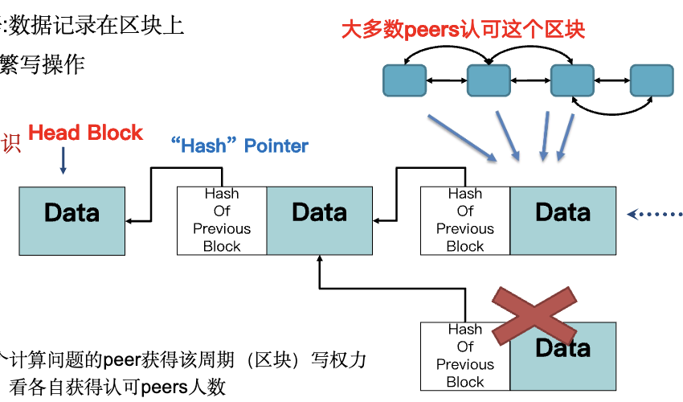

# 计算机网络 课程笔记

> 北京大学《计算机网络》（黄群，2026 秋）｜主教材：Kurose & Ross《计算机网络：自顶向下方法》第 7 版
>
> 本文件计划收录全学期内容，按课件顺序往后追加章节。

## 如何阅读这份笔记

- **结构**：每章先讲“这一章要解决什么问题”，再展开细节，最后是小结和易错点。
- **标记约定**
  - 💡 **例子**：用具体数字或场景理解抽象概念
  - 🔗 **联系**：和 CSAPP / 操作系统课已学内容的对应关系
  - ⚠️ **易错 / 辨析**：概念容易混淆的地方，或课件本身有笔误的地方
  - 📎 **补充**：课件上是图片、或课件没讲但理解时需要的内容（主要来自教材和 RFC）。考试以课件为准
- 公式用 LaTeX（VS Code 自带的 Markdown 预览可以渲染）。

## 目录

- [第 0 章 课程信息](#第-0-章-课程信息)
- [第 1 章 课程介绍：网络从哪来、到哪去](#第-1-章-课程介绍网络从哪来到哪去)
- [第 2 章 网络基础知识](#第-2-章-网络基础知识)
  - 2.1 学网络的分析框架 · 2.2 实体 · 2.3 服务与性能指标 · 2.4 协议 · 2.5 实现与管理 · 2.6 分层架构
- [第 3 章 应用层（一）：概述、Web 与 HTTP](#第-3-章-应用层一概述web-与-http)
- [第 4 章 应用层（二）：DNS 与电子邮件](#第-4-章-应用层二dns-与电子邮件)
- [第 5 章 应用层（三）：P2P、流媒体、CDN、Telnet、FTP、SNMP](#第-5-章-应用层三p2p流媒体cdntelnetftpsnmp)
- [Tutorial 1(a) Socket 编程](#tutorial-1a-socket-编程)
- [附录 A 端口号与协议速查](#附录-a-端口号与协议速查)
- [附录 B 术语中英对照](#附录-b-术语中英对照)

---

## 第 0 章 课程信息


| 项目     | 内容                                                                                         |
| -------- | -------------------------------------------------------------------------------------------- |
| 时间地点 | 理教 302，周一 5-6 节、周三 1-2 节                                                           |
| 成绩构成 | 平时 60%（4 次编程 Lab，每次 15%）+ 期末闭卷 40%                                             |
| 期末题型 | 8–10 道大题：名词解释、辨析与简答、计算与证明                                               |
| Lab      | 必须 C/C++，每个约 1000 行以内；Lab1/2 在 GitHub Classroom 测试，Lab3/4 在 CLab；Lab0 不计分 |
| 迟交     | 每超过 DDL 1 小时扣实际得分 1%；以 DDL 前最后一次提交为准                                    |
| AI 使用  | 允许 vibe coding，但要附完整 session 记录；没交记录且代码雷同的按疑似抄袭处理                |
| 答疑     | Piazza > 微信群 > 私信助教（要实名）                                                         |
| 参考书   | 《UNIX 网络编程》卷 1（套接字）、《TCP/IP 详解》卷 1                                         |

> Lab 要求：不要面向测试样例编程，要读需求文档、自己设计完整的程序架构。测试数据描述会 100% 给出，DDL 前公布 50%–80% 的测试数据。

---

## 第 1 章 课程介绍：网络从哪来、到哪去

> 这一讲以背景知识为主，考试可能以名词解释或简答的形式出现（例如“互联网与互连网的区别”、“病毒与蠕虫的区别”）。

### 1.1 什么是（计算机）网络

- **网络 = 结点（Node）+ 链路（Link）**，可以抽象成一张图（Graph）。
- **通信网络**：通过链路在结点之间传递内容。烽火台、驿站、电报、电话网都是通信网络。
- **计算机网络的特殊之处**：
  - 结点是各种计算设备：PC、服务器、手机、路由器、交换机、智能设备
  - 链路是网线、光纤、无线媒介
  - 传输的是由 0/1 比特构成的**数字信息**
  - 与传统网络的区别在于**提供的服务**（主体、功能、接口、内容）和**服务质量**（丢失率、带宽、时延、稳定性）

**互联网（Internet）与互连网（internet）**


|        | 互联网 / 因特网 Internet             | 互连网 internet              |
| ------ | ------------------------------------ | ---------------------------- |
| 共同点 | 都是“网络的网络”                   | 同左                         |
| 性质   | 专有名词，特指一个具体实例           | 通用名词，泛指这一类网络     |
| 协议   | 必须遵循 TCP/IP                      | 除 TCP/IP 外也可以用其他协议 |
| 范围   | 用路由器把各种网络互连而成、覆盖全球 | 任意多个异构网络互连         |

### 1.2 发展历史（时间线）


| 时间        | 事件                                                  | 意义                                                                                   |
| ----------- | ----------------------------------------------------- | -------------------------------------------------------------------------------------- |
| 1957.10     | 苏联发射第一颗人造卫星                                | 美苏争霸，直接促成 ARPA 成立                                                           |
| 1958.2      | 美国成立国防高级研究计划局 ARPA                       |                                                                                        |
| 1969.8      | **ARPANET 诞生**（UCLA / SRI / UCSB / Utah 四个结点） | 采用**分组交换**，有别于电话网的电路交换（思想来自 Paul Baran：分布式架构 + 分组交换） |
| 1972 底     | 24 个站点                                             | 同时出现许多其他网络，开始考虑网络互连                                                 |
| 1983        | **ARPANET 采用 TCP/IP**                               | 标志现代互联网诞生（“互联网诞生”的第二种说法）                                       |
| 80 年代中期 | 横跨北美、欧洲、澳洲                                  | 成为全球性网络                                                                         |
| 1990        | ARPANET 退役，移交 NSF                                |                                                                                        |
| 1993        | Mosaic 浏览器                                         | Web 1.0 开启                                                                           |
| 1995        | NSFNET 退役                                           | 互联网完全商业化                                                                       |

四个时代：


| 阶段     | 年代       | 典型应用            | 典型接入速率            |
| -------- | ---------- | ------------------- | ----------------------- |
| Web 1.0  | 1993–1999 | 浏览器、门户、电商  | ISDN ~64 Kbps           |
| Web 2.0  | 2000–2007 | 博客、社交、视频    | DSL/LAN ~10 Mbps        |
| 移动互联 | ~2018      | 导航、网购、互联网+ | 光纤入户 + 4G ~100 Mbps |
| 智能互联 | 至今       | 万物互联            | 5G+                     |

Web 1.0 以下载和静态内容为主；从 Web 2.0 开始，用户大量产生数据，动态内容成为主导。

**“互联网诞生”的两种说法**：① 1969 年 ARPANET 诞生；② 1983 年 ARPANET 采用 TCP/IP。

**互联网成功的启示**

- 诞生阶段：有战略需求、传统技术解决不了；分组交换的理论突破和原型实验同时推进；政府持续支持
- 成长阶段：TCP/IP 这条技术路线简单实用；以教育科研网络为起点；IETF/RFC 式的开放协作
- **没有事先的蓝图**，是全世界工程师在实践中不断试错演进出来的

**图灵奖**：Robert Kahn & Vinton Cerf（TCP/IP，2004）、Tim Berners-Lee（WWW，2016）、Robert Metcalfe（以太网，2022）。

**历史上的其他路线**：英国 NPL Mark I、法国 CYCLADES、苏联 OGAS（Glushkov 设想用计算机网络管理计划经济，1 个中央超级结点 + 200 多个中等结点 + 2 万个终端结点）。ARPANET 内部也有过多种技术竞争，最终选择了 TCP/IP。

**中国**：1987 年第一封电子邮件（“越过长城，走向世界”）；1994 年通过 64K 专线全功能接入互联网。五大骨干网：CHINANET（电信）、UNINET（联通）、CMNET（移动）、CERNET（教育网）、CSTNET（科技网）。

### 1.3 当前网络存在的问题

根源：设计时**没有预先蓝图**、**最初以军用为目标**、**没有预料到用户、数据、应用的规模**。

1. **安全与隐私**：最初设想是“一组相互信任的用户连接到一个透明的网络”，没有考虑安全
   - **病毒（Virus）**：需要某种用户交互才能传播（例如打开邮件附件）
   - **蠕虫（Worm）**：不需要用户交互，自己扫描有漏洞的主机并传播
   - 💡 WannaCry = 蠕虫部分（利用 NSA 泄露的“永恒之蓝”，即 Windows 的 MS17-010 漏洞传播）+ 勒索部分（加密文件，后缀改为 .WNCRY，索要比特币）
   - **拒绝服务攻击（DoS）**：制造大量虚假流量占用资源，使合法流量无法使用
   - 拖库（盗走用户资料）→ 洗库（变现）→ **撞库**（拿泄露的账号密码去其他网站尝试登录）
   - 后门、网络监听
2. **性能瓶颈**
   - 尼尔森定律：网络连接速度每年增长 50%，低于摩尔定律
   - 安迪-比尔定律：“What Andy gives, Bill takes away”（硬件提升的性能被软件吃掉）
   - 💡 海量数据搬迁时，网络甚至不如卡车：AWS Snowmobile 用集装箱卡车一次运 100 PB
3. **管理困难**：设备多、功能复杂、难以复现。**Gray Failure**（灰色故障）：间歇性丢包、性能下降，介于“一切正常”和“明确故障”之间，最难排查
4. **政策法规与伦理**：“在互联网上，没有人知道你是一条狗”；GDPR

### 1.4 当今网络的发展

- **新场景**：移动互联网（无线信道更不可靠）、数据中心网络（几十万服务器，低时延直接关系经济收益）、**AI 智算网络**（大模型并行切分到集群后产生大量通信，称为“通信墙”）、卫星网络（星链）、主机网络
- **网络与计算融合**：过去网络是只负责传输的黑盒，现在把计算任务卸载到网络设备：可编程交换机（网内计算）、智能网卡、RDMA、DPU、Intel DPDK（用户态程序直接操作网卡）
- **协议变革**：HTTP/2 + TLS + TCP → HTTP/3 over **QUIC** over UDP
- **软件观念变化**：过去“内存访问远快于网络 I/O”，现在高速网卡让这个假设不再成立
- **网络管理**：从单点控制走向软件定义网络（SDN）、智能化协同管理；目标是“历史可追溯、现状可感知、未来可预测”
- 我国现状：上层应用强、底层通信技术强，**中间的网络体系结构薄弱**

### 1.5 标准化组织与学术会议

```
                ISOC 互联网协会
                      │
              IAB 互联网体系结构委员会
             ┌────────┴────────┐
           IRTF              IETF
      互联网研究任务组      互联网工程任务组
     （只出研究报告）      （实际制定协议标准，发布 RFC）
```

- **ISO**：OSI 七层参考模型；**ITU**：国际电信联盟（政府间机构）；**IEEE**：802 系列（以太网、WiFi）；**W3C**：万维网联盟；**CCSA**：中国通信标准化协会（2002 年成立）
- 学术会议：**ACM SIGCOMM**（最顶级）、USENIX NSDI、IEEE INFOCOM（规模大、覆盖全面）、ACM MobiCom（无线领域）

---

## 第 2 章 网络基础知识

### 2.0 本章在解决什么问题

网络的**基本目标**是传输信息，**终极目标**是更快、更稳定、更好用。面对这样一个庞大的系统，课程用的方法是：

> **把大问题分解为小问题 → 逐一解决 → 把小问题的解合成大问题的解。**

本章给出两个贯穿全学期的工具：

1. **分析框架**（学什么）：任何网络问题都可以从 **实体 / 服务 / 协议 / 实现与管理** 四个角度看。
2. **分层架构**（怎么学）：把网络功能切成若干层，每层各自用上面四个角度分析。

后面每一层（应用层、传输层、网络层、链路层）都按这个模板展开。可以把下面这张表当成全课程的“骨架”，学到新的一层就往里填：


| 角度           | 要回答的问题                                             |
| -------------- | -------------------------------------------------------- |
| **实体**       | 谁在通信？如何命名（naming）？如何组织（结构）？         |
| **服务**       | 对上层提供什么接口？性能如何？有没有可靠性、安全等保障？ |
| **协议**       | 传输内容的格式（语法）、含义（语义）、顺序（时序）       |
| **实现与管理** | 功能和协议由哪个实体实现？资源怎么分配和调度？           |

### 2.1 实体：网络由什么组成

#### 2.1.1 按覆盖范围分类


| 类型       | 范围               | 例子                            |
| ---------- | ------------------ | ------------------------------- |
| 个域网 PAN | 约 10 米           | 蓝牙耳机                        |
| 局域网 LAN | 一个办公室到一栋楼 | 企业网、家里的 WiFi、共享打印机 |
| 城域网 MAN | 一个城市           |                                 |
| 广域网 WAN | 地区、国家乃至全球 |                                 |

#### 2.1.2 互联网的三个组成部分

今天的互联网是**网络的网络**：由多个子网构成，子网又可以继续划分，直到每个公司、家庭、甚至一个房间里的小网络。**ISP**（Internet Service Provider）负责提供接入和互连服务。

```
  ┌─────────── 网络边缘 ───────────┐        ┌──── 网络核心 ────┐
  │ 端系统（主机 host）：           │  接入网  │ 路由器 + 链路构成  │
  │ PC、手机、服务器、IoT 设备       │ ──────> │ 的网状网，核心技术 │
  │ 运行应用程序                    │ (边缘路由器)│ 是分组交换        │
  └────────────────────────────────┘        └──────────────────┘
```

- **网络边缘**：端系统（主机）。客户端（手机、笔记本）和服务器（通常在数据中心）。主机的功能：运行应用程序，把应用数据发往接入网，从网络接收数据交给应用程序
- **接入网**：把端系统连到**边缘路由器**（端系统去往任何远程端系统路径上的第一台路由器）
- **网络核心**：由路由器和链路构成的网状网，关键技术是**分组交换**

#### 2.1.3 一台主机内部的网络结构

```
  用户程序        ── 调用 socket 接口收发数据
  ─────────────────────────────────────────  系统调用边界
  内核协议栈      ── 处理网络数据（TCP/IP），与具体网卡无关
  网卡驱动        ── 管理和访问网卡，针对特定网卡开发
  ─────────────────────────────────────────
  网卡（NIC）     ── 硬件，负责对外通信
```

🔗 **联系 CSAPP/OS**：这和 CSAPP 第 10–11 章的系统级 I/O 是同一张图。socket 在用户态看起来就是一个文件描述符；`read`/`write` 陷入内核，由协议栈处理；网卡通过 DMA 和中断与内核交互。协议栈独立于驱动，所以同一份 TCP/IP 代码可以跑在任何网卡上，这正是分层的好处。

#### 2.1.4 主机的三种“名字”


| 名字              | 形式                         | 特点                                                                        | 所属层次                   |
| ----------------- | ---------------------------- | --------------------------------------------------------------------------- | -------------------------- |
| **MAC 地址**      | 48 位，如`3c:22:fb:12:34:56` | 烧录在网卡里，全球唯一、不可修改（IEEE 把地址空间分给厂商，厂商保证不重复） | 数据链路层                 |
| **IP 地址**       | IPv4 32 位、IPv6 128 位      | 可以按需配置，方便管理                                                      | 网络层                     |
| **主机名 / 域名** | 字符串，如`www.pku.edu.cn`   | 方便人记忆                                                                  | 应用层（由 DNS 翻译成 IP） |

💡 类比：MAC 地址像身份证号（跟着人走、不变），IP 地址像通信地址（搬家就变），域名像昵称（好记，需要查通讯录，也就是 DNS）。

#### 2.1.5 接入网与物理介质

**先分清单位**


|       | 存储（Byte，B）                | 传输（bit，b）                   |
| ----- | ------------------------------ | -------------------------------- |
| K/M/G | $2^{10}$ 进制（1 KB = 1024 B） | $10^3$ 进制（1 Kbps = 1000 bps） |

1 B = 8 b，注意大小写。💡 “100 Mbps 宽带”下载速度上限约为 100/8 = 12.5 MB/s。

**物理介质**

- **引导型**（信号在固体介质中传播）：双绞线、同轴电缆、光纤
- **非引导型**（信号自由传播）：无线电、卫星


| 介质     | 要点                                                                                                 |
| -------- | ---------------------------------------------------------------------------------------------------- |
| 双绞线   | 两根绝缘铜线绞在一起为一对；电话线 1 对，网线 4 对；5 类线 100 Mbps–1 Gbps，6 类线 10 Gbps          |
| 同轴电缆 | 两根同心铜导体；可划分多个频率通道；约 100 Mbps                                                      |
| 光纤     | 光脉冲，每个脉冲代表一位；10–100 Gbps 以上；误码率低，不受电磁噪声影响，中继距离远                  |
| 无线电   | 没有物理线路；**广播**；**半双工**（两个方向都能传，但同一时刻只能一个方向）；受反射、阻挡、干扰影响 |

无线链路类型：蓝牙（短距离）、WiFi（10–100 Mbps，约 10 米）、蜂窝 3/4/5G（约 10 公里）、地面微波（点对点 45 Mbps）、卫星。

💡 **同步卫星 vs 低轨卫星**：同步卫星在 36000 km 高空，往返时延约 280 ms（光往返一趟就要 $2 \times 36000\,\text{km} / (3\times10^5\,\text{km/s}) = 0.24\,\text{s}$）。星链用低轨卫星降低时延，代价是卫星绕地球高速运动，需要大量卫星才能覆盖全球。

**有线接入技术对比**


| 技术            | 线路                    | 是否共享             | 速率                                      | 要点                                                            |
| --------------- | ----------------------- | -------------------- | ----------------------------------------- | --------------------------------------------------------------- |
| 拨号上网        | 电话线                  | 独占                 | 56 Kbps                                   | 不能同时打电话和上网                                            |
| **DSL**         | 电话线                  | **每户独立**到 DSLAM | ADSL 下行 24–52 Mbps、上行 3.5–16 Mbps  | 语音和数据用**不同频率**同时传输，分路器分开；ADSL 上下行不对称 |
| **Cable / HFC** | 有线电视同轴电缆 + 光纤 | **多户共享**头端     | 下行 40 Mbps–1.2 Gbps，上行 30–100 Mbps | 数据和电视信号在共享电缆上用不同频率                            |
| **FTTH**        | 光纤                    | AON 独立 / PON 共享  | 高                                        | 我国已普及（约 5 亿家庭）；美国 80% 以上住宅仍用 DSL 和同轴电缆 |

**PON（无源光网络）的结构**：`ISP 侧 OLT（光线路终端）── 无源分光器 ── 多个用户侧 ONU（如光猫）`。“无源”是指分光器不需要供电，所以成本和能耗低；代价是多户共享一条光纤。AON 每户独立线路，快，但成本高、能耗大。

**无线接入**：WLAN（WiFi，802.11b/g/n 分别为 11/54/450 Mbps，WiFi 6 最高 9.6 Gbps）；广域蜂窝网（运营商提供，约 10 公里）。

**家庭网络的典型结构**：

```
 手机/笔记本 ~~WiFi~~┐
                     ├─[ 一个盒子：无线AP + 路由器 + 防火墙 + NAT ]──[ 光猫/调制解调器 ]── ISP
 台式机 ──以太网─────┘
```

**企业网络**：内部用一系列以太网交换机和 WiFi 组网，通过网关交换机和专线直接连到 ISP。

#### 2.1.6 网络核心：ISP 的层次结构是怎么演化出来的

这一段是从一个问题一步步推出来的，**按推理过程记**比死记结构图更容易：

> **问题**：全世界有成千上万个接入 ISP（access ISP），怎样让任意两个接入 ISP 下的主机都能互通？


| 步骤 | 方案                                                                                | 问题 / 动机                                                              |
| ---- | ----------------------------------------------------------------------------------- | ------------------------------------------------------------------------ |
| 1    | 每两个接入 ISP 之间都拉一条链路                                                     | 需要$O(N^2)$ 条链路，每个新 ISP 都要和已有的 N 个 ISP 相连，**不可扩展** |
| 2    | 所有接入 ISP 都接到**一个全局 ISP**（签服务协议，交钱）                             | 一个全局 ISP 撑不住，而且有利可图，于是会有竞争者出现                    |
| 3    | 出现**多个全局 ISP**（ISP A、B、C）                                                 | 全局 ISP 之间也要互连                                                    |
| 4    | 全局 ISP 之间通过**IXP（互联网交换点）** 或直接的 **peering link（对等链路）** 互连 | 接入 ISP 太多太分散，直接连全局 ISP 成本高                               |
| 5    | 出现**区域 ISP**，把附近的接入 ISP 汇聚起来再接全局 ISP                             |                                                                          |
| 6    | Google、微软等**内容提供商**自建网络，让数据中心离用户更近，并尽量绕开上层 ISP      | 内容提供商网络只承载自己的流量，不为别人转发                             |

最终形成的结构：

```
          Tier-1 ISP ═══(IXP / peering)═══ Tier-1 ISP        Google 等内容提供商网络
          /        \                        /     \          （通过 IXP 直接接区域/接入 ISP）
     区域 ISP     区域 ISP  ···         区域 ISP   ···
     /   |   \
 接入ISP 接入ISP 接入ISP  ···   ← 家庭、校园网、公司
```

- **Tier-1 ISP**：最高级别，**相互之间不结算**（对等互联）。例如中国电信、中国联通、AT&T、Verizon、NTT、德国电信
- **Tier-2 ISP**：例如教育网、中国移动，往往需要向更高级别的 ISP 交流量费
- **POP（Point of Presence）**：ISP 网络中供下级客户接入的一组路由器
- 这个结构受大量**经济和政策因素**影响，实际比示意图复杂得多

### 2.2 服务：网络提供什么功能，用什么方式提供

#### 2.2.1 路由与转发：网络核心的两个基本功能

网络的最终目的是把数据送到目标主机，可以拆成两个功能：


|          | 路由（Routing）                          | 转发（Forwarding）                             |
| -------- | ---------------------------------------- | ---------------------------------------------- |
| 类比     | 用地图**规划**整条路线                   | 在每个路口**执行**：该往哪拐                   |
| 范围     | **全局**操作：计算到目的地要经过哪些结点 | **本地**操作：把分组交给路径上的下一跳         |
| 实现     | 路由算法，结果存进**路由表**             | 用分组头部的目的地址查本地路由表，确定输出链路 |
| 时间尺度 | 慢（秒级到分钟级）                       | 快（纳秒级，每个分组都要做）                   |

💡 **例子**：路由器 R1 的路由表如下，它收到一个头部目的地址为 `0111` 的分组：


| 分组头部的值 | 输出链路 |
| ------------ | -------- |
| 0100         | 3        |
| 0101         | 2        |
| **0111**     | **2**    |
| 1001         | 1        |

查表得到输出链路 2，R1 就把分组从链路 2 发出，这就是**转发**。表里的内容是路由算法事先算好的，这就是**路由**。

路由与转发在网络的**各个层面以不同粒度**出现：结点可以是一个路由器，可以是一个子网，也可以是整个 ISP。

路由器内部（物理视图）：每条链路有输入端口和输出端口，输入端口做“出口选择”（查表），通过**交换结构（Switch Fabric）**把分组送到对应的输出端口。

#### 2.2.2 分组交换 vs 电路交换

这是网络核心搬运数据的两种方法。

**分组交换（Packet Switching，也叫包交换）**：今天最常见的方式

- 把大的**消息（message）** 拆成多个小的**分组（packet）**，以分组为传输单位
- 每个分组的首部带有地址（源地址、目的地址）等控制信息
- 每个分组**独立选择路径**，从一个路由器逐跳转发到下一个
- 采用**存储-转发**机制
- 各主机的分组按需共享链路带宽，称为**统计多路复用（statistical multiplexing）**

**存储-转发（store-and-forward）**：路由器必须**收完整个分组**才能开始往下一跳发送。把 L 位的分组以 R bps 的速率推到链路上需要 $L/R$ 秒。

💡 **例子**：L = 10 Kb，R = 100 Mbps，一跳的发送时延 = $10^4 / 10^8 = 0.1$ ms。
进一步：源端经过 1 个路由器到目的端（共 2 段链路），发送 1 个分组的端到端发送时延是 $2L/R$（忽略传播时延），因为路由器要先完整收下这个分组再发。
📎 如果连续发 P 个分组、经过 N 段链路，总时延是 $(N + P - 1) \cdot L/R$：第一个分组要 $N \cdot L/R$ 到达，之后每隔 $L/R$ 到达一个，像流水线一样。

**电路交换（Circuit Switching）**：电话网的做法，如今在互联网中几乎不用

- 先**呼叫建立连接**，沿途**预留**资源（链路带宽、交换机的交换能力）
- 连接建立后通路被通信双方**独占**，即使空闲也不给别人用
- 因为预留了资源，所以性能有保障；但传输中设备故障会导致传输中断

**电路交换怎样在一条链路上分出多路**

- **FDM 频分多路复用**：每个用户占一段频率，一直占着
- **TDM 时分多路复用**：时间切成帧，每帧分成若干时隙，每个用户固定使用某个时隙

两者都让每一路获得类似专用链路的性能，但**资源专用**，无法应对互联网中大量存在的**突发（burst）流量**。

**对比**


|        | 电路交换           | 分组交换                       |
| ------ | ------------------ | ------------------------------ |
| 连接   | 要先建立连接       | 随时发送，无需建立连接         |
| 资源   | 为每个连接预留     | 不预留，按需共享               |
| 性能   | 有保障             | 无保障：拥塞时会排队、丢包     |
| 复用   | 难以灵活复用       | 统计复用，传突发数据时利用率高 |
| 抗毁性 | 设备故障则通信中断 | 强，可以换路线                 |

💡 **经典计算：为什么分组交换能支持更多用户**

条件：链路 1 Mbps；每个用户传输时占 100 kbps，只有 10% 的时间在传输。

- **电路交换**：每个用户要预留 100 kbps，最多 $1\text{ Mbps}/100\text{ kbps} = 10$ 个用户。
- **分组交换**：设有 35 个用户，每个用户在某一时刻活跃的概率为 $p = 0.1$，且相互独立，同时活跃人数 $X \sim B(35, 0.1)$。只有当 **超过 10 个人同时传输** 时，总需求才会超过 1 Mbps：

$$
P(X > 10) = \sum_{k=11}^{35} \binom{35}{k} 0.1^k \, 0.9^{35-k} \approx 0.00042
$$

即 99.96% 的时间里 35 个用户的分组交换和电路交换一样好用，而用户数是电路交换的 3.5 倍。（课件写“小于 0.0004”，精确值约 0.000424，量级一致。）

背后的直觉：**用户不会同时说话**。电路交换按峰值预留，分组交换按平均值共享。

**分组交换的缺点**

1. 容易**拥塞**，带来排队时延甚至丢包，所以需要设计可靠传输机制和拥塞控制机制（传输层的主要内容）
2. **没有服务质量（QoS）保障**：语音、视频、游戏需要带宽保障。折中办法是**虚电路**（用分组模拟电路交换），但开销大，而且要和普通分组抢带宽，性能难保证。目前仍没有公认的解决方案

#### 2.2.3 面向连接 vs 无连接

从应用程序的角度看，无论底层是分组交换还是电路交换，它做的都是“和网络上另一个程序收发消息”。按调用方式分为两类：


|      | 面向连接                                                                   | 无连接                                     |
| ---- | -------------------------------------------------------------------------- | ------------------------------------------ |
| 类比 | **打电话**：先拨号，对方接起，说话，挂断                                   | **寄快递**：直接交给快递员，各中转站自己送 |
| 过程 | 传数据前先建立会话连接；每个请求或响应都会在对方产生一个“指示”或“确认” | 不需要事先建立连接，传输过程不需要应答     |
| 典型 | TCP                                                                        | UDP、IP                                    |

**面向连接服务的六个核心原语**：

```
   机器 A                                   机器 B
     │ ──(1) 连接请求 CONNECT ─────────────> │
     │ <─(2) 接受响应 ACCEPT ─────────────── │
     │ ──(3) 请求数据 SEND ────────────────> │
     │ <─(4) 应答 RECEIVE/SEND ──────────── │
     │ ──(5) 请求断开 DISCONNECT ──────────> │
     │ <─(6) 断开连接 DISCONNECT ─────────── │
```

🔗 这六个原语几乎一一对应 socket API：`connect` / `listen`+`accept` / `write` / `read` / `close`（见 [Tutorial 1(a)](#tutorial-1a-socket-编程)）。应用程序通过**系统调用**使用它们，内核协议栈负责具体实现。

#### 2.2.4 性能指标

按“**速率类**”和“**时间类**”分组记：


| 速率类                                         | 时间类                              | 综合 / 质量类              |
| ---------------------------------------------- | ----------------------------------- | -------------------------- |
| 带宽、比特率、吞吐量、有效吞吐量、包转发率 PPS | 时延（四个组成部分）、RTT、时延抖动 | 时延带宽积、利用率、丢包率 |

**速率类**


| 指标                           | 定义                                                               | 单位  |
| ------------------------------ | ------------------------------------------------------------------ | ----- |
| **带宽**                       | 信道能通过的**最高**数据率（能力上限）                             | bit/s |
| **比特率**（数据率、传输速率） | 主机往数字信道上发送数据的速率。接入网介绍中说的“速率”都是比特率 | b/s   |
| **吞吐量**（throughput）       | 单位时间内**实际通过**某个网络位置（信道、接口）的数据量           | b/s   |
| **有效吞吐量**（goodput）      | 单位时间内目的地**正确收到的有用信息**（扣除重传、协议头部等）     | b/s   |
| **包转发率 PPS**               | 交换机/路由器每秒转发的分组数（Packet Per Second）                 | 包/s  |

💡 **例子（课件图）**：信道带宽 1000 Mbps，主机 A 以 100 Mbps 发送、主机 B 以 80 Mbps 发送，信道吞吐量 = 180 Mbps，**利用率** = 180/1000 = 18%。

- **信道利用率**：信道有百分之几的时间在被使用；**网络利用率**：全网信道利用率的加权平均
- **丢包率**：丢失的分组数 / 发送的分组数

💡 **思考题：交换机上大包和小包，哪个更容易实现线速转发？**

**线速转发**：端口满负载时，转发速率能达到端口线路的最高速度。
答：**大包更容易**。带宽固定时，包越小，每秒要处理的包越多，而每个包都要查表一次。以 10 Gbps 以太网为例（📎 以太网每帧另有 20 字节前导码和帧间隙）：

- 64 字节最小帧：$10^{10} / ((64+20) \times 8) \approx 14.88$ Mpps，每个包只有约 67 ns 的处理时间
- 1518 字节最大帧：约 0.81 Mpps，每个包约 1.2 μs

所以衡量设备性能时，“能否在最小包下达到线速”才是硬指标。

**时间类：时延的四个组成部分**

$$
d_{\text{total}} = d_{\text{proc}} + d_{\text{queue}} + d_{\text{trans}} + d_{\text{prop}}
$$


| 时延                                 | 发生在哪里                               | 公式 / 量级                           | 取决于                                      |
| ------------------------------------ | ---------------------------------------- | ------------------------------------- | ------------------------------------------- |
| **处理时延** $d_{proc}$              | 结点收到分组后分析首部、差错检验、查路由 | 硬件 10 μs 到几十 ns；软件 ms 到 μs | 设备                                        |
| **排队时延** $d_{queue}$             | 在输出队列里等待链路空闲                 | **不确定**，严重时可达秒级            | 拥塞程度                                    |
| **传输时延** $d_{trans}$（发送时延） | 把分组的所有比特**推上**链路             | $L / R$（分组长度 / 链路速率）        | 分组大小、链路速率                          |
| **传播时延** $d_{prop}$              | 比特在介质中**走完**这段距离             | $d / s$（距离 / 信号传播速度）        | 距离、介质（光纤约 2/3 光速，微波约为光速） |

⚠️ **最容易混淆的一对：传输时延 vs 传播时延**

📎 教材的**车队类比**：10 辆车组成车队，收费站每 12 秒放行一辆车，两个收费站相距 100 km，车速 100 km/h。

- 传输时延 = 整个车队通过收费站的时间 = 10 × 12 s = 120 s（对应 L/R）
- 传播时延 = 一辆车从一个收费站开到下一个的时间 = 1 h（对应 d/s）

两者**完全独立**：传输时延与距离无关，传播时延与分组大小和带宽无关。

💡 **数值例子**：从北京向 1000 km 外的服务器发一个 1500 字节（12000 bit）的分组，链路 100 Mbps，光纤传播速度 $2\times10^8$ m/s。

- $d_{trans} = 12000 / 10^8 = 0.12$ ms
- $d_{prop} = 10^6 / (2\times10^8) = 5$ ms

长距离时传播时延占主导，此时提高带宽基本无助于降低时延。

💡 **高频交易**：极端时延敏感的场景会对四种时延分别下功夫：

- 处理 + 传输时延：设计专用硬件芯片、开发操作系统模块
- 排队 + 传播时延：铺专线、开隧道、架站点；“晴天微波，雨天光纤”（微波在空气中接近光速，同样距离的传播时延只有光纤的约 2/3，但下雨时信号衰减严重）

**排队时延与排队论**

- 如果某段链路上分组的到达速率超过链路的传输速率，分组就在缓冲区排队；**队列满了之后的分组会被丢弃**
- 课件动画中，大部分时间“不需排队”，但**瞬时拥塞经常发生**，最后队列满导致丢包
- 排队时延是四种时延中**最不确定**的，其他三种都比较容易计算

📎 **流量强度**（教材 1.4.2）：设分组长 L 比特、平均到达速率 a 个/秒、链路速率 R，定义流量强度 $La/R$：

- $La/R > 1$：到达的比特快于能发出去的比特，队列无限增长，时延趋于无穷。**设计系统时流量强度绝不能大于 1**
- $La/R \to 1$：平均排队时延急剧上升（不是线性增长）

**Little’s Law（1961）**：

$$
L = A \times W
$$

平均队列长度 = 平均到达速率 × 平均等待时间。现实中 L 容易测量，A 和 W 比较难，所以常用它从 L 推算 W。

💡 **例子**：路由器队列平均有 L = 100 个分组，分组平均到达速率 A = 50000 个/秒，则平均排队时间 $W = L/A = 100/50000 = 2$ ms。
💡 生活例子：食堂窗口前平均排 20 人，每分钟来 4 人，那么平均要等 20/4 = 5 分钟。

**往返时延 RTT（Round-Trip Time）**：从发送方开始发送，到收到接收方的确认，一共经历的时间。可以用 `ping` 测量，用来判断连通性、测时延、估算丢包率。

```bash
$ ping -c 3 www.pku.edu.cn
# 每行输出末尾的 time=xx ms 就是一次 RTT，最后会汇总 min/avg/max/mdev
# 其中 mdev（平均偏差）可以粗略反映时延抖动
```

**时延带宽积 = 传播时延 × 带宽**，即“**以比特计的链路长度**”，也就是链路这根管道里最多能同时容纳多少比特。

💡 传播时延 20 ms，带宽 10 Mb/s，时延带宽积 = $0.02 \times 10^7 = 2\times10^5$ bit。含义：发送端连续发送时，第一个比特刚要到达终点，发送端已经发出了 20 万个比特，它们都还在链路上。**只有管道被比特填满，链路才得到充分利用**。这个概念在传输层的滑动窗口中很重要：窗口至少要等于“带宽 × RTT”才能跑满链路。

**时延抖动（Jitter）**：时延的变化。来源于网络中的队列和缓冲，难以精确预测。语音、视频业务对抖动很敏感。

**延迟丢包**：多媒体应用中，分组虽然到了但到得太晚，已经没有使用价值，接收端只能丢弃。

#### 2.2.5 其他服务保障


| 保障                       | 含义                                           |
| -------------------------- | ---------------------------------------------- |
| 可靠性                     | 发送的每个消息，接收方收到**一次且仅一次**     |
| 完整性                     | 发送的数据不能被篡改                           |
| 隐私性                     | 数据不被第三方截获；有时也包括发送方身份不暴露 |
| 可审计性（accountability） | 可以追溯用户的传输行为                         |

### 2.3 协议：通信的内容

**网络协议**：为在网络中交换数据而建立的规则、标准或约定。通信双方都要遵守：发送方在满足特定条件时发送某个消息；接收方收到某个消息后完成特定的工作。

**协议三要素**


| 要素     | 规定什么                           | 类比           |
| -------- | ---------------------------------- | -------------- |
| **语法** | 数据的格式                         | 怎么讲         |
| **语义** | 要完成什么功能，每个字段是什么意思 | 讲什么         |
| **时序** | 各种操作的先后顺序                 | 双方讲话的顺序 |

💡 以 HTTP 为例（详见第 3 章）：

- 语法：请求行是“方法 空格 URL 空格 版本 CRLF”
- 语义：`GET` 表示读取资源，状态码 `404` 表示找不到
- 时序：客户端先发请求，服务器再回响应；HTTP/1.1 流水线要求按请求顺序响应

通信双方要沟通的事情多种多样（身份、可靠性、资源分配、拥塞、自适应、安全……），这导致网络协议非常复杂，数量上百种。

**协议以“头部封装”的形式定义**：每个协议定义自己的头部，上层数据作为**载荷（payload）**，头部说明如何处理这个分组。

```
 ┌──────────────┬──────────────────────┐
 │ 头部 Header  │ 数据 Data（载荷 Payload）│
 └──────────────┴──────────────────────┘
```

### 2.4 实现与管理

核心问题：**端系统和网络核心如何分工，共同实现网络目标？**

- 基本传输、性能、各种可靠性保障，哪些功能必须有，哪些可选？
- 同一个目标可以有多种实现方式。例如丢包重传，可以由端系统实现，也可以由网络核心实现。选择时要考虑：**是否易于管理和扩展、是否便于新技术更新迭代**
- **网络资源管理**：把链路、交换能力、队列分配给不同应用，要兼顾效率、公平和管理开销


| 协议  | 实现实体      | 提供的功能/服务                  |
| ----- | ------------- | -------------------------------- |
| UDP   | 主机          | 端到端不可靠传输                 |
| TCP   | 主机          | 端到端可靠传输                   |
| DCTCP | 主机 + 交换机 | 端到端可靠传输，并有一定性能保障 |

### 2.5 分层架构：怎么学网络

#### 2.5.1 为什么要分层

网络面对的是一个**复杂且异构**的系统：

- 应用多样：网页、下载、视频通话、邮件、游戏……需求各不相同（吞吐敏感、时延敏感、丢包敏感）
- 设备多样：端设备、路由器、交换机、防火墙；有线和无线链路
- 参与方多样：个人、企业、运营商、政府
- 技术迭代快：1G 到 5G、IEEE 802.3 在 2020 年一年就推出 4 个版本

💡 两个问题就能说明分层的必要性：

- 开发一个游戏直播软件，需要针对 3G、4G、5G、WiFi 分别开发吗？**不需要**，应用层看不到底层是什么网络。
- WiFi 升级到 WiFi 6，微信、支付宝需要适配吗？**不需要**，链路层的变化被上层屏蔽了。

**分层的做法**

- 每层提供特定功能和服务保障
- 层与层之间通过**接口**调用
- **同层实体**之间通过该层**协议**对话
- 对上层屏蔽本层的实现细节

**邮政类比**（课件）：


| 层         | 用户 A 这一侧 | 传递的东西   | 用户 B 这一侧 |
| ---------- | ------------- | ------------ | ------------- |
| 用户应用层 | 写信          | 信件         | 读信          |
| 信件递送层 | 邮局          | 邮包         | 邮局          |
| 交通运输层 | 运送部门      | 货物         | 运送部门      |
| 交通工具层 | 铁路部门      | 火车 → 汽车 | 汽运部门      |

写信人只关心信的内容，不关心邮包走铁路还是公路；铁路部门也不关心货物里装的是信。

**公司合作类比**（课件“X 讯与 X 东合作”）：总裁层谈战略合作，总监层确定项目，经理层细化功能，码农层做代码对接。

- 层级组织对应**实体**
- 合作协议、接口文档对应**协议**
- “我用 Python，你用 Go”对应**各层内部实现独立**（铁打的项目，流水的码农）


| 分层的好处                                | 分层的坏处                             |
| ----------------------------------------- | -------------------------------------- |
| 降低复杂度，便于分析学习                  | 引入额外开销（每层都加一个头部）       |
| 增加灵活性，各层独立演进，加速技术迭代    | 有时跨层信息很重要，但分层把它藏起来了 |
| 统一标准和接口，保证互通（interoperable） |                                        |

🔗 分层是计算机科学的基本思想：CSAPP 里的“硬件 → 操作系统 → 应用程序”、存储器层次结构、OS 课里的“内核态 / 用户态”都是分层。

#### 2.5.2 OSI 七层模型与 TCP/IP 四层模型

```
     OSI 参考模型                    TCP/IP 参考模型
 ┌───────────────────┐
 │ 7 应用层           │         ┌──────────────────┐
 │ 6 表示层           │  ────>  │ 应用层             │
 │ 5 会话层           │         │                  │
 ├───────────────────┤         ├──────────────────┤
 │ 4 传输层           │  ────>  │ 传输层             │
 ├───────────────────┤         ├──────────────────┤
 │ 3 网络层           │  ────>  │ 互联网层（网络层）   │
 ├───────────────────┤         ├──────────────────┤
 │ 2 数据链路层        │  ────>  │ 网络接口层          │
 │ 1 物理层           │         │ (Host-to-Network) │
 └───────────────────┘         └──────────────────┘
```

**OSI 七层（ISO，Day & Zimmermann，1983）各层职责**


| 层           | 职责                                                   | 关键词                                                                                                                                                                    |
| ------------ | ------------------------------------------------------ | ------------------------------------------------------------------------------------------------------------------------------------------------------------------------- |
| 1 物理层     | 在信道上传输 0 和 1（bits on the wire）                | 机械接口（网线接口形状）、电子信号（电压）、时序（采样频率、波特率）、介质                                                                                                |
| 2 数据链路层 | **相邻**网络实体之间的数据传输                         | **成帧**（从比特流中提取完整的帧）、差错检测与纠正、MAC 地址（48 位）、共享信道的**介质访问控制**（像同一教室多人同时发言需要纪律）、流量控制（防止快发送端淹没慢接收端） |
| 3 网络层     | 把分组**跨越网络**从源主机送到目的主机（host to host） | 路由、路由协议、QoS（拥塞、负载均衡、准入控制）、异构网络互联                                                                                                             |
| 4 传输层     | 从源**端口**到目的**端口**（进程到进程）               | 可靠传输（文件传输）/ 不可靠传输（语音、视频会议）                                                                                                                        |
| 5 会话层     | 在应用程序之间建立、维持会话并同步                     |                                                                                                                                                                           |
| 6 表示层     | 数据的语法和语义、数据表示方法、传输的数据结构         |                                                                                                                                                                           |
| 7 应用层     | 通过应用层协议为应用程序提供便捷的网络服务             |                                                                                                                                                                           |

⚠️ **网络层 vs 传输层**：网络层把数据送到某台**主机**，传输层再把数据交给这台主机上的某个**进程**。网络层的控制主要面向运营商，传输层为终端用户提供端到端控制。

**TCP/IP 四层（Cerf & Kahn，1974 年提出，ARPANET 采用）**

- **网络接口层**：为了满足无连接的互联网层的需要，单跳链路必须具备的功能
- **互联网层**：通过多跳把分组**独立地**送到目的地，定义分组格式和协议（IPv4、IPv6）
- **传输层**：源主机和目的主机上的对等实体之间的端到端传输（TCP、UDP）
- **应用层**：传输层之上的所有高层协议（DNS、HTTP、FTP、SMTP……）

⚠️ **先有 TCP/IP 协议栈，然后才有 TCP/IP 参考模型**，这个模型只是用来描述已有的协议栈的。OSI 正相反：先有模型，后设计协议。

**两个模型的比较**


|          | OSI                                                                                                                                          | TCP/IP                                                                                                                                                   |
| -------- | -------------------------------------------------------------------------------------------------------------------------------------------- | -------------------------------------------------------------------------------------------------------------------------------------------------------- |
| 设计思路 | 先有模型后有协议；明确区分了服务、协议、接口，**通用性强**                                                                                   | 只是对已有协议的描述，**实用**                                                                                                                           |
| 网络层   | 支持无连接和面向连接                                                                                                                         | **只支持无连接**（IP）                                                                                                                                   |
| 不足     | 从未真正实现（缺厂商支持）；会话层和表示层内容很少，数据链路层和网络层内容繁杂；差错控制、流量控制在多层重复出现；被视为政府和机构强加的标准 | 没有明确区分服务、接口、协议；不适合描述其他协议栈；把物理层和数据链路层合成一个“网络接口层”，并不是真正的分层；模型不完整，缺少对物理层和链路层的描述 |

**历史**：1983 年 NSFNET 采用 TCP/IP；1984 年 ISO 提出 OSI。当时绝大多数人认为“TCP 只是临时方案，未来属于 OSI”。Tanenbaum 教材第一、二版写“TCP/IP 必将过渡到 OSI”，第三版改为总结 OSI 的失败：**糟糕的时机、糟糕的技术、糟糕的实现、糟糕的政策**。而 TCP/IP 作为 UNIX 的一部分免费提供，成了事实标准。

#### 2.5.3 本课程采用的五层模型

> 网络分层没有对错，只有是否符合需要。

本课程以 TCP/IP 为基础，但把网络接口层拆成数据链路层和物理层；每一层学**通用原理**，用 TCP/IP 协议作为**典型例子**。常借用 OSI 的编号：


| 编号习惯 | 层                 | 常用叫法         |
| -------- | ------------------ | ---------------- |
| L7       | 应用层             | “七层负载均衡” |
| L4       | 传输层             | “四层负载均衡” |
| L3       | 网络层（互联网层） | “三层交换机”   |
| L2       | 数据链路层         | “二层转发”     |
| L1       | 物理层             |                  |

（OSI 的第 5、6 层省略。）

**每层用四个角度分析（全课程骨架）**


| 层                            | 对上层提供的接口                       | 实体                   | 命名               | 架构                | 经典协议                      | 服务与管理                                         |
| ----------------------------- | -------------------------------------- | ---------------------- | ------------------ | ------------------- | ----------------------------- | -------------------------------------------------- |
| **应用层**                    | 封装典型网络业务（Web、文件下载）      | 应用程序               | **域名 + 端口**    | 客户端-服务器、P2P  | HTTP、DNS、SMTP/POP3、FTP、BT | 面向应用需求的优化                                 |
| **传输层**                    | 主机间**端到端**通信（屏蔽网络路径）   | **套接字**（通信端点） | **IP 地址 + 端口** | 一对套接字          | TCP、UDP                      | 连接管理、丢包重传、拥塞控制、负载均衡             |
| **网络层**                    | 主机之间**跨多跳链路**通信（屏蔽链路） | 主机                   | **IP 地址**        | 多个主机互连成图    | IP、BGP、ICMP、ARP            | 路径选择（路由、流量工程）、流量控制、SDN          |
| **接入层**（链路层 + 物理层） | **单条链路**通信                       | 网卡（NIC）            | **MAC 地址**       | 一对网络接口 + 链路 | 以太网、WiFi、蜂窝网          | 成帧（比特流 → 消息流）、差错检测与纠正、链路复用 |

#### 2.5.4 协议、接口、服务的关系

> **协议是“水平”的，接口是“垂直”的。**

```
 第 n+1 层:  实体(n+1) <──── 协议(n+1)（交换信息）────> 实体(n+1)     ← 服务的用户
                 │ 接口                                    │ 接口
 第 n 层:    实体(n)   <──── 协议(n)  ─────────────────> 实体(n)       ← 服务提供者
```

- **协议**：对等实体（同一层、不同机器上）之间的约定
- **接口**：同一台机器上相邻两层之间的调用方式
- **服务**：下层通过接口向上层提供的功能
- 实体使用协议来实现它所定义的接口（服务）；上层实体通过接口调用下层实体

#### 2.5.5 封装与解封装：一个分组的旅程

发送端每经过一层就**加一个头部**（封装），接收端每经过一层就**去掉一个头部**（解封装）：

```
 主机 A (发送 "hello")                                          主机 B (收到 "hello")
 L5  hello                                                      hello
 L4  Ht|hello                                                   Ht|hello
 L3  Hn|Ht|hello                      路由器:  L3 ↑↓             Hn|Ht|hello
 L2  Hl|Hn|Ht|hello         交换机: L2 ↑↓      L2 ↑↓   交换机: L2 ↑↓  Hl|Hn|Ht|hello
 L1  101101010000...        L1           L1            L1         101101010000...
```

（Ht = 传输层头部，Hn = 网络层头部，Hl = 链路层头部）

💡 **结合例子理解**：你在浏览器里访问一个网页，

1. 浏览器生成 HTTP 请求 `GET /index.html ...`（应用层数据，即报文 message）
2. 内核 TCP 加上源端口、目的端口 80 等信息，得到**报文段（segment）**
3. IP 加上源 IP、目的 IP，得到**数据报（datagram）**
4. 以太网/WiFi 加上源 MAC、下一跳的 MAC，得到**帧（frame）**
5. 物理层把帧变成电信号或无线电波

途中的**交换机**只拆到 L2（看 MAC 地址），**路由器**拆到 L3（看 IP 地址，换一个新的 L2 头部后再发出去），只有**目的主机**会一直拆到 L5，把 “hello” 交给浏览器或服务器进程。

📎 各层数据单元的名称（教材术语）：应用层 **报文 message**、传输层 **报文段 segment**、网络层 **数据报 datagram**、链路层 **帧 frame**。

**哪些设备实现哪些层**

- **端系统**：实现全部五层（用户程序运行在端系统上，比特流进来要一路交给用户程序）
- **交换机**：物理层 + 数据链路层（L1–L2）
- **路由器**：物理层 + 数据链路层 + 网络层（L1–L3）


|      | 传统交换机                                     | 传统路由器                 |
| ---- | ---------------------------------------------- | -------------------------- |
| 多跳 | 不支持：只有目的主机与交换机直连时才能正确转发 | 支持：目的主机可以相隔多跳 |

现代交换机和路由器已经不太区分，都支持二层和三层转发，技术资料中两个词经常混用。

#### 2.5.6 互联网设计的两大特征

**特征 1：复杂功能由端系统实现（端到端原则）**

- 电话网的设计是“**笨终端 + 聪明网络**”（电话机很简单，交换网很复杂）
- 互联网反过来，采用“**聪明终端 + 简单网络**”：丢包恢复、拥塞控制、负载均衡等复杂功能由端系统负责；网络核心只做路径选择、流量控制（L3）以及成帧、差错检测、链路复用（L1–L2）
- 在**简单、不可靠的部件上构建出可靠的系统**
- 好处：简单的网络核心大大提升了**可扩展性**

**特征 2：以 IP 为核心（沙漏模型）**

```
     HTTP  SMTP  DNS  RTP  ...        ← Everything over IP
        TCP        UDP
   ──────────  IP  ──────────          ← 沙漏的细腰：只有一个
   以太网  WiFi  4G/5G  光纤 ...        ← IP over everything
```

- IP 可以运行在各种底层物理网络上（IP over everything），也可以支撑各种上层应用（everything over IP）
- 好处：
  - IP 分组被独立处理，网络核心只需要查路由表转发，功能简单，适应了爆炸性增长
  - 只要都支持 IP，多个网络就能互连
  - 上层应用和底层通信被隔开，**两边可以各自独立创新**

**这种设计的问题**

- 各层之间功能重叠
- **IP 本身很难升级**（IPv4 → IPv6 推了几十年）：沙漏的细腰是所有人的依赖，改不动
- 网络资源管理和性能控制依赖端系统，网络核心只能做粗粒度控制；端系统之间缺乏协同。这是**排队时延严重的原因**之一
- 前沿研究的改进方向：减少层级、端系统之间以及端和网络之间协同、更聪明的网络核心（课程最后部分会讲）

### 2.6 本章小结

- **网络的基本内容**：实体（组成、命名、组织方式）、服务（面向连接和无连接、性能指标、其他保障）、协议（三要素、头部封装）、实现与管理
- **分层**：为什么分层（复杂、异构、快速迭代）；怎么分层（五层，每层的实体、命名、功能、典型协议）
- **必会计算**：存储转发时延、四种时延、分组交换统计复用（二项分布）、时延带宽积、Little’s Law
- 参考阅读：教材 1.1–1.5

⚠️ **本章易错点**

1. 传输时延（L/R）和传播时延（d/s）是两回事；带宽提高只会缩短传输时延
2. 带宽是能力上限，吞吐量是实际通过的量，goodput 还要再扣掉无用的部分
3. 存储、传输单位的 K/M/G 进制不同；B 和 b 不同
4. TCP/IP 模型是先有协议后有模型；OSI 是先有模型后有协议
5. 协议是水平的（对等实体之间），接口是垂直的（相邻层之间）
6. 路由是全局规划，转发是本地执行

---

## 第 3 章 应用层（一）：概述、Web 与 HTTP

### 3.0 本章在解决什么问题

应用层是离用户最近的一层。本讲（第二讲的三个课件）按这个顺序展开：

1. **应用层的基本概念**：服务与接口、命名、组织架构（C/S、P2P）
2. **经典应用层协议**：Web 与 HTTP → DNS → 电子邮件 → P2P、流媒体、CDN、Telnet、FTP、SNMP
3. **自己写网络程序**：Socket API（Tutorial 1(a)）

应用层仍然按“实体 / 服务 / 协议 / 实现与优化”来看：

- **实体**：应用程序（进程），命名为 IP + 端口（或域名 + 端口）
- **服务**：借助传输层（TCP/UDP）为具体业务提供通信模式
- **协议**：HTTP、DNS、SMTP……各自规定消息的类型、语法、语义、处理规则
- **实现与优化**：缓存、并发服务器、CDN 等

### 3.1 应用层概述

#### 3.1.1 应用层的位置


| 通信双方             | 交互方式                       | 由谁负责   |
| -------------------- | ------------------------------ | ---------- |
| **同一主机**上的程序 | 进程间通信（锁、信号量、管道） | 操作系统   |
| **不同主机**上的程序 | 网络应用层                     | 计算机网络 |

- 应用层运行在**端系统**的各类软件中，负责与网络通信（提供网络服务，屏蔽底层细节）
- 💡 开发一个 Web 服务器或浏览器，只需要写应用层的处理模块（HTTP 消息处理）；路由器、交换机不关心应用层逻辑，也不需要为它们写代码。这正是**端到端原则**的体现

常见网络应用：Web、文件传输、电子邮件、即时通讯、远程登录、P2P 文件共享、在线游戏、流媒体、语音通话、在线会议、社交网络、搜索引擎……

#### 3.1.2 进程与套接字

- 应用程序在端系统上以**进程**的形式运行（见操作系统课）
- 进程通过**套接字（socket）** 收发消息，消息经过传输层
- **Socket 就像一扇门**：进程从门里把消息推出去；别的进程发来的消息堆在门口等着被取走

```
  主机 A                                  主机 B
  ┌─────────┐                           ┌─────────┐
  │ process │  ← 应用开发者控制            │ process │
  ├──socket─┤  ═══════════════════════  ├──socket─┤
  │transport│                           │transport│
  │ network │  ← 操作系统控制             │ network │
  │  link   │ ────── Internet ───────── │  link   │
  │physical │                           │physical │
  └─────────┘                           └─────────┘
```

🔗 socket 是用户态和内核态的分界线：socket 以上由应用开发者控制，以下由操作系统控制。开发者对传输层能控制的只有两件事：**选择哪种传输协议**（TCP/UDP），以及设置少量参数（如缓冲区大小）。

#### 3.1.3 应用对传输服务的需求，以及传输层能提供什么

**应用的四类需求**


| 需求         | 例子                                                       |
| ------------ | ---------------------------------------------------------- |
| **可靠传输** | 聊天工具、支付要求数据 100% 到达；语音对话可以容忍一定丢失 |
| **高吞吐**   | 视频播放有最低带宽要求；其他应用（弹性应用）用多少算多少   |
| **低时延**   | 在线游戏、电话会议对时延极其敏感                           |
| **安全**     | 数据加密、数据完整性                                       |

**传输层提供的两类服务**


| TCP 服务                           | UDP 服务                                               |
| ---------------------------------- | ------------------------------------------------------ |
| **面向连接**：传输前建立连接       | **无连接**                                             |
| **可靠传输**：丢包重传             | 不可靠：可能丢包，丢了也不恢复                         |
| **有序传输**                       | 不保证顺序                                             |
| **流量控制**：防止**接收方**过载   | 无                                                     |
| **拥塞控制**：防止**网络核心**过载 | 无                                                     |
| 不保证：时延、吞吐量、安全         | 不保证：可靠、顺序、流控、拥塞控制、时延、吞吐量、安全 |

❓ **思考：既然 UDP 什么都不保证，为什么还需要它？**
答：简单、开销小、性能比 TCP 好（不用建连接、没有拥塞控制限速、头部小），有些应用可以接受丢包，或者愿意在应用层自己实现需要的那部分可靠性（比如 QUIC、实时音视频）。

⚠️ 流量控制和拥塞控制的区别：流量控制是**不要撑爆接收方的缓冲区**（点对点问题）；拥塞控制是**不要堵死网络**（全局问题）。

#### 3.1.4 应用层为开发者做了什么

1. **屏蔽底层细节**：屏蔽 TCP 与 UDP 的差异；进一步屏蔽网卡、路由器、交换机等更低层的设备
2. **抽象**：很多网络应用有相同的通信模式，应用层把它们封装成各种通信模式的“库”
3. **提供额外功能**：安全性、服务质量

💡 **例子：SSL + TCP**

- TCP 和 UDP 都**没有加密**，数据在网络上明文传输
- **SSL**（现在叫 TLS）是一种应用层技术，在 TCP 之上提供加密、隐私、数据完整性，并能在另一端验证
- 应用程序调用 SSL 库，就像调用 TCP 一样，只是传出去的是密文
- HTTPS = HTTP + TLS + TCP

总之，**网络应用层大大简化了网络应用的开发**，这是互联网能快速发展的原因之一。

#### 3.1.5 实体的命名：IP 地址 + 端口号

- 可以给主机命名（MAC、IP、主机名），但**只给主机命名不够**：一台主机上运行多个应用，一个应用还可能建立多个连接（socket）。收到消息后，必须知道该交给谁
- **解决方案：用 IP 地址 + 端口号给每个应用命名**
- 常用熟知端口：HTTP 80、SMTP 25（完整列表见 [附录 A](#附录-a-端口号与协议速查)）

💡 类比：IP 地址是宿舍楼的地址，端口号是房间号。快递送到楼（主机），再按房间号送到具体的人（进程）。

#### 3.1.6 应用的两种组织方式：C/S 与 P2P

**客户/服务器（C/S）方式**

- 客户和服务器指的是通信所涉及的**两个应用进程**
- 一个客户可以访问多个服务器；一个服务器可以服务多个客户
- 移动互联网中，每个 App 都是一个客户端


| 客户端程序                 | 服务器程序                     |
| -------------------------- | ------------------------------ |
| **主动**发起通信           | **等待**被连接                 |
| 可以临时接入               | 必须始终在线                   |
| 可以使用动态 IP 地址和端口 | 必须有固定 IP 地址和端口       |
| 客户端之间不直接通信       | 可以扩展成多台机器共同提供服务 |

**服务器的四种工作方式 = {面向连接 TCP, 无连接 UDP} × {循环, 并发}**


|      | 循环方式（iterative）                                                                    | 并发方式（concurrent）                                               |
| ---- | ---------------------------------------------------------------------------------------- | -------------------------------------------------------------------- |
| 含义 | 一次只运行**一个**服务进程，多个请求**按先后顺序**依次处理，其余请求在队列中等候（阻塞） | 可以**同时**运行多个服务进程，每个服务进程响应一个特定客户（非阻塞） |
| 适用 | TCP、UDP 都可以                                                                          | 主要是 TCP                                                           |

四种组合的套接字使用方式：


| 组合                            | 套接字使用                                                                                                                                                                                            |
| ------------------------------- | ----------------------------------------------------------------------------------------------------------------------------------------------------------------------------------------------------- |
| **无连接循环**（UDP）           | 服务进程只用**一个服务套接字**；每个客户用自己的客户套接字；一次处理一个客户的请求                                                                                                                    |
| **面向连接循环**（TCP）         | 服务进程用服务套接字（监听套接字）接受连接请求，对每个连接请求**创建一个连接套接字**；服务完就关闭，再处理下一个连接请求                                                                              |
| **面向连接并发**（TCP，最常用） | 主服务进程在熟知端口上用**监听套接字**等待请求；收到请求后**创建从属服务进程**（子进程），让它用**临时套接字（连接套接字）** 与该客户通信；主进程继续监听。**所有套接字使用服务器的同一个熟知端口号** |
| **无连接（伪）并发**（UDP）     | 课件结论：并非真正并发                                                                                                                                                                                |

**面向连接并发服务的流程**

```
                 ┌───────────────────────┐
  客户1 ──TCP──> │ 主服务进程 (父进程)      │  监听套接字 :80，只接受连接请求
  客户2 ──TCP──> │   │ accept 后 fork       │
  客户3 ──TCP──> │   ├─> 从属进程1 ── 连接套接字1 ── 客户1
                 │   ├─> 从属进程2 ── 连接套接字2 ── 客户2
                 │   └─> 从属进程3 ── 连接套接字3 ── 客户3
                 └───────────────────────┘
          （这些套接字的本地端口都是 80）
```

❓ **为什么无连接的 UDP 只能采用循环方式，不能并发？**
课件答案：UDP 服务端**只有一个套接字**（没有“每个客户一个连接套接字”），这个套接字无法被多个从属进程同时访问；要协调多进程访问，需要调用额外的操作系统功能。

📎 **补充（理解用，考试按课件答）**：实际系统中 UDP 服务也可以并发，例如多个线程对同一个 socket 调用 `recvfrom`（内核保证每个数据报只交给一个调用者）、使用 `SO_REUSEPORT` 让多个 socket 绑定同一端口、或者为每个客户创建一个 `connect` 过的 UDP socket。DNS 服务器就是高并发的 UDP 服务。课件强调的是：UDP 不像 TCP 那样天然地“一个连接一个套接字”。

🔗 **联系 CSAPP 第 11–12 章**：CSAPP 11 章的 echo server 和 Tiny Web 服务器就是**面向连接循环服务器**；12 章讲了三种并发方式：

- 基于进程：`accept` 后 `fork`，子进程处理 `connfd`，**父进程必须 `close(connfd)`**，否则会造成描述符泄漏，连接也关不掉。这正是课件中的“从属服务进程”
- 基于 I/O 多路复用：`select`/`epoll`
- 基于线程：每个连接一个线程

OS 课讲 `fork` 时说的“子进程继承父进程打开的文件描述符”，就是这里子进程能直接使用 `connfd` 的原因。

**P2P（Peer to Peer，对等）方式**

- 通信时**不区分**服务请求方和服务提供方，只要双方都运行 P2P 软件，就可以平等通信
- 本质上仍然使用 C/S 方式，但每个 P2P 进程**既是客户又是服务器**
- 特点：
  - 结点**不需要总在线**，可以随时加入和退出，也可以动态改变 IP 地址（因此需要额外的管理开销）
  - 任意两个结点可以直接通信
  - **易于扩展**：每个结点在消耗资源的同时也贡献自己的资源
- 音视频应用推动了 P2P 的发展（详见 [5.1](#51-p2p)）

#### 3.1.7 应用层协议定义了什么


| 内容     | 说明                           | 以 HTTP 为例                               |
| -------- | ------------------------------ | ------------------------------------------ |
| 消息类型 | 如请求、响应                   | 请求报文、响应报文                         |
| 消息语法 | 有哪些字段，每个字段的取值     | 请求行 = 方法 + URL + 版本                 |
| 消息语义 | 每个字段值的含义               | 200 表示成功                               |
| 处理规则 | 应用程序如何发送、如何响应消息 | 收到`If-Modified-Since` 时，没修改就回 304 |


| 开放协议                                                                       | 私有协议                                                                              |
| ------------------------------------------------------------------------------ | ------------------------------------------------------------------------------------- |
| 由 RFC 定义，所有遵守它的程序都能**互操作**（interoperability）。例：HTTP、DNS | 例：微信（私有 TCP 格式用于消息，私有 UDP 格式用于语音视频通话，混合使用 TCP 和 UDP） |

**常见应用及其协议**


| 应用     | 应用层协议                         | 传输层协议 |
| -------- | ---------------------------------- | ---------- |
| 电子邮件 | SMTP [RFC 2821]                    | TCP        |
| 远程访问 | Telnet [RFC 854]                   | TCP        |
| Web      | HTTP [RFC 2616]                    | TCP        |
| 文件传输 | FTP [RFC 959]                      | TCP        |
| 流媒体   | HTTP（如 YouTube）、RTP [RFC 1889] | TCP 或 UDP |
| 网络电话 | SIP、RTP、私有协议（如 Skype）     | TCP 或 UDP |

### 3.2 Web 基本概念

- **WWW（World Wide Web，万维网）**：一种运行在 IP 网络之上的网络，称为 **Overlay（覆盖）网络**
- 由三部分构成：
  1. **HTTP 服务器和客户端**：服务器存储 Web 对象；客户端（浏览器）发请求、收响应、解释 HTML 并显示，有些对象需要插件
  2. **Web 对象**：网页、多媒体资源、动态对象与服务，用 **URL** 定位
  3. 服务器与客户端之间的 **HTTP 协议**

```
   浏览器                                   Web 服务器
 ┌──────────────────┐   HTTP 请求   ┌────────────────────┐
 │ HTML 解释器       │ ───────────> │ HTTP 服务器  HTML 文档 │
 │ HTTP 客户端       │ <─────────── │                     │
 └──────────────────┘   HTTP 响应   └────────────────────┘
```

#### 3.2.1 URL（统一资源定位符）

```
  http://www.phdcomics.com:8000/comics.php
  └┬─┘   └──────┬─────────┘└┬─┘└────┬────┘
 协议类型    主机名(服务器)   端口   路径和文件名
```

端口省略时使用协议的默认端口（http 80，https 443）。


| 协议名 | 用途        | 例子                                  |
| ------ | ----------- | ------------------------------------- |
| http   | 超文本 HTML | `http://www.pku.edu.cn/xxgk/xxjj.htm` |
| https  | 安全超文本  | `https://www.overleaf.com/`           |
| ftp    | 文件传输    | `ftp://ftp.pku.edu.cn`                |
| file   | 本地文件    | `file:///usr/pku/prog.c`              |
| mailto | 发送邮件    | `mailto:pkumail@pku.edu.cn`           |
| rtsp   | 流媒体      | `rtsp://youtube.com/montypython.mpg`  |
| sip    | 多媒体呼叫  | `sip:eve@advesary.com`                |

#### 3.2.2 静态与动态 Web

- **静态对象/网页**：文本、表格、图片、视频（用 HTML、XML 等标记语言描述）；字体、颜色、布局等风格信息（用 CSS 描述）
- **动态对象/网页**：交互信息（注册、登录）、实时生成的数据。实现方式是 PHP/JSP 等语言 + MySQL 等数据库
- **超链接（HyperLink）**：指向其他对象的 URL

一个最小的 HTML 文档：

```html
<HTML>                               <!-- 文档开始 -->
<HEAD>                               <!-- 首部 -->
  <TITLE>一个 HTML 的例子</TITLE>      <!-- 文档标题 -->
</HEAD>
<BODY>                               <!-- 主体 -->
  <H1>HTML 很容易掌握</H1>             <!-- 1 级标题 -->
  <P>这是第一个段落。虽然很短，但它仍是一个段落。</P>
  <P>这是第二个段落。</P>
</BODY>
</HTML>
```

**为什么需要动态 Web**：内容要随用户、随时间变化（个人主页、搜索结果、购物车）。


| 技术                                  | 在哪里生成动态内容                       |
| ------------------------------------- | ---------------------------------------- |
| CGI（通用网关接口，`*.cgi`）          | 服务器端                                 |
| 脚本语言 + 数据库（`*.php`、`*.asp`） | 服务器端或浏览器端                       |
| PHP                                   | **服务器端**执行，生成 HTML 后发给浏览器 |
| JavaScript                            | **客户端（浏览器）** 执行                |

- 好的脚本程序会把**前端（内容展示）** 和**后端（服务逻辑）** 分开
- 典型组合 **LAMP** = Linux + Apache + MySQL + PHP/Perl/Python

🔗 CSAPP 11.5 的 Tiny 服务器用 CGI 提供动态内容：`fork` 一个子进程，把 `stdout` 重定向（`dup2`）到连接描述符，再 `execve` CGI 程序，CGI 程序的输出就直接发给客户端了。

### 3.3 HTTP 协议

#### 3.3.1 HTTP 提供的服务

- **HTTP（HyperText Transfer Protocol，超文本传输协议）** 通常使用 **TCP**，默认端口 **80**
- **HTTP 是无状态协议**：服务器不保存之前请求的任何状态信息


| 无状态协议                                       | 有状态协议                                                     |
| ------------------------------------------------ | -------------------------------------------------------------- |
| 简单，但效率较低（每个请求都要带上全部必要信息） | 要维护历史信息，比较复杂；客户端或服务器故障时还要保证状态一致 |

需要状态怎么办？用 **Cookie**（见 3.3.5）。

**HTTP 版本演进**


| 版本     | 年份 / RFC                             | 主要特点                                                                       |
| -------- | -------------------------------------- | ------------------------------------------------------------------------------ |
| HTTP/1.0 | 1996，RFC 1945                         | 无状态，**非持久连接**                                                         |
| HTTP/1.1 | 1999，RFC 2616                         | **持久连接（长连接）** 和**流水线**；缓存策略优化；部分资源请求、断点续传      |
| HTTPS    | TLS 1.2（2008）                        | HTTP + TLS，在 TCP 之上加一层安全机制                                          |
| HTTP/2   | 2015，RFC 7540（2022 更新为 RFC 9113） | 目标是提高带宽利用率、降低时延；二进制格式、**多路复用**、头部压缩、服务器推送 |
| HTTP/3   | 2022，RFC 9114                         | 主要是传输层变化：TCP 换成**UDP + QUIC**（传输层章节再讲）                     |

```
  HTTP/1.x      HTTP/1.x      HTTP/2       HTTP/3
                SSL/TLS        TLS          QUIC
    TCP           TCP          TCP          UDP
  ─────────────────────── IP ───────────────────────
```

#### 3.3.2 非持久连接、持久连接、流水线

**非持久连接（HTTP/1.0 默认）**：每个对象都要单独经历 **建立 TCP 连接 → 请求并传输对象 → 关闭 TCP 连接** 三个阶段，每次连接还要经历 TCP 慢启动。

**持久连接（HTTP/1.1 默认）**：在同一个 TCP 连接上，服务器接收请求并响应，再接收请求再响应……响应完**保持连接**不关。

**流水线（HTTP/1.1 pipeline）**：不等上一个响应回来就连续发出多个请求，但服务器**必须按请求顺序响应**。

💡 **例子：算一算需要多少个 RTT**

设用户访问 `http://cs.pku.edu.cn/index.html`，页面引用了 2 幅 jpg 图像，共 3 个对象。假设对象很小、传输时间忽略不计，只算 RTT：

- 建立 TCP 连接（三次握手）：1 RTT，第三次握手可以和 HTTP 请求一起发出
- 一次 HTTP 请求-响应：1 RTT


| 方式                    | 计算                                         | 3 个对象        | 1 个 HTML + 100 幅图 |
| ----------------------- | -------------------------------------------- | --------------- | -------------------- |
| HTTP/1.0 非持久（串行） | 每个对象 2 RTT                               | 2×3 =**6 RTT** | 2×101 =**202 RTT**  |
| HTTP/1.1 持久、无流水线 | 1 次建连 + 每个对象 1 RTT                    | 1+3 =**4 RTT**  | 1+101 =**102 RTT**   |
| HTTP/1.1 持久 + 流水线  | 建连 1 + 取 HTML 1 +**所有图片一次性请求** 1 | **3 RTT**       | **3 RTT**            |

注意：浏览器必须**先拿到 HTML**，解析后才知道要请求哪些图片，所以流水线最少也要 3 RTT。

⚠️ 课件问“如果含 100 幅图像呢？”，答案就是上表最后一列：非持久连接的开销随对象数线性增长，这就是 HTTP/1.1 改成持久连接的动机。
📎 现实中 HTTP/1.0 浏览器会**并行**打开多个 TCP 连接（通常 5–10 个）来缓解这个问题，但每个连接都要握手和慢启动，服务器负担也更重。

**HTTP/2 的改进**

- **多路复用**：
  - HTTP/1.1：一个请求的响应收到后，才能发下一个请求
  - HTTP/1.1 pipeline：可以同时发多个请求，但必须**按顺序**响应。前面的大响应会堵住后面的小响应，这叫**队头阻塞（head-of-line blocking）**
  - HTTP/2：请求和响应可以**交错**，还可以自定义优先级
- **头部压缩**
- **服务器推送**：服务器可以主动推送消息，用来确认客户端存活、预测客户端将要请求的资源（比如发 HTML 时顺便把 CSS 推过去）
- **流量控制**：HTTP/1.1 完全依赖 TCP；HTTP/2 允许应用层自己控制

#### 3.3.3 HTTP 报文格式

HTTP 是**文本协议**（HTTP/2 起改为二进制帧），报文分**请求**和**响应**两种，都由三部分构成：**开始行、首部行、实体主体**。

**请求报文**

```
  ┌────────┬──┬──────┬──┬──────┬────┐
  │ 方法    │SP│ URL  │SP│ 版本  │CRLF│   ← 请求行（开始行）
  ├────────┴──┴──────┴──┴──────┴────┤
  │ 首部字段名: 值 CRLF               │
  │ ...                             │   ← 首部行
  │ 首部字段名: 值 CRLF               │
  ├─────────────────────────────────┤
  │ CRLF                            │   ← 空行，表示首部结束
  ├─────────────────────────────────┤
  │ 实体主体（GET 通常没有）           │
  └─────────────────────────────────┘
```

📎 **一个真实的请求**（每行末尾实际上是 `\r\n`）：

```http
GET /index.html HTTP/1.1
Host: cs.pku.edu.cn
User-Agent: Mozilla/5.0
Accept: text/html
Accept-Language: zh-CN
Connection: keep-alive

```

- `Host`：HTTP/1.1 的**必需字段**。一台服务器（一个 IP）上可能托管多个网站，靠它区分（虚拟主机）
- `Connection: keep-alive` / `close`：要不要持久连接
- 最后的**空行**（单独一个 CRLF）不能省，服务器靠它判断首部结束

🔗 CSAPP 的 Tiny 服务器就是逐行读请求（`rio_readlineb`），读到只有 `\r\n` 的一行时停止，这就是空行的作用。

**请求方法**


| 方法               | 含义                                                                      |
| ------------------ | ------------------------------------------------------------------------- |
| **GET**（最常用）  | 读取 URL 标识的信息                                                       |
| **HEAD**           | 只读取 URL 标识信息的**首部**（例如只想知道文件是否存在、多大、何时修改） |
| **POST**（最常用） | 向 URL 提交数据（参数、表单、评论）                                       |
| PUT                | 在指定 URL 存储一个文档                                                   |
| DELETE             | 删除 URL 标识的资源                                                       |
| OPTIONS            | 请求一些选项信息                                                          |
| TRACE              | 环回测试                                                                  |
| CONNECT            | 用于代理服务器                                                            |

**URL 参数**：以 `?` 开始，每个参数形如 `name=value`，参数之间用 `&` 隔开。
💡 `https://example.com/app?appID=123&appName=wechat`：参数 1 是 `appID=123`，参数 2 是 `appName=wechat`。

**GET vs POST**


|           | GET                                                | POST                                 |
| --------- | -------------------------------------------------- | ------------------------------------ |
| 参数位置  | URL 里（请求行）                                   | 实体主体里                           |
| 长度限制  | 有（URL 长度受浏览器、服务器限制，常见 2048 字符） | 无                                   |
| 数据类型  | 只允许 ASCII                                       | 无限制，也可以是二进制               |
| 后退/刷新 | 无害                                               | 数据会被重新提交（浏览器应提示用户） |
| 书签      | 可以收藏                                           | 不可以                               |
| 缓存      | 能被缓存                                           | 不能缓存                             |
| 历史记录  | 参数会留在浏览器历史中                             | 不会                                 |
| 可见性    | 所有人都能在 URL 里看到                            | 不显示在 URL 中                      |
| 安全性    | 较差，**绝不要用 GET 发送密码**                    | 相对好一些                           |

⚠️ POST 的“更安全”只是指参数不会出现在 URL、历史记录和服务器访问日志里。**在 HTTP 明文传输下，POST 的实体主体同样可以被抓包看到**。真正的安全要靠 HTTPS。

**响应报文**

```
  版本 SP 状态码 SP 短语 CRLF      ← 状态行（开始行）
  首部字段名: 值 CRLF             ← 首部行
  ...
  CRLF                          ← 空行
  实体主体（有些响应没有）
```

📎 **一个真实的响应**：

```http
HTTP/1.1 200 OK
Date: Mon, 28 Sep 2026 08:00:00 GMT
Server: Apache
Last-Modified: Mon, 21 Sep 2026 10:00:00 GMT
Content-Type: text/html; charset=utf-8
Content-Length: 6821
Connection: keep-alive

<html>...（6821 字节的 HTML）...
```

`Content-Length` 告诉客户端实体主体有多长。在持久连接上，客户端靠它知道**这个响应到哪里结束**，下一个响应从哪里开始（TCP 是字节流，本身没有消息边界）。

**状态码**：三位数字，第一位表示类别


| 类别 | 含义                             | 典型例子                                                                                                                               |
| ---- | -------------------------------- | -------------------------------------------------------------------------------------------------------------------------------------- |
| 1xx  | 通知信息（请求已收到，正在处理） |                                                                                                                                        |
| 2xx  | 成功                             | **200 OK**：请求成功，对象在响应的数据部分                                                                                             |
| 3xx  | 重定向（还需要进一步操作）       | **301 Moved Permanently**：对象被移走，新位置在 `Location:` 首部；📎 302 Found（临时重定向，CDN 常用）；**304 Not Modified**（见缓存） |
| 4xx  | 客户端错误                       | **400 Bad Request**：服务器无法理解请求；**404 Not Found**：找不到文档；401 Unauthorized（见 3.3.5）                                   |
| 5xx  | 服务器错误                       | **505 HTTP Version Not Supported**                                                                                                     |

📎 **动手试试**：用 `telnet` 或 `nc` 可以手工和 Web 服务器“说 HTTP”，最能体会“HTTP 就是按约定格式的文本”：

```bash
$ nc example.com 80
GET / HTTP/1.1
Host: example.com
                          # ← 这里再按一次回车，发出空行
# 服务器返回状态行、首部和 HTML

$ curl -v http://example.com/    # -v 会显示发出的请求首部和收到的响应首部
```

#### 3.3.4 HTTP 缓存

两种缓存：

- **浏览器缓存**：在用户主机上保存访问过的网页副本，再次访问时不用从服务器重新传输
- **代理服务器缓存（Web Cache / Proxy）**：ISP 或机构安装 Web 代理缓存服务器，保存其客户访问过的网页副本，**所有客户共享**

**Web 代理的工作流程**

1. 设置用户浏览器，使其通过代理服务器访问 Web，浏览器把所有 HTTP 请求都发给代理
2. 如果缓存中有被请求的对象，代理直接返回
3. 否则，代理向原始服务器请求对象，缓存一份，再返回给客户端

代理既是服务器（对浏览器而言），又是客户端（对原始服务器而言）。好处是**降低时延、减少网络流量**。

💡 **经典计算：代理缓存的性能分析**

```
   原始服务器 ··· 公共互联网（往返 2 s）
                     │
               15 Mbps 接入链路
                     │
           校园网（1 Gbps 局域网）── 用户们
```

条件：平均对象大小 1 Mb；用户请求速率平均 15 个/秒；互联网部分往返时延 2 s；接入链路 15 Mbps；局域网 1 Gbps。

**① 没有缓存**

- 请求产生的流量 = 15 个/s × 1 Mb = 15 Mbps
- 局域网利用率 = 15 Mbps / 1 Gbps = **1.5%**，可以忽略
- 接入链路利用率 = 15 Mbps / 15 Mbps = **100%**，流量强度 ≈ 1，排队时延会变得极大
- 总时延 = 互联网时延 + 接入链路时延 + 局域网时延 = 2 s + **几分钟** + 几毫秒

**② 安装缓存，命中率 40%**

- 只有 60% 的请求需要走接入链路：接入链路利用率 = 0.6 × 15 / 15 = **60%**，排队时延降到约 10 ms 量级
- 总时延 = 0.6 ×（未命中：2 s + 约 10 ms）+ 0.4 ×（命中：约 10 ms）≈ 0.6 × 2.01 + 0.4 × 0.01 ≈ **1.2 s**

📎 **对比方案（教材）**：把接入链路升级到 150 Mbps，利用率降到 10%，总时延约 2 s。花大价钱升级链路，效果反而不如装一台便宜的缓存。这就是缓存的价值：**用存储换带宽**。

🔗 这和 CSAPP 第 6 章的存储器层次结构是同一个思想：利用**局部性**（很多人访问同样的热门网页），在离用户近的地方放一个快而小的缓存，命中率决定平均访问时间，公式形式也一样：平均时延 = 命中率 × 命中时延 + 未命中率 × 未命中代价。

**缓存一致性问题**：怎样保证副本和原始服务器上的对象一致？


| 策略                   | 由谁发起 | 做法                                                                  | 评价                                     |
| ---------------------- | -------- | --------------------------------------------------------------------- | ---------------------------------------- |
| **启发式**             | 服务器   | 响应中带`Last-Modified` 和 `Expires` 字段，缓存在过期前直接使用       | 少用：服务器很难确定`Expires` 该设成多少 |
| **询问式（条件 GET）** | 客户端   | 在请求中带`If-Modified-Since: <缓存时间>`，问原始服务器副本是否已更新 | 常用                                     |

**条件 GET 的交互**

```
 客户端/缓存                                    服务器
   │ GET /logo.png                               │
   │ If-Modified-Since: Mon, 21 Sep 2026 ...  ──>│
   │                                             │ 对象未修改
   │<── HTTP/1.1 304 Not Modified  （没有主体）    │ → 省掉了对象的传输
   │                                             │
   │ GET /news.html                              │
   │ If-Modified-Since: Mon, 21 Sep 2026 ...  ──>│
   │                                             │ 对象已修改
   │<── HTTP/1.1 200 OK  <新的对象数据>             │
```

条件 GET 仍然要花 1 个 RTT，但对象大的时候，省下的传输时间和带宽非常可观。

**禁止缓存**：服务器返回页面时带 `no-cache`（`Cache-Control: no-cache`）；需要授权访问的页面也会限制缓存。

#### 3.3.5 Cookie 与安全

**Cookie：在无状态的 HTTP 上维持用户状态**

Cookie 机制包含四个组成部分：

1. HTTP **响应**中的 `Set-Cookie:` 首部：服务器分配一个唯一的标识
2. 之后的 HTTP **请求**中的 `Cookie:` 首部：浏览器带上这个标识，表明“我是之前那个人”
3. 用户主机上由**浏览器管理**的 Cookie 文件
4. 服务器后端**数据库**：以 Cookie 为键，记录用户的相关信息

```
Set-Cookie: SID=31d4d96e407aad42; Path=/; Domain=example.com    ← 响应中
Cookie: SID=31d4d96e407aad42                                    ← 之后的请求中
```

💡 **例子（课件 Amazon）**：

```
 客户端 Cookie 文件: {ebay: 8734}
   │ ── 常规 HTTP 请求 ───────────────────────> Amazon 服务器
   │                                            产生 cookie 1678，在后端数据库创建记录
   │ <── 常规 HTTP 响应 + Set-Cookie: 1678 ────
 Cookie 文件: {ebay: 8734, amazon: 1678}
   │ ── 常规请求 + Cookie: 1678 ──────────────> 用 1678 查数据库 → 执行特定动作（如显示购物车）
   │ <── 常规响应 ─────────────────────────────
   ⋮  一周以后再次访问
   │ ── 常规请求 + Cookie: 1678 ──────────────> 仍能认出是同一个用户 → 推荐、购物车
```

**Cookie 的字段**（课件说“一般包含 5 个字段”，列出了 4 个）


| 字段                   | 含义                                                                                                    |
| ---------------------- | ------------------------------------------------------------------------------------------------------- |
| 域（Domain）           | Cookie 来自哪里；每个域为每个客户分配的 Cookie 数量有限制                                               |
| 路径（Path）           | 服务器文件树中哪些部分可以使用这个 Cookie                                                               |
| 内容                   | `名字=值` 形式，最多约 4 KB；**只是字符串，不是可执行程序**                                             |
| 📎 过期时间（Expires） | 何时失效；没有这个字段的是“会话 Cookie”，关闭浏览器就失效（课件漏列的第 5 个字段，见 Tanenbaum 教材） |
| 安全（Secure）         | 浏览器只向使用安全传输（HTTPS）的服务器返回这个 Cookie                                                  |


| Cookie 的好处                                                                              | Cookie 的问题                                                                                                                                                                   |
| ------------------------------------------------------------------------------------------ | ------------------------------------------------------------------------------------------------------------------------------------------------------------------------------- |
| 简化用户操作、减少开销：免去重复身份验证；服务器直接获得用户的浏览位置和偏好，不用重新计算 | **泄露隐私**：从本地 Cookie 可以看出用户访问过哪些网站、常访问哪类网站（Python 的 `browser_cookie3` 库能读取主机上的所有 Cookie）；拿到 Cookie 就能**伪造用户请求**（爬虫常用） |

**Web 访问安全（访问控制与认证）**

- 并非所有网页都向公众开放。Web 服务器可以限制客户端的 IP 地址范围（例如只对公司内网开放）
- Apache 把限制访问的规则文件 `.htaccess` 放在受限页面所在的目录，客户端访问时进行规则匹配
- **HTTP 认证**：客户端在 HTTP 请求中提供“用户名-密码”

```
 客户端                                           服务器
   │ ── 常规 HTTP 请求（没有 Authorization） ──────>│
   │ <── 401 Unauthorized                          │
   │     WWW-Authenticate: Basic realm="..."       │
   │ ── 请求 + Authorization: <凭证> ──────────────>│
   │ <── 200 OK                                    │
   │ ── 请求 + Authorization: <凭证> ──────────────>│ ← 无状态：每个请求都要带
   │ <── 200 OK                                    │
```

因为 HTTP 无状态，客户端**每个请求都要带上认证信息**。

📎 Basic 认证的凭证就是 `base64("用户名:密码")`，例如 `bob:hungry` 编码为 `Authorization: Basic Ym9iOmh1bmdyeQ==`。Base64 **只是编码，不是加密**，任何人都能解码，所以必须配合 HTTPS 使用。

### 3.4 本章小结

- 应用层概述：进程与 socket；应用对传输的需求（可靠、吞吐、时延、安全）；TCP 和 UDP 服务的对比；命名 = IP + 端口；C/S 与 P2P；服务器的四种工作方式
- Web：URL、静态/动态页面
- HTTP：无状态；非持久 / 持久 / 流水线（会算 RTT）；HTTP/2 多路复用；报文格式；方法；状态码；缓存（会算代理缓存的时延；条件 GET 和 304）；Cookie 的四个组成部分；401 认证
- 参考阅读：教材 2.1、2.2

⚠️ **本章易错点**

1. HTTP 本身无状态，Cookie 是在它**之上**维持状态的机制，不是 HTTP 变成了有状态协议
2. 持久连接 ≠ 流水线：持久连接是复用 TCP 连接；流水线是不等响应就发下一个请求
3. 流水线必须按序响应（队头阻塞）；HTTP/2 允许交错
4. 304 响应**没有实体主体**
5. 代理缓存不仅降低了命中请求的时延，也**降低了未命中请求的时延**（因为接入链路不再拥塞）

---

## 第 4 章 应用层（二）：DNS 与电子邮件

### 4.1 DNS 提供什么服务

#### 4.1.1 问题：主机的两种名字

- **IP 地址**：定长整数（IPv4 32 位，IPv6 128 位），适合机器处理（路由器按它转发）
- **主机名（域名）**：字符串，适合人记忆

**域名系统 DNS（Domain Name System）** 是互联网的重要基础设施：

- 维护域名与 IP 地址之间的映射
- 可以根据域名查 IP（**正向解析**），也可以根据 IP 查域名（**反向解析**）

```
   域名 ──(DNS)──> IP 地址
```

⚠️ **DNS 提供的是与网络层有关的功能，却用应用层技术实现**（运行在端系统上，基于 UDP）。这再次体现了“把复杂功能放在网络边缘”的设计原则：路由器完全不需要懂域名。

#### 4.1.2 映射关系不是一对一


| 多个域名 → 同一 IP                                                                 | 一个域名 → 多个 IP                                                                                                   |
| ----------------------------------------------------------------------------------- | --------------------------------------------------------------------------------------------------------------------- |
| 一台主机可以有多个名字（**别名**），方便记忆，例如 `www.pku.edu.cn` 和 `pku.edu.cn` | 同一个域名由多台主机提供服务，例如`www.baidu.cn`                                                                      |
| 其中一个叫**规范名（canonical name）**                                              | DNS 由此起到**时延优化**（返回离用户近的服务器）和**负载均衡**（轮流返回不同 IP）的作用，CDN 就利用了这一点（见 5.3） |

#### 4.1.3 从 hosts.txt 到 DNS

- **ARPANET 时期**：一个 `hosts.txt` 文件列出所有主机的名称和 IP，各主机每天晚上从指定站点下载。当时效果不错
- **互联网发展之后**：文件越来越大；需要集中管理来避免重名。这种中心化方式不可扩展
- **1987 年**发布 DNS 的 RFC（RFC 1034、RFC 1035），采用**层次化、分布式**的架构
- hosts 文件在今天的操作系统中仍然存在，**优先级高于 DNS**（Linux 在 `/etc/hosts`，Windows 在 `C:\Windows\System32\drivers\etc\hosts`）

💡 在 `/etc/hosts` 里加一行 `127.0.0.1 www.example.com`，本机访问 `www.example.com` 就会连到自己，因为系统先查 hosts 再查 DNS。开发调试常用这个办法，一些广告屏蔽工具也是这样做的。

#### 4.1.4 DNS 面临的挑战，以及为什么要分布式

- 数十亿条映射记录（每条都很简单）
- 每天**万亿次**查询（Comcast 每天 6000 亿次，Akamai 每天 2.2 万亿次）
- **读远多于写**
- **时延敏感**：需要毫秒级响应（访问任何网站前都要先解析域名）
- 去中心化：数百万个组织各自提供服务
- 要求可靠和安全

所以 DNS 在**逻辑上是一个分布式数据库**，在**物理上由许多域名服务器（Name Server）** 共同完成查询。分布式的好处：**避免单点故障、能承受海量流量**。

📎 教材总结的“为什么不用一个中心化 DNS 服务器”：单点故障、流量太大、离大部分用户太远、维护困难。一句话：**不可扩展**。

### 4.2 域名的结构

#### 4.2.1 域名树

域名采用**层次树状结构**（域树，domain tree）：

```
… .三级域名.二级域名.顶级域名

                         (根，无名字)
     ┌───────┬──────┬──────┼──────┬──────┬──────┐
    com     net    org    edu    gov    cn     uk   ...   ← 顶级域名
   ┌─┴─┐                       ┌──┬──┼──┬──┐
  ibm  hp                     bj  edu com gov ac  ...     ← 二级域名
                                  ┌──┴──┬────┐
                                 pku tsinghua fudan ...   ← 三级域名
                               ┌──┴──┐
                              www  mail  cs  ...           ← 四级域名
```

- 各分量之间用 `.` 隔开，每个分量 **≤ 63** 个字符，总长 **≤ 255** 个字符
- 合法域名中至少有一个点
- **从右往左读，级别从高到低**：`www.pku.edu.cn` 中，`cn` 是顶级域，`edu` 是二级域，`pku` 是三级域

#### 4.2.2 顶级域名（TLD）的三类


| 类型                             | 说明                                                           | 例子                                                         |
| -------------------------------- | -------------------------------------------------------------- | ------------------------------------------------------------ |
| **国家/地区顶级域** nTLD / ccTLD | 目前 300 多个                                                  | `.cn` `.us` `.uk`                                            |
| **基础设施域** `.arpa`           | 专用于互联网基础设施                                           | `in-addr.arpa`（IPv4 反向解析）、`ip6.arpa`（IPv6 反向解析） |
| **通用顶级域** gTLD              | 早期规定 20 个；2011 年批准新 gTLD；截至 2020 年已有 1200 多个 | 见下表                                                       |


| 早期 gTLD | 含义                 | 后来增加的 gTLD（部分）                                   |
| --------- | -------------------- | --------------------------------------------------------- |
| `.com`    | 公司企业             | `.aero` 航空运输                                          |
| `.net`    | 网络服务机构         | `.biz` 商业                                               |
| `.org`    | 非营利组织           | `.info` 各种情况                                          |
| `.edu`    | 教育机构（美国专用） | `.name` 个人                                              |
| `.gov`    | 政府部门（美国专用） | `.pro` 会计、律师、医师等专业人员                         |
| `.mil`    | 军事部门（美国专用） | `.museum` `.travel` `.jobs` `.mobi` `.coop` `.cat` `.tel` |
| `.int`    | 国际组织             |                                                           |

- 2012 年起，公司名可以注册为顶级域名（18 万美元）；也可以注册 `.中国`、`.公司` 等中文顶级域名
- 💡 小国靠 ccTLD 致富：安圭拉 `.ai`、图瓦卢 `.tv`、`.io`

**`.cn` 下的二级域名分三类**

1. **类别域名** 7 个：`.com.cn`（工商金融企业）、`.edu.cn`（教育）、`.gov.cn`（政府）、`.org.cn`（非营利组织）、`.net.cn`（网络服务）、`.ac.cn`（科研）、`.mil.cn`（国防）
2. **行政区域名** 34 个：各省、直辖市、自治区、特区，每个两个字母，如北京 `bj`、河北 `he`
3. **无类别域名**：如 `www.baidu.cn`

#### 4.2.3 域名管理：分级负责

- 最高管理机构：**ICANN**（Internet Corporation for Assigned Names and Numbers）
- ccTLD 下的二级域名由该国自行确定；三级域名由其所属二级域名的管理机构负责，以此类推
- 我国：`.edu.cn` 下的三级域名由 **CERNET** 负责；其他二级域名的注册由 **CNNIC**（中国互联网络信息中心）负责
- 注册流程：申请人 → **注册服务商**（如阿里云）→ **注册管理机构** → ICANN

### 4.3 域名服务器

#### 4.3.1 域名服务器保存什么

- 域树中自己负责那部分的数据
- **相邻域名服务器的信息**：自己没有答案时，知道该去问谁
- 解析过程对用户**透明**

#### 4.3.2 四类域名服务器

```
                     根域名服务器
                          │
        ┌─────────────┬───┴─────────┬─────────┐
    org 服务器     com 服务器     edu 服务器   ...      ← 顶级域名服务器
                      │
                abc.com 域名服务器                     ← 二级域名服务器（权威域名服务器）
                      │
                y.abc.com 域名服务器

   本地域名服务器（递归服务器）：不在上面的层次结构里，由 ISP / 学校部署，离用户近
```

通常所说的 DNS 层次结构只包括前三层（根、顶级、权威），**本地域名服务器不属于这个结构**。


| 服务器                           | 职责                                  | 要点                                                              |
| -------------------------------- | ------------------------------------- | ----------------------------------------------------------------- |
| **根域名服务器**                 | 知道所有**顶级域名服务器**的域名和 IP | **不直接**把被查询的域名转换成 IP，只告诉你去问哪个 TLD 服务器    |
| **顶级域名服务器（TLD）**        | 管理在它这里注册的所有二级域名        | 给出的回答可能是最终结果，也可能是下一步该问的二级域名服务器的 IP |
| **权威域名服务器**（二级域）     | 每台主机都必须在某个权威服务器处登记  | 以“**区（zone）**”为管辖单位                                    |
| **本地域名服务器**（递归服务器） | 每个 ISP 至少有一个，离用户近         | 替用户完成整个查询；实际部署中可能有多层                          |

**根服务器的部署**

- IPv4 根服务器共 **13 套（不是 13 台）**：`a.root-servers.net` 到 `m.root-servers.net`
- 修改根数据只在 a 上进行，然后同步到其他 12 套，既保证一致性，又提高可靠性
- 每套都有多个**镜像**（mirrored），内容定期同步（同步需要时间）。镜像已有 1000 多台，世界上大部分 DNS 服务器都能就近找到一个根服务器
- 📎 镜像使用同一个 IP 地址，由路由把请求送到最近的一台，这叫 **anycast**（任播）
- 2016 年全球新部署 25 套 IPv6 根服务器，其中**中国 4 套**

**区（zone）与域（domain）**

- 各二级域名管理机构可以把自己的域名划分为若干**管辖区（zone）**，每个区设置相应的名字服务器
- 名字服务器的管辖范围以**区**为单位，而不是以域为单位
- **区 ≤ 域**：区可以小于或等于域，但不可能大于域

💡 **例子**：公司 `abc.com` 下有 x、y 两个部门，y 部门下还有 t。

- 方案 (a)：整个 `abc.com` 就是一个区，由一台名字服务器 `dns.abc.com` 管理。**区 = 域**
- 方案 (b)：把 `y.abc.com`（含 t）单独划成一个区，由 `dns.y.abc.com` 管理；其余部分（abc、x、u、v、w）归 `abc.com` 区。这时两个区都**小于** `abc.com` 这个域

🔗 类比文件系统：“域”像目录树的一个子树（逻辑结构），“区”像把子树的某部分交给某台服务器负责（管理和授权的划分），有点像把某个子目录 mount 到另一个设备上。

### 4.4 域名解析过程

#### 4.4.1 基本流程

1. 应用进程需要解析域名时，把域名放进 DNS 请求报文，发给**本地 DNS 服务器**
2. 本地 DNS 服务器得到结果后，把对应的 IP 地址放在应答报文中返回。它可能需要向更上层查询

🔗 在 C 程序里，这一步由 `getaddrinfo()`（CSAPP 11.4.7）完成：它是一个库函数，会读 `/etc/hosts`，再按 `/etc/resolv.conf` 里配置的本地 DNS 服务器地址发 DNS 请求。本地 DNS 服务器的地址通常由 DHCP 自动配置。

#### 4.4.2 递归查询与迭代查询


|              | 递归查询（recursive）                                        | 迭代查询（iterative）                                                      |
| ------------ | ------------------------------------------------------------ | -------------------------------------------------------------------------- |
| 做法         | 被问的服务器不知道答案时，**替请求者去查**，最终把结果交回来 | 被问的服务器不知道答案时，**把下一步该问谁告诉请求者**，由请求者自己继续查 |
| 请求者的工作 | 无需额外操作                                                 | 需要自己发起新的查询                                                       |
| 负担在谁身上 | 被查询的服务器                                               | 请求者                                                                     |
| 典型使用     | **主机 → 本地 DNS**；本地域名服务器内部多层之间             | **本地 DNS → 根、TLD、权威服务器**                                        |

实际中请求方和服务器都有一定自主权选择方式。本地 DNS 向上层服务器**可以**用递归，但**一般优先用迭代**。

❓ **为什么根和 TLD 服务器不做递归？**
📎 如果根服务器替全世界递归查询，它就要为每个查询维持状态、等待下级回复，负担太重。迭代让根服务器每次只回答一句“去问 xxx”，无状态，可以承受海量请求。

💡 **完整例子：主机解析 `y.abc.com`（课件的典型组合方式）**

```
                  ③ 查询 y.abc.com      ┌──────────┐
          ┌──────────────────────────> │ 根服务器   │
          │ <──────────────────────────│          │
          │  ④ “去问 com 服务器 dns.com” └──────────┘
          │
          │       ⑤ 查询 y.abc.com      ┌──────────┐
 ┌────────┴─────┐ ───────────────────> │ dns.com  │ 顶级域名服务器
 │  本地域名      │ <─────────────────── │          │
 │  服务器       │ ⑥ “去问 dns.abc.com”   └──────────┘
 │ （最上一层）   │
 └────────┬─────┘  ⑦ 查询 y.abc.com     ┌─────────────┐
     ▲    │ ───────────────────────>  │ dns.abc.com │ 权威服务器
     │    │ <───────────────────────  │             │
     │    │   ⑧ “y.abc.com 的 IP 是 x.x.x.x”  └─────────────┘
 ② │  ⑨ │ （本地域名服务器有多层时，逐级向上递归）
     │    ▼
 ┌──────────────┐
 │ 下层本地服务器  │
 └──────────────┘
     ▲    │
  ①  │    │ ⑩
     │    ▼
   主机（请求 y.abc.com 的 IP 地址）
```

- ①②⑨⑩：**递归**。主机只发一个请求，最后收到答案；本地域名服务器有多层时，本层没有结果就逐级向上递归
- ③–⑧：**迭代**。请求到达本地域的最上一层服务器，它对自己解析不了的任何域名，开始逐级迭代查询根 → TLD → 权威服务器

📎 **用真实域名走一遍**：解析 `www.pku.edu.cn` 时，本地 DNS 依次问：
根服务器（回答“`.cn` 的服务器是……”）→ `.cn` 服务器（“`edu.cn` 的服务器是……”）→ `edu.cn` 服务器（“`pku.edu.cn` 的服务器是……”）→ `pku.edu.cn` 的权威服务器（“`www.pku.edu.cn` 的 IP 是……”）。
可见实际层数由域名的委派（delegation）决定，不一定只有三层。在 Linux 上用 `dig +trace www.pku.edu.cn` 可以看到这个逐级迭代的过程。

### 4.5 DNS 协议与报文格式

- 使用 **UDP**，端口 **53**
  - 📎 为什么用 UDP：一问一答，报文小，用 TCP 的话光建连接就要 1 个 RTT；丢了就由客户端超时重发。响应过大（被截断，TC=1）或进行区域传送（主从服务器同步整个区）时使用 TCP 53
- 报文分**查询请求**和**查询响应**两类，两者结构基本相同

**报文结构**

```
 ┌──────────────────────────────┬──────────────────────────────┐
 │ 事务 ID (Transaction ID) 16b  │ 标志 (Flags) 16b              │  ┐
 ├──────────────────────────────┼──────────────────────────────┤  │
 │ 问题计数 (Questions)           │ 回答资源记录数 (Answer RRs)     │  │ 基础结构
 ├──────────────────────────────┼──────────────────────────────┤  │（首部，12 字节）
 │ 权威资源记录数 (Authority RRs)  │ 附加资源记录数 (Additional RRs) │  ┘
 ├──────────────────────────────┴──────────────────────────────┤
 │ 查询问题区域 (Queries)                                         │  ← 问题部分
 ├─────────────────────────────────────────────────────────────┤
 │ 回答问题区域 (Answers)                                         │  ┐
 │ 权威名称服务器区域 (Authoritative name servers)                  │  │ 资源记录部分
 │ 附加信息区域 (Additional records)                               │  ┘（只出现在响应中）
 └─────────────────────────────────────────────────────────────┘
```

**基础结构（首部）**

- **事务 ID**：请求和对应的响应中这个值**相同**。客户端靠它把响应和请求配对（UDP 没有连接，可能同时有多个查询在进行）
- **标志**：见下
- 四个计数：问题数、回答 RR 数、权威 RR 数、附加 RR 数（例如权威名字服务器对应 IP 的数目）

**标志字段（16 位）**

```
 ┌────┬────────┬────┬────┬────┬────┬─────┬────────┐
 │ QR │ Opcode │ AA │ TC │ RD │ RA │  Z  │ Rcode  │
 │ 1  │   4    │ 1  │ 1  │ 1  │ 1  │  3  │   4    │   （位数）
 └────┴────────┴────┴────┴────┴────┴─────┴────────┘
```


| 字段                          | 含义                                                                                                                           |
| ----------------------------- | ------------------------------------------------------------------------------------------------------------------------------ |
| **QR**                        | 0 = 查询请求，1 = 响应                                                                                                         |
| **Opcode**                    | 0 = 标准查询，1 = 反向查询，2 = 服务器状态查询                                                                                 |
| **AA**（Authoritative）       | 仅在响应中有效。1 = 回答来自**权威**服务器；0 = 不是（例如来自缓存）                                                           |
| **TC**（Truncated）           | 1 = 响应超过 512 字节被截断，只返回前 512 字节                                                                                 |
| **RD**（Recursion Desired）   | 请求中设置，响应中原样返回。1 = 希望对方**递归**处理；0 且对方没有权威回答时，对方返回能回答该查询的其他服务器列表（**迭代**） |
| **RA**（Recursion Available） | 只出现在响应中。1 = 该服务器**支持递归**                                                                                       |
| **Z**                         | 保留，必须为 0                                                                                                                 |
| **Rcode**                     | 返回码，见下表                                                                                                                 |

**RD 与 RA 的组合决定查询方式**


| 请求的 RD | 被查询服务器支持递归？ | 结果                      |
| --------- | ---------------------- | ------------------------- |
| 1         | 支持                   | **递归查询**，返回 RA = 1 |
| 1         | 不支持                 | 迭代查询，返回 RA = 0     |
| 0         | 支持                   | 迭代查询，返回 RA = 1     |
| 0         | 不支持                 | 迭代查询，返回 RA = 0     |

即：**只有“请求方想要递归（RD=1）且服务器支持（RA=1）”时才是递归查询**。来自其他服务器的应答只在递归查询时出现，可能是授权应答，也可能不是。

**Rcode 常用值**


| 值 | 名称         | 含义                               |
| -- | ------------ | ---------------------------------- |
| 0  | NoError      | 没有错误                           |
| 1  | FormErr      | 报文格式错误，服务器无法理解       |
| 2  | ServFail     | 服务器自身原因导致无法处理         |
| 3  | **NXDomain** | **域名不存在**（输错网址时最常见） |
| 4  | NotImp       | 不支持该查询类型                   |
| 5  | Refused      | 按策略拒绝应答                     |

**问题部分**（通常只有一个问题）


| 字段           | 含义                                                      |
| -------------- | --------------------------------------------------------- |
| 查询名 QNAME   | 一般是要查的域名；反向查询时是 IP 地址                    |
| 查询类型 QTYPE | 要查的资源类型，如 A 表示由域名获取 IPv4 地址             |
| 查询类 QCLASS  | 通常为 1（IN，互联网）；CS、CH 等是早期非互联网的地址类型 |

**资源记录部分**：只在**响应**中出现，包括回答、权威名字服务器、附加信息三个区域，都采用**资源记录（RR）** 格式：


| 字段                  | 含义                                                                                         |
| --------------------- | -------------------------------------------------------------------------------------------- |
| 域名 NAME             | 这条记录对应的域名                                                                           |
| 类型 TYPE             | 与问题部分的查询类型取值相同                                                                 |
| 类 CLASS              | 与问题部分的查询类取值相同                                                                   |
| **生存时间 TTL**      | 以秒为单位。决定这条记录可以在缓存中保存多久；也反映记录的稳定程度，稳定的信息会设置很大的值 |
| 资源数据长度 RDLENGTH |                                                                                              |
| 资源数据 RDATA        | 返回的具体数据                                                                               |

#### 4.5.1 资源记录类型

RR 可以简写为 **(name, ttl, class, type, value)**，不同 type 的 name 和 value 含义不同：


| type      | name    | value                                | 用途                                          |
| --------- | ------- | ------------------------------------ | --------------------------------------------- |
| **A**     | 主机名  | **IPv4 地址**                        | 最常用的正向解析                              |
| **AAAA**  | 域名    | **IPv6 地址**                        |                                               |
| **CNAME** | 别名    | **规范名**                           | 例如`www.cs.vu.nl` 是 `papac022.vu.nl` 的别名 |
| **NS**    | 域名    | 管理该域的**权威名字服务器的主机名** | 实现逐级委派                                  |
| **MX**    | 域名    | 与该域关联的**邮件服务器**名称       | 发邮件时用（见 4.7）                          |
| **SOA**   | 域名    | 该 DNS 区的权威信息                  | 每个区一条                                    |
| **TXT**   | 域名    | 说明文字                             | 📎 也常用于验证域名所有权、反垃圾邮件（SPF）  |
| **PTR**   | IP 地址 | 对应的域名                           | 反向解析                                      |

💡 **读懂真实的资源记录**（课件例子，加上注释）：

```
; name                          TTL    class type  value
cs.vu.nl.                      86400   IN   SOA   hostmaster.cs.vu.nl. 2020091500 7200 3600 2419200 7200
cs.vu.nl.                      86400   IN   TXT   "Vrije Universiteit - Mathematics and Computer Science"
cs.vu.nl.                       7200   IN   MX    10 mx2.surfmailfilter.nl.
cs.vu.nl.                      86400   IN   NS    new-ns2.vu.nl.
google.com.                      299   IN   AAAA  2a00:1450:4017:804::200e
69.174.82.46.in-addr.arpa.     35078   IN   PTR   p2e52ae45.dip0.t-ipconnect.de.
p2e52ae45.dip0.t-ipconnect.de. 86400   IN   A     46.82.174.69
www.cs.vu.nl.                     60   IN   CNAME papac022.vu.nl.
```

逐条解读：

- **SOA**：`hostmaster.cs.vu.nl.` 表示管理员邮箱 `hostmaster@cs.vu.nl`（第一个点换成 @）；`2020091500` 是序列号（常用“日期+编号”，改动区数据时递增，从服务器靠它判断是否需要同步）；后面几个数依次是刷新间隔、重试间隔、过期时间、否定缓存的 TTL（单位都是秒）
- **MX** 的 `10` 是**优先级**，数值越小越优先。一个域可以有多个 MX 做备份
- **AAAA**：google.com 的 TTL 只有 299 s，大网站常设短 TTL，方便快速切换服务器（负载均衡、故障转移）
- **PTR** 和 **A** 是一对：IP `46.82.174.69` 反向解析时写成 `69.174.82.46.in-addr.arpa.`，**IP 的四段顺序颠倒**
- **CNAME**：TTL 60 s

❓ **为什么反向解析要把 IP 倒过来写？**
📎 域名是**从右往左**由粗到细（`cn` → `edu` → `pku`），IP 地址是**从左往右**由粗到细（`46` 是大网段，`69` 是具体主机）。倒过来之后，IP 的网段层次正好对上域名树的层次，于是可以按网段逐级委派：`46.in-addr.arpa` → `82.46.in-addr.arpa` → ……

📎 **动手**：

```bash
$ dig www.pku.edu.cn          # 查 A 记录，ANSWER SECTION 里是 RR，第二列是 TTL
$ dig pku.edu.cn MX           # 查邮件服务器
$ dig -x 8.8.8.8              # 反向查询（PTR）
$ dig +trace www.pku.edu.cn   # 从根开始，展示逐级迭代
$ dig +norecurse @a.root-servers.net www.pku.edu.cn   # 直接问根服务器且 RD=0：只会得到 .cn 服务器的“指引”
```

输出的 `flags:` 一行会显示 `qr rd ra` 等，正好对应上面的标志位；`status: NXDOMAIN` 对应 Rcode = 3。

#### 4.5.2 DNS 缓存

域名服务器广泛使用**高速缓存**，存放最近查询过的域名及附加信息，目的是提高查询效率、减轻根服务器负荷、减少互联网上的 DNS 报文数量。


| 缓存内容                    | 例子                                        | 效果                                       |
| --------------------------- | ------------------------------------------- | ------------------------------------------ |
| **① “域名 → IP”映射**   | 不久前有用户查过`y.abc.com`                 | 本地服务器直接用缓存回答，不必再问根服务器 |
| **② 顶级域名服务器的信息** | 缓存里没有`y.abc.com`，但有 `dns.com` 的 IP | 跳过根服务器，直接问`.com` 服务器          |

正因为有缓存②，**根服务器实际上很少被访问**。主机（操作系统、浏览器）一般也会缓存域名信息。

**缓存一致性**：域名到 IP 的绑定可能变化（但不常变）。

- 域名服务器为每一项设置计时器，处理超时的项目
- 响应中指明绑定的有效时间（TTL），典型值是 48 小时
- **TTL 大**：减少网络开销，但变化生效慢；**TTL 小**：解析更准确，但查询更多
- 缓存项超时被删除后，再有查询就要重新解析

💡 这就是改了域名解析后“要等一段时间才生效”的原因：全世界各个本地 DNS 服务器里的旧记录要等 TTL 到期才会被丢弃。

#### 4.5.3 DNS 安全

DNS 设计之初没有过多考虑安全：

- 几乎所有 DNS 流量都是**基于 UDP 的明文**
- 资源记录没有任何认证和加密

导致的问题：

1. **用户隐私容易泄露**：途经的任何人都能看到你访问了哪些域名
2. 多年来发现了许多威胁 DNS **真实性和完整性**的漏洞。📎 典型的是 **DNS 缓存投毒**：攻击者伪造响应（猜中事务 ID 和端口），抢在真实响应之前送达本地 DNS 服务器，把错误的“域名 → IP”写进缓存，之后所有用户都被引到假网站

**DNSSEC**：用**数字签名**保证 DNS 应答的真实性和完整性

- 域名服务器用自己的**私钥**对资源记录签名
- 解析服务器用域名服务器的**公钥**验证收到的应答
- 验证失败说明报文可能是伪造的，或在传输、缓存过程中被篡改了
- 也包括通过身份验证来否定某个 DNS 数据存在的机制（证明“这个域名确实不存在”）
- 📎 DNSSEC 解决的是**真实性**，不解决**隐私**；加密 DNS 流量要靠 DoT（DNS over TLS）、DoH（DNS over HTTPS）

### 4.6 电子邮件系统的架构

**三个主要组成部分**


| 组成                            | 职责                                                                                                                                     |
| ------------------------------- | ---------------------------------------------------------------------------------------------------------------------------------------- |
| **用户代理**（邮件客户端，UA）  | 编辑、发送邮件；接收、阅读、管理邮件；管理地址簿。没有统一标准（Outlook、手机 App、Web 客户端）                                          |
| **传输代理**（邮件服务器，MTA） | 把邮件从发件人**中继**给收件人；保存用户收到的邮件。**邮箱**是邮件服务器上的一块存储区域，用邮件地址标识；**输出队列**存放等待发送的邮件 |
| **协议**                        | SMTP（发送、中继）、POP3 / IMAP（读取）                                                                                                  |

**一封邮件的旅程**：Alice 给 `Bob@someschool.edu` 发邮件

```
  Alice 的           Alice 的邮件服务器              Bob 的邮件服务器           Bob 的
  用户代理  ──SMTP──> [输出队列] ──────SMTP──────> [Bob 的邮箱] <──POP3/IMAP/HTTP── 用户代理
          ①②                   ③④                 ⑤                   ⑥
             （推 push）             （推 push）                  （拉 pull）
```

1. Alice 用用户代理撰写邮件，收件人 `Bob@someschool.edu`
2. 用户代理把邮件发给 Alice 的邮件服务器，邮件进入**输出队列**
3. Alice 邮件服务器上的 SMTP **客户端**与 Bob 的邮件服务器建立 TCP 连接
4. SMTP 客户端通过这个 TCP 连接发送邮件
5. Bob 的邮件服务器把邮件放进 Bob 的邮箱
6. Bob 调用用户代理读取邮件

📎 **第 3 步中 Alice 的服务器怎么知道 Bob 的邮件服务器在哪？** 它向 DNS 查询 `someschool.edu` 的 **MX 记录**，得到邮件服务器的名字，再查它的 A 记录得到 IP。这里就体现了 DNS 和邮件的联系。

📎 **为什么不让 Alice 的用户代理直接发给 Bob 的服务器？** 如果 Bob 的服务器暂时不可达，Alice 的服务器会把邮件留在队列里**定期重试**（通常每隔几十分钟，持续几天）。Alice 的笔记本不可能一直开着等重试。

### 4.7 邮件格式

SMTP 规定**怎么传输**邮件，邮件本身也要遵循特定格式。类比：**SMTP 相当于 HTTP，邮件格式相当于 HTML**。

```
 From: alice@crepes.fr         ┐
 To: bob@hamburger.edu         │ 首部（header）：必须有 From: 和 To:，
 Subject: Searching for...     ┘ 可以有 Subject: 等可选首部
                               ← 空行
 Hi Bob, ...                   ← 主体（body）：邮件正文
```

⚠️ 这里的 `From:`、`To:` 是**邮件内容**的一部分，和 SMTP 协议中的 `MAIL FROM`、`RCPT TO` **命令**不是一回事。前者相当于信纸上写的抬头，后者相当于信封上写的地址。垃圾邮件和钓鱼邮件经常利用两者可以不一致这一点。

#### 4.7.1 RFC 5322：基本的 ASCII 邮件格式

RFC 5322 是最新修订的互联网邮件格式，其前身是 RFC 822。

📎 **与传输相关的首部字段**（课件为图片，内容见 Tanenbaum 教材 7.2）


| 首部           | 含义                                                     |
| -------------- | -------------------------------------------------------- |
| `To:`          | 主要收件人的邮件地址                                     |
| `Cc:`          | 抄送收件人                                               |
| `Bcc:`         | 密送收件人（其他收件人看不到）                           |
| `From:`        | 邮件的作者                                               |
| `Sender:`      | 实际发送者的地址（可以与作者不同，例如秘书代发）         |
| `Received:`    | 途经的**每个**传输代理都会加一行，用于追踪邮件经过的路径 |
| `Return-Path:` | 回到发送者的路径（退信地址）                             |

📎 **其他首部字段**


| 首部           | 含义                                                  |
| -------------- | ----------------------------------------------------- |
| `Date:`        | 发送日期和时间                                        |
| `Reply-To:`    | 回复应发往的地址                                      |
| `Message-Id:`  | 唯一标识这封邮件的编号                                |
| `In-Reply-To:` | 所回复的邮件的 Message-Id                             |
| `References:`  | 其他相关的 Message-Id（邮件客户端靠它把邮件串成对话） |
| `Keywords:`    | 用户选择的关键词                                      |
| `Subject:`     | 主题，一行摘要                                        |

#### 4.7.2 MIME：多用途互联网邮件扩展

RFC 5322 只支持 ASCII 文本。**MIME（Multipurpose Internet Mail Extensions）** 对它进行多媒体扩展：可以传输多媒体消息和二进制文件（中文、图片、附件）。MIME 加入了**消息体的结构**，并定义了**非 ASCII 消息的编码规则**。

📎 **MIME 增加的首部**


| 首部                         | 含义                                                                   |
| ---------------------------- | ---------------------------------------------------------------------- |
| `MIME-Version:`              | MIME 版本（有这一行就说明是 MIME 邮件）                                |
| `Content-Description:`       | 描述内容的文字                                                         |
| `Content-Id:`                | 唯一标识                                                               |
| `Content-Transfer-Encoding:` | 传输时如何编码：`7bit`、`8bit`、`binary`、`base64`、`quoted-printable` |
| `Content-Type:`              | 内容的类型和格式，形如`类型/子类型`                                    |

📎 **MIME 内容类型和子类型示例**


| 类型        | 子类型示例                           | 说明                                                |
| ----------- | ------------------------------------ | --------------------------------------------------- |
| text        | plain, html, xml, css                | 各种格式的文本                                      |
| image       | gif, jpeg, png                       | 图片                                                |
| audio       | basic, mpeg, mp4                     | 声音                                                |
| video       | mpeg, mp4, quicktime                 | 视频                                                |
| application | octet-stream, pdf, zip, javascript   | 应用程序产生的数据（`octet-stream` 表示任意二进制） |
| message     | rfc822, http                         | 封装的另一封邮件（如转发）                          |
| multipart   | mixed, alternative, parallel, digest | **由多个部分组合**                                  |

💡 **Base64 编码怎么做**：每 3 个字节（24 位）切成 4 组、每组 6 位，每组映射到 64 个可打印字符之一（A–Z、a–z、0–9、+、/）。以 `Hi!` 为例：

```
字符:     H         i         !
ASCII:  0x48      0x69      0x21
二进制:  01001000  01101001  00100001
按 6 位切: 010010 | 000110 | 100100 | 100001
十进制:    18       6        36       33
Base64:    S        G        k        h        →  "SGkh"
```

所以 Base64 让数据**膨胀为原来的 4/3**。这也正是课件说 SMTP“编码效率低下”的原因之一：二进制附件必须先转成 7 位 ASCII 才能用 SMTP 传。

💡 **例子（课件：由 HTML 和音频组成的多部分邮件）**，大致长这样：

```
From: alice@cs.washington.edu
To: bob@ee.uwa.edu.au
MIME-Version: 1.0
Message-Id: <0704760941.AA00747@cs.washington.edu>
Content-Type: multipart/alternative; boundary=qwertyuiopasdfghjklzxcvbnm
Subject: Earth orbits sun integral number of times

This is the preamble. The user agent ignores it. Have a nice day.

--qwertyuiopasdfghjklzxcvbnm
Content-Type: text/html

<p>Happy birthday to you<br> Happy birthday to you<br> ...

--qwertyuiopasdfghjklzxcvbnm
Content-Type: message/external-body;
    access-type="anon-ftp"; site="bicycle.cs.washington.edu";
    directory="pub"; name="birthday.snd"

content-type: audio/basic
content-transfer-encoding: base64

--qwertyuiopasdfghjklzxcvbnm--
```

- `boundary=` 定义分隔字符串，各部分之间用 `--分隔串` 隔开，最后用 `--分隔串--` 结束
- `multipart/alternative` 表示几个部分是**同一内容的不同表示**，用户代理选一个它能显示的（例如能播放声音就播放，否则显示 HTML 文本）；`multipart/mixed` 则表示几个**不同的部分**（正文 + 附件）

### 4.8 SMTP：发送与中继邮件

**逻辑上**

- SMTP 使用 **TCP**，端口 **25**，把邮件从客户可靠地传给服务器
- **直接投递**：发送端服务器直接连到接收端服务器，中间不经过其他邮件服务器
- 三个阶段：**连接建立 → 邮件传送 → 连接关闭**

**实际实现**

- **命令/响应**交互：客户端发一系列命令，服务器逐一响应。命令是 ASCII 字符串，响应是**状态码 + 短语**
- SMTP 是简单的 ASCII 协议，**邮件必须是 7 位 ASCII**

💡 **一次完整的 SMTP 会话**（`C:` 是客户端发的，`S:` 是服务器发的）

```
S: 220 hamburger.edu                                    ← TCP 连上后服务器先打招呼
C: HELO crepes.fr                                       ← 客户端自报家门
S: 250 Hello crepes.fr, pleased to meet you
C: MAIL FROM: <alice@crepes.fr>                         ← 信封上的发件人
S: 250 alice@crepes.fr... Sender ok
C: RCPT TO: <bob@hamburger.edu>                         ← 信封上的收件人（多个收件人就发多条 RCPT）
S: 250 bob@hamburger.edu ... Recipient ok
C: DATA                                                 ← 开始传邮件内容
S: 354 Enter mail, end with "." on a line by itself
C: Do you like ketchup?                                 ← 邮件内容（首部 + 空行 + 主体）
C: How about pickles?
C: .                                                    ← 单独一行 "." 表示邮件结束
S: 250 Message accepted for delivery
C: QUIT
S: 221 hamburger.edu closing connection
```

⚠️ 课件的这个例子中，客户端写的是 `MAIL FROM: <alice@xyz.com>`，服务器却回 `alice@crepes.fr... Sender ok`，应该是笔误（教材原文两处都是 `alice@crepes.fr`）。不过它刚好说明了 SMTP 的一个缺陷：**服务器不验证 `MAIL FROM` 是否属实**。

📎 **一个持久连接上可以发多封邮件**：发完一封后再发 `MAIL FROM` 开始下一封，最后才 `QUIT`。

**SMTP 命令**（课件列表）


| 命令                              | 作用                                           |
| --------------------------------- | ---------------------------------------------- |
| `HELO <domain>`                   | 客户端标识自己                                 |
| `MAIL FROM:<reverse-path>`        | 发件人（退信地址）                             |
| `RCPT TO:<forward-path>`          | 收件人，可以多条                               |
| `DATA`                            | 开始传送邮件内容，以单独一行`.` 结束           |
| `RSET`                            | 放弃当前邮件事务                               |
| `SEND` / `SOML` / `SAML FROM:`    | 发送到终端 / 终端或邮箱 / 终端和邮箱（很少用） |
| `VRFY <string>`                   | 验证用户名是否存在                             |
| `EXPN <string>`                   | 展开邮件列表                                   |
| `HELP` / `NOOP` / `QUIT` / `TURN` | 帮助 / 空操作 / 结束 / 交换收发角色            |

**SMTP 的不足**


| 不足                    | 后果                                                       |
| ----------------------- | ---------------------------------------------------------- |
| 不包括认证              | `MAIL FROM` 可以声称任何发件人（垃圾邮件、钓鱼邮件的根源） |
| 传输 ASCII 而不是二进制 | 编码效率低（Base64 膨胀 4/3）                              |
| 邮件以明文传输          | 没有加密，无法防止窥探                                     |

📎 **SMTP 扩展（ESMTP）** 解决了部分问题：客户端改用 `EHLO` 打招呼，服务器回复它支持的扩展，例如 `AUTH`（客户端认证）、`STARTTLS`（升级为加密连接）、`8BITMIME`（允许 8 位数据）、`SIZE`（声明邮件大小）。用户代理向自己的邮件服务器提交邮件时，现在通常使用 587 端口 + 认证。

📎 **HTTP 与 SMTP 对比**（教材 2.3.1）


|        | HTTP                                            | SMTP                                         |
| ------ | ----------------------------------------------- | -------------------------------------------- |
| 方向   | **拉**（pull）：客户端向服务器要数据            | **推**（push）：发送方把邮件推给接收方服务器 |
| 编码   | 不限制（可以直接传二进制）                      | 必须 7 位 ASCII                              |
| 多对象 | 每个对象一个响应                                | 所有部分放在一封邮件里（multipart）          |
| 共同点 | 都用 TCP 持久连接；都是 ASCII 命令/响应、状态码 |                                              |

### 4.9 邮件访问协议：POP3、IMAP、Webmail

邮件已经到了 Bob 的邮箱，下一步是把它的副本送到 Bob 的用户代理上显示。这一步叫**最终交付**（邮件访问）。

❓ **为什么不能用 SMTP 取邮件？**
取邮件是**拉**操作，而 SMTP 是**推**协议，需要推送目标在线。Bob 的电脑不会一直开机、也没有固定地址，没法作为 SMTP 服务器等别人推。所以要引入专门的最终交付协议，由 Bob 主动去“拉”。

#### 4.9.1 POP3

- RFC 1939 定义，非常简单；用户代理与服务器 TCP **110** 端口建立连接
- C/S 方式：用户 PC 上运行 POP 客户程序，ISP 邮件服务器上运行 POP 服务器程序
- 三个阶段：


| 阶段                        | 做什么                                            | 命令                                |
| --------------------------- | ------------------------------------------------- | ----------------------------------- |
| **认证**（Authorization）   | 用户登录                                          | `user`、`pass`；响应 `+OK` / `-ERR` |
| **事务处理**（Transaction） | 收取邮件，把邮件标记为删除                        | `list`、`retr`、`dele`              |
| **更新**（Update）          | 客户端发`quit` 后，服务器**真正删除**被标记的邮件 | `quit`                              |

💡 **一次 POP3 会话**

```
S: +OK POP3 server ready
C: user bob
S: +OK
C: pass hungry
S: +OK user successfully logged on
C: list                          ← 列出邮件编号和大小
S: 1 498
S: 2 912
S: .
C: retr 1                        ← 取第 1 封
S: <message 1 contents>
S: .
C: dele 1                        ← 标记删除第 1 封
C: retr 2
S: <message 2 contents>
S: .
C: dele 2
C: quit                          ← 进入更新阶段，真正删除
S: +OK POP3 server signing off
```

⚠️ 课件中 `retr 2` 下面写的是 `<message 1 contents>`，应为 `<message 2 contents>`（笔误）。另外，密码 `hungry` 在这里是**明文**传输的。

- POP3 最小命令集：`USER`、`PASS`、`QUIT`、`STAT`、`LIST [msg]`、`RETR msg`、`DELE msg`、`NOOP`、`RSET`
- 可选命令：`APOP name digest`（用摘要代替明文密码）、`TOP msg n`（只取前 n 行）、`UIDL [msg]`（邮件的唯一 ID）
- 📎 上面的例子是“**下载并删除**”模式：换一台电脑就看不到已经收过的邮件了。也可以用“下载并保留”模式。POP3 服务器在会话之间**不保存状态**

#### 4.9.2 IMAP

- POP3 的改进版；服务器监听 **143** 端口
- **最大区别：邮件保存在服务器上，不要求用户取走**，所以用户可以在不同地点、用不同计算机随时阅读和处理邮件
- 其他特性：维护**用户状态**，例如邮件是否已读；可以在服务器上建**文件夹**分类邮件


|          | POP3                           | IMAP                       |
| -------- | ------------------------------ | -------------------------- |
| 端口     | 110                            | 143                        |
| 邮件存放 | 下载到本地（通常从服务器删除） | 留在服务器                 |
| 多设备   | 不方便                         | 方便，各设备看到一致的状态 |
| 状态     | 会话之间无状态                 | 有状态（已读、文件夹）     |
| 复杂度   | 简单                           | 复杂                       |

#### 4.9.3 Webmail

- 用 Web 作为界面，用户代理就是普通的浏览器，用户与远程邮箱之间通过 **HTTP** 通信
- 是 IMAP 和 SMTP 之外的另一种方案（例如用网页版 Gmail、北大邮箱）
- ⚠️ 只是**用户到服务器**这两段换成了 HTTP；**服务器之间仍然用 SMTP**

```
 Alice 浏览器 ──HTTP──> Alice 的邮件服务器 ──SMTP──> Bob 的邮件服务器 <──HTTP── Bob 浏览器
```

### 4.10 本章小结

- DNS：功能（域名 ↔ IP、别名、负载均衡）；层次结构（域名树、区 vs 域）；四类服务器；递归 vs 迭代；报文格式（事务 ID、标志位、RR）；RR 类型；缓存与 TTL；DNSSEC
- 电子邮件：用户代理、传输代理、协议；邮件格式（RFC 5322 首部、MIME、Base64）；SMTP（端口 25，推，命令/响应）；POP3（110）、IMAP（143）、Webmail
- 参考阅读：教材 2.3、2.4

⚠️ **本章易错点**

1. DNS 是应用层协议，但提供的是网络层相关的功能
2. 根服务器是 **13 套**，不是 13 台
3. 本地 DNS 服务器不属于 DNS 层次结构
4. 区 ≤ 域
5. 主机 → 本地 DNS 一般递归；本地 DNS → 上层一般迭代
6. RD 在请求中设置，RA 只出现在响应中
7. 邮件首部的 `From:` / `To:` ≠ SMTP 的 `MAIL FROM` / `RCPT TO`
8. 为什么需要 POP3/IMAP：SMTP 是推协议，取邮件是拉操作

---

## 第 5 章 应用层（三）：P2P、流媒体、CDN、Telnet、FTP、SNMP

### 5.0 本章在解决什么问题

前两章的 Web、邮件都是经典的 C/S 应用。本章讨论三个“**规模**”问题，以及几个经典的老协议：


| 主题                | 核心问题                                                               |
| ------------------- | ---------------------------------------------------------------------- |
| **P2P**             | 不依赖中心服务器，怎样把一个文件分发给大量用户？怎样找到资源在谁那里？ |
| **流媒体**          | 网络只提供“尽力而为”的服务，怎样让视频高清、低延迟、不卡顿？         |
| **CDN**             | 几百万用户同时访问同一份内容，怎样不压垮服务器？                       |
| Telnet / FTP / SNMP | 远程登录、文件传输、网络管理（经典协议，了解设计思想）                 |

### 5.1 P2P

#### 5.1.1 基本概念

- 每个实体都是**对等结点（peer）**
- 服务特点是**去中心化**的连接与传输：
  - 不需要长期在线的服务器
  - 任意两个对等结点可以直接建立连接
  - 对等结点可以随时加入或退出，也可以更换 IP 地址
- 典型例子：P2P 文件分享（BitTorrent）、视频流（PPLive）、VoIP（Skype）

#### 5.1.2 为什么用 P2P：文件分发时间的计算

P2P 的目的是**避免单一中心结点成为性能瓶颈**。

**问题**：服务器上有一个大小为 F 的文件，要分发给 N 个结点，最少需要多长时间？

记号：$u_s$ = 服务器上传带宽；$u_i$ = 结点 i 的上传带宽；$d_i$ = 结点 i 的下载带宽；$d_{min} = \min_i d_i$。假设网络核心带宽充足，瓶颈只在接入链路。

**C/S 架构**：每个客户端只能从服务器下载

- 服务器要**顺序上传 N 份**完整文件：耗时 $NF/u_s$
- 下载最慢的客户端至少需要 $F/d_{min}$

$$
D_{C\text{-}S} \ge \max\left\{ \frac{NF}{u_s},\ \frac{F}{d_{min}} \right\}
$$

N 大时，第一项占主导，**分发时间随 N 线性增长**。

**P2P 架构**：客户端之间也可以互相传

- 服务器至少要上传 **1 份**（否则没人有这个文件）：$F/u_s$
- 下载最慢的结点至少需要 $F/d_{min}$（无论从服务器还是从别的结点下载）
- 所有结点总共要**收到** $NF$ 比特，而整个系统的总上传速率最多是 $u_s + \sum u_i$

$$
D_{P2P} \ge \max\left\{ \frac{F}{u_s},\ \frac{F}{d_{min}},\ \frac{NF}{u_s + \sum_{i=1}^{N} u_i} \right\}
$$

第三项的分子随 N 线性增长，**但分母也随 N 增长**，因为每个新结点也带来了上传能力。这就是 P2P 的**自扩展性（self-scalability）**。

⚠️ 课件中 C/S 的式子写的是“$>$”，严格来说应为“$\ge$”（这是下界，理想调度下可以取到）。

💡 **代入数字**（课件图的参数）：每个结点上传速率都是 u，$F/u = 1$ 小时，$u_s = 10u$，$d_{min} \ge u_s$（下载不是瓶颈，$F/d_{min} \le 0.1$ h）。


| N     | C/S：$NF/u_s = N/10$ h | P2P：$\max\{0.1,\ N/(10+N)\}$ h |
| ----- | ---------------------- | ------------------------------- |
| 10    | 1.0 h                  | 0.5 h                           |
| 30    | **3.0 h**              | **0.75 h**                      |
| → ∞ | → ∞（线性增长）      | →**1 h**（有上界）             |

这就是课件那张图：C/S 曲线是一条直线，P2P 曲线逐渐趋平，永远不超过 1 小时。

#### 5.1.3 P2P 的核心问题：资源索引

> 给定一个资源，怎样找到拥有它的 peer？而 peer 随时可能加入、退出、换 IP。


| 应用         | 索引记录什么                                                    |
| ------------ | --------------------------------------------------------------- |
| P2P 文件传输 | 文件 → 网络位置（IP + 端口）；要动态追踪每个 peer 拥有哪些文件 |
| P2P 即时通讯 | 用户 ID → 网络位置；用户启动软件时把当前 IP 和端口告诉索引系统 |

三种索引方式：

**① 中心化索引**（Napster 的方式）

```
               ┌────────────┐
   Bob  ──1──> │ 中心化服务器  │ <──1── 其他 peers   (1) 每个 peer 上线时告诉服务器：自己的 IP、拥有哪些内容
               └────────────┘
                   ↑   │
                 2 │   │ 2       (2) Alice 问服务器：谁有某内容？答：Bob
                   │   ↓
                  Alice ──────3──────> Bob   (3) Alice 直接向 Bob 请求，文件用 P2P 方式传输
```

**定位**用中心化方式，**传输**用 P2P 方式。问题：**单点故障、性能瓶颈**（以及法律风险：中心服务器容易被起诉关停）。

**② 洪泛查询（Query Flooding）**（Gnutella 的方式）

- 每个 peer **只索引自己拥有的资源**
- peer 之间形成一张图，图中的边是 **TCP 连接**，每个 peer 通常建立**不到 10 个**连接
- ⚠️ 由 peers 和 TCP 连接构成的网络叫 **Overlay（覆盖）网络**，它和底层的 IP 网络不是一回事：Overlay 中相邻的两个 peer，在 IP 网络中可能相隔很多跳
- **查找资源**：向邻居发 `Query`，邻居没有就继续问自己的邻居；找到后，`QueryHit` 沿**查询路径原路返回**给发起者，然后用 HTTP 直接传输资源
- 问题：**产生大量网络消息，可扩展性有限**。📎 实际实现会给查询加一个跳数限制（TTL），但这样就可能找不到远处的资源

**③ 层次化 Overlay（混合方式）**（KaZaA、Skype 的方式）

- 介于中心化和洪泛之间
- 存在**超级结点（super peer / group leader）**：每个普通结点连向至少 1 个超级结点，超级结点之间可以任意连接
- **普通结点与超级结点之间：中心化索引**（超级结点扮演中心服务器，记录“资源 → 网络位置”）
- **超级结点之间：去中心化的洪泛查询**


| 方式       | 定位方法                       | 优点         | 缺点               |
| ---------- | ------------------------------ | ------------ | ------------------ |
| 中心化索引 | 问中心服务器                   | 简单、查得快 | 单点故障、性能瓶颈 |
| 洪泛       | 逐跳问邻居                     | 完全去中心化 | 消息量大、扩展性差 |
| 层次化     | 先问超级结点，超级结点之间洪泛 | 折中         | 依赖超级结点       |

#### 5.1.4 P2P 实例

**Gnutella：纯 P2P 文件分发**，加入网络（建立 TCP 连接）的洪泛过程：

1. 新结点 Alice 通过一个**候选 peers 列表**找到其他 peers
2. Alice 依次尝试列表中的 peer，直到和某个 peer（Bob）建立 TCP 连接
3. **洪泛**：Alice 发 `Ping` 给 Bob，Bob 转发给他所有的邻居，邻居们继续转发；收到 `Ping` 的 peers 向 Alice 回复 `Pong`
4. Alice 收到 `Pong` 后，可以和这些 peers 建立新的 TCP 连接

**BitTorrent（BT）**：基于 P2P 思想的文件分发协议，但**不是纯 P2P**


| 概念                  | 含义                                                                                        |
| --------------------- | ------------------------------------------------------------------------------------------- |
| **torrent（种子群）** | 所有正在交换**某个文件**的 peers 的集合                                                     |
| **tracker（跟踪器）** | 一台独立的**中心化**服务器，维护正在上传/下载该文件的 peers 列表。peer 通过它找到其他 peers |
| **chunk（块）**       | 文件被切成 256 KB 的块（课件写作 256Kb，BT 惯例是 256 KB）                                  |

**BT 的工作过程**

1. peer 加入 torrent 时向 tracker 注册，得到一批 peers 列表；刚开始一个块也没有，随后逐渐从其他 peers 获得
2. peers 之间互相交换各自拥有的**块清单**
3. **下载和上传同时进行**；peers 之间还会交换各自知道的其他 peers
4. peers 动态加入和退出；拿到整个文件后可能**自私地离开**，也可能留下来继续上传（做种）

**两个关键策略**


| 策略                                   | 规则                                                                                                           | 目的                                                 |
| -------------------------------------- | -------------------------------------------------------------------------------------------------------------- | ---------------------------------------------------- |
| **请求块：最稀缺优先（rarest first）** | Alice 定期向邻居询问块清单，在自己缺失的块中，**优先请求拥有者最少的块**                                       | 让稀缺的块尽快多起来，避免拥有者离开后该块彻底消失   |
| **发送块：一报还一报（tit-for-tat）**  | Alice 只给**向她发送数据最快的 4 个 peers** 发送块，对其余的暂不发送（**choke**）；**每 10 秒**重新计算前 4 名 | 激励上传：你给别人的越多，别人给你的越多             |
|                                        | **每 30 秒随机选 1 个 peer** 向其发送数据（**optimistically unchoke**，乐观疏通）                              | 给新人和潜在好伙伴机会；也让自己有机会发现更快的伙伴 |

💡 **乐观疏通如何让两人成为伙伴**：
(1) Alice 随机选中 Bob（optimistically unchoke），开始给 Bob 发数据
(2) Alice 成了 Bob 的 top 4 提供者之一，于是 Bob 也开始回报 Alice
(3) Bob 也进入 Alice 的 top 4
结果：上传能力相近的 peers 会互相匹配。**想下得快，就要找到更好的伙伴，也就是自己多上传**。学术界有专门研究这类去中心化系统**激励机制**的方向。

**BT 的问题**：下载速度不及预期（大型网站的下载其实很快）；版权纠纷；peers 缺乏共享精神；政府和主流网站封杀；恶意 peer。

**Skype**：基于 P2P 的即时通讯

- 私有应用层协议（工作原理是通过逆向工程推断的）
- **层次化结构**：有超级结点（SN），超级结点上的索引记录“用户名 → IP 地址”；另有一台中心化的登录服务器
- 层次化的额外好处：两个普通结点可能因为 **NAT**（网络地址转换）或**防火墙**而无法直接建立连接，这时可以用超级结点做**中继（relay）**：Alice 连到她的 SN(A)，Bob 连到他的 SN(B)，由超级结点在 A、B 之间中继
- 超级结点之间也不一定完全连通，有时还需要第三方超级结点做中继

**天网 Maze**：北大计算机系网络所 2003 年开发的 P2P 文件分享系统，最多 500 万注册用户、10 万用户同时在线，后更名为 AmazingStore。用**积分和排队策略鼓励分享**，惩罚非法资源。

**区块链**：也是一种 P2P 系统

- 每个 peer 存一部分数据；数据记录在**区块**上，每个区块包含**前一个区块的哈希**，形成链
- 和之前的 P2P 系统不同：需要**频繁写**。问题变成**谁有权写**，也就是分布式系统中的经典问题：**共识**
- 经典共识算法（Raft、Paxos、PBFT）都不适用于区块链这种开放、互不信任、规模很大的场景
- 比特币的共识方式是**挖矿**：每个周期生成一个区块，最早解出某个计算难题的 peer 获得这个区块的写权力；几乎同时产生的多个区块，看各自获得多少 peers 认可
- 

#### 5.1.5 分布式哈希表（DHT）

> 没有中心化的 tracker，能不能实现 P2P？

P2P 系统的本质是**把关键字（key）集合分散到多个 peers 上**，核心挑战是**管理 key → peer 的映射**：peers 可能随时加入或退出，需要追踪 key 的存储位置变化。


| 方式    | 怎样找到 key                                                                              |
| ------- | ----------------------------------------------------------------------------------------- |
| tracker | **中心化**记录各 peer 的活跃情况和它保存的 key                                            |
| 洪泛    | 资源在 peers 上**无结构**分布，只能暴力遍历                                               |
| **DHT** | 用哈希把 peers 和 key 组织起来，**不需要中心化 tracker**，就能算出每个 key 在哪个 peer 上 |

DHT 是一个概念，有多种实现。最初的 4 种：**Chord**（2001，SIGCOMM）、CAN（2001）、Pastry（2001）、Tapestry（2004）。

**Chord 的基本思想**

1. 对所有 peer 的地址和所有 key **计算哈希值**，取模后排列在一个**圆环**上
2. 每个 key 由圆环上**顺时针方向的下一个 peer**（称为后继 successor）负责存储
3. 查询时，如果当前 peer 没有这个 key，就**沿顺时针方向**继续向后继查询

💡 **例子**：哈希空间为 0–7（3 位），peers 位于 0、1、3。

```
              0 (peer)
         7          1 (peer)
       6              2
         5          3 (peer)
              4
```


| key           | 顺时针下一个 peer | 存在哪里 |
| ------------- | ----------------- | -------- |
| 1             | 1                 | peer 1   |
| 2、3          | 3                 | peer 3   |
| 4、5、6、7、0 | 0（绕一圈回来）   | peer 0   |

**peer 加入**：新 peer 位于位置 5

1. 通知**前驱**（peer 3）和**后继**（peer 0）更新邻居关系
2. 从后继 peer 0 那里**迁移**本应归自己管的数据：key 4 和 5

如果多个 peers 几乎同时加入：每个 peer **周期性地询问后继**“谁是你的前驱？”，据此修正邻居关系并迁移数据（稳定化过程）。

**peer 退出**

- **正常退出**：通知前驱和后继更新邻居关系，把数据迁移到后继
- **异常退出**（崩溃）：数据丢失。解决方案：每份数据在**多个 peer 上备份**，发现异常退出后从备份恢复

peers 加入或退出时需要更新；更新可以**延迟**进行，但会增加查询开销。

**Chord 的问题与虚拟结点**

- 问题 1：**负载不均衡**。哈希值分布有随机性，结点在环上可能分布不均。例如上例中 peer 0 管 5 个 key，peer 1 只管 1 个
- 问题 2：**各 peer 能力不同**，应该让能力强的多存一些
- **解决方案：把每个 peer 拆成多个虚拟结点**，散布在环上的不同位置

💡 接上例：让 peer 1 在位置 6 再放一个虚拟结点。划分前 peer 0 存 key 4、5、6、7、0，peer 1 只存 key 1；划分后 key 4、5、6 改由位置 6 的虚拟结点负责，**peer 1 存 key 1、4、5、6**，负载更均衡。能力强的 peer 可以分配更多虚拟结点。

📎 **查询效率**：只沿后继逐个查询，最坏要走 O(N) 步。Chord 论文中每个结点还维护一张 **finger 表**（第 k 项指向距离自己 $2^k$ 之后的第一个 peer），每一步至少把剩余距离减半，查询只需 **O(log N)** 跳，思路和二分查找一样。

**实际应用**：许多存储系统基于 Chord 管理去中心化的 peers，例如 **Amazon Dynamo**、**Apache Cassandra**，多用于**数据中心内部**的资源存储（那里的 peers 和资源更可控）。

🔗 这就是“一致性哈希”。和普通哈希 `hash(key) % N` 对比：普通哈希在 N 变化时几乎所有 key 都要搬家；一致性哈希只需搬动新 peer 和它前驱之间的那一段 key。

### 5.2 流媒体

#### 5.2.1 概念与分类

**流媒体**：连续媒体（音视频）经过压缩编码、打包后，通过网络发给接收方；接收方重组、解码、播放。

**特性**

- 端到端**性能约束**
- **时序性约束**：数据必须按一定顺序连续播放
- 有一定**容错性**：丢失部分分组仍能完成基本功能

**三类服务**


| 类型         | 做法                       | 时延要求                                           |
| ------------ | -------------------------- | -------------------------------------------------- |
| **媒体点播** | 提前录好，边下载边播放     | 起始时延 < 10 s；类 VCR 操作（拖动进度条）< 1–2 s |
| **媒体直播** | 边录制边上传，边下载边播放 | 大规模直播往往有数秒时延                           |
| **实时交互** | 双方或多方实时通信         | < 400 ms 可接受；VR 需要 < 25 ms                   |

课件图中各类应用的大致要求：


| 应用                  | 平均码率 | 平均延迟要求 |
| --------------------- | -------- | ------------ |
| 视频会议              | ~3 Mbps  | ~150 ms      |
| 直播                  | ~6 Mbps  | ~500 ms      |
| 云游戏                | ~30 Mbps | ~20 ms       |
| XR（AR/VR、远程控制） | ~50 Mbps | ~16 ms       |

趋势：新一代应用要求**更高码率、更低延迟**。

#### 5.2.2 编码与封装


| 类别                           | 标准           | 要点                                                             |
| ------------------------------ | -------------- | ---------------------------------------------------------------- |
| **视频编码**                   | H.264          | 最主流；支持不同分辨率和码率；兼容性好                           |
|                                | H.265（HEVC）  | H.264 的升级，同等质量下体积小约 50%；硬件成本高，专利费高       |
|                                | VP9            | Google 开源，性能与 H.265 相当，无许可费                         |
|                                | AV1            | 开源免费，性能优于 H.265 和 VP9                                  |
| **音频编码**                   | AAC、MP3、Opus |                                                                  |
| **容器格式**（封装视频和音频） | MP4            | 支持多种编码，兼容性最好                                         |
|                                | MKV            | 多音轨、多字幕，适合影视；兼容性不如 MP4                         |
|                                | FLV            | 支持的编码最少；早期因跨平台、交互性好用于网络流媒体，现逐渐淘汰 |

⚠️ **编码格式 vs 容器格式**：`.mp4` 是容器（相当于一个“箱子”），里面装的视频可以是 H.264 或 H.265，音频可以是 AAC。

**专利问题**：H.264 所属专利池 MPEG LA 收费较低（前 10 万台设备免费，之后每台 0.2 美元）；H.265 制定后，杜比、飞利浦等企业组成专利池 HEVC Advance，收费高昂（手机 0.533 美元/台，电视 1.6 美元/台），小米曾两次在海外被起诉。“一流企业做标准”，还是“专利流氓”？

#### 5.2.3 核心矛盾

- **目标**：画质、启动延迟、流畅、交互性
- **现实约束**：带宽有限且动态变化、时延抖动、丢包、终端异构
- **怎样在“尽力而为”的网络上获得好的视频质量？**
  - UDP 不保证可靠传输（丢包、乱序）
  - TCP 保证不丢、有序（还引入额外开销），但**无法保证带宽和时延**

#### 5.2.4 最简单的做法：HTTP 下载 + 本地缓存（点播）

```
   浏览器 ──1. GET 元文件──────────────────> Web 服务器
   浏览器 <─2. RESPONSE（元文件）──────────── Web 服务器
   浏览器 ──3. 把元文件交给媒体播放器
 媒体播放器 ──4. GET 音/视频文件（URL 来自元文件）──> 媒体服务器
 媒体播放器 <─5. RESPONSE（音/视频数据）──────────── 媒体服务器
   （边下载、边解压、边播放；用时间戳同步音频流和视频流）
```

**元文件**是一个很小的文件，记录了音视频文件的 URL（以及编码类型等）。之所以绕一步，是为了让浏览器把工作交给专门的媒体播放器。

#### 5.2.5 用缓冲消除抖动

发送端**以恒定速率**产生分组，但经过网络后，由于时延抖动，分组**到达时间变得不均匀**。如果**到达即播放**，就会卡顿。

**办法：在接收端先缓存一段时间，再以恒定速率播放（推迟播放时间）**。这能在一定程度上消除抖动，**代价是增加了时延**。

💡 **例子**：发送端每 20 ms 产生一个分组。


| 分组 | 发送时刻 | 网络时延 | 到达时刻 | 到达即播（计划 = 发送时刻 + 100 ms） | 延迟播放（计划 = 发送时刻 + 180 ms） |
| ---- | -------- | -------- | -------- | ------------------------------------ | ------------------------------------ |
| 1    | 0        | 100      | 100      | 100 ✓                               | 180 ✓                               |
| 2    | 20       | 150      | 170      | 120 ✗（还没到，卡顿）               | 200 ✓                               |
| 3    | 40       | 110      | 150      | 140 ✗                               | 220 ✓                               |
| 4    | 60       | 180      | 240      | 160 ✗                               | 240 ✓                               |
| 5    | 80       | 120      | 200      | 180 ✗                               | 260 ✓                               |

- 按第 1 个分组的时延（100 ms）安排播放：后面时延更大的分组都赶不上，卡顿
- 把播放时延定为 180 ms（不小于最大网络时延）：全部按时播放，代价是用户要多等 80 ms 才开始播
- 如果某个分组的时延超过 180 ms，它到达时已经过了播放时刻，只能丢弃，这就是第 2 章说的**延迟丢包**

所以播放时延要在“卡顿”和“延迟”之间折中。点播可以设得很大（缓冲几十秒），实时交互只能设得很小。

**客户端缓冲区的双阈值控制**

```
   媒体服务器 ═══(网络)═══> [ 客户端缓冲区 ██████████░░░░░░░ ] ──> 媒体播放器
                                     ↑低阈值        ↑高阈值
```

- 客户端播放的是**本地缓冲区**里的内容，而不是直接播放刚从网络收到的内容
- 缓冲区内容 **< 低阈值**：快播完了，容易卡顿，需要**加速传输**
- 缓冲区内容 **> 高阈值**：占用过多存储空间，可以**减慢传输**
- 需要决定：缓存多大？服务器以多快的速率发送？才能在不稳定的网络中尽量满足“高清、低延迟、不卡顿”。这些决策需要专门的网络协议支持

#### 5.2.6 流媒体协议

**需要两类协议**

- **信令协议**：控制连接的建立和播放，如 RTSP
- **数据传送协议**：让音视频能按时延敏感的方式传输，如 RTP/RTCP。其中 RTP 负责**实际数据传输**，RTCP 负责**服务质量保障**

**TCP 还是 UDP？**


| UDP                                        | TCP                                           |
| ------------------------------------------ | --------------------------------------------- |
| 不可靠但效率高，更适合实时应用             | 可靠，但重传和拥塞控制会带来延迟              |
| 需要自己实现流量控制算法，开发成本高、复杂 | 现成可用                                      |
| 可能被路由器丢弃或被**防火墙拦截**         | 可以**畅通无阻**（防火墙基本都放行 HTTP/TCP） |

结果是衍生出大量协议，技术路线各异：

```
 流媒体技术:   RTSP   WebRTC   RTMP   HLS  MPEG-DASH  HDS  Smooth Streaming
 应用层:      RTP+RTCP                      ──── HTTP ────
 传输层:        UDP       SCTP      TCP
 网络层:                   IP        RSVP
```

**RTP 与 RTCP**


|        | RTP（实时传输协议）                                                            | RTCP（RTP 控制协议）                                                                                 |
| ------ | ------------------------------------------------------------------------------ | ---------------------------------------------------------------------------------------------------- |
| 作用   | 为实时应用提供端到端的**数据传输**                                             | 与 RTP 配合的**辅助控制协议**                                                                        |
| 功能   | **不保证服务质量**；不对多媒体数据做任何处理（编码、解码、缓存都是播放器的事） | **服务质量的监视与反馈**、媒体间同步、组播中成员的标识                                               |
| 传输层 | UDP                                                                            | UDP；多个 RTCP 消息可以封装在一个 UDP 数据报中；**周期性**发送，带有发送端和接收端的服务质量统计报告 |

RTP 和 RTCP 很少直接使用，大多作为其他流媒体协议的基础。

📎 RTP 头部中最重要的字段：**序号**（检测丢包和乱序）、**时间戳**（按采样时刻安排播放、同步音视频）、**载荷类型**（编码格式）、**SSRC**（流的标识）。

**RTSP（实时流式协议，“互联网遥控协议”）**

- **本身不传送数据**，是一个多媒体**播放控制**协议，通用性好。它没有定义音视频编码方案，没有规定播放器如何缓存，也没有规定音视频在网络层如何封装
- 控制暂停、继续、后退、前进等
- **有状态**：记录用户所处的状态（初始化、播放、暂停）
- 控制分组可以在 TCP 或 UDP 上传送；数据用 RTP + RTCP 传输

**RTSP 的工作过程**

```
 浏览器    ──1. GET 元文件──────────> Web 服务器
 浏览器    <─2. RESPONSE（元文件）──── Web 服务器
 浏览器    ──3. 元文件──> 媒体播放器
 媒体播放器 ──4. SETUP ────────────> 媒体服务器 (RTSP 服务器)   ← 建立会话
 媒体播放器 <─5. RESPONSE ─────────
 媒体播放器 ──6. PLAY ─────────────>                          ← 从特定位置开始播放
 媒体播放器 <─7. RESPONSE ─────────
 媒体播放器 <═══ 音频/视频流（RTP）═══                          ← 数据走 RTP，不走 RTSP
 媒体播放器 ──8. TEARDOWN ─────────>                          ← 断开
 媒体播放器 <─9. RESPONSE ─────────
```

⚠️ **RTSP 和 RTCP 都是控制协议，区别在哪？**


|          | RTSP                               | RTCP                           |
| -------- | ---------------------------------- | ------------------------------ |
| 控制目的 | **对用户可见**（暂停、继续播放等） | **对用户不可见**（质量反馈等） |
| 实现     | UDP 或 TCP                         | UDP                            |

📎 用 FTP 类比：RTSP 的控制和数据分开走（**带外控制**），和 FTP 的控制连接、数据连接分开是一个思路。

**RTMP**：Adobe 开发，最初用于 Flash 媒体传输，后被广泛使用


|              | RTMP                       | RTSP              |
| ------------ | -------------------------- | ----------------- |
| 开发者       | Adobe                      | IETF              |
| 底层         | TCP                        | TCP 或 UDP        |
| 依赖其他协议 | 无                         | RTP + RTCP        |
| 延迟         | 低                         | 高                |
| 交互能力     | 支持复杂交互（聊天、游戏） | 播放、暂停等      |
| 开销         | 大                         | 低（UDP）         |
| 应用场景     | 直播、实时通信             | IP 摄像头、物联网 |

**其他**

- **RSVP**：让网络层预留资源，通常用于专网
- **MMS**：微软流媒体协议，支持 UDP、TCP，但不用 RTP/RTCP，而是微软内部的 ASF 格式，逐渐淘汰
- 随着 HTML5 出现，专门的流媒体协议逐渐减少，最新的技术是 **WebRTC** 和**基于 HTTP 的流媒体**

**WebRTC（Web Real-Time Communication）**

- Google 发起的实时音视频通信开源项目，开源项目与 IETF 标准同步推进
- 在**浏览器之间建立点对点连接**，传输音视频流
- 为满足实时性，核心协议建立在 **UDP** 之上：
  - **SRTP / SRTCP**（Secure RTP/RTCP）：媒体数据的封装与传输控制
  - **SCTP**（流控制传输协议）：提供类似 TCP + TLS 的特性。`RTCPeerConnection` 建立和维护端到端连接，`RTCDataChannel` 支持任意二进制数据传输
  - **DTLS**：对传输内容加密，即 UDP 版的 TLS
  - **ICE、STUN、TURN**：用于**内网穿透**，应对 NAT 等私有地址转换问题

**基于 HTTP 的流媒体**


| 协议             | 开发者               | 要点                                                                                      |
| ---------------- | -------------------- | ----------------------------------------------------------------------------------------- |
| **MPEG-DASH**    | MPEG（开放国际标准） | 支持各种音视频格式和封装格式                                                              |
| **HLS**          | Apple                | 面向 iOS、Safari；只用 MPEG-2 TS 文件格式                                                 |
| HDS              | Adobe                | 本想取代 RTMP，因 Flash 停止更新而停止（RTMP 本身不限于 Flash，仍在广泛使用，但也在减少） |
| Smooth Streaming | 微软                 | 服务于 Silverlight，已被 HTML5 + CSS3 + JS 取代，逐渐减少                                 |

#### 5.2.7 DASH 与自适应码率（ABR）

**DASH（Dynamic Adaptive Streaming over HTTP）的基本思想**

1. 把完整视频切成固定时长（**2–10 s**）的**片段（segment）**，**每个片段提供多种码率**
2. 视频片段和对应的**元文件**（MPD，列出每个片段各种码率版本的 URL）放在普通的 HTTP 服务器上
3. **客户端**根据网络状况、缓冲区大小等，**为每个片段自适应地选择码率**来下载

⚠️ **决策在客户端**，服务器只是一台普通的 HTTP 服务器。所以 DASH 可以直接利用现有的 Web 基础设施：HTTP 缓存、CDN、防火墙友好。

**核心问题：怎样为下一个片段选择贴近当前可用带宽的码率？**

- 码率 **>** 可用带宽：片段来不及到达，**卡顿**
- 码率 **<** 可用带宽：画质低，**浪费带宽**
- 更难的是：**可用带宽随时间不断变化**

**ABR（自适应码率）算法**


| 规则                                      | 思路                                                           | 例子                                       |
| ----------------------------------------- | -------------------------------------------------------------- | ------------------------------------------ |
| **基于吞吐量**                            | 估计未来吞吐量，选**不高于估计值的最大码率**                   | 用滑动窗口对最近几个片段的下载吞吐量取平均 |
| **基于缓冲**                              | 根据缓冲区的充满程度决定下一个片段的码率                       | 缓冲少就选低码率保流畅，缓冲多就选高码率   |
| **放弃请求规则**（Abandon Requests Rule） | 下载某个片段时如果发现要卡顿，**中止当前请求**，改下低码率版本 |                                            |

💡 **例子**：可选码率为 {1, 2.5, 5, 8} Mbps。

- **基于吞吐量**：最近 3 个片段测得吞吐量 6、4、5 Mbps，滑动平均 = 5 Mbps，选 **5 Mbps**。如果下一段突然降到 2 Mbps，5 Mbps 的片段就要花 2.5 倍时长才能下完，缓冲区会被消耗。所以实际算法常乘一个安全系数（例如 0.8 × 5 = 4，选 2.5 Mbps）
- **基于缓冲**：规定缓冲 < 10 s 时选 1 Mbps，> 30 s 时选 8 Mbps，中间按比例选择。好处是不需要预测带宽；缺点是启动阶段缓冲为空，画质总是从最低开始

ABR 广泛用于 DASH、直播、实时通信等各类流媒体传输。可用带宽难以预测，所以找到与之匹配的最佳码率很有挑战。

**可扩展视频编码 SVC（Scalable Video Coding）**：从编码上缓解问题

- 以 H.264 为基础，支持**多层分级**：一个**基础层**（低帧率、低分辨率）+ 若干**增强层**（逐层提升分辨率或帧率）
- 带宽不足时只传输和解码基础层，画质不高但不卡；带宽充足时再传增强层
- 优点：保证基础层避免卡顿，富余带宽用来传增强层
- 缺点：编解码复杂度增加，增强层多时开销过大

**更底层的优化**（应用层的优化空间有限）

- 传输层：拥塞控制、快速丢包恢复、**多路径传输**（例如手机同时用 WiFi 和 5G）
- 网络层：网络调度、服务质量感知测量、边缘计算

### 5.3 内容分发网络（CDN）

#### 5.3.1 问题与思路

> 怎样把内容同时分发给几百万个用户？

用一台超大的服务器（mega-server）？

- **单点故障**
- **网络拥塞**（所有流量汇聚到一处）
- 远程用户的**路径很长**
- 显然**不可扩展**

**CDN（Content Delivery / Distribution Network）**

- 基本思想来自 MIT 对 Web 服务器“瞬间拥塞”问题的解决方案（1998 年，后来成立了 Akamai）
- 本质是一种 **Web 缓存系统**：在**靠近网络边缘（用户）** 的地方提供内容，包括静态内容、流媒体、用户上传的视频等
- 优点：
  - 降低响应时延，避免网络拥塞
  - 避免原始服务器过载，**防御 DDoS 攻击**（攻击流量被分散到大量边缘结点）
  - 分布式架构，可扩展性好
  - **对用户透明**，用户不需要感知

🔗 CDN 就是 3.3.4 代理缓存思想的放大版：代理缓存由用户侧（学校、ISP）部署，CDN 由**内容提供方**付费、在全球部署。

**谁提供 CDN**：CDN 服务商（Akamai、蓝汛、世纪互联、网宿）、互联网内容提供商 ICP（腾讯、百度）、互联网服务提供商 ISP（移动、联通、电信）。

**两个关键问题**：① CDN 服务器怎么布局？② 用户怎样从合适的 CDN 服务器获取资源？

#### 5.3.2 服务器布局

在多个地理分布的位置存储和服务多个内容副本，有两种思路：


| 课件叫法 | 📎 教材叫法          | 做法                                                                    | 例子                                                                                                                                                 |
| -------- | -------------------- | ----------------------------------------------------------------------- | ---------------------------------------------------------------------------------------------------------------------------------------------------- |
| **广度** | Enter deep（深入）   | 把 CDN 服务器**深入部署到大量接入网内部**，离用户最近，但数量多、维护难 | 腾讯云 CDN 2100+ 结点，覆盖国内三大运营商和十几家中小运营商以及全球 50+ 国家和地区，带宽 120 Tbps+；Akamai 在 120 多个国家部署 24 万台服务器（2015） |
| **深度** | Bring home（请进门） | 在**少数靠近接入网的关键位置**（如 IXP）建大集群，好维护，但离用户稍远  |                                                                                                                                                      |

#### 5.3.3 如何把请求导向合适的 CDN 服务器

**目标**：把请求调度到**较近**或**负载较轻**的 CDN 服务器。方法分为**客户端选择**和**服务器选择**两大类。

**清单（manifest）方式（客户端选择）**：订阅者请求内容时，服务提供者返回一份拷贝“**清单**”，列出内容在哪些 CDN 结点、有哪些码率版本。客户端根据清单，以能支持的最高速率获取内容；如果某条路径拥塞，可以换一个副本或换一个码率。（这就是 DASH 的 MPD，Netflix 也是这样做的）

**方法 1：HTTP 重定向**

- 客户端照常请求原始服务器，**由原始服务器决定用哪台 CDN 服务器**
- 返回 HTTP 状态码 **30X**，在 `Location:` 首部给出 CDN 服务器上的新位置
- 缺点：多了一次到原始服务器的往返，而且原始服务器仍要处理所有请求

**方法 2：DNS 辅助（最常用）**

- 由**负载均衡 DNS** 决定选择哪台 CDN 服务器。它需要收集各 CDN 服务器的位置和负载
- 如果 CDN 服务器上找不到请求的对象，就从原始服务器获取（回源），然后缓存下来

💡 **DNS 方式的完整流程**（📎 参照教材的 NetCinema / KingCDN 例子）：视频网站 `www.example.com` 购买了 CDN 服务

```
 客户端 ──(1) 解析 www.example.com──> 本地 DNS
 本地 DNS ──(2)(3)(4) 迭代查询：根 → .com → example.com 的权威 DNS
 权威 DNS ──(5) 不直接给 IP，而是返回 CNAME：www.example.com.cdn-provider.net
 本地 DNS ──(6) 去问 CDN 服务商的负载均衡 DNS
 负载均衡 DNS ──(7) 根据“本地 DNS 的位置”和各结点负载，挑一台 CDN 服务器，返回它的 IP
 本地 DNS ──(8) 把这个 IP 交给客户端
 客户端 ──(9)(10) 直接与该 CDN 服务器建立 TCP 连接，发 HTTP 请求取内容
```

关键在第 (5) 步：内容提供方的权威 DNS 用一条 **CNAME 记录**，把域名解析的控制权“交给”了 CDN 服务商。这就是 4.1.2 说的“一个域名对应多个 IP，DNS 起到时延优化和负载均衡的作用”。
📎 注意：负载均衡 DNS 看到的是**本地 DNS 服务器**的 IP，而不是用户的 IP，所以它只能按本地 DNS 的位置来近似用户的位置。

**方法 3：URL 重写**

- 网站所有者**改写页面**，把页面中嵌入对象的链接改成指向 CDN 的 URL
- 💡 原始页面中写的是 ``，改写后变成 ``。HTML 本身仍由原始服务器提供，图片、视频等大对象由 CDN 提供

### 5.4 Telnet：远程登录

- 网络最早提供的基本服务之一，通过**终端仿真协议**访问远程计算机系统，就像访问本地资源一样，过程对用户透明
- **目标**：解决**异构计算机系统之间的差异**，主要体现在对终端键盘输入命令的解释上（不同系统的换行符、控制字符不同）
- 20 世纪 60 年代后期出现，1983 年由 RFC 854 确定为互联网标准；Telnet = Teletype over Network

**关键设计：网络虚拟终端 NVT（Network Virtual Terminal）**

- 定义一组**通用字符集**，通过统一的数据表示保证不同终端与主机之间的兼容

```
   客户端格式  ──[Telnet 客户]── NVT 格式 ──(TCP)──[Telnet 服务器]── 服务器格式
```

**工作过程**

1. 本地 Telnet 客户进程与远程主机的 Telnet 服务器进程建立 **TCP** 连接，默认端口 **23**
2. 本地终端输入的用户名、口令以及之后的任何命令或字符，转换成 NVT 格式发给服务器
3. 服务器把 NVT 格式转换成自己能识别的格式
4. 远程主机的输出（命令回显、执行结果）以 NVT 格式传回，本地再转换成本地格式显示

💡 NVT 的思想和 C 语言的 `htons` 一样：通信双方可能各有各的表示方式（字节序、换行符），**约定一个统一的网络表示**，各自负责和它互相转换。这样 N 种系统只需要 2N 个转换器，而不是 N² 个。

📎 Telnet 以**明文**传输所有内容（包括密码），现在已被 **SSH**（端口 22）取代。但 telnet/nc 仍是调试文本协议的好工具（见 3.3.3 的动手实验）。

### 5.5 FTP 与 TFTP：文件传输

#### 5.5.1 FTP

**网络环境下复制文件的复杂性**：各计算机存储数据的格式不同；目录结构和文件命名规则不同；相同的文件操作在不同系统上命令不同；访问控制方法不同。

**FTP（File Transfer Protocol）**

- 互联网上使用最广泛的应用层协议之一，RFC 959（1985 年）
- 提供**交互式**访问，允许指定文件类型和格式，支持存取权限
- **屏蔽了各计算机系统的细节**，适合在异构网络中的任意计算机之间传送文件
- C/S 方式

**工作过程**

1. 服务器**主进程**打开 TCP **21** 端口，等待客户连接
2. 客户用任意一个本地端口号连接服务器的 21 端口
3. 客户请求到来时，主进程启动**控制进程**和**数据进程**处理请求
4. 控制进程和数据进程处理完后终止
5. 主进程继续等待其他客户，主进程与从属进程**并行工作**（这就是 3.1.6 的**面向连接并发**服务器）

**两个端口、两个连接**（FTP 最重要的特点）

```
  FTP 客户端                                           FTP 服务器
 ┌──────────┐                                        ┌──────────┐
 │ 用户界面   │                                        │          │
 │ 控制进程  ─┼──── TCP 控制连接 ──────────────────────┼─ 控制进程 │ ← 端口 21，整个会话期间一直保持
 │ 数据传输   │                                        │ 数据传输  │
 │  进程    ─┼──── TCP 数据连接 ──────────────────────┼─  进程    │ ← 端口 20，每传一个文件建立一次
 └──────────┘                                        └──────────┘
```


|            | 控制连接                                                | 数据连接                                             |
| ---------- | ------------------------------------------------------- | ---------------------------------------------------- |
| 服务器端口 | 21                                                      | 20                                                   |
| 生命周期   | **整个会话期间一直保持**                                | 服务器收到文件传输请求后创建，**传完一个文件就关闭** |
| 传什么     | 命令和响应（`USER`、`PASS`、`LIST`、`RETR`、`STOR` 等） | 文件内容、目录列表                                   |

📎 **补充理解**

- 这种设计叫**带外（out-of-band）控制**：控制信息和数据走不同的连接。对比 HTTP 是**带内**控制（请求首部和数据在同一个连接中）
- FTP 服务器是**有状态**的：要在控制连接上记住用户是谁、当前在哪个目录。对比 HTTP 是无状态的
- 上面“服务器用 20 端口主动连客户端”的是**主动模式**。客户端在 NAT 或防火墙后面时，服务器连不进来，所以现在常用**被动模式（PASV）**：服务器开一个临时端口，让客户端主动去连，这时数据连接的服务器端口就不是 20 了
- FTP 同样是明文传输，现在多用 SFTP（基于 SSH）

#### 5.5.2 TFTP：简单文件传输协议


| 特点          | 说明                                                                                             |
| ------------- | ------------------------------------------------------------------------------------------------ |
| 实现          | 很小，易于实现；C/S 方式，使用**UDP**，服务器端口 **69**                                         |
| 功能          | 只支持文件传输，**不支持交互**；没有庞大的命令集，**没有列目录功能**，**不能对用户进行身份鉴别** |
| 支持          | ASCII 或二进制传送；对文件读或写                                                                 |
| 首部          | 很简单                                                                                           |
| 与 FTP 的关系 | **两个不同的协议**                                                                               |

**数据传输**

- 以 PDU 为单位传输。PDU 也叫文件块（block），从 **1 开始按序编号**
- 每个数据 PDU 带 **512 字节**数据，最后一个可以不足 512 字节
- **文件结束的判断**：收到**不满 512 字节**的数据 PDU 就表示文件结束

💡 **例子**

- 文件 1000 字节：块 1（512 B）、块 2（488 B）。块 2 不满 512 字节，传输结束
- 文件恰好 1024 字节：块 1（512 B）、块 2（512 B），这时接收方无法判断是否结束，所以**必须再发一个只有首部、没有数据的块 3（0 B）**

**工作过程（停止-等待）**

- 开始时，TFTP 客户进程向服务器的 **UDP 69 端口**发送**读请求 PDU** 或**写请求 PDU**
- 服务器进程**选择一个新的端口**和客户进程通信（这样 69 端口可以继续接收其他客户的请求）
- **每发送完一个文件块就等待对方确认**，确认中要指明所确认的**块编号**
- 发送方在规定时间内收不到确认，就**重发**该数据 PDU
- 请求方在规定时间内收不到下一个文件块，也要**重发确认 PDU**
- 这样即使某个 PDU 丢失，文件传输也不会失败

🔗 TFTP 在 UDP 之上**自己实现了可靠传输**（编号 + 确认 + 超时重传），这就是传输层要学的**停止-等待协议**的最简单形态。它也说明了“为什么有 UDP”：如果只需要一点点可靠性，可以在应用层用最少的代码自己做。TFTP 常用于无盘工作站启动、路由器固件升级等只能跑很小程序的场合。

### 5.6 SNMP：网络管理

#### 5.6.1 网络管理概述

**目的**：有效利用网络资源；及时报告和处理故障；保证网络正常、高效运行。

**五大功能**（📎 常记作 FCAPS）


| 功能     | 英文                     |
| -------- | ------------------------ |
| 故障管理 | Fault Management         |
| 配置管理 | Configuration Management |
| 计费管理 | Accounting Management    |
| 性能管理 | Performance Management   |
| 安全管理 | Security Management      |

**网络管理系统的组成**

```
                     ┌────────────────┐
                     │ 管理器 Manager   │  网络管理进程，提供管理界面
                     │   网络 MIB      │
                     └───┬────────┬───┘
            网络管理协议 SNMP  │        │
                     ┌───┴──┐  ┌──┴───┐
                     │ 代理  │  │ 代理  │  Agent：运行在被管设备中的进程
                     │本地MIB│  │本地MIB│
                     └──────┘  └──────┘
                    管理对象：路由器 / 交换机 / 其他设备
```


| 组成                           | 说明                                                                                                                         |
| ------------------------------ | ---------------------------------------------------------------------------------------------------------------------------- |
| **管理器（Manager）**          | 网络管理进程，提供用户界面，完成管理任务                                                                                     |
| **管理对象（Managed Object）** | 网络中的软硬件系统                                                                                                           |
| **代理（Agent）**              | 运行在管理对象中的进程，负责与管理器交互                                                                                     |
| **管理信息库（MIB）**          | 存储网络信息。**本地 MIB**：每个代理管理自己的，只含本设备的信息；**网络 MIB**：代理和管理器交换状态信息后共同构成全网的 MIB |
| **网络管理协议**               | TCP/IP 中是**SNMP**（Simple Network Management Protocol）；OSI 中是 CMIP                                                     |

#### 5.6.2 SNMP

**指导思想**

- **尽可能简单**：用简单的系统结构和协议解决复杂的网络管理问题。交互过程简单，只有 **4 类操作**；使用 **UDP**，简化设计、降低通信开销
- **影响尽量小**：网络中任何软硬件的增减，对原有管理对象的影响尽量小

**版本**：SNMPv1（1988–1990）→ SNMPsec（1992）→ SNMPv2（1993）→ **SNMPv3**（2002，安全性和可管理性大大提高）

**两种工作方式**


|        | 轮询（polling）                                                         | 陷阱（trap）                                                         |
| ------ | ----------------------------------------------------------------------- | -------------------------------------------------------------------- |
| 发起方 | 管理器**周期性**地询问代理                                              | 代理**主动**报告，不需要管理器询问                                   |
| 操作   | “读”：发**get** 报文检测对象状态；“写”：发 **set** 报文修改对象状态 | 代理检测到事件后检查门限值，只报告达到门限的事件（这一步叫**过滤**） |
| 优点   | 实现简单；能限制管理信息的通信量                                        | 只在严重事件发生时才发送；trap 报文简单，字节数少                    |
| 缺点   | 不够灵活，能管理的设备数目不能太多；开销大                              |                                                                      |

**实际通常两者结合**：用**周期性轮询**实时监控网络资源，用**陷阱**报告重要事件。

💡 类比：轮询像老师每节课点名问“作业交了吗”；陷阱像学生出了问题主动举手。只点名的话，出事后要等下一轮才知道；只等举手的话，学生可能忘了举。

**SNMP 的实现**

- 使用无连接的 **UDP**（不保证可靠交付）
- C/S 方式：
  - **代理**运行服务器进程，在 UDP **161** 端口接收 get/set 报文、发送 response 报文；管理器用临时端口与之通信
  - **管理器**运行服务器进程，在 UDP **162** 端口接收代理发来的 **trap** 报文

⚠️ 课件原文写的是“UPD 端口”，应为 UDP。另外注意角色：对 get/set 来说管理器是**客户端**、代理是服务器（161）；对 trap 来说**管理器反而是服务器**（162）。

**SNMP 报文格式**

```
 ┌──────────┬─────────┬──────────────────── SNMP 报文 ─────────────────────────┐
 │ IP 首部   │ UDP 首部 │ 版本 │ 首部 │ 安全参数 │      SNMP 报文的数据部分          │
 │ 20 字节   │ 8 字节   │      │     │         │                                │
 └──────────┴─────────┴──────┴─────┴─────────┴────────────────────────────────┘
                                               │
     ┌──────────────┬────────┬─────────┬───────┬─────────┬─────────┬──────────────────┐
     │ 上下文引擎 ID  │ 上下文名 │ PDU 类型 │ 请求 ID │ 差错状态  │ 差错索引  │ 名 值 名 值 …       │
     └──────────────┴────────┴─────────┴───────┴─────────┴─────────┴──────────────────┘
                              └──────────── PDU 首部 ──────────────┘└─ 变量绑定 ─┘
```

**PDU（Protocol Data Unit）**：某个协议的一个消息。**变量绑定**是若干“名-值”对，例如“接口 3 收到的字节数 = 123456”。

**SNMPv3 的报文类型**


| 操作类型 | 说明                     | PDU 类型                                               |
| -------- | ------------------------ | ------------------------------------------------------ |
| **读**   | 管理器读取管理对象的状态 | GetRequest-PDU、GetNextRequest-PDU、GetBulkRequest-PDU |
| **写**   | 管理器修改管理对象的状态 | SetRequest-PDU                                         |
| **响应** | 代理对管理器请求的应答   | Response-PDU                                           |
| **通知** | 代理向管理器报告重要事件 | Trapv2-PDU、InformRequest-PDU                          |

这就是“只有 4 类操作”：读、写、响应、通知。

**SNMP 的局限**

- 提供的信息：基本流量统计（报文数、字节数）、设备 CPU 利用率、内存占用
- **缺乏细粒度信息**：无法识别 TCP 连接，更不可能记录每个连接传了多少数据
- **读**：提供的数据不足以支撑复杂的网络管理
- **写**：能修改的设备状态有限（改参数、开关某个端口）
- **替代方案**：
  - 状态读取：新型**网络测量**算法
  - 设备控制：**软件定义网络（SDN）**、网络功能虚拟化、可编程网络

### 5.7 本章小结

- **P2P**：分发时间公式（C/S 线性增长，P2P 自扩展）；三种索引方式；BitTorrent（tracker、rarest first、tit-for-tat、乐观疏通）；Skype 超级结点与中继；DHT/Chord（后继、加入退出、虚拟结点）
- **流媒体**：点播/直播/实时交互；编码与容器；缓冲消除抖动（以时延为代价）；RTP/RTCP/RTSP/RTMP；WebRTC；DASH + ABR；SVC
- **CDN**：动机；部署（广度/深度）；三种重定向方法（HTTP 30X、DNS + CNAME、URL 重写）
- **Telnet**（TCP 23，NVT）；**FTP**（TCP 21 控制 + 20 数据）；**TFTP**（UDP 69，512 字节块，停止-等待）；**SNMP**（UDP 161/162，轮询 + 陷阱，4 类操作）
- 参考阅读：教材 2.5、2.6

⚠️ **本章易错点**

1. BitTorrent 不是纯 P2P（有中心化的 tracker）；Gnutella 是纯 P2P
2. Overlay 网络的“相邻”≠ IP 网络的相邻
3. P2P 分发时间是**下界**
4. RTSP 本身不传数据；RTSP 对用户可见，RTCP 对用户不可见
5. DASH 的码率决策在**客户端**
6. FTP 控制连接一直保持，数据连接每个文件一次；TFTP 用 UDP，靠“不满 512 字节”判断结束，恰好 512 的整数倍时要补一个空块
7. SNMP 的 trap 由代理发往管理器的 162 端口

---

## Tutorial 1(a) Socket 编程

> 🔗 CSAPP 第 11 章已经学过 socket 和 echo 服务器，这里按课件重新梳理一遍，并补上 CSAPP 里被 `open_clientfd` / `open_listenfd` 包装起来的细节（`sockaddr_in`、字节序）。后面的 Lab 必须用 C/C++ 写，这一节是基础。

### T.1 目标：一个 echo 程序

- 由一个**客户程序**和一个**服务器程序**组成，运行在不同的端系统上，通过网络通信（P2P 程序则是每个程序同时具备两种功能）
- **Socket（套接字）**：程序调用网络收发数据的接口，位于应用程序（开发者控制）和传输层（操作系统控制）之间
- **echo 程序的功能**：
  1. 客户从键盘读入一行字符，发给服务器
  2. 服务器收到后，把数据原样发回客户
  3. 客户收到回送的数据，显示在屏幕上

### T.2 Socket API 基础

- Socket API 于 1981 年在 BSD UNIX 中引入，此后成为编写互联网程序的标准接口
- 应用要**显式地创建、使用、释放**套接字
- 采用 C/S 模式：客户总是主动发起通信的一方，服务器始终在等待客户的请求
- 通过 socket API 可以使用两种传输服务：


| 服务                   | 协议 | socket 类型   |
| ---------------------- | ---- | ------------- |
| 不可靠的**数据报**服务 | UDP  | `SOCK_DGRAM`  |
| 可靠的**字节流**服务   | TCP  | `SOCK_STREAM` |

#### T.2.1 套接字描述符就是文件描述符

Linux 程序通过**套接字描述符**进行套接字通信，它在类型上与**文件描述符完全兼容**，所以收发数据可以直接用文件读写调用：

```c
#include <unistd.h>
ssize_t read(int fd, void *buf, size_t count);         // 从 fd 读（接收），返回实际读到的字节数
ssize_t write(int fd, const void *buf, size_t count);  // 向 fd 写（发送），返回实际写出的字节数
```

🔗 这就是 UNIX“一切皆文件”：OS 课学的进程描述符表 → 打开文件表 → v-node 表，socket 也在这张表里占一个位置，所以 `fork` 之后子进程同样继承 socket。

但只有 `read`/`write` 不够：读写之前还要把描述符和**网络相关的信息**关联起来：通信类型（TCP/UDP）、本机 IP 地址、端口（一台主机上有多个网络应用）、通信对象。

**为什么需要端口号**：能不能用进程所在主机的地址来标识进程？**不能**，一台主机上运行着许多进程。所以 **进程标识 = 主机地址 + 与该进程关联的端口号**。

#### T.2.2 `socket()`：创建套接字

```c
#include <sys/socket.h>
int socket(int domain,    /* 网络层地址家族：AF_INET (IPv4)、AF_INET6、AF_UNIX (本机进程间) */
           int type,      /* 传输层：SOCK_STREAM (TCP 字节流)、SOCK_DGRAM (UDP 数据报) */
           int protocol); /* 通常为 0，表示按前两个参数选默认协议 */
/* 返回套接字描述符；出错返回 -1 并设置 errno */
```

客户和服务器都要调用。此时的 socket 只是一个“空壳”，还没有地址。

#### T.2.3 `bind()`：绑定本地地址

```c
int bind(int socket_fd, const struct sockaddr *sa, socklen_t sa_len);
/* 成功返回 0，出错返回 -1 */
```

- 把**本地**套接字地址（本地 IP + 端口）与描述符绑定
- **通常由服务器调用**：服务器要在一个**众所周知**的端口上等待客户
- **客户程序不需要调用 `bind()`**：操作系统会自动分配一个临时端口（课件写 1024–50000；📎 Linux 的实际范围见 `/proc/sys/net/ipv4/ip_local_port_range`，本机为 32768–60999）

#### T.2.4 地址结构：`sockaddr` 与 `sockaddr_in`

所有 Socket API 函数都用 `struct sockaddr` 作参数，它是**通用地址结构**，相当于其他地址结构的“虚父类”：

```c
struct sockaddr {            /* 通用地址，16 字节 */
    u_short sa_family;       /* 地址家族 AF_xxx，2 字节 */
    char    sa_data[14];     /* 地址值，14 字节，不好直接填 */
};

struct sockaddr_in {         /* IPv4 专用地址，同样 16 字节，可看作 sockaddr 的“子类” */
    sa_family_t    sin_family;  /* 总是 AF_INET，2 字节 */
    in_port_t      sin_port;    /* 端口号，uint16_t，2 字节，【网络字节序】 */
    struct in_addr sin_addr;    /* IPv4 地址，4 字节，【网络字节序】 */
    char           sin_zero[8]; /* 填充，为了和 sockaddr 一样大，置 0 */
};
struct in_addr { in_addr_t s_addr; };  /* uint32_t */
```

**使用方式**：用结构清晰的 `sockaddr_in` 填写地址，调用 API 时**强制转换**成 `struct sockaddr *`。


|                        | 好处                                                                    | 坏处                                           |
| ---------------------- | ----------------------------------------------------------------------- | ---------------------------------------------- |
| 系统统一使用`sockaddr` | 无论什么类型的地址（IPv4、IPv6、UNIX 域）都能统一处理，简化操作系统实现 | `sa_data` 是 14 字节的二进制数组，用户不好设置 |

🔗 这是用 C 模拟**面向对象的多态**：两个结构的第一个字段都是 `family`，内核先看 `family`，再决定把后面的字节解释成哪种地址。CSAPP 11.4 用 `typedef struct sockaddr SA;` 来少写一些强制转换；现代代码更推荐用 `getaddrinfo()` 自动填写地址结构，能同时支持 IPv4 和 IPv6。

#### T.2.5 字节序：`htons` / `htonl`

`sin_port` 和 `sin_addr` 必须以**网络字节序（大端）** 存储，而 x86 主机是**小端**。

💡 端口 8000 = `0x1F40`：


|                             | 低地址字节 | 高地址字节 |
| --------------------------- | ---------- | ---------- |
| x86 内存中的`uint16_t 8000` | `40`       | `1F`       |
| 网络字节序（大端）          | `1F`       | `40`       |

如果忘了 `htons`，直接写 `sin_port = 8000`，内核会把内存中的 `40 1F` 当作大端数解释，实际监听的是端口 `0x401F` = 16415。**服务器启动不报错，客户端却怎么也连不上**，这是新手最常见的 bug 之一。


| 函数                                    | 含义                                                                        |
| --------------------------------------- | --------------------------------------------------------------------------- |
| `htons` / `ntohs`                       | host to network short（16 位，用于端口）/ 反向                              |
| `htonl` / `ntohl`                       | host to network long（32 位，用于 IPv4 地址）/ 反向                         |
| `inet_pton(AF_INET, "10.0.0.1", &addr)` | 点分十进制字符串 → 网络字节序的二进制地址（p = presentation，n = network） |
| `inet_ntop`                             | 反向                                                                        |
| `INADDR_ANY`                            | 0.0.0.0，表示绑定本机**所有**网卡地址                                       |

🔗 CSAPP 2.1.3 讲过大小端，这里就是它在实际中的用处；也和 5.4 Telnet NVT 的思想一样：**约定统一的网络表示**。

#### T.2.6 `close()`：关闭套接字

```c
int close(int fd);   /* 成功返回 0，出错返回 -1 */
```

- **TCP** 套接字：会让本地进程向远程进程**发送关闭连接的消息**，连接关闭后释放资源
- **UDP** 套接字：只是让内核释放为这个描述符分配的资源（没有连接可关）

### T.3 UDP 编程

UDP **无连接**，设置好 fd 就可以直接收发，不需要建立连接：

- 发送用 `sendto`，接收用 `recvfrom`
- fd 可以 `bind` 到某个“本机 IP + 端口”，也可以不绑定（由系统分配端口）。无论是否绑定，都可以调用 `sendto` 和 `recvfrom`
- `sendto` 时**直接在参数里指定目标**，不管目标是否在接收（无连接）
- `recvfrom` 直接接收数据，同时得知是谁发来的

```c
ssize_t sendto(int sockfd, const void *buff, size_t nbytes, int flags /* 通常 0 */,
               const struct sockaddr *to, socklen_t addrlen);      /* 对方地址在 to 中 */
ssize_t recvfrom(int sockfd, void *buff, size_t nbytes, int flags /* 通常 0 */,
                 struct sockaddr *from, socklen_t *addrlen);       /* 对方地址写入 from */
/* 返回发送/接收的字节数，出错返回 -1 */
```

⚠️ 注意 `sendto` 的最后一个参数是 `socklen_t`（值），`recvfrom` 的最后一个参数是 `socklen_t *`（指针）。后者是**值-结果参数**：调用前填缓冲区大小，返回时内核写入实际地址长度。

**UDP echo 的流程**

```
      客户端                                      服务器
      socket                                      socket
        │                                          bind
        │                                          │
        │  ──────── sendto (request) ──────────>  recvfrom  ◄─┐
        │                                          │          │ while(true)
      recvfrom <────── sendto (reply) ──────────  sendto   ───┘
        │
   write 到屏幕
        │ (读到 EOF)
      close
```

- 服务器的 `recvfrom` 收到的消息可以来自**不同的客户端**
- 一次 `sendto` 即完成一次服务，返回后继续为下一个客户端服务。这就是 3.1.6 的**无连接循环服务**

**UDP 服务器**（以课件代码为基础，修正了笔误，已在本机编译测试通过）：

```c
#include <stdio.h>
#include <stdlib.h>
#include <string.h>
#include <sys/socket.h>
#include <netinet/in.h>
#include <arpa/inet.h>
#include <unistd.h>

#define SERV_PORT 8000
#define MAXLINE   4096

int main(void) {
    char mesg[MAXLINE];
    struct sockaddr_in servaddr, cliaddr;
    socklen_t len;

    int sockfd = socket(AF_INET, SOCK_DGRAM, 0);
    memset(&servaddr, 0, sizeof(servaddr));             /* 课件用 bzero，效果相同 */
    servaddr.sin_family      = AF_INET;
    servaddr.sin_addr.s_addr = htonl(INADDR_ANY);       /* 本机任意地址 */
    servaddr.sin_port        = htons(SERV_PORT);        /* 别忘了 htons */
    if (bind(sockfd, (struct sockaddr *)&servaddr, sizeof(servaddr)) < 0) {
        perror("bind"); exit(1);
    }
    for (;;) {
        len = sizeof(cliaddr);                          /* 值-结果参数：每次都要重置 */
        ssize_t n = recvfrom(sockfd, mesg, MAXLINE, 0,
                             (struct sockaddr *)&cliaddr, &len);
        if (n < 0) { perror("recvfrom"); continue; }
        sendto(sockfd, mesg, n, 0, (struct sockaddr *)&cliaddr, len);  /* 发回给来者 */
    }
}
```

**UDP 客户端**：

```c
/* 头文件和宏同上 */
int main(int argc, char **argv) {
    char sendline[MAXLINE], recvline[MAXLINE + 1];
    struct sockaddr_in servaddr;

    if (argc != 2) { fprintf(stderr, "usage: %s <IPaddress>\n", argv[0]); exit(1); }
    int sockfd = socket(AF_INET, SOCK_DGRAM, 0);
    memset(&servaddr, 0, sizeof(servaddr));
    servaddr.sin_family = AF_INET;
    servaddr.sin_port   = htons(SERV_PORT);
    if (inet_pton(AF_INET, argv[1], &servaddr.sin_addr) != 1) {   /* "127.0.0.1" → 二进制 */
        fprintf(stderr, "bad address\n"); exit(1);
    }
    while (fgets(sendline, MAXLINE, stdin) != NULL) {
        sendto(sockfd, sendline, strlen(sendline), 0,
               (struct sockaddr *)&servaddr, sizeof(servaddr));
        ssize_t n = recvfrom(sockfd, recvline, MAXLINE, 0, NULL, NULL); /* 不关心来源 */
        if (n < 0) { perror("recvfrom"); exit(1); }
        recvline[n] = '\0';                            /* recvfrom 不会补 '\0' */
        fputs(recvline, stdout);
    }
    return 0;
}
```

客户端没有调用 `bind`：**第一次 `sendto` 时内核自动为 sockfd 分配端口**，可以用 `getsockname()` 查看分配的是哪个端口。

⚠️ **UDP 客户端的隐患**：如果请求或回复丢了，`recvfrom` 会**永远阻塞**。实际程序要设置超时（`setsockopt` 设置 `SO_RCVTIMEO`）并重发，就像 TFTP 那样。

### T.4 TCP 编程

#### T.4.1 TCP 连接的抽象

TCP 需要**先建立连接**，可以把连接想象成一对套接字之间的一条**封闭管道**：

- 发送端 TCP 把要发送的字节序列从管道一端（套接字）送进去
- 接收端 TCP 从管道另一端取出字节序列
- 管道中传输的字节**不丢失、保持顺序**
- 管道两端各有 TCP 缓冲区和变量，由操作系统控制

**服务器维护多个套接字：1 个监听套接字 + 多个连接套接字**，每个连接套接字对应一个连接。

1. 服务器进程在**监听套接字**上等待连接请求
2. 客户端调用 `connect()` 向监听套接字发起连接请求
3. 服务器收到连接请求后，系统**自动创建一个新的套接字（连接套接字）**，与该客户进程通信
4. 监听套接字可以继续等待：
   - 为每个连接套接字分配一个进程，服务进程继续监听 → 可以同时服务多个客户（**并发**）
   - 由原来的服务进程处理所有连接套接字 → **循环**
5. 服务结束后关闭连接

#### T.4.2 TCP 专用的三个调用

```c
/* 客户端：向服务器发起连接（地址在 servaddr 中） */
int connect(int sockfd, const struct sockaddr *servaddr, socklen_t addrlen);
/* 成功返回 0，出错返回 -1。TCP 的三次握手就发生在这个调用里 */

/* 服务器：把主动套接字变成被动套接字，进入监听状态 */
int listen(int sockfd, int backlog);   /* backlog：连接队列的最大长度 */

/* 服务器：从已建立连接的队列中取出一个客户 */
int accept(int sockfd, struct sockaddr *cliaddr, socklen_t *addrlen);
/* 返回一个【新的】描述符（连接套接字），用来和这个客户交换数据，用完要 close；
   客户的 IP 和端口写入 cliaddr */
```

**TCP echo 的流程**

```
     客户端                                        服务器
     socket                                        socket
       │                                            bind
       │                                           listen
     connect ─────── (建立连接) ──────────────>   accept  ◄───────────┐
       │                                            │                 │
     write ──────────── 请求 ────────────────────>  read               │ while(true)
     read  <─────────── 应答 ──────────────────── write               │
       │  （循环多次）                                │                 │
     close ──────────── EOF ─────────────────────>  read 返回 0        │
                                                  close(connfd) ──────┘
                                              结束这个客户，继续为下一个客户服务
```

**TCP 服务器**（循环方式）：

```c
/* 头文件同上，另加 <errno.h>；LISTENQ 例如 1024 */
static void str_echo(int sockfd) {
    char buf[MAXLINE];
    ssize_t n;
again:
    while ((n = read(sockfd, buf, MAXLINE)) > 0)   /* 读多少写多少，直到对方关闭（返回 0） */
        write(sockfd, buf, n);
    if (n < 0 && errno == EINTR)                   /* 被信号打断（软中断），重试 */
        goto again;
    else if (n < 0)
        perror("read");
}

int main(void) {
    struct sockaddr_in servaddr, cliaddr;
    socklen_t clilen;

    int listenfd = socket(AF_INET, SOCK_STREAM, 0);             /* 监听套接字 */
    int on = 1;   /* 📎 允许服务器重启后立刻重新 bind 同一端口（否则可能报 Address already in use） */
    setsockopt(listenfd, SOL_SOCKET, SO_REUSEADDR, &on, sizeof(on));
    memset(&servaddr, 0, sizeof(servaddr));
    servaddr.sin_family      = AF_INET;
    servaddr.sin_addr.s_addr = htonl(INADDR_ANY);
    servaddr.sin_port        = htons(SERV_PORT);
    if (bind(listenfd, (struct sockaddr *)&servaddr, sizeof(servaddr)) < 0) {
        perror("bind"); exit(1);
    }
    listen(listenfd, LISTENQ);
    for (;;) {
        clilen = sizeof(cliaddr);
        int connfd = accept(listenfd, (struct sockaddr *)&cliaddr, &clilen);
        /* connfd 是新分配的描述符，但【不分配新端口】 */
        if (connfd < 0) { perror("accept"); continue; }
        str_echo(connfd);
        close(connfd);          /* 课件代码漏了这一句：不关的话描述符会泄漏 */
    }
}
```

**TCP 客户端**：

```c
static void str_cli(FILE *fp, int sockfd) {
    char sendline[MAXLINE], recvline[MAXLINE + 1];
    while (fgets(sendline, MAXLINE, fp) != NULL) {
        write(sockfd, sendline, strlen(sendline));
        ssize_t n = read(sockfd, recvline, MAXLINE);
        if (n == 0) { fprintf(stderr, "server terminated prematurely\n"); exit(1); }
        if (n < 0)  { perror("read"); exit(1); }
        recvline[n] = '\0';     /* read 不会补 '\0'，课件代码直接 fputs 有越界风险 */
        fputs(recvline, stdout);
    }
}

int main(int argc, char **argv) {
    struct sockaddr_in servaddr;
    if (argc != 2) { fprintf(stderr, "usage: %s <IPaddress>\n", argv[0]); exit(1); }
    int sockfd = socket(AF_INET, SOCK_STREAM, 0);
    memset(&servaddr, 0, sizeof(servaddr));
    servaddr.sin_family = AF_INET;
    servaddr.sin_port   = htons(SERV_PORT);
    inet_pton(AF_INET, argv[1], &servaddr.sin_addr);
    if (connect(sockfd, (struct sockaddr *)&servaddr, sizeof(servaddr)) < 0) {
        perror("connect"); exit(1);
    }
    str_cli(stdin, sockfd);
    close(sockfd);
    return 0;
}
```

**编译运行**：

```bash
gcc -Wall -o tcp_srv tcp_srv.c && gcc -Wall -o tcp_cli tcp_cli.c
./tcp_srv &                   # 服务器在 8000 端口监听
./tcp_cli 127.0.0.1           # 输入一行，回显一行；Ctrl-D 结束
nc 127.0.0.1 8000             # 也可以用 nc 当客户端测试服务器
nc -u 127.0.0.1 8000          # UDP 版本用 -u
ss -tlnp | grep 8000          # 查看谁在监听 8000
```

#### T.4.3 深入理解 bind / listen / accept

- **bind**：声明占用某个端口（如 HTTP 占 80），通过绑定到监听描述符实现
- **listen**：监听这个端口上有没有连接请求。端口必须先被 bind 占用；收到的连接请求放入**队列**
- **accept**：从队列中取出一个连接请求，如果决定接受，就为这个连接分配**新的描述符 fd**
  - 有多个连接时，每个连接有各自的 fd，但**共用同一个端口号**，即监听时的端口号
  - 系统内部用**四元组（源 IP，源端口，目的 IP，目的端口）** 区分连接，所以多个连接共用服务器端口也能区分开
  - 即使先关闭了监听描述符，也**不影响已经建立的连接**

💡 **实测**（用上面的循环服务器，服务器打印每次 `accept` 的结果）：

```
listenfd=3 connfd=4 client=127.0.0.1:33848
listenfd=3 connfd=4 client=127.0.0.1:33856
```

- `listenfd` 一直是 3（0、1、2 是标准输入、输出、错误）
- 每个 `connfd` 都是 4：上一个连接 `close` 后描述符 4 被释放，又被下一个连接复用（🔗 CSAPP 10.3：`open` 总是返回最小的可用描述符）
- 两个客户端的端口 33848、33856 是**内核自动分配的临时端口**；服务器这一侧两个连接的本地端口**都是 8000**。`ss -tn` 能看到两条连接 `127.0.0.1:8000 ↔ 127.0.0.1:33848` 和 `127.0.0.1:8000 ↔ 127.0.0.1:33856`，只靠对端端口区分

💡 **实测：循环服务器一次只能服务一个客户**。第一个客户端连着不退出时，启动第二个客户端并输入 `second`：

- 第二个客户端的 `connect` **立即成功**。三次握手由**内核**完成，连接放进 listen 队列等待 `accept`，不需要服务器进程参与
- 它发出的 `second\n` 已经到达服务器，停在内核的接收缓冲区中（`ss` 显示该连接 `Recv-Q = 7`，正好 7 个字节），但服务器进程还卡在第一个客户的 `read` 上，没有人去 `accept` 它
- 第一个客户端退出后，服务器才 `accept` 第二个连接，第二个客户端才收到回显

这就是 3.1.6 中“**循环方式：其他客户的请求在队列中排队等候**”的真实表现，也说明了为什么实际的 TCP 服务器都用并发方式。

#### T.4.4 三组收发函数


| 函数                  | 特点                                                                 | 适用 |
| --------------------- | -------------------------------------------------------------------- | ---- |
| `read` / `write`      | 与文件操作统一的接口                                                 | TCP  |
| `send` / `recv`       | 针对网络程序，多了第四个参数`flags`（如 `MSG_PEEK`、`MSG_DONTWAIT`） | TCP  |
| `sendto` / `recvfrom` | 每次指定目标、得到来源                                               | UDP  |

UDP 也可以用 `read`/`write`、`send`/`recv`，但需要**另外指定**发送目标和接收来源（📎 做法是对 UDP socket 调用 `connect`，给它设一个默认对端。这不会建立任何连接，只是让内核记住对方的地址）。

### T.5 容易踩的坑

⚠️ **1. TCP 是字节流，没有消息边界；UDP 是数据报，有边界**


|                                  | UDP                                      | TCP                                                        |
| -------------------------------- | ---------------------------------------- | ---------------------------------------------------------- |
| 发送方`sendto` 两次，各 100 字节 | 接收方`recvfrom` 两次，每次恰好 100 字节 | 接收方`read` 可能一次读到 200 字节，也可能先读 150 再读 50 |

所以课件的 `str_cli` 中“`write` 一行、`read` 一次就认为收到了完整的一行”，在本机测试中能工作，但在真实网络上**不保证**：一行可能分几次到达。正确的做法是循环读到换行符为止，也就是 CSAPP 10.5 的 **RIO 包**（`rio_readlineb`、`rio_writen`）要解决的**不足值（short count）** 问题。这也是 HTTP 需要 `Content-Length` 或空行来**自己划分消息边界**的原因（见 3.3.3）。

⚠️ **2. `write` 也可能只写出一部分**（非阻塞 socket 或被信号打断时），可靠的做法是循环写直到写完（`rio_writen`）。

⚠️ **3. `read` 返回 0 表示对方关闭了连接（EOF）**，返回 -1 才是出错；`errno == EINTR` 表示被信号打断，应该重试（课件 `str_echo` 中 `goto again` 就是在处理这种情况）。

⚠️ **4. 向已关闭的连接写数据会收到 `SIGPIPE`，默认处理是终止进程**。服务器程序一般要忽略这个信号（`signal(SIGPIPE, SIG_IGN)`），否则一个客户端提前断开就能让整个服务器退出。（🔗 CSAPP 11.6 节讨论 Tiny 服务器的健壮性时提到过）

⚠️ **5. 课件代码中的笔误**（照抄会编译报错或行为错误）


| 位置                           | 课件写法                      | 应为                                |
| ------------------------------ | ----------------------------- | ----------------------------------- |
| UDP 服务器`recvfrom`/`sendto`  | `cliaddr`                     | `(struct sockaddr *)&cliaddr`       |
| UDP 客户端`sendto`             | `(struct sockaddr *)servaddr` | `(struct sockaddr *)&servaddr`      |
| `sendto` 原型的最后一个参数    | `socklen_t *addrlen`          | `socklen_t addrlen`（值，不是指针） |
| `connect` 原型的最后一个参数   | `socklen_t *addrlen`          | `socklen_t addrlen`                 |
| `fprintf(stderr, %s\n, "...")` | 缺引号                        | `fprintf(stderr, "%s\n", "...")`    |
| `exit(EXIT_SUCCESSFUL)`        | 没有这个宏                    | `exit(EXIT_SUCCESS)`                |
| `struct sockaddre *`           | 拼写错误                      | `struct sockaddr *`                 |
| 循环服务器主循环               | 没有`close(connfd)`           | 服务完要关闭                        |
| `str_cli`                      | `read` 后直接 `fputs`         | 先补`recvline[n] = '\0'`            |

### T.6 更复杂的 socket 编程（后续 Lab 可能用到）


| 主题             | 解决什么问题                                                           | 🔗                            |
| ---------------- | ---------------------------------------------------------------------- | ----------------------------- |
| 阻塞 / 非阻塞    | 默认`accept`、`read` 会阻塞；非阻塞（`O_NONBLOCK`）时立即返回 `EAGAIN` |                               |
| **I/O 多路复用** | 一个进程同时处理多个描述符：`select`、`poll`、`epoll`                  | CSAPP 12.2                    |
| 多线程           | 每个连接一个线程（`pthread`）                                          | CSAPP 12.3，OS 课的线程与同步 |
| 多进程           | `accept` 后 `fork`                                                     | CSAPP 12.1，OS 课的进程       |

参考：教材 2.7；Linux man pages（`man 2 socket`、`man 7 tcp`）；《UNIX 网络编程》卷 1。

---

## 附录 A 端口号与协议速查


| 协议                   | 传输层                            | 端口 | 章节 |
| ---------------------- | --------------------------------- | ---- | ---- |
| FTP 数据               | TCP                               | 20   | 5.5  |
| FTP 控制               | TCP                               | 21   | 5.5  |
| 📎 SSH                 | TCP                               | 22   | 5.4  |
| Telnet                 | TCP                               | 23   | 5.4  |
| SMTP                   | TCP                               | 25   | 4.8  |
| DNS                    | **UDP**（大响应和区域传送用 TCP） | 53   | 4.5  |
| TFTP                   | **UDP**                           | 69   | 5.5  |
| HTTP                   | TCP                               | 80   | 3.3  |
| POP3                   | TCP                               | 110  | 4.9  |
| IMAP                   | TCP                               | 143  | 4.9  |
| SNMP（代理收 get/set） | **UDP**                           | 161  | 5.6  |
| SNMP trap（管理器收）  | **UDP**                           | 162  | 5.6  |
| 📎 HTTPS               | TCP（HTTP/3 用 UDP）              | 443  | 3.3  |

**记忆规律**：一问一答、报文小、要求简单的协议（DNS、TFTP、SNMP）用 UDP；需要可靠传输长数据的（HTTP、SMTP、FTP、POP3、IMAP、Telnet）用 TCP。

**有状态 vs 无状态**


| 无状态                                             | 有状态                                                                 |
| -------------------------------------------------- | ---------------------------------------------------------------------- |
| HTTP（用 Cookie 在上层维持状态）、POP3（会话之间） | FTP（当前目录、登录用户）、RTSP（播放/暂停状态）、IMAP（已读、文件夹） |

**推 vs 拉**：SMTP 推；HTTP、POP3、IMAP 拉。

**带内 vs 带外控制**：HTTP、SMTP 带内；FTP（控制连接/数据连接）、RTSP（RTSP 控制/RTP 数据）带外。

## 附录 B 术语中英对照


| 中文                        | 英文                                 | 中文            | 英文                     |
| --------------------------- | ------------------------------------ | --------------- | ------------------------ |
| 结点                        | node                                 | 链路            | link                     |
| 端系统 / 主机               | end system / host                    | 接入网          | access network           |
| 网络核心                    | network core                         | 边缘路由器      | edge router              |
| 分组交换                    | packet switching                     | 电路交换        | circuit switching        |
| 存储-转发                   | store-and-forward                    | 统计多路复用    | statistical multiplexing |
| 频分/时分多路复用           | FDM / TDM                            | 虚电路          | virtual circuit          |
| 路由                        | routing                              | 转发            | forwarding               |
| 互联网交换点                | IXP                                  | 存在点          | PoP                      |
| 带宽                        | bandwidth                            | 吞吐量          | throughput               |
| 有效吞吐量                  | goodput                              | 包转发率        | PPS                      |
| 传输时延                    | transmission delay                   | 传播时延        | propagation delay        |
| 处理时延                    | processing delay                     | 排队时延        | queueing delay           |
| 往返时延                    | RTT                                  | 时延抖动        | jitter                   |
| 时延带宽积                  | delay-bandwidth product              | 流量强度        | traffic intensity        |
| 协议                        | protocol                             | 接口            | interface                |
| 服务                        | service                              | 对等实体        | peer entity              |
| 头部 / 载荷                 | header / payload                     | 封装            | encapsulation            |
| 报文 / 报文段 / 数据报 / 帧 | message / segment / datagram / frame | 端到端原则      | end-to-end principle     |
| 套接字                      | socket                               | 端口            | port                     |
| 客户/服务器                 | client/server                        | 对等            | peer-to-peer             |
| 循环 / 并发服务器           | iterative / concurrent server        | 覆盖网络        | overlay network          |
| 统一资源定位符              | URL                                  | 持久连接        | persistent connection    |
| 流水线                      | pipelining                           | 队头阻塞        | head-of-line blocking    |
| 条件 GET                    | conditional GET                      | 代理服务器      | proxy server             |
| 域名系统                    | DNS                                  | 顶级域          | TLD                      |
| 权威服务器                  | authoritative server                 | 本地 DNS 服务器 | local DNS server         |
| 递归 / 迭代查询             | recursive / iterative query          | 资源记录        | resource record (RR)     |
| 区                          | zone                                 | 生存时间        | TTL                      |
| 用户代理                    | user agent                           | 邮件传输代理    | mail transfer agent      |
| 分布式哈希表                | DHT                                  | 跟踪器          | tracker                  |
| 最稀缺优先                  | rarest first                         | 一报还一报      | tit-for-tat              |
| 乐观疏通                    | optimistic unchoke                   | 超级结点        | super peer               |
| 自适应码率                  | ABR                                  | 可扩展视频编码  | SVC                      |
| 内容分发网络                | CDN                                  | 网络虚拟终端    | NVT                      |
| 管理信息库                  | MIB                                  | 陷阱            | trap                     |
| 网络字节序                  | network byte order                   | 值-结果参数     | value-result argument    |

---

<!-- 后续章节（传输层、网络层、链路层……）从这里继续追加 -->
