# 金融人工智能 课程笔记

> 北京大学经济学院 · 刘蕴霆 · 2026 秋 · Artificial Intelligence in Finance
>
> 考核：课堂参与 10% + 作业 40% + 个人 AlphaLab 项目 50%（**无闭卷考试**）。所以本笔记的目标是：**弄懂金融逻辑 → 能用 Python 正确实现 → 会验证结果**。
>
> 标记：💡 例子 · 💻 代码 · 🔗 联系 · ⚠️ 易错/辨析 · 📎 补充（课件以外） · 🛠️ 项目/作业提示

## 目录

- [全课主线](#全课主线)
- [第 1 讲 课程介绍：用 AI 支持金融决策](#第-1-讲-课程介绍用-ai-支持金融决策)
  - [1.1 课程定位与四个 Block](#11-课程定位与四个-block)
  - [1.2 Block 1：金融决策与 AI 开发环境](#12-block-1金融决策与-ai-开发环境)
  - [1.3 Block 2：金融大数据分析与金融建模](#13-block-2金融大数据分析与金融建模)
  - [1.4 Block 3：投资策略开发与风险评估](#14-block-3投资策略开发与风险评估)
  - [1.5 Block 4：金融软件与智能体系统的开源开发](#15-block-4金融软件与智能体系统的开源开发)
  - [1.6 先修要求、考核与 AlphaLab 项目](#16-先修要求考核与-alphalab-项目)
  - [1.7 参考文献](#17-参考文献)
- [第 2 讲 固定收益证券基础](#第-2-讲-固定收益证券基础)
  - [2.1 现值与贴现函数](#21-现值与贴现函数)
  - [2.2 有效年利率 EAR 与复利频率 APR](#22-有效年利率-ear-与复利频率-apr)
  - [2.3 连续复利与利率换算](#23-连续复利与利率换算)
  - [2.4 房贷：等额本息的月供与摊还表](#24-房贷等额本息的月供与摊还表)
  - [2.5 房贷的 NPV 与期限选择](#25-房贷的-npv-与期限选择)
  - [2.6 期限结构：不同期限的即期利率](#26-期限结构不同期限的即期利率)
  - [2.7 附息债券定价](#27-附息债券定价)
  - [2.8 到期收益率 YTM](#28-到期收益率-ytm)
  - [2.9 YTM 的局限：三只五年期债券](#29-ytm-的局限三只五年期债券)
  - [2.10 静态复制与卖空](#210-静态复制与卖空)
  - [2.11 远期利率与远期合约](#211-远期利率与远期合约)
  - [2.12 Python 输出与文件读写](#212-python-输出与文件读写)
- [第 3 讲 利率动态与风险管理：主成分分析](#第-3-讲-利率动态与风险管理主成分分析)
  - [3.1 数据：美国国债即期利率 1961–2014](#31-数据美国国债即期利率-19612014)
  - [3.2 描述统计：均值、波动、相关性](#32-描述统计均值波动相关性)
  - [3.3 PCA 的动机与构造](#33-pca-的动机与构造)
  - [3.4 PCA 的数学：特征值问题](#34-pca-的数学特征值问题)
  - [3.5 解释方差与因子个数](#35-解释方差与因子个数)
  - [3.6 从因子回到利率：回归与 G = B'](#36-从因子回到利率回归与-g--b)
  - [3.7 实证结果：水平、斜率、曲率](#37-实证结果水平斜率曲率)
  - [3.8 应用：收益率曲线套利（蝶式交易）](#38-应用收益率曲线套利蝶式交易)
- [第 4 讲 久期、凸性与求导](#第-4-讲-久期凸性与求导)
  - [4.1 债券价格对收益率的敏感性](#41-债券价格对收益率的敏感性)
  - [4.2 久期的定义：连续复利收益率](#42-久期的定义连续复利收益率)
  - [4.3 离散复利：麦考利久期与修正久期](#43-离散复利麦考利久期与修正久期)
  - [4.4 附息债券的久期：现值加权平均时间](#44-附息债券的久期现值加权平均时间)
  - [4.5 凸性与二阶近似](#45-凸性与二阶近似)
  - [4.6 符号求导：SymPy](#46-符号求导sympy)
  - [4.7 数值求导：有限差分](#47-数值求导有限差分)
  - [4.8 步长的选择：截断误差 vs 舍入误差](#48-步长的选择截断误差-vs-舍入误差)
  - [4.9 自动微分：与 AI 的联系](#49-自动微分与-ai-的联系)
  - [4.10 杠铃与子弹](#410-杠铃与子弹)
  - [4.11 杠铃总是跑赢子弹吗？](#411-杠铃总是跑赢子弹吗)
  - [4.12 凸性与收益率曲线的形状](#412-凸性与收益率曲线的形状)
- [第 5 讲 连续时间方法：布朗运动、伊藤引理与蒙特卡洛模拟](#第-5-讲-连续时间方法布朗运动伊藤引理与蒙特卡洛模拟)
  - [5.1 从随机游走到连续极限](#51-从随机游走到连续极限)
  - [5.2 布朗运动的定义与 Python 模拟](#52-布朗运动的定义与-python-模拟)
  - [5.3 记号与平方变差](#53-记号与平方变差)
  - [5.4 布朗运动的重要性质](#54-布朗运动的重要性质)
  - [5.5 从常微分方程到 SDE](#55-从常微分方程到-sde)
  - [5.6 随机微分方程（SDE）](#56-随机微分方程sde)
  - [5.7 伊藤引理](#57-伊藤引理)
  - [5.8 伊藤引理的三个例子](#58-伊藤引理的三个例子)
  - [5.9 模拟扩散过程：Euler 与 Milstein](#59-模拟扩散过程euler-与-milstein)
  - [5.10 离散时间、离散状态近似：树](#510-离散时间离散状态近似树)
  - [5.11 应用：在险价值（VaR）](#511-应用在险价值var)
  - [5.12 例子：用回归估计 Vasicek 模型](#512-例子用回归估计-vasicek-模型)
  - [5.13 留给后面课程的问题](#513-留给后面课程的问题)
- [附录 A 公式速查](#附录-a-公式速查)
- [附录 B Python 工具速查](#附录-b-python-工具速查)
- [附录 C 术语中英对照](#附录-c-术语中英对照)
- [附录 D 课件勘误与版本差异](#附录-d-课件勘误与版本差异)
- [附录 E 线性代数补充：特征值、对称矩阵、PCA 与 SVD](#附录-e-线性代数补充特征值对称矩阵pca-与-svd)
  - [E.1 特征值回顾](#e1-特征值回顾矩阵在某些方向上只拉伸)
  - [E.2 对称矩阵与谱定理](#e2-对称矩阵与谱定理)
  - [E.3 二次型、半正定，以及“为什么 PCA 取最大特征值”](#e3-二次型半正定以及为什么-pca-取最大特征值)
  - [E.4 协方差矩阵 = 数据矩阵的“平方”](#e4-协方差矩阵--数据矩阵的平方)
  - [E.5 PCA = 协方差矩阵的谱分解](#e5-pca--协方差矩阵的谱分解)
  - [E.6 SVD：任何矩阵都能“旋转—拉伸—旋转”](#e6-svd任何矩阵都能旋转拉伸旋转)
  - [E.7 PCA 用 SVD 来算](#e7-pca-用-svd-来算)
  - [E.8 低秩近似：“用 K 个因子还原数据”](#e8-低秩近似用-k-个因子还原数据)
  - [E.9 速查对照](#e9-速查对照)
- [附录 F 概率与随机微积分补充](#附录-f-概率与随机微积分补充)
  - [F.1 正态分布的矩](#f1-正态分布的矩)
  - [F.2 对数正态分布](#f2-对数正态分布)
  - [F.3 中心极限定理与蒙特卡洛标准误](#f3-中心极限定理与蒙特卡洛标准误)
  - [F.4 泰勒展开与大 O 记号](#f4-泰勒展开与大-o-记号)
  - [F.5 伊藤微积分 vs 普通微积分](#f5-伊藤微积分-vs-普通微积分)
  - [F.6 OU / Vasicek 过程的精确解](#f6-ou--vasicek-过程的精确解)

---

## 全课主线

课程的核心一句话：**AI 让“算”变得便宜，但把计算变成可靠的金融决策，仍然需要经济学推理、实证证据和批判性检验。**

```
Block 1  金融决策 + AI 开发环境          金融问题 → 计算任务；Python / Git / AI 编程工具
   │                                     （→ 项目：Proposal pitch）
   ▼
Block 2  金融大数据分析 + 金融建模       现金流估值 → 债券 → CAPM → 多因子 → 衍生品(蒙特卡洛)
   │       第 2 讲 固定收益基础  ────┐    “模型假设 → 实现 → 验证 → 解释”
   │       第 3 讲 利率 PCA      ────┤    曲线怎么动：水平/斜率/曲率
   │       第 4 讲 久期/凸性/求导 ───┤    动一点价格变多少；SymPy / 差分 / 自动微分
   │       第 5 讲 连续时间/模拟 ────┘    布朗运动 → SDE → 伊藤引理 → 蒙特卡洛、VaR、Vasicek
   │                                     （→ 项目：Module demo）
   ▼
Block 3  投资策略开发 + 风险评估         信号 → 策略 → 组合；回测、样本外、过拟合
   │                                     （→ 项目：Evaluation discussion）
   ▼
Block 4  金融软件 + 智能体系统           AlphaLab 模块、Agent（规划/调用工具/人工审核）
                                         （→ 项目：Final showcase）
```

目前进度（截至 2026-10-19）：第 1–5 讲。第 2–5 讲都属于 Block 2 的**利率/固定收益**部分：第 2 讲是“静态”的定价（给定今天的曲线怎么定价），第 3 讲是“动态”的风险（曲线怎么变、用几个因子描述它的变化），第 4 讲量化“曲线动一点、价格变多少”（久期、凸性，以及用代码求导），第 5 讲给出描述随机演化的连续时间语言（布朗运动、伊藤引理）和最通用的计算工具（蒙特卡洛模拟），为后面的 $p=E(mX)$ 定价做准备。

---

## 第 1 讲 课程介绍：用 AI 支持金融决策

> **本讲地图**：课程概览（syllabus）。说明四个 Block 的内容、每个 Block 里会用到的金融模型和编程技能、考核方式、贯穿全学期的 AlphaLab 个人项目。几个“样例”（因子动物园流程图、蒙特卡洛期权定价、Dell 估值）预告了 Block 2 的风格：**每个模型都要用真实数据/数字落地，并且要检查假设。**

### 1.1 课程定位与四个 Block

- **课程焦点（Course Focus）**
  - 用人工智能支持**金融决策**。
  - 计算和 AI 的进步扩展了我们分析金融数据、实现模型、构建应用和智能体系统（agent systems）的能力。
  - 但要把这些能力变成**可靠的**金融决策，需要：经济学推理（economic reasoning）、实证证据（empirical evidence）、批判性评估（critical evaluation）。

- **四个 Block**

| Block | 主题 | 内容 |
|---|---|---|
| 01 | 金融决策与 AI 环境搭建（Financial Decision-Making and AI Environment Setup） | 金融任务与 AI 编程工具；Python、Git 与 GitHub 协作 |
| 02 | 金融大数据分析与金融建模（Financial Big Data Analysis and Financial Modeling） | 资产定价与衍生品定价；模型实现与解释 |
| 03 | 投资策略开发与风险评估（Financial Investment Strategy Development and Risk Assessment） | 信号、策略与组合配置；回测与风险评估 |
| 04 | 金融软件与智能体系统的开源开发（Open-Source Development of Financial Software and Agent Systems） | AlphaLab 模块与智能体系统；个人项目与同行评审 |

### 1.2 Block 1：金融决策与 AI 开发环境

**目标**
- 把估值、投资、风险管理中的金融问题**翻译成计算任务**。
- 搭建 Python 开发环境：安装、配置、模型接入（model integration）。
- 学会使用 AI 智能体与编程工具：课件列了 **OpenClaw、Hermes、OpenCode、Codex**。

**面向金融应用的编程概念**（课件逐条对应了金融用途）

| 编程概念 | 金融里的用途 |
|---|---|
| 变量与数据结构：数字、布尔、字符串、列表、字典 | 表示价格、利率、现金流 |
| 控制流：条件、循环 | 衍生品收益（payoff）、交易规则、重复计算 |
| 函数与模块：输入、返回值、作用域、可复用代码 | 定价和风险计算 |
| 数组与金融数据：NumPy、pandas；索引、矩阵运算、分组、连接（join）、文件读写 | 处理价格/收益率面板数据 |
| 调试与验证：读懂报错、校验输入、**对照已知结果**、**可复现的模拟** | 保证数字是对的 |

💡 “对照已知结果”在后面几讲里反复出现：第 2 讲用 `assert` 核对月供 12,886.03、用 IRR 核对 YTM；syllabus 里的蒙特卡洛要“对照 Black–Scholes 验证”。这就是本课的工作方式：**每个数值结果都要有一个独立的检验。**

**Git 与 GitHub 开源协作**：课程项目的共同基础。

| 01 仓库与分支 | 02 修改与审阅 | 03 共同维护 |
|---|---|---|
| 创建和克隆仓库 | 提交修改（commit） | 维护项目代码 |
| 管理分支 | 提交 Pull Request | 维护运行环境 |
| 跟踪 issue | 审阅并合并代码 | 维护文档 |

🛠️ 这些是给 Block 4 的金融应用软件和智能体系统协作开发做准备的。

### 1.3 Block 2：金融大数据分析与金融建模

**资产定价模型及应用**：现金流估值 → 债券定价 → 资本资产定价模型（CAPM）→ 多因子定价模型 → 衍生品定价（含期权）。

每个模型都要做到两件事：
- **金融逻辑（Financial Logic）**：模型假设、风险溢价（risk premia）、定价逻辑。
- **实现与解释（Implementation and Interpretation）**：用 AI 辅助编程在 Python 中实现；检查假设和参数的影响；**验证计算**并解释模型结论。

数据方面：跨市场、跨资产类别的多维数据，包括数据获取和基础分析，为建模服务。

#### 1.3.1 因子动物园：实证资产定价流程图

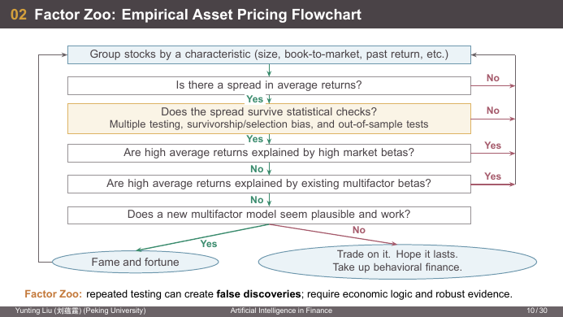

这张图（源自 Cochrane 的一张经典幽默图）描述了“发现一个新因子”的完整检验流程：

```
按某个特征给股票分组（市值、账面市值比、过去收益……）
  │
  ├─ 平均收益有差异（spread）吗？ ──────────────────── 否 → 回到开头，换特征
  │  是
  ├─ 差异经得起统计检验吗？ ─────────────────────────── 否 → 回到开头
  │  （多重检验、幸存者/选择偏差、样本外检验）
  │  是
  ├─ 高平均收益能被高市场 β 解释吗？（CAPM） ────────── 是 → 回到开头（没有新东西）
  │  否
  ├─ 能被已有多因子模型的 β 解释吗？（如 FF3） ──────── 是 → 回到开头
  │  否
  └─ 新的多因子模型合理且有效吗？
        是 → 名利双收（Fame and fortune）
        否 → “拿去交易，祈祷它能持续；或者改行研究行为金融”
```

- **因子动物园（Factor Zoo）**：研究者对大量特征反复检验，必然产生**假发现（false discoveries）**；所以要求**经济逻辑 + 稳健证据**。

💡 为什么多重检验会产生假发现：假设 100 个特征其实都没用，每个用 5% 显著性水平检验，平均也会有 5 个“显著”。如果只发表显著的那 5 个，读者看到的全是假因子。📎 Harvey, Liu and Zhu (2016) 因此建议新因子的 t 统计量门槛提高到约 3.0，而不是 2.0。

🔗 “能否被市场 β 解释”就是 CAPM 检验；“能否被已有多因子 β 解释”就是 Fama–French (1993) 的思路（参考文献里有）。🔗 Block 3 的“信息泄露与过拟合”是同一个问题在策略回测中的版本。

#### 1.3.2 资产类别与投资工具

| 标的市场 | 例子 | 研究内容 |
|---|---|---|
| 股票 | 个股、股票 ETF | 盈利、估值、因子暴露 |
| 债券 | 国债、公司债 | 收益率曲线、久期、信用利差 |
| 大宗商品 | 黄金、白银、原油、铜、农产品 | 供求、通胀、储存成本 |
| 货币 | 美元、欧元、人民币等 | 汇率、利差 |
| 现金与货币市场 | 国库券、存款、回购 | 流动性、短期利率 |

标的资产和利率 → **衍生品**（远期、期货、期权、互换）→ 获得或对冲风险暴露。

🔗 和金工概的主线一致（Hull 第 1 章：远期/期货/期权/互换，套保/投机/套利）。

#### 1.3.3 无套利衍生品定价

欧式看涨期权（European call）赋予在到期日 $T$ 以执行价 $K$ 买入股票的权利，到期收益：

$$
\text{payoff} = \max(S_T - K,\ 0)
$$

- **无套利**：复制组合和期权的价格必须相同。
- **定价测度 $Q$**：用风险中性概率对收益求期望再贴现：

$$
C_0 = e^{-rT}\,\mathbb{E}^Q\!\left[\max(S_T-K,0)\right]
$$

- 风险中性下股票漂移率（drift）为 $r$；Black–Scholes 给出解析基准。
- 假设：股票不分红、几何布朗运动、$r$ 和 $\sigma$ 为常数、无摩擦交易。

🔗 金工概会在二叉树 / BSM 讲系统推导风险中性定价。

#### 1.3.4 蒙特卡洛模拟定价

流程：**风险中性模型 → 模拟路径 → 贴现收益 → 求均值和标准误**

$$
X_i = e^{-rT}\max\!\left(S_T^{(i)}-K,0\right),\qquad
\widehat{C}_N=\frac1N\sum_{i=1}^N X_i,\qquad
\widehat{SE}=\frac{s_X}{\sqrt N}
$$

- 各条路径独立；$s_X$ 是 $X_i$ 的样本标准差。
- **精度**：标准误以 $N^{-1/2}$ 的速度下降，也就是路径数翻 100 倍，误差只缩小到 1/10。
- 课件参数：$S_0=100$，$r=5\%$，$\sigma=20\%$，$T=1$，无分红。**用 Black–Scholes 验证。**
- 进一步应用：利率衍生品、路径依赖期权；要检查**时间步长偏差**（time-step bias）和**监控规则**（monitoring rules，比如障碍期权是连续监控还是每天收盘监控）。

💡📎 课件没给 $K$，取 $K=100$（平值）算一遍：

- BS 解析价：$d_1=\dfrac{\ln(100/100)+(0.05+0.02)\cdot1}{0.2}=0.35$，$d_2=0.15$，
  $C=100N(0.35)-100e^{-0.05}N(0.15)=\mathbf{10.4506}$。
- 蒙特卡洛（种子 0）：

| 路径数 $N$ | $\widehat C_N$ | $\widehat{SE}$ | 与 BS 差 |
|---|---|---|---|
| 1,000 | 9.5497 | 0.4389 | −0.90（约 2 个 SE） |
| 100,000 | 10.4468 | 0.0465 | −0.004 |

路径数 ×100，SE 从 0.44 降到 0.047，正好约 1/10。

💻📎 实现（在 GBM 下 $S_T$ 可以一步精确模拟，不需要离散化，所以没有时间步长偏差）：

```python
import math
import numpy as np

S0, K, r, sigma, T = 100.0, 100.0, 0.05, 0.20, 1.0
rng = np.random.default_rng(0)            # 固定种子 → 可复现
N = 100_000
Z = rng.standard_normal(N)
ST = S0 * np.exp((r - 0.5 * sigma**2) * T + sigma * math.sqrt(T) * Z)  # 风险中性下漂移 r
X = math.exp(-r * T) * np.maximum(ST - K, 0.0)                         # 贴现收益
C_hat, se = X.mean(), X.std(ddof=1) / math.sqrt(N)                     # ddof=1：样本标准差
print(f"MC = {C_hat:.4f} ± {1.96 * se:.4f}")                           # 95% 置信区间
```

⚠️ 注意指数里是 $r-\tfrac12\sigma^2$ 而不是 $r$：$\ln S_T$ 服从正态，但 $\mathbb E[S_T]=S_0e^{rT}$ 要求这一项修正（Itô 引理）。

#### 1.3.5 Dell 案例：市盈率与 PEG

课件用一个真实案例（数据日期 2026-09-09）说明估值倍数的逻辑和陷阱。

| 输入 | 数值（USD/股） |
|---|---|
| 2026-09-08 收盘价 | 533.88 |
| Zacks FY27 一致预期 EPS | 25.34 |
| Zacks FY28 一致预期 EPS | 29.46 |
| Dell FY27 non-GAAP EPS 指引 | 25.50 |
| Dell FY27 GAAP EPS 指引 | 24.37 |

计算：

$$
P/E_{FY27}=\frac{533.88}{25.34}=21.07\times,\qquad P/E_{FY28}=\frac{533.88}{29.46}=18.12\times
$$

$$
g=\left(\frac{29.46}{25.34}-1\right)\times100=16.26\%,\qquad \text{PEG}_{1yr}=\frac{21.07}{16.26}=1.30
$$

解读：
- 这些是**财年预测倍数**（forward multiples，用未来 EPS），不是历史市盈率。
- 一年期 PEG 不能确定“合理价值”。
- **盈利口径很重要**：用 GAAP 指引，FY27 P/E 是 $533.88/24.37=21.91\times$。

⚠️ PEG 的约定：分母里的 $g$ 用“百分数的数字”（16.26），不是小数 0.1626。所以 PEG = 1 大致表示“市盈率 = 增长率的百分数”。

**估值取决于倍数**：情景价值 = FY27 一致预期 EPS × 假设 P/E

| 假设 P/E | 情景价值 | 相对收盘价 |
|---|---|---|
| 15× | $380.10 | −28.8% |
| 20× | $506.80 | −5.1% |
| 25× | $633.50 | +18.7% |

- EPS 低于预期 15% 且 P/E 为 20×：$25.34\times0.85\times20=\$430.78$（比收盘价低约 19.3%）。
- 课堂讨论：市场价格隐含约 21.1 倍 FY27 EPS。盈利的持续性、利润率、现金转化能力能支撑这个倍数吗？
- 课件声明：倍数和 EPS 不及预期都是示意性假设，不是可比公司估计或目标价；差异不含股利。

💡 这个表说明：**同一个 EPS，倍数 ±5 就让估值变化约 ±25%。** 用倍数估值时，真正的判断在“倍数该是多少”，而这需要可比公司、增长和风险的分析。

#### 1.3.6 Dell 案例：做 DCF 之前先核对现金流

Q2 FY27（截至 2026-07-31）现金流调节，单位十亿美元：

```
自由现金流 FCF                    0.986   = 经营现金流 2.225 − 资本支出及资本化软件净额 1.239
+ 融资应收款（financing receivables）+6.667
+ 设备租赁（equipment leases）       +0.496
= 调整后自由现金流（adjusted FCF）   8.149
```

（验算：$2.225-1.239=0.986$；$0.986+6.667+0.496=8.149$ ✓）

DCF 必须解决的三件事：
1. **正常化**利润率、再投资和营运资本（一个季度的数字有很强的季节性、一次性因素）。
2. 对**融资应收款及其对应的融资负债**建模时口径一致。
3. **贴现率匹配**：公司自由现金流 FCFF 用 WACC 贴现；股权自由现金流 FCFE 用股权成本贴现。

**DCF 纪律**：调整后 FCF 不自动等于 FCFF。做企业价值 DCF 时，先从企业价值调节到股权价值（减去净债务等），再除以**稀释后股数**。FCF 和调整后 FCF 都是公司自定义的 non-GAAP 指标。

📎 为什么融资应收款的调整这么大：Dell 通过 Dell Financial Services 向客户提供分期/租赁融资。客户分期付款时，Dell 已确认收入但现金还没收到，应收款增加会压低经营现金流；而这部分应收款主要由专门的债务融资支持。公司的“调整后 FCF”把它加回来，相当于把“融资业务”和“卖电脑业务”分开看。问题是：如果加回应收款，就必须同时把对应的融资债务当作经营性负债处理，否则就重复计算了（这就是第 2 条“口径一致”的意思）。

### 1.4 Block 3：投资策略开发与风险评估

因子模型和机器学习把金融分析和投资决策连起来：

| 01 交易信号 | 02 投资策略 | 03 组合构建 |
|---|---|---|
| 因子模型 | 策略规则 | 组合配置 |
| 机器学习 | AI 辅助的策略编码 | 风险收益权衡 |
| 信号构建 | 参数分析 | 配置约束 |

目标：解释模型输出，并把它转化为投资决策。

**策略评估与风险评估**

| 环节 | 内容 | 目的 |
|---|---|---|
| 01 检验（Tests） | 历史回测、样本外检验、情景分析 | 在不同样本和市场环境下评估策略 |
| 02 绩效与风险 | 收益、波动、回撤；风险暴露；交易成本与换手率 | 把绩效和风险、交易成本放在一起评估 |
| 03 验证（Validation） | **信息泄露与过拟合**；简单基准 vs AI 模型 | 把策略假设、实现、绩效评估和风险控制连起来 |

💡 信息泄露（information leakage / look-ahead bias）的典型例子：用 2020-12-31 的财报数据在 2020-12-31 当天调仓。但年报通常要到次年 3–4 月才公布，回测里“提前知道”了未来信息，收益会被高估。

🔗 机器学习概论里的训练集/测试集划分：金融时间序列不能随机划分，必须**按时间**切分（先训练、后测试），否则同样是信息泄露。

### 1.5 Block 4：金融软件与智能体系统的开源开发

**金融应用软件开发**：应用场景是组合分析、风险监控、策略研究。
- 软件形式：金融 App、Web 应用、桌面分析工具。
- 组成：用户界面、数据接口、金融模型。
- 开发流程：需求分析 → 实现 → 测试与部署；用真实金融任务验证功能和分析结果，根据测试反馈改进。

**金融智能体系统与协作角色**：通过开源协作开发金融智能体。

| 研究（Research） | 计算（Computation） | 验证（Verification） |
|---|---|---|
| 探索在金融分析和研究任务中的协作 | 在智能体工作流中调用金融分析工具 | 在协作流程中审核分析结果 |

- **系统能力**：规划任务、调用工具、记录执行过程。
- **控制与审核**：工具接口、权限管理、人工审核机制。

🔗 参考文献里的 ReAct（推理与行动交替）就是这种智能体的基本范式：模型先“想”（reasoning），再“做”（调用工具，比如调用第 2 讲的 `bond_yield` 函数），看到结果后再想下一步。

### 1.6 先修要求、考核与 AlphaLab 项目

**先修要求**
- 金融：基础估值、投资、风险管理、无套利推理、衍生品收益。
- 编程：写过、读得懂简单程序，处理过数据。
- 数学与统计：微积分、线代、概率、统计推理。
- 衍生品定价：随机过程，尤其是布朗运动、几何布朗运动、Itô 引理。

**考核**

| 项目 | 权重 | 说明 |
|---|---|---|
| 课堂参与 | 10% | 准备和实质性参与 |
| 作业 | 40% | 金融分析与编程任务 |
| 个人课程项目 | 50% | AlphaLab 扩展、GitHub 工作、持续评审和展示 |

**个人 AlphaLab 项目**
- 个人负责：每位同学设计、实现并答辩**自己**对 AlphaLab 的贡献。
- 学期中：做小模块、做简短进度展示、通过 GitHub 同行评审修改。
- 最终扩展：在此基础上交付一个**实质性的、集成进包里的**扩展，支持一个完整的金融应用。

**贯穿全课的展示与评审**

| 时间点 | 展示 | 内容 |
|---|---|---|
| Block 1 之后 | 提案陈述（Proposal pitch） | 讲清金融问题和计划的 AlphaLab 贡献；同学质疑范围和评估计划 |
| Block 2 之后 | 模块演示（Module demo） | 展示可运行的例子；轮值评审检查金融逻辑和可复现性 |
| Block 3 之后 | 评估讨论（Evaluation discussion） | 分享基准测试、一个局限或失败实验，以及根据同学反馈做的修改 |
| Block 4 结束 | 最终展示（Final showcase） | 演示集成后的扩展，为其价值、证据和个人贡献辩护 |

**GitHub 贡献与同行评审**
- **Issues**：提出有用的问题或提案，定义验收标准（acceptance criteria），记录问题如何解决。
- **Pull requests**：提交聚焦的、经过测试的修改，关联 issue；解释修改并回应评审。
- **同行评审**：每个检查点轮换评审人；检查金融逻辑、运行例子或测试、给出可执行的反馈、跟进修改。
- **贡献日志**：记录 PR、提出和解决的 issue、评审的数量和链接。得分看实质内容、质量和跟进。

**项目评分细则（占总成绩 50%）**

| 权重 | 组成 | 评估依据 |
|---|---|---|
| 30% | 最终 AlphaLab 扩展 | 金融价值；正确性和评估；包集成、测试、文档 |
| 10% | GitHub 贡献过程 | 实质性的 issue 和 PR 工作，清晰的记录，完成评审—修改循环 |
| 5% | 全程同行评审 | 有用的反馈、独立检查、跨检查点和 PR 评审的跟进 |
| 5% | 展示与答辩 | 三次进度展示（各 1%）；最终演示和个人答辩（2%） |

**项目展示要做到**
- **演示（Demonstrate）**：把各次进度展示连成一个可复现的端到端演示。
- **评估（Evaluate）**：展示加入你的扩展前后包能做什么，用合适的基准衡量正确性、可靠性和计算性能。
- **辩护（Defend）**：用测试、文档和 GitHub 记录解释你的设计、个人贡献和对同学反馈的回应。

🛠️ 从评分细则看，**测试和文档**分量很重（30% 里明确列出）。第 2 讲的代码示范了课程期待的风格：每段计算后跟 `assert` 检验已知结果、求根前检查区间两端异号、用独立方法（IRR vs brentq）交叉验证。项目代码应当沿用这种风格，把这些 `assert` 写成 `pytest` 测试。

### 1.7 参考文献

**金融**
- Veronesi (2010). *Fixed Income Securities: Valuation, Risk, and Risk Management*. Wiley. ← 第 2、3 讲的记号 $Z(t,T)$、PCA 讲法都来自这本书
- Glasserman (2003). *Monte Carlo Methods in Financial Engineering*. Springer.
- Bali, Engle, and Murray (2016). *Empirical Asset Pricing: The Cross Section of Stock Returns*. Wiley.
- Fama and French (1993). Common Risk Factors in the Returns on Stocks and Bonds. *JFE*.
- Ang, Hodrick, Xing, and Zhang (2006). The Cross-Section of Volatility and Expected Returns. *JF*.

**AI 与机器学习**
- James et al. (2023). *An Introduction to Statistical Learning: with Applications in Python* (ISLP). 核心 ML 读物：预测、正则化、模型评估、Python 实验。
- Huyen (2025). *AI Engineering: Building Applications with Foundation Models*. 核心 AI 应用读物：提示词、检索、智能体、评估。
- Nagel (2021). *Machine Learning in Asset Pricing*. 金融联系：高维预测与资产定价问题。
- Raschka (2024). *Build a Large Language Model (From Scratch)*. 选读：分词、注意力、Transformer、微调。

**AI 研究与实践**
- Gu, Kelly, and Xiu (2020). Empirical Asset Pricing via Machine Learning. *RFS*. → Block 2–3：比较 ML 方法、评估金融预测。
- Yao et al. (2023). ReAct: Synergizing Reasoning and Acting in Language Models. *ICLR*. → Block 4：推理与调用外部工具交替进行。
- Jimenez et al. (2024). SWE-bench: Can Language Models Resolve Real-World GitHub Issues? *ICLR*. → Block 1 和 4：用仓库测试评估 AI 生成的补丁。
- 实践资源：scikit-learn；Hugging Face Agents Course；GitHub Docs。

### 第 1 讲小结

- 课程 = 金融模型 × Python 实现 × 验证 × 开源协作，最终落到 AlphaLab 个人项目（50%）。
- 反复出现的方法论：**任何数字都要有独立检验**（BS 验证 MC、IRR 验证 YTM、`assert` 验证已知结果）；**任何“发现”都要经得起多重检验和样本外检验**（因子动物园）；**任何估值都要看清假设**（Dell 的倍数和现金流口径）。

<details>
<summary>✅ 自测题</summary>

1. 蒙特卡洛定价用 1 万条路径时 SE 为 0.14，想把 SE 降到 0.014，需要多少条路径？
   → SE ∝ $N^{-1/2}$，要缩小 10 倍需 100 倍路径：100 万条。
2. Dell 的一年期 PEG 是多少？如果用 GAAP EPS 算 P/E，PEG 会变大还是变小？
   → 1.30；GAAP EPS 更低 → P/E 更高（21.91×）→ PEG 变大（增长率不变的话）。
3. 为什么“调整后 FCF”不能直接用 WACC 贴现当作企业价值？
   → 它把融资应收款的变动加回了，但没有对应处理融资债务，口径不等于 FCFF；必须先核对它是否符合 FCFF 定义。
4. 在因子动物园流程图里，如果一个特征的高收益能被市场 β 解释，意味着什么？
   → 它不是新的定价因子，只是 CAPM 风险补偿的体现，回到起点。

</details>

---

## 第 2 讲 固定收益证券基础

> **本讲地图**：Block 2 的第一站，从最简单的金融资产——**确定的现金流**——开始。
>
> 主线：**贴现函数 $Z(t,T)$ 是一切的基础** → 利率只是 $Z$ 的不同“报价方式”（EAR / APR / 连续复利）→ 用 $Z$ 给任何确定现金流定价（房贷、附息债券）→ 用一个数概括价格（YTM）以及它的局限 → 无套利：静态复制、从即期利率推出远期利率。
>
> 编程主线：用 Python 做数值计算（`math`/`numpy`）、求根（`scipy.optimize.brentq`）、IRR（`numpy_financial`）、画图（`matplotlib`）、格式化输出与文件读写（f-string、`csv`、`pathlib`）。
>
> 🔗 这讲的金融内容基本是《固定收益证券》前几章的复习（记号来自 Veronesi 教材）。重点放在**用代码实现并验证**，以及几个容易被忽视的细节：复利约定、YTM 的局限、远期利率不是预测。
>
> 📂 本讲有新旧两版课件，本节以 2026 秋新版（`lecture2（1）.pdf`，Python）为准，差异见[附录 D](#附录-d-课件勘误与版本差异)。
>
> 贯穿本讲的约定：现金流是**确定的**（合约规定），市场**无摩擦**、**无套利**，除非例子另有说明。

### 2.1 现值与贴现函数

$$
\underbrace{Z(t,T)}_{t\text{ 时的价格}} \longleftrightarrow \underbrace{1 \text{ 单位货币}}_{T\text{ 时的支付}}
$$

- 在 $t$ 时买一个合约，它在 $T>t$ 时支付 1 单位货币。它的价格（同一货币计价）就是这笔支付的**现值（present value）**。
- 这个价格记作 $Z(t,T)$，叫**贴现函数（discount function）**。
- **零息债券（zero-coupon bond, ZCB）**只在到期时支付；$Z(t,T)$ 就是面值为 1 的零息债券价格。

**记号**

| 符号 | 含义 |
|---|---|
| $t$ | 估值日 |
| $T$ | 支付日 |
| $k=T-t$ | 距离支付的时间（年） |
| $Z(t,T)$ | $t$ 时对 $T$ 时 1 单位货币的价格 |
| $r_n(t,T)$ | 名义年即期利率（nominal annual spot rate），每年复利 $n$ 次 |
| $r(t,T)$ | 连续复利年即期利率 |

⚠️ 记号不统一：其他教材用 $P_t^{(k)}$ 表示同一个东西 $Z(t,t+k)$。货币在记号里是隐含的：**每种货币有自己的贴现函数**。

💡 **现值问题**：美元四年期贴现因子 $Z(t,t+4)=0.7$。

1. 承诺四年后无风险支付 \$1,000，今天能收到多少？→ $1000\times0.7=\mathbf{\$700}$。
2. 四年后支付 EUR 10,000 的债券价格是多少？→ **题目条件不够**：需要**欧元**的贴现因子，美元的 0.7 不能用。
3. 今天投资 \$1，四年后的终值是多少？→ $1/0.7=\mathbf{1.428571}$ 美元。

第 3 问的逻辑：花 0.7 买一张四年后付 1 的债券，那么花 1 就能买 $1/0.7$ 张，四年后收到 $1/0.7$。**终值就是现值的倒过来。**

**贴现函数的形状**

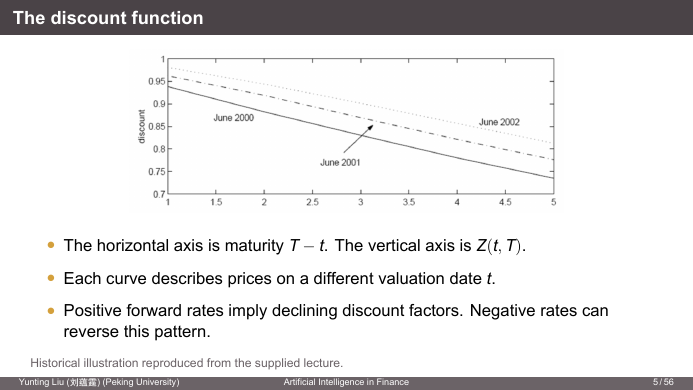

- 横轴是期限 $T-t$，纵轴是 $Z(t,T)$；每条曲线是一个估值日（图中是 2000、2001、2002 年 6 月）的贴现函数。
- **远期利率为正 ⟹ 贴现因子随期限递减**。负利率时这个规律可能反转（2014–2021 年欧元区、日本出现过：借给德国政府 5 年，到期拿回的比借出去的少，$Z>1$）。
- 🔗 图里 2001 年的曲线比 2000 年的高很多：2001 年美联储连续大幅降息，利率低 → 贴现因子高。

### 2.2 有效年利率 EAR 与复利频率 APR

**利率是怎么从 $Z$ 定义出来的**：比较两个投资：
- 花 $Z(t,T)$ 买零息债券，持有到期，拿到 1；
- 把同样的 $Z(t,T)$ 存进一个假想的银行账户，按固定利率、**每年复利一次**。

让银行账户到期余额恰好等于 1 的那个利率，就是这张债券的**有效年利率（effective annual rate, EAR）**：

$$
Z(t,T)(1+\text{EAR})^{T-t}=1
\quad\Longrightarrow\quad
Z(t,T)=(1+\text{EAR})^{-(T-t)},\qquad \text{EAR}=Z(t,T)^{-1/(T-t)}-1
$$

- 每个期限可以有**不同的** EAR（这就是后面的期限结构）。

**贴现与终值**：

$$
PV=\frac{F}{(1+\text{EAR})^k}=F\,Z(t,t+k),\qquad
FV=C(1+\text{EAR})^k=\frac{C}{Z(t,t+k)}
$$

- 现金流和价格必须用**同一种货币**。
- 贴现率必须和**期限**、**复利约定**都匹配。
- 课件旧版指出：这里 EAR 依赖于期限 $k$ 是**无套利的要求**。如果所有 $k$ 年期投资不用同一个 $k$ 年利率，就能低借高贷套利。

💻 **复习题**（课件第 8 页）

| 现值 | EAR | 期限 | 求 |
|---|---|---|---|
| \$100 | 5.25% | 1 年 | 终值 |
| \$600 | 8.00% | 5 年 | 终值 |
| 到期 1 单位 | 6.25% | 3 年 | 贴现因子 |

```python
import math
import numpy as np

fv1 = 100 * 1.0525          # 105.25
fv2 = 600 * 1.08**5         # 881.5968...
discount = 1.0625**(-3)     # 0.833706
print(f"{fv1:.2f}, {fv2:.2f}, {discount:.6f}")
assert math.isclose(fv2, 881.59684608)
```

结果：**105.25, 881.60, 0.833706**。

- Python 用 `**` 求幂（不是 `^`，`^` 是按位异或）。
- `math.isclose` 而不是 `==`：浮点数不能直接比相等（🔗 CSAPP 第 2 章：`0.1 + 0.2 != 0.3`）。默认相对容差 `rel_tol=1e-9`。

**一年内多次复利**：名义年利率（APR）$a$、每年复利 $n$ 次，就是每期支付 $a/n$。以半年复利为例：

| 经过时间 | 半年期数 | 1 单位初始投资的价值 |
|---|---|---|
| 0.5 年 | 1 | $1+a/2$ |
| 1 年 | 2 | $(1+a/2)^2$ |
| 2 年 | 4 | $(1+a/2)^4$ |
| $k$ 年 | $2k$ | $(1+a/2)^{2k}$ |

$$
1+\text{EAR}=\left(1+\frac{a}{2}\right)^2
\qquad\text{一般地}\qquad
1+\text{EAR}=\left(1+\frac{\text{APR}}{n}\right)^n
$$

所以 $k$ 年后 $C$ 的现值有两种等价写法：

$$
PV=\frac{C}{(1+\text{EAR})^k}=\frac{C}{(1+\text{APR}/n)^{nk}}
$$

- 用 APR 时：**每期利率是 APR/n，期数是 nk**。
- ⚠️ **永远不要直接用 APR 当贴现率**（旧版课件原话：never discount using APR directly）。$n=1$ 时 APR = EAR，否则两者一般不同。
- 这里的 APR 指名义年利率报价。实际产品披露还可能涉及**费用**和**计息天数约定（day-count convention）**。

💡 **APR 披露的例子**（课件第 11 页，一张 Discover 信用卡广告）：

| 项目 | 条款 |
|---|---|
| 年费 | \$0 |
| 购物 APR | 前 14 个月 0% 优惠 APR，之后 13.24%–24.24% 浮动 |
| 余额转移 APR | 前 14 个月 0% 优惠 APR，之后 13.24%–24.24% 浮动 |
| 余额转移手续费 | 3% |

- 要分别识别：**优惠期**、之后的**浮动 APR**、**转移手续费**。
- **一个利率报价不能描述合约的全部现金流。** 比如“0% APR 转移余额”看起来免费，但 3% 的一次性手续费相当于：如果你 14 个月内还清，实际年化成本约 $1.03^{12/14}-1\approx2.6\%$，而不是 0。

📎 美国信用卡 APR 按日计息：日利率 = APR/365。24.24% 的 APR 对应 EAR $=(1+0.2424/365)^{365}-1\approx27.4\%$。

**复利约定对照**

| $n$ | 频率 | 利率报价 | 课堂例子 |
|---|---|---|---|
| 1 | 年 | 有效年利率 | 年付息债券 |
| 2 | 半年 | 名义年收益率 | 半年付息债券（美国国债；旧版称 bond equivalent yield, BEY） |
| 12 | 月 | 名义年利率 | 按月还款的房贷（旧版还有信用卡） |
| ∞ | 连续 | 对数年利率 | 期限结构公式 |

- 各市场和合约规定自己的报价约定。**约定本身不重要，重要的是知道用的是哪种。**
- ⚠️ **付息频率**和**利率复利频率**是两个不同概念，通过一致的换算联系起来（比如可以用连续复利利率给半年付息债券定价）。

**从贴现因子求即期利率**：$T-t$ 年的总回报是 $1/Z(t,T)$，所以

$$
\left(1+\frac{r_n(t,T)}{n}\right)^{n(T-t)}=\frac{1}{Z(t,T)}
\quad\Longrightarrow\quad
r_n(t,T)=n\left[Z(t,T)^{-1/[n(T-t)]}-1\right]
$$

- 改变 $n$ 会改变利率的**数值**，但贴现因子和整个期间的总回报**不变**。一个价格，多种报价。

### 2.3 连续复利与利率换算

$n\to\infty$ 时 $\left(1+\frac{r}{n}\right)^n\to e^r$，得到**连续复利**利率 $r(t,T)$：

$$
Z(t,T)\,e^{r(t,T)(T-t)}=1
\quad\Longrightarrow\quad
r(t,T)=-\frac{\log Z(t,T)}{T-t},\qquad Z(t,T)=e^{-r(t,T)(T-t)}
$$

等价的名义利率随 $n$ 增大收敛于连续复利利率：

$$
r_n(t,T)=n\left[e^{r(t,T)/n}-1\right]\longrightarrow r(t,T)
$$

一年期：$\text{EAR}=e^r-1$，$r=\log(1+\text{EAR})$。（$\log$ 在本课一律指自然对数。）

🔗 为什么理论（期限结构、金工概的 $F_0=S_0e^{rT}$、BSM）都爱用连续复利：**乘法变加法**。多期复利 $e^{r_1T_1}e^{f(T_2-T_1)}=e^{r_1T_1+f(T_2-T_1)}$，取对数就是线性的，远期利率公式会很干净（见 2.11）。

💡 **固定名义利率 8%，复利频率越高，EAR 越高**：

| 频率 | EAR = $(1+0.08/n)^n-1$ |
|---|---|
| 年（1） | 8.000% |
| 半年（2） | 8.160% |
| 季（4） | 8.243% |
| 月（12） | 8.300% |
| 日（365） | 8.328% |
| 小时（8,760） | 8.329% |
| 连续 | $e^{0.08}-1=$ 8.329% |

💡 **固定 EAR 11%，等价的名义利率**（同一个有效回报的不同报价）：

| 频率 | 名义年利率 $r_n=n(1.11^{1/n}-1)$ |
|---|---|
| 年 | 11.000% |
| 半年 | 10.713% |
| 季 | 10.573% |
| 月 | 10.482% |
| 日（365） | 10.437% |
| 小时（8,760） | 10.436% |
| 连续 | $\log(1.11)=$ 10.436% |

两张表方向相反：第一张固定名义报价，频率越高有效回报越高；第二张固定有效回报，频率越高需要的名义报价越低。复利频率从“月”到“日”以后差别只在小数点后第三位，所以连续复利是日复利的很好近似。

💻 **利率换算的 Python 实现**

```python
frequencies = [1, 2, 4, 12, 365, 8760]
for n in frequencies:
    ear = math.expm1(n * math.log1p(0.08 / n))    # (1+0.08/n)^n - 1
    apr = n * math.expm1(math.log1p(0.11) / n)    # n[(1.11)^(1/n) - 1]
    print(f"n={n:4d}: EAR={ear:.3%}, APR={apr:.3%}")
    assert math.isclose((1 + apr / n)**n, 1.11, rel_tol=1e-11)   # 反向验证
print(f"Continuous: {math.expm1(0.08):.3%}")      # e^0.08 - 1
print(f"Continuous: {math.log1p(0.11):.3%}")      # log(1.11)
```

- `log1p(x)` 精确计算 $\log(1+x)$，`expm1(x)` 精确计算 $e^x-1$，在 $x$ 接近 0 时尤其重要。
- 写法：$(1+x)^n-1=\exp(n\log(1+x))-1=$ `expm1(n*log1p(x))`。
- `{ear:.3%}` 把小数 0.08328 显示为 `8.328%`（乘 100 加百分号，保留 3 位小数）。
- 每次循环都用 `assert` 把算出的 APR 代回去，检验是否还原出 1.11。

🔗📎 **为什么要用 `log1p`/`expm1`（CSAPP 浮点数）**：`1 + x` 在 $x$ 很小时会丢掉 $x$ 的低位有效数字（双精度只有约 16 位有效数字，1 占掉了开头）。之后再 $n$ 次方，误差会被放大 $n$ 倍。实测：

| $n$ | 朴素 `(1+0.08/n)**n - 1` | `expm1(n*log1p(0.08/n))` |
|---|---|---|
| 8,760 | 0.08328667195555 | 0.08328667195614 |
| $10^9$ | 0.0832870748 | 0.0832870677 |
| $10^{13}$ | **0.0832178**（错在第 4 位） | 0.0832870677（= $e^{0.08}-1$） |

小时复利时误差还只在第 12 位，但 $n$ 很大时朴素算法就算错了。

### 2.4 房贷：等额本息的月供与摊还表

**问题设定**
- 借入本金 $P$，期限 $T$ 年，共 $N=12T$ 期月供。
- 固定名义年利率 $a$，按月复利，月利率 $r_m=a/12$。
- 每月末的还款包含利息和本金偿还。
- 固定月供 $C$ 是多少，才能恰好还清贷款？

课件数值：$P=2{,}000{,}000$，$a=6\%$，$T=25$，$N=300$，$r_m=0.5\%$。

**余额递推**：设 $B_j$ 为第 $j$ 期还款后的未偿余额。

$$
\begin{aligned}
B_0&=P\\
I_j&=r_m B_{j-1} &&\text{第 } j \text{ 月利息}\\
A_j&=C-I_j &&\text{本金偿还（摊还，amortization）}\\
B_j&=B_{j-1}-A_j=(1+r_m)B_{j-1}-C
\end{aligned}
$$

- 从上月末的余额开始 → 计息 → 减去月供 → 把新余额带到下个月。
- **终止条件：$B_N=0$。**

旧版课件把这个过程画成流程图：

```
Period 1                          Period t                            Period T_e = 12T
Interest(1) = Balance(0)·APR/12   Interest(t) = Balance(t-1)·APR/12   ...
Amort(1) = C − Interest(1)        Amort(t) = C − Interest(t)          Balance(T_e) = 0
Balance(1) = Balance(0)−Amort(1)  Balance(t) = Balance(t-1)−Amort(t)
```

**两种还款方式**
- **等额本息（equal installment）**：每月**总还款** $C$ 固定，利息和本金的构成每月变化。
- **等额本金（equal amortization）**：每月**偿还的本金**固定，所以总还款每月变化（逐月递减）。

**求 $C$ 的两种方法**
1. **数值法**：把 $B_N$ 看成 $C$ 的函数 $B_N(C)$，用求根器解 $B_N(C)=0$（Python 用 `scipy.optimize.brentq`，旧版 MATLAB 用 `fzero`/`fsolve`）。
2. **现值法**：令还款的现值等于原始本金。

**现值法推导**：从贷款人（银行）的角度，按贷款利率贴现，还款的现值必须等于借出的本金（银行在这个利率下恰好“公平”）：

$$
P=\sum_{j=1}^{N}\frac{C}{(1+r_m)^j}=C\,\frac{1-(1+r_m)^{-N}}{r_m}
$$

（等比数列求和：首项 $C/(1+r_m)$，公比 $1/(1+r_m)$。）所以当 $r_m>0$ 时

$$
\boxed{C=\frac{P\,r_m}{1-(1+r_m)^{-N}}}
$$

- 零利率时 $C=P/N$（公式 0/0，需要单独处理）。
- 25 年例子：**月供 12,886.03**。

📎 为什么递推和现值法等价：把递推展开，$B_N=(1+r_m)^N P - C\sum_{j=0}^{N-1}(1+r_m)^j$，令 $B_N=0$ 两边除以 $(1+r_m)^N$，就得到现值公式。所以“余额归零”和“现值等于本金”是同一个条件。

💻 **月供公式**

```python
P, rm, N = 2_000_000.0, 0.06 / 12, 25 * 12     # 数字里的 _ 只是分隔符，便于阅读
if rm == 0:
    C = P / N                                   # 零利率分支，避免 0/0
else:
    C = P * rm / (1 - (1 + rm)**(-N))
print(f"Monthly payment: {C:,.2f}")             # ,.2f → 12,886.03（千分位 + 2 位小数）
assert abs(C - 12886.0280297103) < 1e-7

from mor_demo import level_payment              # 课件 demo 里封装好的函数
assert abs(level_payment(P, rm, N) - C) < 1e-7
assert level_payment(1200, 0, 12) == 100        # 零利率边界情况
```

- 适用于合法输入 $P>0$、$r_m\ge0$、正整数 $N$。
- `demo/mor_demo.py` 里保存的 `level_payment` 还做了**输入校验**，并对小利率使用数值稳定的分母（$1-(1+r_m)^{-N}$ 在 $r_m$ 很小时同样有 2.3 节的精度问题，可写成 `-expm1(-N*log1p(rm))`）。

💻 **摊还表**

```python
balance = np.empty(N + 1)         # 含初始本金，所以 N+1 个
interest = np.empty(N)
amortization = np.empty(N)
balance[0] = P
for j in range(N):                # j = 0..N-1 对应第 1..N 月
    interest[j] = balance[j] * rm
    amortization[j] = C - interest[j]
    balance[j + 1] = balance[j] - amortization[j]

assert abs(balance[-1]) < 0.01                # 最后余额归零
assert abs(amortization.sum() - P) < 0.01     # 本金偿还加起来等于本金
assert math.isclose(interest[0], 10_000.0)    # 第 1 月利息 = 2,000,000 × 0.5%
```

- ⚠️ Python 数组从 0 开始索引：`interest[0]` 属于**第 1 个月**。`balance` 有 $N+1$ 个元素，因为包含初始本金 `balance[0]`。
- `np.empty` 只分配内存不初始化（比 `np.zeros` 快），因为后面每个元素都会被赋值。

💻 **画图**

```python
import matplotlib.pyplot as plt
months = np.arange(1, N + 1)
fig, ax = plt.subplots()
ax.plot(months, np.full(N, C), label="Payment")
ax.plot(months, interest, label="Interest")
ax.plot(months, amortization, label="Amortization")
ax.set(xlabel="Month", ylabel="Currency units per month")
ax.legend()
fig.savefig("mortgage_payments.png", dpi=180)
plt.close(fig)                    # 释放图形，循环画很多图时避免内存累积
```

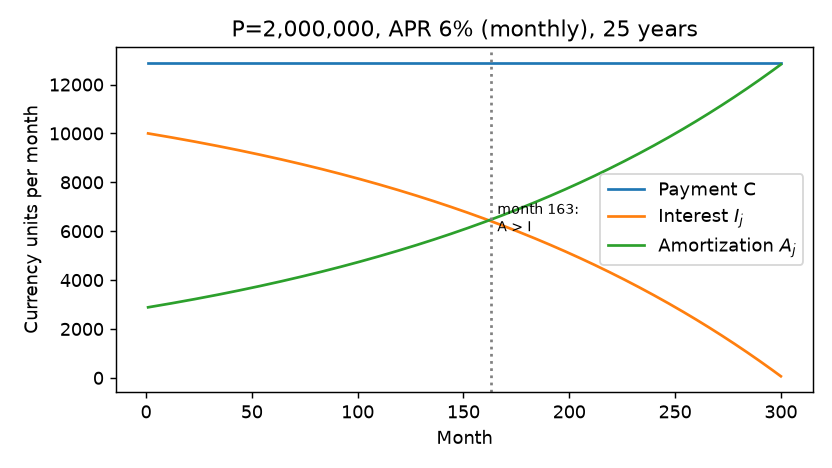

- 总还款不变；随着余额下降，利息下降；所以同样的月供在后期偿还更多本金。

💡 看具体数字：

| | 第 1 月 | 第 300 月 |
|---|---|---|
| 利息 | 10,000.00 | 64.11 |
| 本金偿还 | 2,886.03 | 12,821.92 |

- 本金偿还从第 **163** 个月（约第 14 年）起才超过利息。前 13 年多，月供的一大半都在付利息。
- 总还款 $12{,}886.03\times300=3{,}865{,}808$，总利息 **1,865,808**，接近本金。

💻 **数值求根**

```python
from scipy.optimize import brentq

def terminal_balance(payment):
    remaining = P
    for _ in range(N):
        remaining = remaining * (1 + rm) - payment
    return remaining                             # B_N(C)

lo, hi = 0.0, P * (1 + rm)
assert terminal_balance(lo) * terminal_balance(hi) < 0    # 区间两端必须异号
C_root = brentq(terminal_balance, lo, hi, xtol=1e-8)
assert abs(C_root - C) < 1e-7                              # 与解析公式交叉验证
```

- **Brent 方法**要求：函数连续，区间两端函数值**异号**（保证区间内有根）。它结合了二分法（稳）和割线/反二次插值（快）。
- 为什么 $[0,\ P(1+r_m)]$ 一定包住根：$C=0$ 时从不还款，$B_N=P(1+r_m)^N>0$；$C=P(1+r_m)$ 时第一个月就连本带息全还清，之后余额为负，$B_N<0$。
- $B_N(C)$ 对 $C$ 是线性递减的，所以根唯一。

📎🔗 **等额本息 vs 等额本金**（国内房贷两种都常见，旧版课件提到可对比招商银行的房贷计算器）：同样 200 万、6%、25 年：

| | 等额本息 | 等额本金 |
|---|---|---|
| 首月还款 | 12,886.03 | $6{,}666.67+10{,}000=$ **16,666.67** |
| 末月还款 | 12,886.03 | $6{,}666.67+33.33=$ **6,700.00** |
| 总利息 | 1,865,808 | $r_mP(N+1)/2=$ **1,505,000** |
| 按 0.5% 月利率贴现的还款现值 | 2,000,000 | 2,000,000 |

⚠️ 等额本金总利息少了 36 万，但**这不代表它更便宜**：两种方式按贷款利率算的现值都**正好是本金**，对银行来说一样公平。等额本金利息少，是因为你更早还了本金，占用银行的钱更少。哪种对你更好，取决于你自己的机会成本，也就是下一节的 NPV。

### 2.5 房贷的 NPV 与期限选择

**借款人视角**：拿到贷款是现金流入，还款是流出。

$$
\text{NPV}_{\text{borrower}}(d_m)=P-\sum_{j=1}^{N}\frac{C}{(1+d_m)^j}
$$

- $d_m$ 是借款人的**月度机会贴现率**（opportunity discount rate）。
- 对这种正的还款序列：$d_m=r_m$ 时 NPV = 0；$d_m>r_m$ 时 NPV > 0；$d_m<r_m$ 时 NPV < 0。
- 如果机会成本 $d$ 是 EAR，要先换算：$d_m=(1+d)^{1/12}-1$。
- **净现值法则（NPV rule）**：只投资、只做 NPV 为正的交易。所以**当你的机会成本高于贷款利率时就该借**。
- 讨论：流动性约束、外部投资机会如何影响融资选择？
  - 外部投资机会好（比如能稳定赚 8%）→ $d$ 高 → 借贷款、把自有资金拿去投资更划算。
  - 流动性约束紧（手里没钱、别处借不到）→ 自有资金的影子价格高 → $d$ 高 → 更倾向于借。
- 这个比较固定合约不变，**排除了费用、税、违约、提前还款**；只评估融资现金流本身，和买不买房分开。

💡 一个直观理解：如果 $d_m>r_m$，从你的角度看，未来的还款“不太值钱”（贴现得更狠），而今天拿到的 200 万是足额的，所以 NPV 为正。

💻 **现值函数**

```python
def pv_of_payments(payments, rate):
    cf = np.asarray(payments, dtype=float)
    periods = np.arange(1, cf.size + 1)               # 1, 2, ..., N：第一笔在一期之后
    return float(cf @ (1.0 + rate)**(-periods))       # 向量内积 Σ cf_j · (1+rate)^(-j)

payments = np.full(N, C)
assert abs(pv_of_payments(payments, rm) - P) < 0.01   # 按贷款利率贴现 = 本金
npv_at_loan_rate = P - pv_of_payments(payments, rm)
npv_at_double_rate = P - pv_of_payments(payments, 2 * rm)
assert npv_at_double_rate > 0
print(f"Borrower NPV at 1% monthly: {npv_at_double_rate:,.2f}")
```

- 输出：机会成本为每月 1% 时，借款人 NPV = **776,516.08**。
- `@` 是矩阵/向量乘法：一行代码完成加权求和，不用写循环（NumPy 向量化）。
- ⚠️ 约定：第一笔现金流发生在**一期之后**（期末付款，ordinary annuity）。如果现金流从今天开始（期初付款），`periods` 要从 0 开始。
- 完整版（带形状和利率校验）是 `demo/mdiscount.py` 里的 `present_value`。

💻 **房贷期限与借款人 NPV**：本金和 6% APR 不变，比较 21–30 年，设 $d_m=1.1r_m=0.55\%$。

```python
terms = np.arange(21, 31)
npvs = []
for years in terms:
    periods = int(years) * 12
    payment = level_payment(P, rm, periods)
    repayments = np.full(periods, payment)
    npvs.append(P - pv_of_payments(repayments, 1.1 * rm))
fig, ax = plt.subplots()
ax.plot(terms, npvs, marker="o")
ax.set(xlabel="Maturity (years)", ylabel="Borrower NPV")
fig.savefig("mortgage_maturities.png", dpi=180)
plt.close(fig)
assert np.all(np.diff(npvs) > 0)          # NPV 随期限严格递增
```

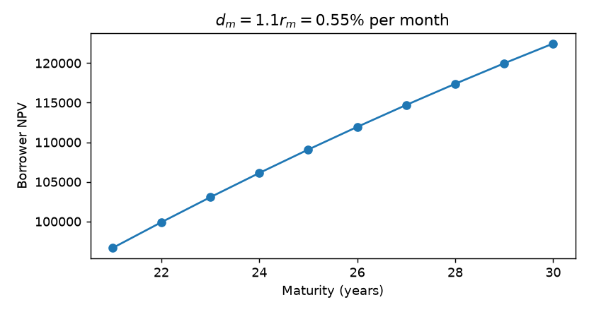

| 期限（年） | 月供 | 借款人 NPV | 总利息 |
|---|---|---|---|
| 21 | 13,977.14 | 96,632 | 1,522,239 |
| 25 | 12,886.03 | 109,081 | 1,865,808 |
| 30 | 11,991.01 | 122,470 | 2,316,764 |

- 在这些假设下，**期限越长 NPV 越高**：借款人的机会成本高于贷款利率，“便宜的钱”借得越久越好。
- 期限也改变了月供大小和总利息（30 年总利息比 21 年多近 80 万，但 NPV 反而更高：**总利息不是正确的决策指标，NPV 才是**）。
- 反过来，如果 $d_m<r_m$（比如你没有好的投资机会），NPV 为负且期限越长越负，应该尽量短借或提前还款。
- 保存的练习：`demo/mor_demo2.py`。

### 2.6 期限结构：不同期限的即期利率

前面的房贷假设了**一个**固定利率。现实中同一天不同期限的利率不同。

- 同一估值日，不同期限的**即期利率（spot rate）**可以不同。
- $k$ 年即期利率又叫 $k$ 年**零息收益率（zero-coupon yield）**，给 $k$ 年后的单笔支付定价。
- **每一笔有日期的支付用它自己的贴现因子**：

$$
PV=\sum_{j=1}^m C_j\,Z(t,T_j)=\sum_{j=1}^m\frac{C_j}{\left(1+r_n(t,T_j)/n\right)^{n(T_j-t)}}
=\sum_{j=1}^m C_j\,e^{-r(t,T_j)(T_j-t)}
$$

**贴现因子与即期利率的互换**（汇总）：

$$
Z(t,T)=\left(1+\frac{r_n(t,T)}{n}\right)^{-n(T-t)}=e^{-(T-t)r(t,T)}
$$

$$
r_n(t,T)=n\left[Z(t,T)^{-1/[n(T-t)]}-1\right],\qquad r(t,T)=-\frac{\log Z(t,T)}{T-t}
$$

- 这些公式是**同一个价格**在不同利率约定下的表达。
- 货币、期限、现金流假设必须一致。
- 贴现函数 = 支付 1 单位货币的贴现债券价格；即期利率 = 假想银行账户支付的利率。

**利率期限结构（term structure of interest rates）**：即期利率与期限的关系，也叫**收益率曲线（yield curve）**、即期利率曲线。

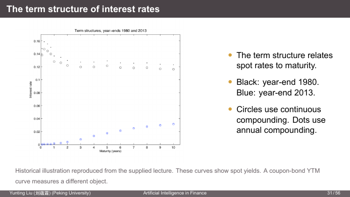

- 黑色：1980 年末，利率约 12–15%，**向下倾斜**（倒挂，inverted），短端最高。当时 Volcker 大幅加息抗通胀，市场预期未来利率会下降。
- 蓝色：2013 年末，短端接近 0，**向上倾斜**，10 年约 3%。这是金融危机后的零利率时期。
- 圆圈 = 连续复利，圆点 = 年复利。同一条曲线，年复利报价比连续复利**略高**（因为 $\text{EAR}=e^r-1>r$），利率越高差得越多（1980 年差距明显，2013 年几乎重合）。
- ⚠️ 这些是**即期收益率**曲线。附息债券的 YTM 曲线衡量的是另一个对象（见 2.8）。

### 2.7 附息债券定价

- **普通债券（straight bond / bullet bond）**定期付息，到期偿还面值 $F$。
- 年票面利率 $c$、每年付 $m$ 次 → 每次利息 $cF/m$。
- 剩余 $k$ 年、在付息日结算，未来支付日 $T_j=t+j/m$，$j=1,\dots,mk$。

$$
P=\sum_{j=1}^{mk}\frac{cF}{m}Z(t,T_j)+F\,Z(t,t+k)
$$

- **无套利定价就是把各笔支付的价值加起来。** 附息债券 = 一组零息债券的组合。零息债券价格是附息债券定价的“积木”（building blocks）。
- 在两个付息日之间结算时，结算时点和**应计利息（accrued interest）**也会影响价格（🔗 固收里的全价 = 净价 + 应计利息）。

用即期利率写（半年付息，半年复利报价）：

$$
P=\sum_{j=1}^{2k}\frac{cF/2}{\left(1+r_2(t,t+j/2)/2\right)^j}+\frac{F}{\left(1+r_2(t,t+k)/2\right)^{2k}}
$$

- 日期 $t+j/2$ 的利息用该期限的即期利率；面值用 $k$ 年即期利率。
- 用其他复利约定也行，一致换算后价格相同。旧版课件的话：“数学不在乎付息频率是否等于复利频率”。

⚠️ 旧版课件第 26 页公式的最后一项写成了 $F\left(1+\frac{r_2(t,t+0.5)}{2}\right)^{-2k}$，面值用了 **0.5 年**的即期利率，应为 $r_2(t,t+k)$。新版已改正。

### 2.8 到期收益率 YTM

**到期收益率（yield to maturity, YTM）**：用**一个**不变的贴现率贴现全部合约现金流，恰好得到债券价格。

$$
P=\sum_{j=1}^{2k}\frac{cF/2}{(1+y/2)^j}+\frac{F}{(1+y/2)^{2k}}
$$

- 这里 $y$ 是半年复利的名义年收益率。**YTM 的复利频率约定与付息频率相同。**
- 即期曲线对每个期限**分别**贴现；YTM 用**一个数**概括结果价格。
- 零息债券没有利息再投资的问题，所以它的收益率就是持有到期的年化回报。附息债券实现的复合回报还取决于**再投资利率**。

💡 **两年期债券例子**：美元债券，面值 \$100，年付息，票面利率 6%。连续复利一年、两年即期利率为 2% 和 2.5%。旧版说明这是一只 Eurobond（欧洲债券，年付息）。

第 1 步：先把连续复利即期利率变成贴现因子：

$$
Z(t,t+1)=e^{-0.02}=0.980199,\qquad Z(t,t+2)=e^{-2\times0.025}=0.951229
$$

第 2 步：价格

$$
P=6e^{-0.02}+106e^{-2(0.025)}=5.881+100.830=\mathbf{106.7115}
$$

第 3 步：年有效 YTM 解

$$
106.7115=\frac{6}{1+y}+\frac{106}{(1+y)^2}\quad\Longrightarrow\quad y=\mathbf{2.5170\%}
$$

📎 对照：两个即期利率换成年有效利率分别是 $e^{0.02}-1=2.020\%$、$e^{0.025}-1=2.532\%$。YTM 2.517% 非常接近 2 年期的 2.532%，因为绝大部分现金流（总额 112 中的 106）在第 2 年。这就是“YTM 近似是即期利率的加权平均”的直观含义。

💻 **求解 YTM**

```python
bond_price = 6 * math.exp(-0.02) + 106 * math.exp(-2 * 0.025)
print(f"Bond price: {bond_price:.6f}")           # 106.711511

def pricing_error(y):
    return 6 / (1 + y) + 106 / (1 + y)**2 - bond_price

assert pricing_error(0.0) * pricing_error(0.20) < 0
ytm = brentq(pricing_error, 0.0, 0.20, xtol=1e-13)
print(f"Annual effective YTM: {ytm:.4%}")        # 2.5170%
assert abs(pricing_error(ytm)) < 1e-9            # 代回去能还原价格
```

- 试错法（trial and error）找的是同一个根；有区间的求根器让过程**可重复**。
- 对常规的正现金流债券，**收益率越高价格越低**（单调），所以根唯一。
- 求解结果代回去应当能还原观测价格。

💻 **用 IRR 交叉验证**：YTM 就是债券现金流的**内部收益率（internal rate of return, IRR）**。

```python
import numpy_financial as npf
annual_irr = npf.irr([-bond_price, 6.0, 106.0])      # 第 0 期是负的买价
assert abs(annual_irr - ytm) < 1e-10

semiannual_cf = np.full(10, 4.0)                     # 5 年、半年付息、票面 8%：每期 4
semiannual_cf[-1] += 100.0                           # 最后一期加面值
half_year_irr = npf.irr(np.r_[-100.0, semiannual_cf])  # 平价买入
nominal_yield = 2 * half_year_irr                    # 半年复利名义收益率
effective_yield = (1 + half_year_irr)**2 - 1         # 年有效收益率
assert abs(nominal_yield - 0.08) < 1e-10
assert abs(effective_yield - 0.0816) < 1e-10
```

- ⚠️ **IRR 是按现金流期间算的**：半年一期的现金流，`irr` 返回的是**半年**利率 4%，名义年收益率要 ×2（8%），年有效收益率是 $1.04^2-1=8.16\%$。
- 要把**负的买价放在第 0 期**。
- `np.r_[a, b]` 把标量和数组拼接成一个数组。
- `numpy_financial` 是从 NumPy 拆出去的独立包（`pip install numpy-financial`），`np.irr` 已被移除。

**YTM 的解读：假想银行账户**（用债券自己的支付日程）
- 把债券价格存入一个按 YTM 计息、按付息频率复利的账户。
- 到期前每个付息日，取出等于利息的金额。
- 最后一次取款前，账户里恰好剩下最后一期利息加面值。
- **平价债券**（价格 = 面值，在付息日）：YTM = 年票面利率（频率约定匹配时）。原因：存入 $F$，第一期利息 $F\cdot c/n$ 恰好被取走，账户里还是 $F$，每期重复。上面半年付息 8% 平价债券的 IRR 验证了这一点。

YTM 把现金流和价格压缩成一个内部利率，**一般不等于**各个即期利率。

### 2.9 YTM 的局限：三只五年期债券

**YTM 比较的局限**
- YTM 既取决于市场价格，也取决于**现金流的形态**。
- 即期曲线不平时，同一到期日的债券会因为票面利率不同而有不同的 YTM（**票息效应，coupon effect**）。
- **YTM 高并不说明价值更好，也不说明实现的复合回报更高。**
- 再投资、违约、提前卖出、税、交易成本都会改变实现回报。
- YTM 有时可以近似为即期利率的加权平均，但权重取决于支付时间和贴现，而不只是现金流大小。

💡 **三只五年期债券**：面值 \$100，年付息，付息日相同。

| 债券 | 年票面利率 | 价格 | 年 YTM |
|---|---|---|---|
| A | 8% | 108.00 | 6.0959% |
| B | 6% | 100.25 | 5.9407% |
| C | 4% | 92.00 | 5.8937% |

问题：B 的收益率比 C 高，B 是更好的投资吗？

💻 求三只债券的 YTM：

```python
from interest_demo import bond_yield

bonds = [("A", 8.0, 108.0), ("B", 6.0, 100.25),
         ("C", 4.0, 92.0)]
yields = []
for name, coupon, price in bonds:        # 元组解包
    cashflows = np.full(5, coupon)
    cashflows[-1] += 100                 # 第 5 年：利息 + 面值
    y = bond_yield(price, cashflows)
    assert abs(pv_of_payments(cashflows, y) - price) < 1e-8   # 代回验证
    yields.append(y)
    print(f"{name}: price={price:.2f}, YTM={y:.4%}")
assert yields[0] > yields[1] > yields[2]
```

完整脚本 `demo/interest_demo.py` 还用 `numpy_financial.irr` 核对根，并把结果导出为 CSV。

**答案：看现金流，不看 YTM。**

| 头寸 | 今天成本 | 第 1–4 年每年 | 第 5 年 |
|---|---|---|---|
| 0.5 份 A | 54.00 | 4.00 | 54.00 |
| 0.5 份 C | 46.00 | 2.00 | 52.00 |
| **组合** | **100.00** | **6.00** | **106.00** |
| 1 份 B | 100.25 | 6.00 | 106.00 |

- 半份 A + 半份 C **完全复制**了 B 的现金流，但便宜 0.25。
- **套利**：买入复制组合、卖空 B → 今天收入 0.25，未来净现金流全部为零。
- 所以 B 相对 A、C 是**贵**的（被高估），尽管它的 YTM 比 C 高。
- 这个套利要求：信用和合约条款相同、日期匹配、可以无摩擦卖空。
- **只看 YTM 排序会漏掉现金流比较。**

📎 为什么 YTM 会“骗人”：A 的票息高，现金流更多集中在前几年，它的 YTM 更接近短期即期利率；C 相反，更接近 5 年期即期利率。如果短端利率高于长端（向下倾斜的曲线），高票息债券的 YTM 自然更高。这是**现金流形态**造成的，和便宜贵无关。比较相对价值，要用即期曲线（或复制）逐笔定价。

### 2.10 静态复制与卖空

- **复制（replication）**：用交易中的金融工具复制另一个工具的现金流，得到它的**合成（synthetic）**版本。
- **无套利**：如果真实工具存在，它的价格必须等于合成版本的价格，否则存在套利机会。
- **静态复制**：建好头寸后一直持有到各笔支付发生，中途不调整（区别于 BSM 的**动态**复制，需要不断调整 Delta）。

**买入与卖空**

| 头寸 | 今天 | 未来支付日 |
|---|---|---|
| 买入债券 | 支付债券价格 | 收到约定现金流 |
| 卖空债券 | 收到债券价格 | 支付对应现金流 |

- 买债券 ≈ **借出**钱（lending）；卖空债券 ≈ **借入**钱（borrowing）。
- 合成工具 = 组合交易头寸来再现另一个工具的现金流。
- 实际卖空还涉及借券安排、保证金、费用；下面的例子用无摩擦模型。

💡 **从债券价格反推贴现因子（bootstrapping 的雏形）**：一年期零息债券到期付 \$110，价格 \$108；两年期附息债券一年后付 \$5，两年后付 \$105，价格 \$106。求 $Z(t,t+2)$。

第 1 步：零息债券直接给出一年期贴现因子

$$
Z(t,t+1)=\frac{108}{110}=0.981818
$$

第 2 步：附息债券 = 5 × 一年期零息 + 105 × 两年期零息，无套利要求

$$
106=5Z(t,t+1)+105Z(t,t+2)
\quad\Longrightarrow\quad
Z(t,t+2)=\frac{106-5(108/110)}{105}=\mathbf{0.962771}
$$

复制的直观理解：**买入附息债券，卖空 5/110 份一年期零息债券**。一年后收到的 5 恰好用来偿还卖空（5/110 × 110 = 5），只剩下第 2 年的 105。这个组合的成本是 $106-\frac{5}{110}\times108=101.09$，所以两年后 1 元的价格是 $101.09/105=0.962771$。

📎 换成利率：一年期 EAR $=110/108-1=1.852\%$；两年期 EAR $=0.962771^{-1/2}-1=1.915\%$。

🔗 这就是固收里 **bootstrapping（息票剥离法）** 从一串附息债券逐期推出零息曲线的方法：每多一个期限，就多一个方程、多解出一个 $Z$。

### 2.11 远期利率与远期合约

- **即期利率**：锁定**从今天开始**的借贷。
- **远期利率（forward rate）**：今天锁定**未来某日开始**的借贷条件，$t<T_1<T_2$，远期借贷区间 $[T_1,T_2]$。
- 即期贴现因子通过无套利复制**决定**远期利率（反过来也成立）。
- ⚠️ **远期利率是在模型下可以锁定的利率，它本身不是对未来即期利率的预测。**（📎 在预期假说下它等于预期的未来即期利率；但有期限溢价时不等。🔗 金工概：远期价格 $F_0=S_0e^{rT}$ 同样是由无套利决定的，而不是由预期决定的。）

💡 **远期利率例子**：今天一年期、两年期即期 EAR 为 10% 和 12%。

$$
100\text{ 投资一年}=100(1.10)=110,\qquad 100\text{ 投资两年}=100(1.12)^2=125.44
$$

设 $f$ 为第 1–2 年的一年期远期 EAR。“先投一年再按 $f$ 滚一年”必须等于“直接投两年”：

$$
1.10(1+f)=1.12^2\quad\Longrightarrow\quad f=\frac{1.12^2}{1.10}-1=\mathbf{14.0364\%}
$$

未来的借贷利率今天就约定好。比较的是**初始成本和最终支付日都相同**的两种投资。

**构造合成远期贷款**：今天借入 $100/1.10$ 一年，同时把同样金额借出两年。

| 头寸 | 今天 | 第 1 年 | 第 2 年 |
|---|---|---|---|
| 一年期借入 | +90.9091 | −100.0000 | 0 |
| 两年期借出 | −90.9091 | 0 | +114.0364 |
| **净现金流** | **0** | **−100.0000** | **+114.0364** |

（$90.9091\times1.12^2=114.0364$）

- 净头寸：第 1 年借出 100，第 2 年收回 114.0364，即锁定了 14.0364% 的**远期借出**利率。今天零成本。
- 两个头寸都反过来，就是同一利率的**远期借入**。
- 如果市场上有人报的远期利率不是 14.0364%，就能用这个合成头寸对做套利。

**连续复利下的无套利**：从 $t$ 到 $T_2$ 投资 1 单位的两种方式：
1. 直接按即期利率 $r(t,T_2)$ 投到 $T_2$；
2. 按 $r(t,T_1)$ 投到 $T_1$，并**今天**锁定 $[T_1,T_2]$ 的远期再投资利率 $f(t,T_1,T_2)$。

两个都是确定的终值，必须相等：

$$
e^{(T_2-t)r(t,T_2)}=e^{(T_1-t)r(t,T_1)}\,e^{(T_2-T_1)f(t,T_1,T_2)}
$$

取对数：

$$
(T_2-t)r(t,T_2)=(T_1-t)r(t,T_1)+(T_2-T_1)f(t,T_1,T_2)
$$

$$
\boxed{f(t,T_1,T_2)=\frac{(T_2-t)r(t,T_2)-(T_1-t)r(t,T_1)}{T_2-T_1}=\frac{\log Z(t,T_1)-\log Z(t,T_2)}{T_2-T_1}}
$$

- 等式里即期和远期利率都用**连续复利、同一时间单位（年）**。
- 直观：$(T-t)r(t,T)$ 是“累计对数回报”，远期利率就是累计回报在 $[T_1,T_2]$ 上的**增量除以时间**。长期即期利率 ≈ 期间内远期利率的平均。

**零息债券的远期合约**：在 $t$ 约定价格 $F(t,T_1,T_2)$，在 $T_1$ 交割一张 $T_2$ 支付 1 单位的债券。
- 远期买方在 $T_1$ 支付 $F(t,T_1,T_2)$ 并收到债券；债券在 $T_2$ 支付 1。这是**远期借出**头寸。
- 反方向（约定在 $T_1$ 卖出债券）就是**远期借入**（卖债券 = 借钱）。
- 新签的、定价公允、无预付款的远期，**签订时市场价值为零**。
- 公允远期价格使两笔未来支付的现值相等。签订后远期的价值会随利率变化。

**复制远期合约**：
1. 买 1 份 $T_2$ 零息债券，花 $Z(t,T_2)$。
2. 卖空 $q=Z(t,T_2)/Z(t,T_1)$ 份 $T_1$ 零息债券，所得 $q\,Z(t,T_1)=Z(t,T_2)$ 恰好支付第 1 步。
3. 在 $T_1$ 支付 $q$ 平掉空头，在 $T_2$ 收到 1。

初始成本为零，所以公允的**远期贴现因子**是

$$
\boxed{F(t,T_1,T_2)=\frac{Z(t,T_2)}{Z(t,T_1)}}
$$

对应的利率报价：名义远期利率 $f_n$：$F=(1+f_n/n)^{-n(T_2-T_1)}$；连续复利 $f$：$F=e^{-f(T_2-T_1)}$。

🔗 金工概的远期价格 $F_0=S_0e^{rT}$ 是同一个逻辑：这里“标的”是 $T_2$ 零息债券，现价 $S_0=Z(t,T_2)$，持有到 $T_1$ 的“融资成本”是 $1/Z(t,T_1)$，所以 $F=Z(t,T_2)/Z(t,T_1)$。

💡 **玩具例子**：连续复利一、二、三年即期利率为 4%、6%、8%。

| 远期区间 | 计算 | 连续复利年利率 |
|---|---|---|
| 第 0–1 年 | $1(4\%)/1$ | 4% |
| 第 1–2 年 | $[2(6\%)-1(4\%)]/1$ | **8%** |
| 第 2–3 年 | $[3(8\%)-2(6\%)]/1$ | **12%** |
| 第 0–2 年 | $2(6\%)/2$ | 6% |
| 第 1–3 年 | $[3(8\%)-1(4\%)]/2$ | **10%** |

- 从第 0 年开始的区间就是即期投资；其余在未来开始。
- 一年期远期：第 1–2 年 8%、第 2–3 年 12%；两年期远期：第 1–3 年 10%。
- 第 1–3 年远期利率的 EAR 为 $e^{0.10}-1=10.5171\%$。
- 验证“即期 ≈ 远期的平均”：3 年即期 8% = (4% + 8% + 12%)/3 ✓。上升的即期曲线意味着远期曲线在即期曲线**上方**、上升得更快。

💻 **远期利率的 Python 实现**

```python
maturities = np.array([0.0, 1.0, 2.0, 3.0])
spot_cc = np.array([0.0, 0.04, 0.06, 0.08])          # 期限 0 处放 0，使 Z(0)=1
Z = np.exp(-maturities * spot_cc)                    # [1, 0.9608, 0.8869, 0.7866]
forward_cc = -np.diff(np.log(Z)) / np.diff(maturities)   # 相邻期限的远期利率
assert np.allclose(forward_cc, [0.04, 0.08, 0.12])

forward_1_to_3 = math.log(Z[1] / Z[3]) / 2           # 10%
forward_discount = Z[3] / Z[1]                       # F(0,1,3) = 0.818731 = e^{-0.2}
assert math.isclose(forward_1_to_3, 0.10)
assert math.isclose(forward_discount,
                    math.exp(-2 * forward_1_to_3))
assert math.isclose(-forward_discount * Z[1] + Z[3], 0,
                    abs_tol=1e-12)                   # 远期合约初始价值为 0
```

- `np.diff(x)` 返回相邻元素之差 `x[1:] - x[:-1]`，正好对应“累计对数回报的增量 / 时间增量”。
- 最后一个检查：第 1 年支付远期价格（现值 $-F\cdot Z(0,1)$）、第 3 年收到 1（现值 $Z(0,3)$），总现值为零。
- ⚠️ `math.isclose(x, 0)` 必须给 `abs_tol`：默认只有相对容差，和 0 比时相对容差没有意义，会永远返回 False（除非恰好等于 0）。

### 2.12 Python 输出与文件读写

旧版课件这里讲 MATLAB 的 `sprintf`/`fprintf`，新版换成 Python 的等价物。

💻 **格式化文本与控制台输出**

```python
message = f"Price = {bond_price:.2f}; YTM = {ytm:.4%}"
print(message)                    # Price = 106.71; YTM = 2.5170%

heading = f"{'Bond':<8}{'Price':>12}{'YTM':>12}"
row = f"{'Example':<8}{bond_price:>12.2f}{ytm:>12.4%}"
print(heading)
print(row)
```

- f-string 生成一个 Python 字符串；`print` 在控制台显示它。
- `.2f`：两位小数；`.4%`：把小数显示为百分数（×100，四位小数）。
- `<8` / `>12`：固定宽度字段内左对齐 / 右对齐，用来排出整齐的表格。

| 格式说明 | 输入 | 输出 |
|---|---|---|
| `{x:.2f}` | 106.711511 | `106.71` |
| `{x:,.2f}` | 12886.028 | `12,886.03` |
| `{x:.4%}` | 0.025170 | `2.5170%` |
| `{s:<8}` | `'Bond'` | `'Bond    '` |
| `{x:>12.2f}` | 106.71 | `'      106.71'` |
| `{n:4d}` | 12 | `'  12'` |

💻 **写文本和 CSV 文件**

```python
from pathlib import Path
import csv

Path("bond_result.txt").write_text(message + "\n", encoding="utf-8")
with open("bond_result.csv", "w", newline="", encoding="utf-8") as f:
    writer = csv.writer(f)
    writer.writerow(["bond", "price", "annual_effective_ytm"])
    writer.writerow(["Example", bond_price, ytm])
saved = Path("bond_result.txt").read_text(encoding="utf-8")
assert saved.strip() == message               # 读回来验证
```

- 文本文件存格式化的句子；**CSV 文件保留独立的数据列**。
- 🛠️ **利率存成小数，并在列名里写明约定**（`annual_effective_ytm`，而不是 `ytm` 或 `ytm_%`）。这样别人读数据时不会搞错是百分数还是小数、是 EAR 还是 APR。
- `with` 块在写完后自动关闭文件（即使中途出错）。模式 `"w"` 会**覆盖**已有文件。
- `newline=""` 是 `csv` 模块的要求，否则在 Windows 上每行之间会多出空行。
- 统一写 `encoding="utf-8"`，避免不同系统默认编码不同（比如中文 Windows 默认 GBK）。

**课堂文件**：在 `slides2` 目录、激活 Python 环境后：

```bash
python -m pip install -r requirements.txt
python demo/mdiscount.py          # 对一组未来支付贴现
python demo/mor_demo.py           # 房贷月供和摊还表、画图
python demo/mor_demo2.py          # 期限比较
python demo/interest_demo.py      # 求根 vs IRR，导出收益率表
```

- 输出在 `demo/output/`。要单独运行幻灯片里的代码片段，在 `demo/` 下启动 Python **按顺序**运行（后面的片段依赖前面定义的 `P`、`rm`、`C`、`bond_price` 等变量）。

### 第 2 讲小结

```
贴现函数 Z(t,T) ─── 一切定价的基础（1 单位 T 时货币的今日价格）
   │
   ├── 报价方式：EAR / APR(n) / 连续复利 r ── 同一个 Z，不同数字；绝不直接用 APR 贴现
   │
   ├── 定价确定现金流：PV = Σ C_j · Z(t,T_j)
   │      ├── 房贷：P = C·[1−(1+r_m)^−N]/r_m；摊还表递推；NPV 决策看机会成本 vs 贷款利率
   │      └── 附息债券 = 零息债券组合
   │
   ├── YTM：一个数概括价格 ── 平价债券 YTM = 票面利率；但 YTM 高 ≠ 便宜（票息效应）
   │
   └── 无套利
          ├── 静态复制：A/2 + C/2 复制 B → 套利；从债券价格反推 Z（bootstrapping）
          └── 远期：F(t,T1,T2) = Z(t,T2)/Z(t,T1)；f = Δ[(T−t)r] / ΔT；远期 ≠ 预测
```

编程要点：`**` 求幂；`math.isclose` 比较浮点数（和 0 比要 `abs_tol`）；`log1p`/`expm1` 保精度；`brentq` 求根前检查异号；`npf.irr` 按期返回；向量化 `cf @ discount`；`np.diff`；f-string 格式；CSV 列名写清约定。**每个结果都用独立方法验证。**

<details>
<summary>✅ 自测题</summary>

1. $Z(t,t+3)=0.85$。求三年期的 EAR、半年复利名义利率、连续复利利率。
   → EAR $=0.85^{-1/3}-1=5.567\%$；$r_2=2(0.85^{-1/6}-1)=5.492\%$；$r=-\ln0.85/3=5.417\%$。三者依次递减。
2. 银行报“年利率 12%，按月复利”，EAR 是多少？
   → $1.01^{12}-1=12.68\%$。
3. 100 万、年利率 4.8%（月复利）、10 年期等额本息房贷，月供多少？
   → $r_m=0.4\%$，$N=120$，$C=10^6\times0.004/(1-1.004^{-120})\approx10{,}509.06$。
4. 为什么 YTM 更高的债券不一定更值得买？请用本讲例子说明。
   → B 的 YTM 高于 C，但 0.5A + 0.5C 以 100 复制 B（价格 100.25），B 被高估。YTM 差异来自现金流形态（票息效应）。
5. 连续复利即期利率 1 年 3%、2 年 3.5%，求 1–2 年远期利率和远期贴现因子。
   → $f=2(3.5\%)-3\% = 4\%$；$F=e^{-0.04}=0.9608$（也等于 $e^{-0.07}/e^{-0.03}$）。
6. `npf.irr([-100] + [3]*9 + [103])` 返回 0.03，这只债券的名义年收益率是多少？（半年付息）
   → IRR 是半年利率，名义年收益率 6%，年有效收益率 $1.03^2-1=6.09\%$。

</details>

---

## 第 3 讲 利率动态与风险管理：主成分分析

> **本讲地图**：第 2 讲给定**一天**的收益率曲线做定价；本讲看曲线**随时间怎么变**。
>
> 问题：收益率曲线上有很多个利率（这里 12 个期限），每个都在变。风险管理时要对冲 12 个风险源吗？
> 答案：不需要。这 12 个利率**高度相关**，用**主成分分析（principal component analysis, PCA）**可以找出 3 个因子——**水平（level）、斜率（slope）、曲率（curvature）**——解释 99.9% 的利率水平变动和约 97% 的月度变化。
>
> 路线：读取 1961–2014 年美国国债即期利率 → 描述统计（均值、波动、相关性）→ PCA 的构造（最大化方差 → 特征值问题）→ 解释方差 → 回归回到利率 → 经济解释 → 应用：蝶式交易。
>
> 🔗 **机器学习概论**：PCA 是最经典的无监督降维方法，这里是它在金融中的第一个应用。🔗 **固定收益**：久期对冲只对冲“平行移动”，也就是只对冲 PC1；PCA 告诉我们这样做还剩多少风险。🔗 syllabus：PCA 也用于股票收益截面（寻找共同驱动力），为 Block 2–3 的多因子模型做铺垫。

### 3.1 数据：美国国债即期利率 1961–2014

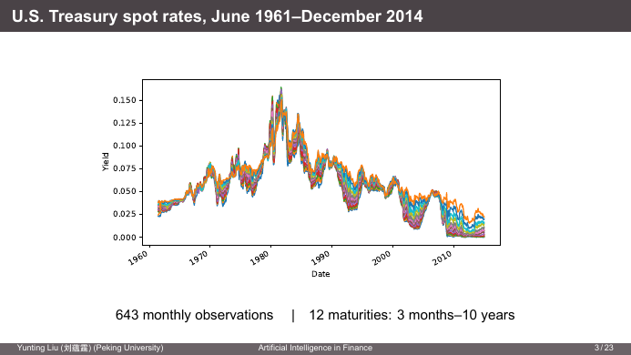

- **643 个月度观测**（1961 年 6 月–2014 年 12 月），**12 个期限**（3 个月–10 年）。
- 利率以小数存储（0.15 = 15%），连续复利（cc）即期利率。
- 形状：1960 年代约 3–5% → 1981 年前后峰值约 15%（Volcker 抗通胀）→ 之后 30 年持续下行 → 2009 年后短端接近 0。所有期限的曲线**一起**起落。

💻 **读取利率和日期**

```python
import numpy as np
import pandas as pd

path = "demo/USTreasSpotRates.xlsx"
data = pd.read_excel(path, header=3)         # 前 3 行是说明，第 4 行（索引 3）是表头
ymd = data[["Year", "Month", "Day"]]
dates = pd.to_datetime(ymd.rename(
    columns=str.lower))                      # 列名改成 year/month/day 小写才能被 to_datetime 识别
rates = data.iloc[:, 3:].to_numpy(float)     # 第 4 列起是 12 个期限的利率 → 643×12 的 ndarray
```

- `header=3`：Excel 文件前几行是标题/说明，指定第 4 行为列名。
- `pd.to_datetime` 接受一个含 `year`、`month`、`day` 列的 DataFrame，拼出日期。`rename(columns=str.lower)` 把每个列名传给 `str.lower` 函数。
- `iloc[:, 3:]` 按**位置**切片：所有行、第 3 列以后。`.to_numpy(float)` 转成浮点 NumPy 数组，后面做矩阵运算。
- 课件提示：用 `dates.dt.month` 取日历特征；用 `pd.date_range(..., freq="ME")` 生成月末日期网格（`"ME"` = month end，pandas 2.2 起取代 `"M"`）。

### 3.2 描述统计：均值、波动、相关性

**平均收益率随期限上升，波动率随期限下降**

| 期限（月） | 平均利率（%） | 标准差（百分点） |
|---|---|---|
| 3 | 5.00 | 3.18 |
| 6 | 5.18 | 3.22 |
| 9 | 5.28 | 3.24 |
| 12 | 5.36 | 3.20 |
| 18 | 5.47 | 3.20 |
| 24 | 5.56 | 3.14 |
| 30 | 5.66 | 3.09 |
| 36 | 5.76 | 3.06 |
| 48 | 5.92 | 2.98 |
| 60 | 6.04 | 2.90 |
| 84 | 6.24 | 2.77 |
| 120 | 6.41 | 2.60 |

- 平均利率：3 个月 5.00%，10 年 6.41%。平均收益率曲线**向上倾斜**，约 140bp（📎 通常解释为**期限溢价**：持有长期债券承担更多利率风险，要求补偿）。
- 标准差：3 个月 3.18pp，10 年 2.60pp。短端利率更“跳”（它直接受央行政策影响），长端更平滑（它是未来短期利率的某种平均，平均会抹平波动）。

**月度变化**

- 月度利率变化围绕 0 波动；在市场压力时期（如 1979–1982 年美联储改变货币政策操作方式时）各期限一起剧烈摆动，幅度可达 ±3–5 个百分点。

**利率高度联动，水平值尤其如此**：与 3 个月收益率的相关系数

| 期限（月） | 3 | 6 | 9 | 12 | 18 | 24 | 30 | 36 | 48 | 60 | 84 | 120 |
|---|---|---|---|---|---|---|---|---|---|---|---|---|
| 水平值 | 1.00 | 1.00 | 1.00 | 0.99 | 0.98 | 0.98 | 0.97 | 0.96 | 0.95 | 0.94 | 0.92 | 0.90 |
| 月度变化 | 1.00 | 0.95 | 0.89 | 0.85 | 0.79 | 0.77 | 0.74 | 0.69 | 0.63 | 0.63 | 0.51 | 0.48 |

- 3 个月和 10 年收益率的相关系数：水平值 **0.90**，月度变化只有 **0.48**。
- 收益率水平共享一个强烈的共同趋势；逐月的变动在不同期限之间差异更大。

⚠️ 为什么水平值的相关性这么高：水平值有**长期趋势**（1960–80 年代上升，之后下降）。两个都有趋势的序列，即使短期变动关系不强，水平值的相关性也会很高（🔗 计量里“伪回归”的同一类问题）。**风险管理关心的是变化**：明天的损益取决于利率变多少，而不是利率在哪。所以后面看到的“月度变化的 PCA”才是对冲时更相关的数字。

### 3.3 PCA 的动机与构造

**动机**
- 高相关意味着即期利率背后有**共同因子**：数据在“呼唤”因子（crying for factors）。
- PCA 从历史收益率中找出“最好”的因子，“最好”指：
  1. 因子能“解释”各期限收益率变动中**尽可能大的比例**；
  2. 因子之间**相互独立**（⚠️ 严格说是**不相关**；只有在联合正态时不相关才等于独立）。
- PCA 也广泛用于：股票收益的截面（寻找共同驱动力）、降维（在低维空间中传递最多信息）、机器学习等。

**用线性组合构造共同因子**

- $t$ 时观测到 $d$ 个即期利率，排成**行向量**：

$$
Y_t\equiv(y_{1,t},\,y_{2,t},\,\dots,\,y_{d,t})
$$

- 用即期利率的线性组合构造 $d$ 个共同因子：

$$
P_t=Y_tB,\qquad B=(\beta_1,\beta_2,\dots,\beta_d)
$$

  - $P_t$ 是 $1\times d$ 向量；
  - 每个 $\beta_k$（$k=1,\dots,d$）是 $d\times1$ 列向量，是第 $k$ 个因子的**载荷（loading）**。
- 把所有观测堆起来：$T\times d$ 矩阵 $Y\equiv[Y_1;Y_2;\dots;Y_T]$，$P\equiv[P_1;\dots;P_T]$ 也是 $T\times d$：

$$
P=YB
$$

本数据：$T=643$，$d=12$。

**$B$ 的下标约定**（课件特别强调）：

$$
B=\begin{pmatrix}
\beta_{11}&\beta_{21}&\cdots&\beta_{d1}\\
\beta_{12}&\beta_{22}&\cdots&\beta_{d2}\\
\vdots&\vdots&\ddots&\vdots\\
\beta_{1d}&\beta_{2d}&\cdots&\beta_{dd}
\end{pmatrix}
$$

- **第 $k$ 列**是因子 $k$ 的载荷向量 $\beta_k$。
- **第 $i$ 行**汇集了期限 $i$ 在各因子上的载荷。
- ⚠️ 注意 $\beta_{ki}$ 的下标：**第一个下标是因子，第二个是期限**，和通常矩阵“行、列”的下标顺序相反（$\beta_{ki}$ 在 $B$ 的第 $i$ 行第 $k$ 列）。

💡 第一个因子：$P_{1,t}=Y_t\beta_1=\beta_{11}y_{1,t}+\beta_{12}y_{2,t}+\dots+\beta_{1d}y_{d,t}$，就是 12 个利率的加权和。如果 $\beta_1$ 的 12 个权重都差不多（比如都约 0.29），$P_{1,t}$ 就约等于“所有利率的平均水平”，也就是水平因子。

### 3.4 PCA 的数学：特征值问题

**协方差矩阵** $M$（$Y_t$ 的协方差矩阵）：
- $d\times d$ 方阵；
- 第 $(i,j)$ 个元素是 $y_i$ 与 $y_j$ 的协方差；
- 因此**对称**，并且**半正定**（任何线性组合的方差 $\beta'M\beta\ge0$）。

**特征值与特征向量**：

$$
\underbrace{M}_{d\times d}\ \underbrace{\beta}_{d\text{ 维向量}}=\underbrace{\lambda}_{\text{标量}}\ \underbrace{\beta}_{d\text{ 维向量}}
$$

对任何协方差矩阵：有 $d$ 个**实数、非负**的特征值 $\lambda_1\ge\lambda_2\ge\dots\ge\lambda_d$，对应的归一化特征向量 $\beta_1,\dots,\beta_d$ **两两正交**。（📎 这是实对称矩阵的**谱定理**：$M=B\Lambda B'$，$B$ 为正交矩阵。为什么成立、和 SVD 的关系，见[附录 E](#附录-e-线性代数补充特征值对称矩阵pca-与-svd)。）

**第一主成分的推导**

- **归一化**：让每个因子的载荷平方和为 1：$\beta_{k1}^2+\beta_{k2}^2+\dots+\beta_{kd}^2=1$，即 $\beta_k'\beta_k=1$。
  - 为什么需要：否则把 $\beta$ 乘以 10，方差就变成 100 倍，最大化问题没有解。
- **目标**：选择 $\beta_1$ 使 $Y_t\beta_1$ 的方差最大：

$$
\max_{\beta_1}\ \mathrm{Var}(Y_t\beta_1)=\beta_1'M\beta_1\qquad\text{s.t.}\quad\beta_1'\beta_1=1
$$

  （$\mathrm{Var}(Y_t\beta)=\beta'\mathrm{Var}(Y_t')\beta=\beta'M\beta$，线性组合的方差公式。）
- **拉格朗日函数**：

$$
\mathcal L=\beta_1'M\beta_1-\lambda_1(\beta_1'\beta_1-1)
$$

- **一阶条件**：$\partial\mathcal L/\partial\beta_1=2M\beta_1-2\lambda_1\beta_1=0$（用到 $M$ 对称时 $\partial(\beta'M\beta)/\partial\beta=2M\beta$），即

$$
M\beta_1=\lambda_1\beta_1
$$

  **一阶条件就是特征值方程！** 拉格朗日乘子 $\lambda_1$ 就是特征值。
- 代回目标函数：$\beta_1'M\beta_1=\beta_1'(\lambda_1\beta_1)=\lambda_1\beta_1'\beta_1=\lambda_1$。所以

$$
\max\ \lambda_1\beta_1'\beta_1=\max\ \lambda_1
$$

  **因子方差就等于特征值**；要方差最大，就选**最大的特征值**。
- 结论：最大特征值 $\lambda_1$ 对应的归一化特征向量 $\beta_1$，称为**第一主成分的载荷**。

**第 $k$ 个主成分**：在已有前 $k-1$ 个主成分的条件下，

$$
\max_{\beta_k}\ \mathrm{Var}(Y_t\beta_k)=\beta_k'M\beta_k\qquad\text{s.t.}\quad\beta_k'\beta_k=1,\ \ \beta_k\perp\beta_1,\dots,\beta_{k-1}
$$

解是第 $k$ 大特征值对应的特征向量。

📎 为什么正交约束会让因子不相关：$\mathrm{Cov}(Y_t\beta_j,Y_t\beta_k)=\beta_j'M\beta_k=\lambda_k\beta_j'\beta_k=0$。写成矩阵：$\mathrm{Var}(P_t)=B'MB=\Lambda$（对角矩阵），所以各因子的方差就是 $\lambda_1,\dots,\lambda_d$，协方差全为 0。

### 3.5 解释方差与因子个数

- 特征值 $\lambda_1\ge\dots\ge\lambda_d$ 在 MATLAB 的 `pca` 中叫 `latent`；在 Python 中就是协方差矩阵的特征值。
- 第 $k$ 个因子的**解释方差比例**：

$$
\frac{\lambda_k}{\lambda_1+\lambda_2+\dots+\lambda_d}
$$

  分母 $\sum\lambda_k=\mathrm{tr}(M)=\sum_i\mathrm{Var}(y_i)$，就是 12 个利率方差之和（总方差）。
- PCA 从数据协方差矩阵中提取共同成分；前几个主成分自然成为因子候选。选择 $K<d$ 个因子，使解释方差超过比如 85%。

💻 **三行代码做 PCA**

```python
M = np.cov(rates, rowvar=False)          # 12×12 协方差矩阵；rowvar=False：每列是一个变量
e = np.linalg.eigvalsh(M)[::-1]          # 对称矩阵的特征值（升序）→ 反转成降序
share = 100 * e / e.sum()                # 各主成分的解释方差比例（%）
```

| PC | 比例 | 累计 |
|---|---|---|
| 1 | 97.97% | 97.97% |
| 2 | 1.80% | 99.77% |
| 3 | 0.15% | 99.92% |
| 4 | 0.04% | 99.96% |

**前三个主成分解释了收益率水平 99.92% 的变动。**

- ⚠️ `np.cov` 默认把**每行**当成一个变量（`rowvar=True`）。我们的数据是 643 行 × 12 列、每列是一个期限，必须写 `rowvar=False`，否则会得到 643×643 的矩阵。
- ⚠️ `eigvalsh`/`eigh` 专门用于对称（Hermitian，名字里的 `h`）矩阵，保证返回实数，并且按**升序**排列，所以要 `[::-1]` 反转。通用的 `np.linalg.eig` 不保证顺序，还可能返回带极小虚部的复数。
- 要拿到载荷（特征向量），用 `e, B = np.linalg.eigh(M)`，再 `e, B = e[::-1], B[:, ::-1]`（列也要一起反转）。

💻📎 **完整流程**（课件只给了前三行，以下是得到载荷、因子和回归系数的补全版）：

```python
Yc = rates - rates.mean(axis=0)          # 去均值（PCA 关心的是围绕均值的变动）
M = np.cov(rates, rowvar=False)
e, B = np.linalg.eigh(M)
e, B = e[::-1], B[:, ::-1]               # 降序
B = B * np.sign(B.sum(axis=0))           # 符号标准化（见下面的 ⚠️）
P = Yc @ B                               # 643×12 的主成分时间序列
assert np.allclose(P.var(axis=0, ddof=1), e)   # 因子方差 = 特征值
assert np.allclose(B.T @ B, np.eye(12))        # 载荷正交归一

# 用 scikit-learn 得到同样的结果
from sklearn.decomposition import PCA
pca = PCA().fit(rates)                   # 自动去均值
# pca.components_ 是 B'（每行一个主成分），pca.explained_variance_ 是 e
# pca.explained_variance_ratio_ 是 share / 100
```

⚠️ **特征向量的符号是任意的**：如果 $\beta$ 是特征向量，$-\beta$ 也是（$M(-\beta)=\lambda(-\beta)$）。不同软件、不同版本可能返回相反的符号。所以“PC2 为正时曲线变陡还是变平”取决于符号约定，解读前要先看载荷图。

💡📎 **玩具例子：手算一遍 PCA**。3 个期限（1 年、5 年、10 年），6 个月的收益率（%）：

| 月 | 1 年 | 5 年 | 10 年 |
|---|---|---|---|
| 1 | 2.0 | 3.0 | 3.5 |
| 2 | 2.5 | 3.4 | 3.8 |
| 3 | 3.0 | 3.7 | 4.0 |
| 4 | 2.8 | 3.6 | 4.0 |
| 5 | 3.5 | 4.0 | 4.2 |
| 6 | 4.0 | 4.3 | 4.4 |

协方差矩阵（%²）：

$$
M=\begin{pmatrix}0.5067&0.3227&0.2193\\0.3227&0.2067&0.1413\\0.2193&0.1413&0.0977\end{pmatrix}
$$

特征值 $\lambda=(0.8083,\ 0.0026,\ 0.0001)$，解释比例 99.67%、0.32%、0.01%。载荷矩阵（列 = PC1、PC2、PC3）：

$$
B=\begin{pmatrix}0.791&-0.536&-0.296\\0.505&0.300&0.809\\0.345&0.789&-0.508\end{pmatrix}
$$

解读：
- **PC1**：三个载荷同号（都为正），所有利率同涨同跌 → 水平。但权重 0.79 > 0.51 > 0.34，短端最大，因为这组数据里 1 年期利率的波动最大（方差 0.51 vs 0.10）。**PCA 基于协方差，波动大的变量权重大。**（真实数据里 12 个期限波动差不多，所以 PC1 载荷接近平的。）
- **PC2**：短端负、长端正 → 斜率（这个符号下，PC2 上升使曲线变陡）。
- **PC3**：两端负、中间正 → 曲率。
- 验证：`P.var(ddof=1)` = (0.8083, 0.0026, 0.0001)，正好等于特征值 ✓。
- 第 1 个月的 PC1 得分 $=0.791(2.0-2.97)+0.505(3.0-3.67)+0.345(3.5-3.98)=-1.268$：整条曲线处于样本的低位。

### 3.6 从因子回到利率：回归与 G = B'

**从因子到即期利率的关系**：用回归看 $K$ 个因子如何决定每个期限的利率：

$$
y_{i,t}=\text{常数}+P_t(\gamma_{i1},\gamma_{i2},\dots,\gamma_{iK})'+e_{i,t},\qquad i=1,\dots,d
$$

- 这里 $P_t$ 取前 $K$ 个主成分。
- $e_{i,t}$ 与 $P_t$ 正交；否则残差里还有共同成分。
- PCA 是**因子分析**的一个例子；也有其他统计方法提取因子（📎 例如最大似然因子分析、Nelson–Siegel 参数化曲线）。

**$\gamma$ 与 $\beta$ 是什么关系？为什么？**

- 用**全部** $d$ 个因子回归原序列（矩阵形式）：

$$
Y=PG,\qquad \gamma_i=(\gamma_{i1},\dots,\gamma_{id})',\qquad G=(\gamma_1,\gamma_2,\dots,\gamma_d)
$$

- 因子满足 $P=YB$，而 $B$ 是正交矩阵，所以

$$
\boxed{G=B'}
$$

**推导**（两种方式）：

1. **直接求逆**：$P=YB$ 两边右乘 $B'$：$PB'=YBB'=Y$（$B$ 是正交方阵，$BB'=B'B=I$）。所以 $Y=PB'$，即 $G=B'$。
   - ⚠️ 课件写“using the property $B'B=I$”，严格说这一步用的是 $BB'=I$。对正交**方阵**两者等价（$B'B=I\Rightarrow B'=B^{-1}\Rightarrow BB'=I$），所以结论没问题。
2. **回归系数公式**（设数据已去均值，$Y'Y=(T-1)M$）：

$$
(P'P)^{-1}(P'Y)=(B'Y'YB)^{-1}B'Y'Y=(B'MB)^{-1}B'M=\Lambda^{-1}B'(B\Lambda B')=\Lambda^{-1}\Lambda B'=B'
$$

   （$(T-1)$ 在两边约掉；用到 $M=B\Lambda B'$ 和 $B'B=I$。）

**含义**：第 $i$ 个期限在因子 $k$ 上的回归系数 $\gamma_{ik}$ = $G$ 的第 $k$ 行第 $i$ 列 = $B'$ 的 $(k,i)$ 元素 = $\beta_{ki}$。**回归系数就是载荷。** 也就是说：

$$
y_{i,t}-\bar y_i=\sum_{k=1}^d\beta_{ki}P_{k,t}
$$

利率可以由因子**精确**还原；只取前 $K$ 个时，剩下的就是残差 $e_{i,t}=\sum_{k>K}\beta_{ki}P_{k,t}$。

📎 只用前 $K$ 个因子回归时，系数仍然等于载荷。因为被省略的因子与保留的因子**不相关**，不会造成遗漏变量偏误。这就是为什么课件第 17 页（载荷）和第 19 页（回归系数）的两张图**一模一样**。

💡 玩具例子验证：用上面的 $P$ 对去均值的 $Y$ 做最小二乘回归（`np.linalg.lstsq(P, Yc)`），得到的系数矩阵与 $B'$ 完全相同（小数点后 4 位一致）。

### 3.7 实证结果：水平、斜率、曲率

**前三个主成分的载荷**

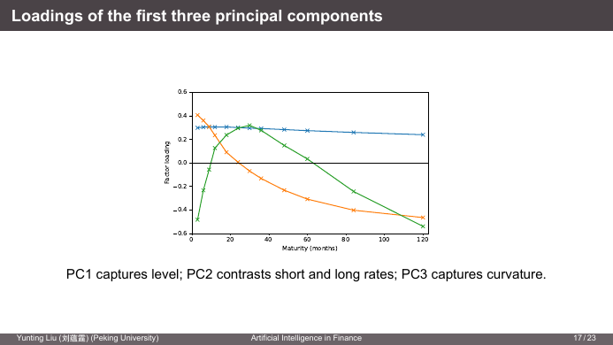

从图上读（横轴为期限，单位：月）：

| | 形状 | 近似数值 |
|---|---|---|
| PC1（蓝） | 几乎水平，全部为正 | 3 个月约 0.30 → 10 年约 0.24 |
| PC2（橙） | 从正到负单调下降 | 3 个月约 +0.40，约 24 个月过零，10 年约 −0.46 |
| PC3（绿） | 两端负、中间正（驼峰） | 3 个月约 −0.48，约 30 个月峰值 +0.31，10 年约 −0.54 |

- **PC1 = 水平**：所有期限载荷几乎相同 → 所有利率同幅度变动。
- **PC2 = 斜率**：短端和长端反向。
- **PC3 = 曲率**：短端和长端同向，中间反向。
- 📎 PC1 载荷全约 0.29 的原因：12 个期限、载荷平方和为 1，完全平坦时每个是 $1/\sqrt{12}=0.289$。

**三个因子能很好地还原每个收益率**：残差标准差（bp）

| 期限（月） | 残差 SD | 期限（月） | 残差 SD |
|---|---|---|---|
| 3 | 12 | 30 | 6 |
| 6 | 6 | 36 | 7 |
| 9 | 10 | 48 | 9 |
| 12 | 10 | 60 | 9 |
| 18 | 9 | 84 | 8 |
| 24 | 6 | 120 | 10 |

所有 12 个期限的残差标准差只有 **6–12 个基点**（利率本身的标准差约 300 个基点）。3 个月残差最大（12bp），因为最短端受货币政策、国库券供需等特殊因素影响较多。

**收益率对前三个 PC 的暴露**：对每个期限的利率用前三个 PC 回归，得到水平、斜率、曲率的暴露系数（图与载荷图一致，正是 $G=B'$ 的体现）。

**水平、斜率、曲率的经济解释**
- PCA 构造的因子是**纯粹的统计对象**。
- 经济解释是**事后**（ex post）通过观察 $\gamma$ 系数加上去的（课件原文的方向）：
  - 第一因子正冲击 → 收益率曲线**正向平行移动**。
  - 第二因子正冲击 → 短期利率**下降**、长期利率**上升**，曲线**变陡**。
  - 第三因子正冲击 → 短期和长期利率**上升**、中期利率**下降**，曲线**更弯**。

⚠️ **符号约定不一致**：课件第 21 页对 PC2、PC3 方向的文字描述（沿用 Veronesi 教材）与第 17/19 页 Python 算出的载荷图**正好相反**：图中 PC2 短端为正、长端为负，所以按图的符号，PC2 正冲击是短端**上升**、长端**下降**（曲线变平）；PC3 两端为负、中间为正，正冲击是中间**上升**、两端**下降**。原因见 3.5：特征向量的符号是任意的。两种说法都对，只是对应的因子符号相反。**描述时要说清楚用的是哪个符号约定，最好直接说“短端和长端反向变动”这种不依赖符号的描述。**

**三个因子同时概括水平和变化**

| 主成分 | PC1 | PC2 | PC3 | PC4 |
|---|---|---|---|---|
| 比例，收益率水平（%） | 97.97 | 1.80 | 0.15 | 0.04 |
| 累计，水平（%） | 97.97 | 99.77 | 99.92 | 99.96 |
| 比例，月度变化（%） | 85.82 | 8.93 | 2.00 | 0.94 |
| 累计，变化（%） | 85.82 | 94.75 | 96.75 | 97.69 |

- 三个 PC 解释了 **99.92%** 的水平变动和 **96.75%** 的月度变化。
- PC1 是整体水平变动；PC2 和 PC3 补充斜率和曲率。

💡 **对比水平 vs 变化**：对月度变化做 PCA，PC1 的比例从 98% 降到 86%，PC2 从 1.8% 升到 8.9%。原因同 3.2：水平值中的长期共同趋势抬高了 PC1。**对冲时应该看“变化”这一行**。

🔗 **对久期对冲的启示**（固定收益）：传统久期对冲假设收益率曲线**平行移动**，也就是只对冲 PC1。根据月度变化的数字，这只覆盖了约 86% 的变动方差，剩下约 14%（主要是斜率变化）没有对冲。用 PC1+PC2 两个因子对冲覆盖约 95%，三个因子约 97%。这就是**因子久期（factor duration）/ 关键利率久期**的动机。

📎 为什么恰好是“水平、斜率、曲率”这三种形状：只要各期限利率的相关性随期限距离平滑衰减（近的期限相关性高，远的低），这类相关矩阵的特征向量天然呈现“0 次（平）、1 次（单调）、2 次（驼峰）”的形状，类似于傅里叶/多项式展开的低阶项。所以在几乎所有国家的国债数据里都能看到这三个因子。

### 3.8 应用：收益率曲线套利（蝶式交易）

- 收益率曲线套利策略常采用**蝶式交易（butterfly trade）**：
  - 例如：**做多 5 年期**债券、**做空 2 年期和 10 年期**债券，权重使组合对**水平**和**斜率**的暴露为零。
  - **蝶式价差（butterfly spread）** = −（短期收益率）+ 2 ×（中期收益率）−（长期收益率）。
- Perold (1999) 的案例研究报告，**LTCM（长期资本管理公司）**经常做这类收益率曲线套利交易。
- 策略消除了收益率曲线的水平和斜率变动，只对**曲率**有暴露：在正向蝶式价差或扭转（twist）时获利，在负向时亏损。

💡📎 **用载荷算对冲比例**。设头寸以 DV01（收益率变动 1bp 时的价格变动）为单位，做多 1 单位 5 年期 DV01，求 2 年、10 年的 DV01 头寸 $w_2,w_{10}$。组合对因子 $k$ 的收益率暴露是 $\sum_i w_i\beta_{ki}$。

从载荷图近似读数（仅为示意）：

| 期限 | PC1 | PC2 | PC3 |
|---|---|---|---|
| 24 个月 | 0.30 | 0.01 | 0.30 |
| 60 个月 | 0.28 | −0.30 | 0.03 |
| 120 个月 | 0.24 | −0.46 | −0.54 |

令水平和斜率暴露为零：

$$
\begin{cases}
0.30\,w_2+0.28\cdot1+0.24\,w_{10}=0\\
0.01\,w_2-0.30\cdot1-0.46\,w_{10}=0
\end{cases}
\quad\Longrightarrow\quad
w_2\approx-0.40,\quad w_{10}\approx-0.66
$$

即：做多 1 单位 5 年 DV01，做空约 0.40 单位 2 年 DV01 和 0.66 单位 10 年 DV01。剩余的曲率暴露 $=0.30(-0.40)+0.03(1)+(-0.54)(-0.66)\approx0.27$。

- 组合的损益 ≈ $-\sum_i w_i\cdot\text{DV01}\cdot\Delta y_i$，只剩曲率这一项。
- **做多中间、做空两翼**：当中期收益率相对两翼**下降**（中间的债券涨价）时赚钱。

⚠️ “正向蝶式价差时获利”的方向要小心：按课件的定义，蝶式价差 $=-y_S+2y_M-y_L$。**价差下降**（中期收益率相对下降）时，做多中期的组合才赚钱。课件“profits during a positive butterfly”应当按 Veronesi 的因子符号理解：“第三因子正冲击 = 两端上升、中间下降”，这对做多中间的组合有利。做交易时应当直接写清楚“赚在哪种曲线形变上”。

📎 LTCM 的教训：这类交易每笔赚的是很小的曲率偏离，需要**高杠杆**放大收益。1998 年俄罗斯违约引发的流动性危机中，各种“应当收敛”的价差反而大幅扩大，LTCM 巨亏后由美联储协调救助。**PCA 基于历史协方差**，在危机中相关结构会突变，“中性”的组合可能突然有了大暴露。🔗 Block 3 的情景分析和样本外检验正是为此。

### 第 3 讲小结

```
12 个期限的利率  ──高度相关──►  PCA
                                  │  max β'Mβ  s.t. β'β=1   ⟹  Mβ = λβ
                                  │  因子方差 = 特征值；因子互不相关
                                  ▼
               PC1 水平（~98% 水平 / ~86% 变化）
               PC2 斜率（~1.8% / ~9%）
               PC3 曲率（~0.15% / ~2%）
                                  │
          回归 Y = P G，G = B'（回归系数 = 载荷）；3 因子残差仅 6–12bp
                                  │
              应用：久期对冲只管 PC1；蝶式交易对冲 PC1、PC2，押注 PC3
```

编程要点：`pd.read_excel(header=)`、`pd.to_datetime`、`iloc`、`np.cov(rowvar=False)`、`np.linalg.eigh`（升序，要反转）、特征向量符号任意、`sklearn.decomposition.PCA`。

<details>
<summary>✅ 自测题</summary>

1. 为什么 PCA 的一阶条件 $M\beta=\lambda\beta$ 选**最大**的特征值？
   → 代回目标函数，方差 $=\beta'M\beta=\lambda$，要最大化方差就选最大的 $\lambda$。
2. 协方差矩阵特征值为 (4.0, 0.8, 0.15, 0.05)，前两个 PC 累计解释多少？
   → $(4.0+0.8)/5.0=96\%$。
3. 为什么对利率**水平**做 PCA 时 PC1 的解释比例（98%）比对**月度变化**做（86%）更高？风险管理该看哪个？
   → 水平值有长期共同趋势，推高了共同成分的比例；损益取决于变化，风险管理看变化。
4. 你用 `np.linalg.eigh` 算出 PC2 的载荷是短端负、长端正，同学算出来短端正、长端负。谁错了？
   → 都没错，特征向量符号任意，两者只差一个负号。
5. 用前 3 个 PC 回归 10 年期收益率，系数等于什么？为什么省略其他 9 个 PC 不会使系数有偏？
   → 等于 $B$ 第 12 行的前三个元素（载荷 $\beta_{1,12},\beta_{2,12},\beta_{3,12}$）；因为各 PC 两两不相关，遗漏变量与保留的回归元不相关。
6. 一个只做久期中性（DV01 加总为零）的组合，还面临哪些利率风险？
   → 斜率和曲率风险（按月度变化约占 14%）；更严格地说，只有载荷完全平坦时 DV01 中性才等于 PC1 中性。

</details>

---

## 第 4 讲 久期、凸性与求导

> **本讲地图**：第 3 讲说明收益率曲线的变动主要是“水平”这一个因子。本讲问下一个问题：**曲线平移一点，我的债券（组合）价值变多少？** 一阶答案叫**久期（duration）**，二阶修正叫**凸性（convexity）**。
>
> 两部分：
> - **Part 1 债券的利率风险**：用对数收益率定义久期 → 零息债券久期 = 期限 → 附息债券久期 = 现值加权平均时间 → 凸性与二阶泰勒近似 → 杠铃 vs 子弹：凸性不是免费的。
> - **Part 2 用 Python 求导**：久期、凸性都是导数。没有解析式时怎么求导？三种方法：**符号求导（SymPy）**、**数值求导（有限差分）**、**自动微分（JAX / PyTorch）**。
>
> 🔗 **固定收益证券**：久期/凸性你学过，本讲新增的是“用连续复利写得更干净”和“用代码算导数”。🔗 **金工概（Hull）**：期权的希腊字母 $\Delta=\partial P/\partial S$、$\Gamma=\partial\Delta/\partial S$、$\Theta=\partial P/\partial T$、Vega $=\partial P/\partial\sigma$、$\rho=\partial P/\partial r$ 和久期/凸性是同一类东西：**价格对风险因子的一阶、二阶导数**，用于动态对冲和构造市场中性策略。**没有闭式价格时，数值求导是非常有用的技能。** 🔗 第 7 讲：自动微分就是神经网络训练用的反向传播。

### 4.1 债券价格对收益率的敏感性

- **大问题**：利率突然变动时，债券组合的价值怎么变？
- **具体问题**：某个期限的即期利率变动时，这个期限的零息债券（ZCB）价格怎么变？
- 我们用**百分比变化**来衡量，而百分比变化对应**对数收益率**：$d\log P=dP/P$。**久期就是 $\log P$ 对收益率的导数（取负号）。**

课件第 3 页的图：20 年期 ZCB 的价格 $e^{-20r}$ 随即期利率 $r$（0 到 10%）下降，并且是一条**向下凸**的曲线（$r=0$ 时价格 1，$r=5\%$ 时 $0.368$，$r=10\%$ 时 $0.135$）。

**资产收益率的数学**

- 发生了意外，资产价格变了，收益率是多少？

$$
\text{简单收益率（simple return）}\equiv\frac{\text{新价格}-\text{旧价格}}{\text{旧价格}},\qquad \text{对数收益率（log return）}=\log(\text{新})-\log(\text{旧})
$$

  对数收益率的好处是**对称**：涨 $x\%$ 和跌 $x\%$ 都是“$x\%$”。（💡 价格 100 → 110 → 100：简单收益率 +10%、−9.09%，不对称；对数收益率 +9.53%、−9.53%，对称，而且两期相加为 0。）
- 变动很小时，简单收益率变成微分：简单收益率 $=dP/P$。
- 对数收益率是同一个东西：

$$
\frac{d\log P}{dP}=\frac1P\quad\Longrightarrow\quad d\log P=\frac{dP}{P}
$$

**债券收益率的直觉**：$M$ 年期连续复利 ZCB，即期利率上升 1 个百分点，$r\to r+0.01$。

- 简单收益率：$\dfrac{e^{-M(r+0.01)}-e^{-Mr}}{e^{-Mr}}=e^{-0.01M}-1\approx-0.01M$
- 对数收益率：$\log\left(e^{-M(r+0.01)}\right)-\log\left(e^{-Mr}\right)=-0.01M$（**精确**）
- 一般结论：即期利率上升 $x$ 个百分点，$M$ 年 ZCB 价格的对数收益率**恰好**下降 $Mx\%$，简单收益率**约**下降 $Mx\%$。
- 反过来读：**单位利率冲击造成的百分比损失与期限成正比**，期限是 ZCB 的天然风险度量。久期把这一点推广到任意债券。

💡 20 年 ZCB，$r=5\%$：价格 $e^{-1}=0.3679$。利率升到 6%：价格 $e^{-1.2}=0.3012$，简单收益率 $-18.13\%$，对数收益率 $-20\%$（$=20\times1\%$）。期限越长、冲击越大，“$\approx$”的误差越大，这个误差正是后面凸性要修正的东西。

### 4.2 久期的定义：连续复利收益率

债券价格 $P$，连续复利（continuously compounded, c-c）收益率 $y$。把价格看成收益率的函数，问 $P$ 对 $y$ 有多敏感：

$$
\boxed{D=-\frac{dP/P}{dy}=-\frac1P\frac{dP}{dy}=-\frac{d\log P}{dy}}
$$

文字版（分子分母同乘 100%）：

$$
D=-\frac{\text{债券价格的百分比变化}}{\text{连续复利收益率的微小百分点变化}}
$$

**零息债券**：

$$
D=-\frac{1}{Z(0,M)}\frac{dZ(0,M)}{dr(0,M)}=-\frac{1}{e^{-Mr(0,M)}}\left(-Me^{-Mr(0,M)}\right)=M
$$

- **ZCB 的久期 = 它的期限**；附息债券的久期 < 期限（中间有票息提前回来）。
- 久期也衡量了利率变动时债券的**风险大小**。

💡 用法：久期 7 的债券，收益率上升 10bp，价格约下跌 $7\times0.10\%=0.70\%$。

### 4.3 离散复利：麦考利久期与修正久期

**年复利**收益率 $y_1$ 时，**麦考利久期（Macaulay duration）**：

$$
D=-\frac{dP/P}{d(1+y_1)/(1+y_1)}=-(1+y_1)\frac1P\frac{dP}{dy_1}
$$

（分母是“$1+y_1$ 的百分比变化”，这样定义出来的 $D$ 仍然是现值加权平均时间，见 4.4。）

**修正久期（modified duration）**：

$$
D_M=-\frac{dP/P}{dy_1}=\frac{1}{1+y_1}D
$$

- 每种复利约定（每年 $n$ 次）有自己的修正久期：$D_M=-\dfrac{dP/P}{dy_n}$。
- 换算很简单：

$$
D=\left(1+\frac{y_n}{n}\right)D_M
$$

- **经验法则**：业界报价的是修正久期（直接乘 $\Delta y$ 就是价格百分比变化）；麦考利久期是下一节推导的“现金流加权平均时间”。
- 连续复利是 $n\to\infty$ 的极限，$1+y_n/n\to1$，所以**连续复利下麦考利久期和修正久期是同一个数**，这就是 4.2 的定义那么干净的原因。

💡📎 **同一只债券，三种约定**（5 年期、每年付息 8、面值 100，价格 94.546，对应 c-c 收益率 9%）：

| 约定 | 收益率 | 修正久期 $D_M=-\frac{1}{P}\frac{dP}{dy_n}$ | $(1+y_n/n)D_M$ |
|---|---|---|---|
| 连续复利 | 9.0000% | 4.2904 | 4.2904 |
| 年复利 $n=1$ | 9.4174%（$=e^{0.09}-1$） | 3.9211 | 4.2904 |
| 半年复利 $n=2$ | 9.2056% | 4.1016 | 4.2904 |

麦考利久期与约定无关（都是 4.2904，因为现值权重不变），修正久期随约定不同。⚠️ 拿到一个“久期”数字，先问清楚是哪种久期、哪种复利约定。

### 4.4 附息债券的久期：现值加权平均时间

债券在 $T_1,T_2,\dots,T_N$ 支付票息 $C$（⚠️ 是金额，不是票面利率），在 $T_N$ 支付面值 $F$。连续复利收益率 $y$。

$$
P=Ce^{-T_1y}+Ce^{-T_2y}+\dots+Ce^{-T_Ny}+Fe^{-T_Ny}
$$

逐项求导（$de^{-T_iy}/dy=-T_ie^{-T_iy}$），再除以 $-P$：

$$
-\frac1P\frac{dP}{dy}=\frac{Ce^{-T_1y}}{P}T_1+\frac{Ce^{-T_2y}}{P}T_2+\dots+\frac{Ce^{-T_Ny}}{P}T_N+\frac{Fe^{-T_Ny}}{P}T_N
$$

- **结果：久期是各支付时间的加权平均，权重是每笔现金流的现值占比（加起来为 1）**：

$$
\boxed{D=\sum_iw_iT_i,\qquad w_i=\frac{CF_i\,e^{-T_iy}}{P}}
$$

- 等价地：**组合的久期 = 各成分久期按市值加权的平均**（因为组合价格是各成分价格之和，求导是线性的）。

🔗 这个“加权平均时间”的解释在离散复利下属于麦考利久期（4.3），所以麦考利久期也叫“平均回收期”。

### 4.5 凸性与二阶近似

**凸性**衡量价格–收益率曲线的弯曲程度，并按价格标准化：

$$
\boxed{\text{Convexity}=C=\frac1P\frac{d^2P}{dy^2}}\qquad\left(\text{c-c：}C=\sum_iw_iT_i^2\right)
$$

（再对 $y$ 求一次导：$d^2e^{-T_iy}/dy^2=T_i^2e^{-T_iy}$，所以凸性是支付时间**平方**的现值加权平均。ZCB 的凸性 $=M^2$。）

**二阶泰勒近似**：

$$
\Delta P\approx-P\times D\times\Delta y+\frac12P\times C\times(\Delta y)^2
$$

- 只用久期 = 切线近似；凸性修正曲线偏离切线的部分。
- 凸性项 $\frac12PC(\Delta y)^2\ge0$：**不论利率上升还是下降，凸性都对债券持有人有利**（涨得比切线多，跌得比切线少）。

💻 **久期与凸性：十行 NumPy**（课件代码）

```python
import numpy as np

cashflow = np.array([8., 8., 8., 8., 108.])
t = np.arange(1, 6)                # 支付时间 1..5（年）
y = 0.09                           # 连续复利收益率

pv = cashflow * np.exp(-t * y)     # 每笔现金流的现值
P = pv.sum()                       # 债券价格 = 现值之和
w = pv / P                         # 现值权重（加起来为 1）

duration = w @ t                   # 4.2904
convexity = w @ t**2               # 20.0950
```

逐行：
- `np.arange(1, 6)` 生成 `[1 2 3 4 5]`（不含终点 6）。
- `cashflow * np.exp(-t * y)`：逐元素相乘，一次算出 5 个贴现现金流，不用写循环。
- `w @ t` 是内积 $\sum w_iT_i$；`t**2` 逐元素平方（⚠️ 不是 `t^2`，那是按位异或）。
- 每一行都对应上面的公式：久期是现值加权的平均支付时间，凸性是平方时间的加权平均。

💡 **复现与拆解**：

| $T_i$ | 1 | 2 | 3 | 4 | 5 | 合计 |
|---|---|---|---|---|---|---|
| 现金流 | 8 | 8 | 8 | 8 | 108 | |
| 现值 | 7.3114 | 6.6822 | 6.1070 | 5.5814 | 68.8638 | $P=94.5459$ |
| 权重 $w_i$ | 0.0773 | 0.0707 | 0.0646 | 0.0590 | 0.7284 | 1 |

$D=4.2904<5$：72.8% 的价值集中在第 5 年，其余在前 4 年，平均时间被拉到 5 年之前。

💡📎 **近似效果**：$P=94.546$，$D=4.2904$，$C=20.095$。

| $\Delta y$ | 真实 $\Delta P$ | 久期近似 $-PD\Delta y$ | 久期 + 凸性 |
|---|---|---|---|
| +1% | −3.9629 | −4.0564 | −3.9614 |
| −1% | +4.1530 | +4.0564 | +4.1514 |
| +2% | −7.7448 | −8.1128 | −7.7329 |
| −2% | +8.5054 | +8.1128 | +8.4928 |

- 只用久期：利率升 1% 时**高估**了损失（4.06 vs 3.96），利率降 1% 时**低估**了收益（4.06 vs 4.15）。这就是凸性“两头有利”。
- 加上凸性后，±1% 的误差降到 0.002 以内；±2% 时也只差约 0.01。

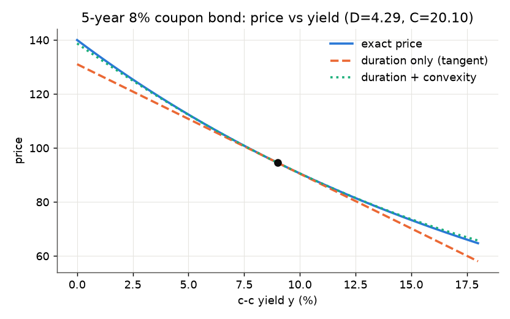

图中：蓝线是真实价格，橙色虚线是久期给出的切线，绿色点线是加上凸性的抛物线。离 9% 越远，切线越不准，抛物线仍贴得很紧。

### 4.6 符号求导：SymPy

久期、凸性都是导数。第一种办法：让计算机做代数。**准确（精确），但慢且不灵活**，每换一个价格函数就要重新推导。

💻 课件代码：

```python
import sympy as sp

M, y = sp.symbols("M y", positive=True)
P = sp.exp(-M * y)                 # M 年 ZCB 的价格

D = -sp.diff(P, y) / P             # 久期
C = sp.diff(P, y, 2) / P           # 凸性
print(sp.simplify(D), sp.simplify(C))   # M , M**2
```

- `sp.symbols(..., positive=True)`：声明符号并告诉 SymPy 它们为正，化简时可以用这个信息（比如 $\sqrt{M^2}=M$）。
- `sp.diff(P, y)` 一阶导，`sp.diff(P, y, 2)` 二阶导。
- `sp.simplify` 把 $\frac{Me^{-My}}{e^{-My}}$ 化成 $M$。
- 结果验证了 ZCB：久期 $=M$，凸性 $=M^2$。

📎 也可以对 4.5 的附息债券直接做，然后代数值 `.subs(y, 0.09)`，得到 4.290421 和 20.095023，和 NumPy 一致。

- **适用场景**：公式已知、需要精确结果时。
- **不适用**：价格来自模拟或数值求解器（比如蒙特卡洛定价、PDE 数值解）时，没有可以求导的表达式。

### 4.7 数值求导：有限差分

当 $f$ 只是一个**黑箱**（模拟、定价器、训练好的模型），通过取样来求导：

| 方法 | 公式 | 截断误差 |
|---|---|---|
| 前向差分（forward difference） | $\dfrac{f(x+\Delta x)-f(x)}{\Delta x}$ | $O(\Delta x)$ |
| 后向差分（backward difference） | $\dfrac{f(x)-f(x-\Delta x)}{\Delta x}$ | $O(\Delta x)$ |
| 中心差分（central difference） | $\dfrac{f(x+\Delta x)-f(x-\Delta x)}{2\Delta x}$ | $O(\Delta x^2)$，通常最划算 |
| 二阶导数 | $\dfrac{f(x+\Delta x)-2f(x)+f(x-\Delta x)}{(\Delta x)^2}$ | $O(\Delta x^2)$ 📎 |

💻 课件代码：

```python
f = lambda x: np.exp(-x)           # 真实导数：-exp(-x)
x0, h = 0.09, 1e-5
fwd = (f(x0 + h) - f(x0)) / h
ctr = (f(x0 + h) - f(x0 - h)) / (2 * h)
snd = (f(x0 + h) - 2 * f(x0) + f(x0 - h)) / h**2
```

💡 实际结果（真实 $f'(0.09)=-0.9139311853$，$f''(0.09)=0.9139311853$）：

| | 数值 | 误差 |
|---|---|---|
| 前向 | −0.9139266156 | $+4.57\times10^{-6}$ |
| 后向 | −0.9139357549 | $-4.57\times10^{-6}$ |
| 中心 | −0.9139311853 | $-1.56\times10^{-11}$ |
| 二阶 | 0.9139311530 | $-3.23\times10^{-8}$ |

同样的 $h=10^{-5}$，中心差分比前向差分准了约 30 万倍。前向和后向的误差**大小相同、方向相反**，平均起来正好是中心差分，误差的一阶项被抵消了。

**为什么中心差分精度高一阶**（📎 泰勒展开，见[附录 F.4](#f4-泰勒展开与大-o-记号)）：

$$
f(x\pm h)=f(x)\pm hf'(x)+\frac{h^2}{2}f''(x)\pm\frac{h^3}{6}f'''(x)+\dots
$$

- 前向：$\dfrac{f(x+h)-f(x)}{h}=f'(x)+\dfrac h2f''(x)+\dots$，误差 $\approx\frac h2f''$。验证：$\frac{10^{-5}}{2}\times0.914=4.57\times10^{-6}$ ✓。
- 中心：两式相减，偶数次项抵消，$\dfrac{f(x+h)-f(x-h)}{2h}=f'(x)+\dfrac{h^2}{6}f'''(x)+\dots$，误差 $\approx\frac{h^2}{6}|f'''|=1.5\times10^{-11}$ ✓。

**优点**：快、灵活、不需要闭式解。**缺点**：近似的。那么 $h$ 怎么选？

### 4.8 步长的选择：截断误差 vs 舍入误差

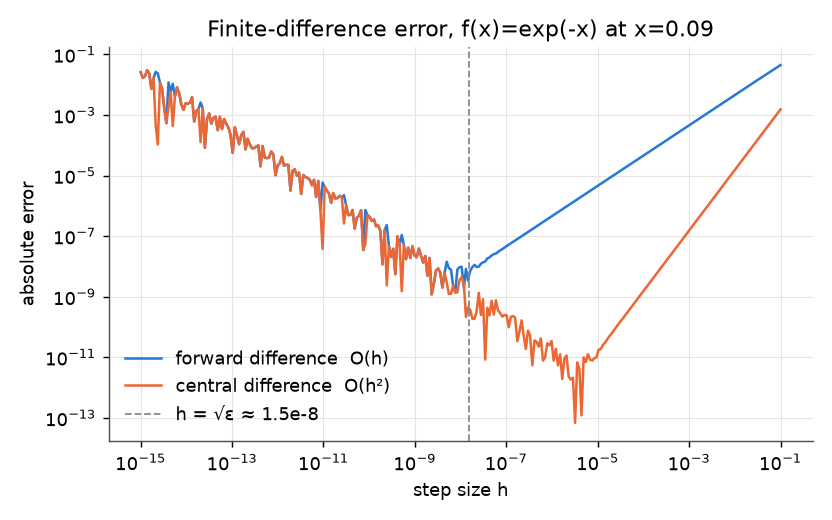

- **截断误差（truncation error）**：泰勒展开 $\frac{f(x+h)-f(x)}{h}=f'(x)+\frac h2f''(x)+\dots$。差商是**割线**斜率，即使精确算术也有偏差。前向差分误差按 $h$ 缩小、中心差分按 $h^2$ 缩小：在对数–对数坐标里斜率分别是 $+1$ 和 $+2$（图的右半边，$h$ 越小误差越小）。
- **舍入误差（roundoff error）**：$f(x+h)-f(x)$ 是两个很接近的浮点数相减，有效数字被抵消，留下约 $\varepsilon_{mach}$ 量级的噪声；再除以很小的 $h$，噪声被放大成约 $\varepsilon_{mach}/h$。在图上是斜率 $-1$ 的部分（图的左半边，$h$ 越小误差越大，还很“毛糙”）。
- **最优点**在两支相交处：
  - 前向：$h^*\approx\sqrt{\varepsilon}\approx10^{-8}$；
  - 中心：$h^*\approx\varepsilon^{1/3}\approx4\times10^{-6}$（课件数；用 $\varepsilon=2.2\times10^{-16}$ 算是 $6\times10^{-6}$，量级一样），误差约 $5\times10^{-13}$，比前向好约 1000 倍。

📎 **最优步长的推导**（前向）：总误差 $E(h)\approx\frac h2|f''|+\frac{\varepsilon|f|}{h}$。对 $h$ 求导令其为 0：$h^*=\sqrt{2\varepsilon|f|/|f''|}\sim\sqrt\varepsilon$，此时 $E\sim\sqrt\varepsilon\approx10^{-8}$。中心差分：$E(h)\approx\frac{h^2}{6}|f'''|+\frac{\varepsilon|f|}{h}$，$h^*\sim\varepsilon^{1/3}$，$E\sim\varepsilon^{2/3}\approx4\times10^{-11}$（实际常常更小）。

💡 我在 $10^{-15}$ 到 $10^{-1}$ 的网格上实测：前向差分最小误差约 $4.5\times10^{-9}$（$h\approx3\times10^{-9}$）；中心差分最小误差约 $4\times10^{-13}$（$h\approx1.8\times10^{-6}$）。中心差分的最小误差和课件一致；前向差分我测出来比课件写的 $3\times10^{-10}$ 大一个数量级左右（舍入噪声是“毛糙”的，最低点在哪取决于网格，按上面的推导应在 $10^{-8}\sim10^{-9}$ 量级）。

**解释**：$h$ 太大 → 割线偏差；$h$ 太小 → 浮点噪声。**如果价格来自模拟，误差的下限是蒙特卡洛标准误，而不是 $\varepsilon_{mach}$**：此时 $f(x+h)-f(x)$ 里的噪声是 MC 噪声（比如 $10^{-3}$），$h$ 要取得大得多。

🔗 **CSAPP 浮点数**：双精度有 52 位尾数，$\varepsilon_{mach}=2^{-52}\approx2.2\times10^{-16}$（`np.finfo(float).eps`），是 1 和下一个可表示的数之间的距离。$f(x+h)$ 和 $f(x)$ 前面十几位相同，相减后只剩后几位有效，这叫**灾难性抵消（catastrophic cancellation）**。

⚠️ 二阶差分的舍入误差是 $\varepsilon/h^2$，比一阶更敏感：$h=10^{-5}$ 时舍入误差上限约 $2\times10^{-6}$，实测误差 $3\times10^{-8}$。二阶导数最优步长约 $\varepsilon^{1/4}\approx10^{-4}$。📎 用 $h=10^{-4}$ 对 4.5 的债券算：久期 4.290421、凸性 20.095023，和精确值一致到 6–7 位。

🛠️ **项目提示**：给 AlphaLab 写希腊字母/久期的数值版本时：(1) 用中心差分；(2) 把 $h$ 设为参数并用**相对步长** `h = h_rel * max(1, abs(x))`；(3) 写单元测试，用有解析解的情形（ZCB、Black–Scholes）对比，断言误差 < 某个容差；(4) 如果底层是蒙特卡洛定价，$x+h$ 和 $x-h$ 两次定价要用**同一组随机数**（common random numbers），否则 MC 噪声会被 $1/h$ 放大。

### 4.9 自动微分：与 AI 的联系

第三种方法：**自动微分（automatic differentiation, AD）**，在代码执行的过程中用**链式法则**追踪导数。精确到机器精度：没有步长、也不需要符号代数。

💻 课件代码（JAX）：

```python
import jax, jax.numpy as jnp

def price(y):                       # 5 年期附息债券
    cf = jnp.array([8., 8., 8., 8., 108.])
    t = jnp.arange(1, 6)
    return jnp.sum(cf * jnp.exp(-t * y))

duration = -jax.grad(price)(0.09) / price(0.09)
convexity = jax.grad(jax.grad(price))(0.09) / price(0.09)
```

- `jax.numpy` 是和 NumPy 接口几乎一样的数组库，但它的运算可以被 JAX 追踪。
- `jax.grad(price)` 返回一个**新函数**，计算 `price` 的导数；`(0.09)` 是在 $y=0.09$ 处求值。
- `jax.grad(jax.grad(price))`：导数的导数，即二阶导。
- ⚠️ `jax.grad` 要求输入是浮点数（`0.09` 而不是整数 `0`），输出是标量。
- 结果应为 4.2904、20.0950，和 4.5 一致。（我的环境没装 JAX；下面用纯 Python 实现的 AD 验证了同样的数字。）

- **这正是反向传播（backpropagation）**，训练神经网络的算法（第 7 讲）。
- 实践中：蒙特卡洛定价中的**路径希腊字母（pathwise Greeks）**、组合优化中的梯度、机器学习定价模型的敏感性分析。

💻📎 **AD 是怎么做到“精确”的：20 行的前向模式 AD**。思路：每个数都带上它的导数，记为 $(v,\dot v)$（**对偶数，dual number**）。每个基本运算同时更新值和导数：

- 加法：$(a,\dot a)+(b,\dot b)=(a+b,\ \dot a+\dot b)$
- 乘法：$(a,\dot a)\times(b,\dot b)=(ab,\ \dot ab+a\dot b)$（乘积法则）
- 指数：$\exp(a,\dot a)=(e^a,\ e^a\dot a)$（链式法则）

```python
import math

class Dual:
    def __init__(self, val, der=0.0):
        self.val, self.der = val, der            # 值和导数
    def __add__(self, o):
        o = o if isinstance(o, Dual) else Dual(o)   # 常数的导数为 0
        return Dual(self.val + o.val, self.der + o.der)
    __radd__ = __add__                           # 让 0.0 + Dual 也能用
    def __mul__(self, o):
        o = o if isinstance(o, Dual) else Dual(o)
        return Dual(self.val * o.val, self.der * o.val + self.val * o.der)
    __rmul__ = __mul__                           # 让 8.0 * Dual 也能用
    def __neg__(self):
        return Dual(-self.val, -self.der)

def exp(x):
    return Dual(math.exp(x.val), math.exp(x.val) * x.der)

def price(y):
    total = 0.0
    for c, t in zip([8., 8., 8., 8., 108.], range(1, 6)):
        total = total + c * exp(-t * y)
    return total

p = price(Dual(0.09, 1.0))     # 种子：dy/dy = 1
print(p.val, p.der, -p.der / p.val)   # 94.5459  -405.6417  4.290421193724
```

- `Dual(0.09, 1.0)`：输入 $y$ 的导数是 $dy/dy=1$。
- `price` 的代码**一个字都没改**，运算符重载让每一步自动带上导数。
- 结果 4.290421193724 与解析值**完全一致到机器精度**，不存在步长问题：每一步用的是精确的导数规则，误差只来自普通的浮点运算。
- 📎 这是**前向模式**（一个输入、多个输出时高效）。神经网络是“百万个参数 → 一个损失”，用的是**反向模式**（先正向算一遍记下计算图，再从输出往回传导数），一次反向传播就得到所有参数的梯度。JAX 的 `grad` 和 PyTorch 的 `.backward()` 都是反向模式。

**三种方法对比**

| | 符号求导 SymPy | 数值求导（有限差分） | 自动微分 JAX/PyTorch |
|---|---|---|---|
| 精度 | 精确 | 近似（截断 + 舍入） | 机器精度 |
| 需要 | 闭式表达式 | 只要能求值（黑箱） | 用可追踪的代码写成的函数 |
| 速度 | 慢（表达式膨胀） | 快；$n$ 个参数要 $2n$ 次求值 | 反向模式：梯度成本 ≈ 几次函数求值 |
| 典型用途 | 推导、验证公式 | 黑箱定价器、模拟 | 神经网络、大规模优化、路径希腊字母 |

### 4.10 杠铃与子弹

两个**久期相同**的组合：
- **杠铃（barbell）**：一只长期 ZCB + 一只短期 ZCB。
- **子弹（bullet）**：一只中期 ZCB。

- 两者对**小幅**平行移动的损失相同（一阶敏感性相同）。
- 杠铃把现金流分散到两端，$\sum_iw_iT_i^2$ 更大：**杠铃的凸性更大**。

📎 为什么：均值相同时，$\sum w_iT_i^2=D^2+\sum w_i(T_i-D)^2$，即**凸性 = 久期² + 支付时间的方差**。子弹的支付时间集中在一点（方差 0），杠铃分散在两端（方差大）。比如 ZCB 10 年 + 30 年各一半市值，$D=20$，凸性 $=0.5(100)+0.5(900)=500=20^2+100$；而 20 年 ZCB 凸性 $=400$。

- **思考题**：既然凸性总是好的，为什么不是人人都持有杠铃？（答案在 4.11。）

**例子**（课件数字）

- **子弹组合**：面值 \$100,000 的 20 年 ZCB，YTM 6.5%
  市值 \$27,822；修正久期 19.37；凸性 384.60。
- **杠铃组合**：10 年 ZCB（YTM 6.0%）+ 30 年 ZCB（YTM 6.4%），市值分别 \$13,938 和 \$13,884（合计同样 \$27,822）：

$$
\text{Duration}=\frac{13938\times9.70874+13884\times29.06977}{13938+13884}=19.37
$$

- 子弹的凸性是 385。
- 杠铃的凸性是 478：**相同久期下更大的曲率**。

💡 **复现这些数**：课件没说复利约定，反推发现是**半年复利**（美国债券惯例）。

- 子弹市值：$100000/(1+0.065/2)^{40}=27{,}822.59$ ✓
- ZCB 的修正久期 $=T/(1+y/2)$：$20/1.0325=19.3705$；$10/1.03=9.70874$；$30/1.032=29.06977$ ✓
- 📎 半年复利 ZCB 的凸性 $=\dfrac{T(T+0.5)}{(1+y/2)^2}$（对 $P=F(1+y/2)^{-2T}$ 求两次导再除以 $P$）：
  - 20 年：$20\times20.5/1.0325^2=384.60$ ✓
  - 10 年：$10\times10.5/1.03^2=98.97$；30 年：$30\times30.5/1.032^2=859.14$
  - 杠铃：$(13938\times98.97+13884\times859.14)/27822=478.3$ ✓
- 杠铃两只 ZCB 的面值：$13938\times1.03^{20}=\$25{,}174$，$13884\times1.032^{60}=\$91{,}896$。
- 市值 13,938 和 13,884 是解“市值之和 = 27,822、市值加权久期 = 19.37”这个两元一次方程组得到的（精确解 13,938.30 和 13,884.29）。

💻📎

```python
def zcb(T, y, face=1.0):                       # 半年复利 ZCB 价格
    return face / (1 + y / 2) ** (2 * T)

mv_bullet = zcb(20, 0.065, 100_000)            # 27822.59
md = lambda T, y: T / (1 + y / 2)              # 修正久期
cv = lambda T, y: T * (T + 0.5) / (1 + y / 2) ** 2   # 凸性

# 求杠铃市值：两个条件（总市值相同、久期相同）
A = np.array([[1, 1], [md(10, .06), md(30, .064)]])
b = np.array([mv_bullet, mv_bullet * md(20, .065)])
mv10, mv30 = np.linalg.solve(A, b)             # 13938.30, 13884.29
conv_barbell = (mv10 * cv(10, .06) + mv30 * cv(30, .064)) / mv_bullet   # 478.3
```

### 4.11 杠铃总是跑赢子弹吗？

- 如果利率**立即**平行移动，不论上还是下，杠铃都跑赢子弹：凸性赚钱。
- 但如果利率**一直不动**，随着时间流逝子弹跑赢杠铃：
  - 子弹赚 6.5%；
  - 杠铃赚约 6.2%，即 10 年 6% 和 30 年 6.4% 的市值加权平均。
- **结论：凸性不是免费的，要用收益率来买。** 杠铃 vs 子弹是在赌利率变动的**大小和速度**，不是免费午餐。

💡📎 **情景分析**（用上面复现的面值，所有收益率同时平移 $\Delta y$，立即重新定价）：

| $\Delta y$ | 子弹市值 | 杠铃市值 | 杠铃 − 子弹 |
|---|---|---|---|
| −2% | 41,065 | 41,844 | +779 |
| −1% | 33,785 | 33,944 | +159 |
| 0 | 27,823 | 27,822 | ≈0 |
| +1% | 22,934 | 23,040 | +107 |
| +2% | 18,922 | 19,273 | +352 |

杠铃在两边都赢，而且优势随 $(\Delta y)^2$ 增长：这正是凸性差 $\frac12P(C_{bar}-C_{bul})(\Delta y)^2$。验证 $\Delta y=\pm1\%$：$\frac12\times27822\times(478.3-384.6)\times0.0001=130$，介于 +107 和 +159 之间 ✓（两边不对称是三阶项）。

**利率不动、持有一年**：子弹的一年收益 $=1.0325^2-1=6.61\%$（赚 \$1,838）；杠铃 $\approx6.30\%$（赚 \$1,752）。一年少赚约 \$87。对比：利率需要立即平移约 0.8% 以上，凸性的好处才能抵消这一年的收益差。

🔗 **金工概（Hull）**：这和期权的 **Gamma–Theta 权衡**是同一回事。多头 Gamma（凸性）的头寸在价格大幅波动时赚钱，但每天付出 Theta（时间价值衰减）。“凸性用收益率来买”就是债券版的“Gamma 用 Theta 来买”。🔗 第 5 讲伊藤引理会把这个直觉变成公式：$\frac12F_{rr}\sigma^2$ 项。

### 4.12 凸性与收益率曲线的形状

- 如果收益率曲线是平的、只做平行移动，那么凸性更大的组合**总是**跑赢凸性小的组合，就有套利机会。
- 所以，只要市场变动主要是平行移动（第 3 讲：PC1 解释了约 86% 的变化），**子弹一开始就必须提供更高的收益率**，补偿它较低的凸性。
- 这有助于解释为什么期限结构常常是**驼峰形**：在很长期限处向下弯，那里凸性相对久期最大（ZCB 凸性 ∝ $T^2$，久期 ∝ $T$），投资者放弃收益率来买凸性。
- 有证据表明，**波动率越高（凸性越值钱），收益率曲线越弯**。

📎 这在例子里已经体现：10 年 6.0%、20 年 6.5%、30 年 6.4%，曲线在 20 年附近见顶、30 年回落。🔗 第 5 讲例 3 的债券价格公式 $e^{\frac{\sigma^2}{6}(T-t)^3-(T-t)r}$ 里，$\frac{\sigma^2}{6}(T-t)^3$ 这一项就是“凸性价值”，它让长期收益率 $y=r-\frac{\sigma^2}{6}(T-t)^2$ 随期限下降，$\sigma$ 越大下降越多。

### 第 4 讲小结

```
利率冲击 Δy ──►  债券价格变化 ΔP/P
                    │
   一阶：久期  D = −(1/P) dP/dy = Σ wᵢ Tᵢ       （ZCB：D = M）
   二阶：凸性  C = (1/P) d²P/dy² = Σ wᵢ Tᵢ²     （ZCB：C = M²）
   ΔP ≈ −P D Δy + ½ P C (Δy)²
                    │
   离散复利：D_Macaulay = (1 + yₙ/n) · D_modified；连续复利两者相同
                    │
   杠铃 vs 子弹：同久期，杠铃凸性大（C = D² + 时间方差）
   ⟹ 利率大幅变动时赢；利率不动时输（凸性用收益率买）⟹ 长端曲线下弯

求导三法：符号（SymPy，精确/需闭式）· 有限差分（黑箱/选 h）· 自动微分（机器精度/反向传播）
   有限差分：中心差分 O(h²)；最优 h ≈ ε^{1/3}（中心）、√ε（前向）；MC 定价时噪声下限是标准误
```

编程要点：`w @ t` 加权求和；`sympy.diff`/`simplify`；中心差分；`np.finfo(float).eps`；`jax.grad` 及其嵌套。

<details>
<summary>✅ 自测题</summary>

1. 10 年期 ZCB，连续复利即期利率从 3% 升到 3.5%。对数收益率和简单收益率各是多少？
   → 对数 $-10\times0.5\%=-5\%$（精确）；简单 $e^{-0.05}-1=-4.88\%$。
2. 一只债券年复利收益率 5%，麦考利久期 8。修正久期多少？收益率上升 20bp，价格约变多少？
   → $D_M=8/1.05=7.62$；$-7.62\times0.2\%=-1.52\%$。
3. 组合：60% 市值在久期 2 的债券，40% 在久期 12 的债券。组合久期？如果都是 ZCB（连续复利），组合凸性？
   → $0.6\times2+0.4\times12=6$；$0.6\times4+0.4\times144=60$（$=6^2+$ 时间方差 24）。
4. 用前向差分 $h=10^{-12}$ 算久期，结果误差反而比 $h=10^{-6}$ 大，为什么？
   → 舍入误差约 $\varepsilon/h=2\times10^{-4}$，远大于截断误差；$h$ 太小，被浮点噪声主导。
5. 用蒙特卡洛定价（标准误约 $10^{-3}$）算 Delta，用中心差分，$h$ 取 $10^{-6}$ 合适吗？
   → 不合适。MC 噪声被放大到 $10^{-3}/10^{-6}=1000$。应取较大的 $h$ 并使用共同随机数；或用路径导数（自动微分）。
6. 同久期下杠铃凸性更大，为什么市场上不存在“买杠铃卖子弹”的无风险套利？
   → 子弹收益率更高，利率不动时子弹赚得多；杠铃只在利率大幅变动时占优，这是对波动率的押注。
7. `jax.grad(jax.grad(price))(0.09) / price(0.09)` 算的是什么？如果改成 `-jax.grad(...)` 呢？
   → 凸性 $\frac1P\frac{d^2P}{dy^2}$；加负号就错了，凸性的定义没有负号（久期才有）。

</details>

---

## 第 5 讲 连续时间方法：布朗运动、伊藤引理与蒙特卡洛模拟

> **本讲地图**：第 2–4 讲都是“给定今天的利率，算价格/风险”，没有描述利率**随时间怎么随机演化**。本讲建立描述随机演化的语言：**随机过程（stochastic process）**，即按时间索引的一族随机变量，是描述股价、利率、波动率演化的自然语言。
>
> 三部分：
> - **Part A 布朗运动**：从随机游走取连续极限；为什么正态分布是“免费得到的”；$(dX)^2=dt$。
> - **Part B 随机微分方程（SDE）与伊藤引理**：漂移 + 扩散；随机函数的链式法则（多一个二阶项）。
> - **Part C 离散化与蒙特卡洛模拟**：Euler 与 Milstein 格式、在险价值（VaR）、估计 Vasicek 模型。
>
> 必读：Glasserman《Monte Carlo Methods in Financial Engineering》第 1 章。
>
> 🔗 **金工概（Hull）**：维纳过程、伊藤引理、几何布朗运动、二叉树、VaR 在 Hull 里都有，本讲偏重“怎么模拟、怎么验证”。🔗 **第 1 讲**：蒙特卡洛期权定价里的 $S_T=S_0\exp[(r-\frac12\sigma^2)T+\sigma\sqrt TZ]$ 本讲会用伊藤引理推出来。🔗 **第 4 讲**：伊藤引理的 $\frac12F_{rr}s^2$ 项就是“凸性 × 波动”，例 3 会推出“债券对冲击的暴露 ∝ 久期”。🔗 **机器学习概论**：大数定律、中心极限定理、蒙特卡洛估计的标准误。

### 5.1 从随机游走到连续极限

**离散时间的随机游走（random walk）**：

$$
X_t=X_{t-1}+\epsilon_t,\qquad\epsilon_t\text{ 跨期 i.i.d.}
$$

- 刻画利率的动态对于决定期限结构至关重要。
- 在连续时间中建模和模拟过程，对资产定价特别有价值。**连续时间把“许多微小冲击”变成优雅的数学，也变成我们能跑的模拟。**

**把 $[0,t]$ 切成小段**

- 连续时间过程是离散过程取连续极限得到的。
- 把 $[0,t]$ 分成 $n$ 段，每段长 $\Delta t=t/n$。增量记为

$$
\Delta X_i\equiv X(i\Delta t)-X((i-1)\Delta t),\qquad i=1,\dots,n
$$

- $\Delta X_i$ 是真正的条件冲击：彼此**独立**。后面所有连续时间工具，都来自“一个微小冲击有多大”这个选择。

**对增量建模**

- 假设增量 i.i.d.，且

$$
E(\Delta X_i)=0,\qquad\mathrm{Var}(\Delta X_i)=\frac tn=\Delta t\quad(\text{总方差 }n\cdot\Delta t=t)
$$

- 写成

$$
\Delta X_i=\sqrt{\Delta t}\,\epsilon_i,\qquad\epsilon_i\text{ i.i.d.},\ E(\epsilon_i)=0,\ \mathrm{Var}(\epsilon_i)=1,\ E(\epsilon_i^4)<\infty
$$

- $\epsilon_i$ 的分布可以不指定：伯努利（±1）、正态、厚尾，只要均值 0、方差 1。
- 增量加起来是总变化：$X(t)-X(0)=\sum_{i=1}^n\Delta X_i$。

⚠️ **为什么是 $\sqrt{\Delta t}$ 而不是 $\Delta t$**：要让总方差 $n\cdot\mathrm{Var}(\Delta X_i)$ 在 $n\to\infty$ 时保持有限且非零，单步方差必须 $\propto1/n=\Delta t/t$，所以单步标准差 $\propto\sqrt{\Delta t}$。如果单步大小取 $\Delta t$，总方差 $n\Delta t^2=t^2/n\to0$，随机性消失；取更大则发散。

**连续极限与正态性**

$$
X(t)-X(0)=\sqrt n\left(\frac{\sqrt t}{n}\sum_{i=1}^n\epsilon_i\right)
$$

$n\to\infty$ 时，由**中心极限定理（CLT）**：

$$
\sqrt n\left(\frac{\sqrt t}{n}\sum_{i=1}^n\epsilon_i\right)\xrightarrow{d}N(0,t)
$$

- 极限是**布朗运动**：样本路径连续。
- **$\epsilon_i$ 的分布无关紧要。** 一旦取连续极限，结果往往变成正态，不论小冲击的分布是什么，正态性是“免费的”。

💡📎 **抛硬币也能得到布朗运动**：$\epsilon_i=\pm1$ 各 50%（均值 0、方差 1），$n=1000$，模拟 10 万条：$X(1)$ 的样本均值 0.003、方差 1.000，直方图和 $N(0,1)$ 几乎重合。（⚠️ 但它只能取 $\{-\sqrt{1000},\dots,\sqrt{1000}\}/\sqrt{1000}$ 上间隔 0.063 的格点；尾部概率 $P(X<-1.645)$ 在格点上是 4.6% 而不是 5%，$n$ 越大越接近。）

### 5.2 布朗运动的定义与 Python 模拟

**一维标准布朗运动（Brownian motion）/ 维纳过程（Wiener process）** $\{X(t),0\le t\le T\}$ 满足：
1. 样本路径**连续**；
2. **独立增量**：对任意 $k$ 和任意 $0\le t_0<t_1<\dots<t_k\le T$，$X(t_1)-X(t_0),\dots,X(t_k)-X(t_{k-1})$ 相互独立；
3. **正态增量**：$X(t)-X(s)\sim N(0,t-s)$，$0\le s<t$；
4. $X(0)=0$。

独立增量 + 正态增量就是整个定义，其他性质都可以推出来。

**Python 中的随机数**

- 计算机里的随机数都是**伪随机（pseudo-random）**：由算法生成，但能通过统计随机性检验。
- 所有随机性都从一个**设了种子的生成器**流出，结果可以复现：

💻 课件代码：

```python
import numpy as np

rng = np.random.default_rng(123)       # 种子：一个可重复的数字流

rng.normal()                           # 标准正态     -> -0.9891
rng.uniform()                          # [0,1) 均匀   -> 0.0538
rng.integers(0, 10, size=5)            # 随机整数     -> [9 2 2 1 3]
```

- 种子让结果可重复：每个种子就像一本存着固定随机数序列的书。**研究代码里一定要设种子。**
- ⚠️ 三行的结果是**按顺序**从同一个流里取的。如果新建 `default_rng(123)` 后直接调用 `integers`，得到的是 `[0 6 5 0 9]`，不是 `[9 2 2 1 3]`。我实测三个结果都和课件一致。
- `integers(0, 10)` 不含 10（同 `range`）。

🛠️ **可复现性**：项目里不要用全局的 `np.random.seed()` + `np.random.normal()`（旧 API，全局状态，被任何库调用都会改变序列）。在函数参数里显式传 `rng`，比如 `def simulate(..., rng)`，测试时传入固定种子的生成器。

**模拟布朗路径**

💻 课件代码：

```python
n, m = 500, 5                     # 步数，路径数
dt = 1 / n
dW = rng.normal(0, np.sqrt(dt), size=(m, n))   # m×n 个独立的 N(0, dt) 增量
W = np.hstack([np.zeros((m, 1)),               # 每条路径从 W(0)=0 开始
               np.cumsum(dW, axis=1)])         # 沿时间轴累加：W(t_k) = ΔW_1+…+ΔW_k
```

- `rng.normal(0, np.sqrt(dt), ...)`：⚠️ 第二个参数是**标准差** $\sqrt{dt}$，不是方差 $dt$。这是最常见的 bug。
- `size=(m, n)`：每行一条路径，每列一个时间步。
- `np.cumsum(dW, axis=1)`：沿列方向（时间）累加，这就是 $X(t)-X(0)=\sum\Delta X_i$。
- `np.hstack` 在左边拼一列 0，得到 $m\times(n+1)$ 的矩阵，对应时间 $0,dt,\dots,1$。

- 检验（20,000 条路径）：课件 $X(1)$ 均值 +0.005（理论 0），方差 0.997（理论 1）。我用 `default_rng(123)` 重新生成 20,000×500 得到均值 +0.0049、方差 0.995，都在抽样误差内（均值的标准误 $1/\sqrt{20000}=0.007$）。

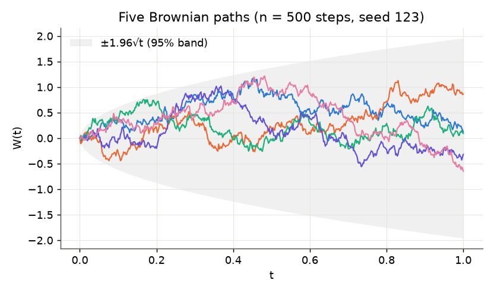

- 图是从 $t=0$ 到 $t=1$ 的模拟路径（灰色带是 $\pm1.96\sqrt t$，95% 的路径在任一时刻落在里面），$n\to\infty$ 时就是布朗运动。
- 历史：布朗运动是随机振动粒子（Robert Brown，1827）、股价（Louis Bachelier，1900）、原子（Albert Einstein，1905）的数学。**金融里的数学很大程度上来自物理。**

### 5.3 记号与平方变差

- “$X$ 是布朗运动”“$X$ 服从布朗运动过程”。记号：$X_t$、$X(t)$ 或 $X$。
- 连续时间增量的简写 $dX$、$dX(t)$、$dX_t$：

$$
dX(t)=\lim_{\Delta t\to0}\Delta X_i=\lim_{\Delta t\to0}\sqrt{\Delta t}\,\epsilon_i
$$

- 直观上可以想成 $dX\sim N(0,dt)$，因为这是 $n\to\infty$ 时的极限分布。
- 数学上不严格、但极其方便的思考方式：

$$
E(dX)=0,\qquad E\left[(dX)^2\right]=dt,\qquad E\left[dX_1(t)\,dX_2(t)\right]=\rho\,dt
$$

  下标表示相关系数为 $\rho$ 的两个布朗运动。

**反常但重要：$(dX)^2$ 不是随机的，等于 $dt$**

- 不能把 $dX\sim N(0,dt)$ 推得太远：正态变量的平方服从 $\chi^2(1)$ 分布，但这里 $(dX)^2$ 的分布是**退化的**（一个常数 $dt$）。
- 直觉：$dX$ 是非常多个微小硬币的和，每个的大小是 $\sqrt{dt/n}$。它们的平方和是 $n\times(dt/n)=dt$，**精确地**。随机性在平方里抵消，而不是在水平里抵消。
- **不确定性是 $\sqrt{dt}$ 阶的，不确定性的平方是 $dt$ 阶的，而且是确定的。这一个事实就是伊藤微积分的核心。**

**证明概要**：连续时间里正比于 $\sqrt{dt}$ 的随机性，产生正比于 $dt$ 的平方变差（quadratic variation）。对任意期限 $T$：

$$
\int_0^T[dX(t)]^2=\lim_{n\to\infty}\sum_{i=1}^n\left(\sqrt{\frac Tn}\epsilon_i\right)^2=T=\int_0^Tdt
$$

证明：

$$
E\left[\sum_{i=1}^n\left(\sqrt{\tfrac Tn}\epsilon_i\right)^2\right]=E\left[\sum_{i=1}^n\frac Tn\epsilon_i^2\right]=T
$$

$$
\mathrm{Var}\left[\sum_{i=1}^n\left(\sqrt{\tfrac Tn}\epsilon_i\right)^2\right]=\frac{T^2}{n^2}\sum_{i=1}^n\mathrm{Var}(\epsilon_i^2)=\frac{2T^2}{n}\xrightarrow{n\to\infty}0
$$

在无限短的时间里，$[dX(t)]^2$ 收敛到 $dt$：**均值对，方差消失。**

⚠️ $\mathrm{Var}(\epsilon_i^2)=2$ 用的是正态：$E\epsilon^4-(E\epsilon^2)^2=3-1=2$。一般分布是 $E\epsilon^4-1$（伯努利 ±1 时是 0！），这就是为什么定义里要求 $E(\epsilon_i^4)<\infty$：只要四阶矩有限，方差 $\frac{T^2}{n}(E\epsilon^4-1)$ 就趋于 0。正态矩见[附录 F.1](#f1-正态分布的矩)。

💡📎 **数值验证**：$T=1$，每个 $n$ 模拟 200 次，算 $\sum(\Delta X_i)^2$：

| $n$ | 平方和的均值 | 平方和的方差 | 理论方差 $2/n$ |
|---|---|---|---|
| 10 | 1.0012 | 0.1940 | 0.2 |
| 100 | 0.9918 | 0.0197 | 0.02 |
| 1,000 | 1.0041 | 0.00163 | 0.002 |
| 10,000 | 0.9993 | 0.00019 | 0.0002 |
| 100,000 | 0.9997 | 0.000019 | 0.00002 |

```python
rng = np.random.default_rng(0)
for n in [10, 100, 1000, 10_000, 100_000]:
    dX = rng.normal(0, np.sqrt(1 / n), size=(200, n))
    qv = (dX**2).sum(axis=1)          # 200 个平方变差
    print(n, qv.mean(), qv.var())
```

对比：$\sum|\Delta X_i|$（一阶变差）的期望是 $n\sqrt{1/n}\sqrt{2/\pi}=0.80\sqrt n\to\infty$。所以布朗路径的“长度”无穷大，**处处连续但处处不可导**。

**随机微积分的乘法规则**

$$
\begin{aligned}
&E(dX)=0,\quad E[(dX)^2]=dt\\
&E(dX\times dt)=E(dX)\,dt=0\\
&\mathrm{Var}\left[(dX)^2\right]=E\left[(dX)^4\right]-\left(E\left[(dX)^2\right]\right)^2=3dt^2-dt^2=2dt^2\to0\\
&E\left[(dX\,dt)^2\right]=E\left[(dX)^2\right]dt^2=dt^3\to0,\qquad\mathrm{Var}(dX\,dt)=0
\end{aligned}
$$

- **工作规则**：

| $\times$ | $dt$ | $dX$ |
|---|---|---|
| $dt$ | 0 | 0 |
| $dX$ | 0 | $dt$ |

- 重要洞见：**任何计算得到正比于 $(dt)^\alpha$、$\alpha>1$ 的项，这一项就是 0。** $dX$ 算 $\frac12$ 阶，所以 $dX\,dt$ 是 $\frac32$ 阶 → 0；$(dX)^2$ 是 1 阶 → 保留。

### 5.4 布朗运动的重要性质

- **连续性**：$X_t$ 的样本路径连续（但**处处不可导**！）。
- **马尔可夫性（Markov）**：给定 $X_\tau$（$\tau<t$），$X_t$ 的分布只依赖于 $X_\tau$，与更早的历史无关。
- **鞅（martingale）**：$E(X_t\mid X_\tau)=X_\tau$。
- **正态性**：对任意 $t_2>t_1$，$X_{t_2}-X_{t_1}\sim N(0,t_2-t_1)$。**方差与时间间隔成线性关系**，这是 i.i.d. 冲击的“指纹”。

🔗 方差 ∝ 时间 ⟹ 标准差 ∝ $\sqrt{\text{时间}}$。这就是“年化波动率 = 日波动率 × $\sqrt{252}$”和 5.11 中“10 天 VaR = 1 天 VaR × $\sqrt{10}$”的来源。

### 5.5 从常微分方程到 SDE

**热身：银行账户**

- 银行账户每 $\Delta$ 年计息一次（比如半年复利 $\Delta=1/2$），年利率（APR）$r$ 固定。
- 0 时刻存入 100，$B(t)$ 为 $t$ 时的余额：

$$
B(t+\Delta)=(1+r\Delta)B(t)
$$

- 改写：$\dfrac{B(t+\Delta)-B(t)}{\Delta}=rB(t)$。
- 令 $\Delta\to0$：

$$
\frac{dB(t)}{dt}=rB(t)
$$

  **所有复利约定都收敛到同一个连续极限。**

💡 $r=5\%$，1 年：年复利 105.00，半年 105.0625，月 105.1162，日 105.1267，连续 $100e^{0.05}=105.1271$。（🔗 第 2 讲 2.3 连续复利。）

**微分方程**：$\dfrac{dB(t)}{dt}=rB(t)$ 把 $B(t)$ 的**变化**和它的**水平**联系起来。解是满足这个方程和初始条件 $B(0)=100$ 的函数。

**解**：$B(t)=100e^{rt}$

- 检查导数：$\dfrac{dB(t)}{dt}=100re^{rt}=rB(t)$ ✓
- 检查初值：$B(0)=100e^0=100$ ✓

指数增长是“增长正比于水平”的不动点。记住它，Part C 的 GBM 解里会再出现。

**利率的均值回归（mean reversion）**：瞬时利率的确定性模型

$$
\frac{dr}{dt}=\gamma(\bar r-r_t)
$$

$r_t<\bar r$ 时利率上升，$r_t>\bar r$ 时下降，回归速度是 $\gamma$。

- **解**：$r(t)=\bar r-(\bar r-r(0))e^{-\gamma t}$
- 检查导数：$\dfrac{dr(t)}{dt}=-(\bar r-r(0))e^{-\gamma t}(-\gamma)$。代入 $(\bar r-r(0))e^{-\gamma t}=\bar r-r(t)$：$\dfrac{dr(t)}{dt}=\gamma(\bar r-r(t))$ ✓
- 检查初值：$r(0)=\bar r-(\bar r-r(0))e^0=r(0)$ ✓

💡📎 $\gamma=0.5$，$\bar r=5\%$，$r(0)=2\%$：$r(1)=3.18\%$，$r(2)=3.90\%$，$r(5)=4.75\%$。距离 $\bar r$ 的差每过 $\ln2/\gamma=1.39$ 年减半（**半衰期，half-life**）。

**解微分方程**

- 令人失望的现实：**没有解微分方程的通用方法**，有些方程没有已知的解析解。
- 试试这个：

$$
\frac{dB(t)}{dt}=r(t)B(t),\qquad\frac{dr(t)}{dt}=\gamma(\bar r-r(t))
$$

- 📎（这个其实能解：$B(t)=B(0)\exp\int_0^tr(s)ds$，再代入 $r(s)$ 积分。但稍微改一下，比如让 $\gamma$ 依赖 $B$，就解不出来了。）
- **闭式解失败时，模拟是退路**，这正是 Part C 要去的地方。

### 5.6 随机微分方程（SDE）

一般的 SDE：

$$
dX(t)=\underbrace{\mu(X(t),t)\,dt}_{\text{漂移项（drift）}}+\underbrace{\sigma(X(t),t)\,dB(t)}_{\text{扩散项（diffusion）}}
$$

$B_t$ 是标准布朗运动。

- 推广了布朗运动：漂移 $\mu(X,t)$ 和扩散 $\sigma(X,t)$ 可以随状态和时间变化。
  - $\mu(X,t)$ 是**漂移**：可预测的部分。
  - $\sigma(X,t)dB_t$ 是**扩散**：不可预测的随机部分。
- 也是把常微分方程 $dX=\mu(X,t)dt$ 推广到随机情形。
- SDE 的解也叫**扩散过程（diffusion process）**。**SDE = ODE + 布朗冲击：在时间上是局部的，天然是马尔可夫的。**
- 期望的（微小）变化：$E_t(dX(t))=\mu(X(t),t)\,dt$
- 不可预测的部分：$\mathrm{Var}_t(dX(t))=\sigma(X(t),t)^2\,dt$
- **扩散过程的定义**：$\mu(\cdot)$ 和 $\sigma(\cdot)$ 在左边的 $dX(t)$ 和右边的 $dB(t)$ **之前**就已确定。漂移的大小是 $dt$ 阶，扩散是 $\sqrt{dt}$ 阶，它们在不同阶进入，这正是伊藤微积分能工作的原因。

💡📎 **数值感受**：$\mu=0.2$，$\sigma=0.1$（年化），$dt=1/252$（一天）。漂移 $0.2/252=0.08\%$，扩散的标准差 $0.1/\sqrt{252}=0.63\%$。**短期内噪声远大于漂移**（8 倍）；1 年后漂移 20%、噪声 10%，漂移才占上风。这就是日收益率里几乎看不出期望收益的原因。

**SDE 用来做什么？**
1. **求 SDE 的解**：解析解很难、很少。模拟？→ 蒙特卡洛（Part C）
2. **推出其他 SDE**：某个变量 $F$ 依赖于这个过程，$F=F(r(t),t)$。$r(t)$ 是扩散过程，所以 $F$ 也是。$F$ 的运动规律是什么？→ **伊藤引理**

**我们的随机均值回归例子**

$$
dr(t)=\gamma(\bar r-r(t))\,dt+\sigma\,dX(t)
$$

- 这个连续时间的均值回归过程叫 **Ornstein–Uhlenbeck（OU）过程**，在利率里叫 **Vasicek 模型**：一个平稳的高斯马尔可夫扩散过程。
- $r(t+\tau)-r(t)$ 的条件分布是什么？
- 像微分方程一样，SDE 可能很难甚至无法求解，没有一般理论。这个例子维基百科上有解，后面会在 Part C 里模拟它。

📎 **答案**（推导见[附录 F.6](#f6-ou--vasicek-过程的精确解)）：给定 $r(t)$，

$$
r(t+\tau)\sim N\left(\bar r+(r(t)-\bar r)e^{-\gamma\tau},\ \ \frac{\sigma^2}{2\gamma}\left(1-e^{-2\gamma\tau}\right)\right)
$$

- 均值：和确定性 ODE 的解一样，以速度 $\gamma$ 回到 $\bar r$。
- 方差：$\tau$ 小时 $\approx\sigma^2\tau$（像布朗运动）；$\tau\to\infty$ 时趋于 $\frac{\sigma^2}{2\gamma}$（**平稳分布**，不再无限增大，均值回归把它“拉住”）。
- ⚠️ 正态分布意味着 **Vasicek 利率可以为负**。
- ⚠️ “平稳”是指从平稳分布 $N(\bar r,\sigma^2/2\gamma)$ 出发时；从某个固定的 $r(0)$ 出发，分布会随时间变化，逐渐收敛到平稳分布。

### 5.7 伊藤引理

**动机**：一个固定收益工具的价格是 $V(t)$，瞬时利率服从

$$
dr(t)=\gamma(\bar r-r(t))\,dt+\sigma\,dX(t)
$$

怎么确定这个价格的动态？

- 扩散过程的函数也是扩散过程：$dV(t)$ 的漂移和扩散是什么？
- **伊藤引理（Itô's lemma）** 给出随机微积分的规则：扩散过程的链式法则，但有一个重要的变化。**定价 = 把一个扩散过程变换成另一个；伊藤引理就是这台变换机器。**

**单变量扩散过程的伊藤引理**

- 扩散过程：$dr(t)=m(r(t),t)\,dt+s(r(t),t)\,dX$
- 依赖于它的东西：$F=F(r(t),t)$
- 在 $(r(t),t)$ 处做**二阶泰勒展开**：

$$
dF=\underbrace{\frac{\partial F}{\partial r}dr}_{\text{展开}}+\underbrace{\frac{\partial F}{\partial t}dt}_{\text{保留}}+\underbrace{\frac12\frac{\partial^2F}{\partial r^2}(dr)^2}_{\text{展开}}+\underbrace{\frac{\partial^2F}{\partial r\,\partial t}dr\,dt}_{\text{丢掉}}+\underbrace{\frac12\frac{\partial^2F}{\partial t^2}(dt)^2}_{\text{丢掉}}
$$

- 保留所有 $dt$ 或 $dX$ 的项，丢掉 $(dt)^2$ 和 $(dt)^{3/2}$ 阶的项。**普通微积分里二阶项在 $dt\to0$ 时消失；这里 $(dr)^2$ 是 $dt$ 阶的，所以它留了下来。**
- 展开 $(dr)^2$：

$$
(dr)^2=\underbrace{m^2(dt)^2}_{\text{丢掉}}+\underbrace{2ms\,(dt)(dX)}_{\text{丢掉}}+\underbrace{s^2(dX)^2}_{\text{保留，}=s^2dt}
$$

- **公式**：

$$
\boxed{dF=\left(\frac{\partial F}{\partial r}m(r,t)+\frac{\partial F}{\partial t}+\underbrace{\frac12\frac{\partial^2F}{\partial r^2}s(r,t)^2}_{\text{凸性}\times\text{不确定性}}\right)dt+\frac{\partial F}{\partial r}s(r,t)\,dX}
$$

**读这个公式**：
- 扩散项 $F_rs\,dX$：就是普通链式法则，冲击按斜率 $F_r$ 传过来。
- 漂移项多了 $\frac12F_{rr}s^2$：**凸性 × 方差**。$F$ 是凸函数（$F_{rr}>0$）时，即使 $r$ 没有漂移，$F$ 也会向上漂。🔗 这就是 Jensen 不等式 $E[F(r)]\ge F(E[r])$ 的微分版本；也是第 4 讲“凸性两头有利”的连续时间版本。

**非线性与瞬时相关**

- 两个随机变量 $y_1$、$y_2$ **完全相关**，如果它们线性同步变动：$y_1$ 高一个单位时 $y_2$ 总是高 $k$ 个单位，$y_2=a+ky_1$。
- 非线性变换如 $y_2=y_1^2$ 或 $y_2=e^{A-By_1}$ 和 $y_1$ **不**完全相关。
- **但是**：如果 $y_1$ 是扩散过程，$y_2$ 只依赖于 $y_1$，那么 $dy_1$ 和 $dy_2$ **瞬时完全相关**：
  - $dy_1$ 的布朗部分是 $s(y_1,t)\,dX$；
  - $dy_2$ 的布朗部分是 $\frac{\partial y_2}{\partial y_1}s(y_1,t)\,dX$。
- 逻辑：冲击非常小，所有变动都发生在切线附近，在那里一切都是线性的。
- 🔗 这就是**动态对冲**能成立的原因：在每个瞬间，期权/债券和标的只受同一个 $dX$ 驱动，可以用 $\partial V/\partial r$ 份标的完全对冲；但要**持续调仓**，因为斜率在变（金工概 Black–Scholes 的推导就是这样）。

**伊藤引理里没有什么**

- 公式里**没有** $m(r(t),t)$ 和 $s(r(t),t)$ 的导数。
- 直觉：在 $t$ 时刻，$m$ 和 $s$ 先被确定，然后 $dX$ 实现、时间 $dt$ 过去。从 $dX$、$dt$ 到 $m$、$s$ 没有反馈。系数在区间开头被“冻结”，适应性只通过它们对当前状态 $r(t)$ 的依赖进入。
- 🔗 这和 5.9 的 Euler 格式一致：每一步都用**区间起点**的 $m$、$s$。（这也是伊藤积分和 Stratonovich 积分的区别：后者用区间中点。）

💻 **用 SymPy 验证伊藤引理**（课件代码）

```python
import sympy as sp

r, g, rb, s = sp.symbols("r gamma rbar sigma", positive=True)
drift = g * (rb - r)                        # Vasicek 漂移 m(r)

F = r**2                                    # F(r) = r^2
dF = sp.diff(F, r) * drift \
   + sp.Rational(1, 2) * sp.diff(F, r, 2) * s**2   # 伊藤项
print(sp.expand(dF))
# 2*gamma*rbar*r - 2*gamma*r**2 + sigma**2
```

- `dF` 这里只算了 $dt$ 前的系数（漂移）：$F_r\cdot m+\frac12F_{rr}s^2$（$F$ 不显含 $t$，所以没有 $F_t$）。
- `sp.Rational(1, 2)`：⚠️ 写成 `1/2` 会变成浮点数 0.5，结果里会出现 `0.5*...`、`1.0*sigma**2` 这种不干净的形式。
- 末尾的 `\` 是 Python 的续行符。
- 读出：$d(r^2)=\left(2\gamma r(\bar r-r)+\sigma^2\right)dt+2\sigma r\,dX$。扩散项 $F_r\cdot s=2r\sigma$，可以用 `sp.diff(F, r) * s` 得到。
- **符号代数是手推伊藤结果的廉价裁判，它永远不会把乘积法则搞错。** 我实测输出和课件一致。

### 5.8 伊藤引理的三个例子

**例 1**：Vasicek 模型 $dr=\gamma(\bar r-r(t))dt+\sigma dX$。$F=r^2$ 和 $F=e^{A-Br}$ 的扩散过程是什么？

- $F=r^2$：$F_r=2r$，$F_{rr}=2$：

$$
dF=\left(2\gamma r(\bar r-r)+\sigma^2\right)dt+2\sigma r\,dX
$$

- $F=e^{A-Br}$：$F_r=-BF$，$F_{rr}=B^2F$：

$$
dF=\left(-B\gamma(\bar r-r)+\frac12B^2\sigma^2\right)F\,dt-B\sigma F\,dX
$$

- 即使 $r$ 的漂移为零，$\frac12B^2\sigma^2$ 也会在 $F$ 里制造漂移：**波动率喂养凸性**。同样的结构会在例 3 里给债券定价。

💡📎 代数值：$\gamma=0.25$，$\bar r=4\%$，$r=2\%$，$\sigma=1\%$。$d(r^2)$ 的漂移 $=2(0.25)(0.02)(0.02)+0.0001=0.0002+0.0001=0.0003$/年，扩散系数 $2(0.01)(0.02)=0.0004$。伊藤项 $\sigma^2=0.0001$ 贡献了三分之一的漂移。

📎 $e^{A-Br}$ 的形状就是 ZCB 价格（$B$ 相当于久期）。所以例 1 第二问已经在说：**债券价格的波动 = 久期 × 利率波动**，$|{-B\sigma}|$。

**例 2：伊藤引理的核心直觉**

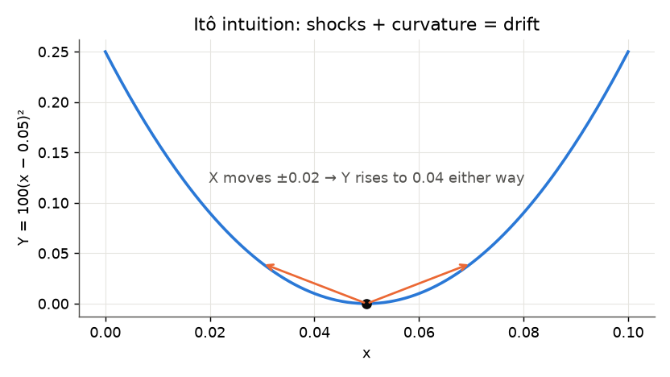

- $X(t)$ 是布朗运动，$Y(t)=100(X(t)-0.05)^2$。
- 在 $X(t)=0.05$ 处，扩散项 $dX(t)$ 让 $Y(t)$ **预期上升**：我们不知道 $X$ 会升还是降，但知道它**会变**。
- 所以扩散项 $dX(t)$ 加上函数的非线性，在 $dY(t)$ 中制造了漂移项。

数学：
- 从 $Y_t=100(X_t-0.05)^2$ 出发，在 $X_t$ 处二阶泰勒展开：

$$
dY_t=200(X_t-0.05)\,dX+\frac12\cdot200\,(dX)^2
$$

- 用 $(dX_t)^2=dt$：

$$
dY_t=100\,dt+200(X_t-0.05)\,dX_t
$$

- 漂移 $100\,dt$ **纯粹是伊藤项**，它的存在只是因为“不确定性的平方就是时间”。

💡📎 在 $X=0.05$ 处，模拟 $10^6$ 个 $dX\sim N(0,10^{-4})$：$E[dY]/dt=99.99$ ≈ 100 ✓。在这一点 $dX$ 项系数为 0，$Y$ 的变化**全部**来自伊藤项。

**例 3：债券价格的动态**

- 最简单的瞬时利率动态：$dr(t)=\sigma\,dX(t)$；$m(r,t)=0$，$s(r,t)=\sigma$。
- 到期日 $T$ 的债券价格，投资者风险中性（以后证明）：

$$
P(t,T)=e^{\frac{\sigma^2}{6}(T-t)^3-(T-t)r(t)}
$$

- 先求导数：

$$
\frac{\partial P}{\partial r}=-(T-t)P_t,\qquad\frac{\partial^2P}{\partial r^2}=(T-t)^2P_t,\qquad\frac{\partial P}{\partial t}=\left(-\frac{\sigma^2}{2}(T-t)^2+r_t\right)P_t
$$

  （$\partial/\partial t$ 时注意 $\frac{d}{dt}(T-t)^3=-3(T-t)^2$，$\frac{d}{dt}[-(T-t)]=+1$。）指数仿射的形式让每个导数都是 $P_t$ 的倍数。

- 代入伊藤引理：

$$
dP=\left[\left(-\frac{\sigma^2}{2}(T-t)^2+r_t\right)P_t+\frac12(T-t)^2P_t\sigma^2\right]dt-(T-t)P_t\sigma\,dX
$$

- 化简：伊藤项**正好抵消** $-\sigma^2/2$ 项：

$$
\boxed{\frac{dP}{P}=r_t\,dt-(T-t)\,\sigma\,dX}
$$

- **债券在期望上赚无风险利率**（这正是“风险中性”的含义），它对冲击的暴露**与久期 $(T-t)$ 成正比**。伊藤引理产生了金融，而不只是微积分。

🔗 **和第 4 讲连起来**：$\partial P/\partial r=-(T-t)P$，所以 ZCB 久期 $=T-t$，债券收益率的波动 = 久期 × 利率波动 $\sigma$。$\frac{\sigma^2}{6}(T-t)^3$ 是凸性的价值（见 4.12）。我用 SymPy 验证了这三个导数和最后的化简（漂移 = $r$，扩散 = $-(T-t)\sigma$）。

💡📎 $\sigma=1\%$，$T-t=10$，$r=3\%$：$P=e^{0.0001/6\times1000-0.3}=e^{-0.2833}=0.7533$（若没有凸性项则为 $e^{-0.3}=0.7408$）。这只债券的年化收益波动率 $=10\times1\%=10\%$。

📎 **用伊藤引理解 GBM**（课件“Part C 会再出现”的那个指数）：$dV=\mu V\,dt+\sigma V\,dX$。取 $F=\log V$：$F_V=1/V$，$F_{VV}=-1/V^2$：

$$
d\log V=\left(\frac1V\mu V-\frac12\frac1{V^2}\sigma^2V^2\right)dt+\frac1V\sigma V\,dX=\left(\mu-\frac12\sigma^2\right)dt+\sigma\,dX
$$

右边系数是常数，直接积分：

$$
\boxed{V_T=V_0\exp\left[\left(\mu-\tfrac12\sigma^2\right)T+\sigma X_T\right]},\qquad X_T\sim N(0,T)
$$

- $\log V_T$ 正态 → $V_T$ **对数正态**。$E[V_T]=V_0e^{\mu T}$（对数正态的均值公式，见[附录 F.2](#f2-对数正态分布)）。
- $-\frac12\sigma^2$ 是伊藤修正：对数收益率的期望比算术收益率的期望低 $\frac12\sigma^2$。🔗 第 1 讲的 $S_T=S_0\exp[(r-\frac12\sigma^2)T+\sigma\sqrt TZ]$ 就是 $\mu=r$ 的情形。

### 5.9 模拟扩散过程：Euler 与 Milstein

- **SDE 难解但好模拟。**
- 用一个作业里的扩散过程举例：$dV_t=\mu V_t\,dt+\sigma V_t\,dX_t$（GBM）。
- 同样的方法适用于 $dr_t=\gamma(\bar r-r_t)dt+\sigma dX_t$。
- 我们想要的解是给定 $V_t$ 时 $V_\tau$ 的概率分布（或给定 $r_t$ 时 $r_\tau$ 的分布）。没有闭式解怎么办？用近似：
  1. **离散时间、连续状态**近似（Euler、Milstein）；
  2. **离散时间、离散状态**近似（树）。

**Euler 方法（Euler–Maruyama）**

1. 以 $\Delta t$ 为间隔离散化时间（比如每天、每小时）。
2. 把扩散过程 $dy=m(y(t),t)dt+s(y(t),t)dX$ 近似为

$$
y_{t+\Delta t}-y_t=m(y(t),t)\,\Delta t+s(y(t),t)\underbrace{\sqrt{\Delta t}\,\epsilon_t}_{\Delta X_t}
$$

3. 递推：

$$
\begin{aligned}
y_{t+\Delta t}-y_t&=m(y(t),t)\Delta t+s(y(t),t)\sqrt{\Delta t}\,\epsilon_t\\
y_{t+2\Delta t}-y_{t+\Delta t}&=m(y(t+\Delta t),t+\Delta t)\Delta t+s(y(t+\Delta t),t+\Delta t)\sqrt{\Delta t}\,\epsilon_{t+\Delta t}\\
y_{t+3\Delta t}-y_{t+2\Delta t}&=m(y(t+2\Delta t),t+2\Delta t)\Delta t+s(y(t+2\Delta t),t+2\Delta t)\sqrt{\Delta t}\,\epsilon_{t+2\Delta t}
\end{aligned}
$$

4. 模拟出的 $y_\tau$ 是来自近似分布的一个随机抽样。
5. 重复很多次，计算分布的性质：均值、中位数、分位数……

**Milstein 方法**

和 Euler 一样，但当 $s$ 真的依赖于 $y(t)$ 时，加一个修正项：

$$
y_{t+\Delta t}-y_t=m(y(t),t)\Delta t+s(y(t),t)\sqrt{\Delta t}\,\epsilon_t+\frac12s(y(t),t)\frac{\partial s(y(t),t)}{\partial y}\Delta t\left(\epsilon_t^2-1\right)
$$

- 可能更精确：Milstein 的**强收敛阶（strong order）为 1**，Euler 为 1/2。
- GBM：$s(y)=\sigma y$，所以 $s\,\partial s/\partial y=\sigma^2y$。修正项 $\frac12ss'\Delta t(\epsilon^2-1)$ 用的正是“$(\Delta X)^2\approx\Delta t$ 平均成立、但逐条路径并不成立”这个事实。

📎 **修正项从哪来**：在一步内 $s(y)$ 本身也在随 $y$ 变。把 $s(y_u)\approx s(y_t)+s'(y_t)\,s(y_t)(X_u-X_t)$ 代回 $\int s\,dX$，多出一项 $ss'\int_t^{t+\Delta t}(X_u-X_t)dX_u=\frac12ss'\left[(\Delta X)^2-\Delta t\right]$，而 $(\Delta X)^2=\Delta t\,\epsilon^2$。均值为 0（$E\epsilon^2=1$），所以**不改变均值，只修正单条路径**。$s$ 不依赖 $y$ 时（Vasicek），$s'=0$，Milstein = Euler。

📎 **强收敛 vs 弱收敛**：
- **强收敛（strong）**：逐条路径的误差 $E|y_T^{\text{模拟}}-y_T^{\text{真实}}|$（用**同一条**布朗路径比较）。关心路径本身时用（比如路径依赖期权、对冲误差）。
- **弱收敛（weak）**：分布性质的误差 $|E[g(y_T^{\text{模拟}})]-E[g(y_T)]|$。只关心均值、价格、分位数时用。Euler 和 Milstein 的弱阶都是 1，所以**算价格/均值时两者差不多**。

💻 **Euler 与 Milstein 的 Python 实现**（课件代码）

```python
def m(v, mu):    return mu * v
def s(v, sigma): return sigma * v, sigma          # 返回 s(V) 和 ds/dV

def simulate(scheme, T=2, steps=500, v0=1.0, mu=0.2, sigma=0.1):
    dt, v = 1 / steps, v0
    z = rng.normal(size=int(T * steps))           # 一条路径需要的全部标准正态冲击
    for zi in z:
        s0, s_deriv = s(v, sigma)                 # 区间起点的 s 和 s'（"冻结"）
        v += m(v, mu) * dt + s0 * np.sqrt(dt) * zi           # Euler 一步
        if scheme == "milstein":
            v += 0.5 * s0 * s_deriv * dt * (zi**2 - 1)        # Milstein 修正
    return v                                      # 只返回终值 V_T
```

逐行要点：
- `s()` 同时返回 $s$ 和 $\partial s/\partial V$，这样 Milstein 只需要多一行。
- ⚠️ `steps` 是**每单位时间（每年）**的步数，`dt = 1/steps`；总步数是 `T*steps = 1000`。参数名容易让人误以为是总步数。
- ⚠️ Milstein 修正里用的是 `s0`（**更新前**的 $v$ 算出来的），这是对的；如果写成 `s(v, sigma)` 重新算，就用了更新后的 $v$，违反了“系数冻结在区间起点”。
- `v += ...` 对浮点数是重新赋值，不会出现 NumPy 数组原地修改的别名问题。
- `zi**2 - 1` 均值为 0：修正项不改变期望。
- 向量化（用二维冲击数组同时模拟所有路径）可以快几个数量级。

💻📎 **向量化版本**（自己补的）：

```python
def simulate_vec(scheme, rng, n_sims=10_000, T=2, steps=500, v0=1.0, mu=0.2, sigma=0.1):
    dt = 1 / steps
    Z = rng.normal(size=(n_sims, int(T * steps)))   # 每行一条路径
    v = np.full(n_sims, v0)
    for k in range(Z.shape[1]):                     # 只对时间循环，路径方向向量化
        z = Z[:, k]
        v_old = v
        v = v_old + mu * v_old * dt + sigma * v_old * np.sqrt(dt) * z
        if scheme == "milstein":
            v = v + 0.5 * sigma**2 * v_old * dt * (z**2 - 1)
    return v, Z
```

- 时间方向无法向量化（每步依赖上一步），但路径之间独立，可以一次处理 10,000 条。循环次数从 $10^7$ 降到 $10^3$。
- `Z` 按行存储：第 $i$ 行恰好是逐条调用 `simulate` 时第 $i$ 条路径取到的 1000 个数，所以用同一种子时两种写法结果**完全相同**（我验证过）。
- 返回 `Z` 是为了能算“同一条布朗路径下的精确解” $V_0\exp[(\mu-\frac12\sigma^2)T+\sigma\sqrt{dt}\sum_kz_k]$，用来测强误差。

**模拟例子**

- 动态：$dV=0.2V_t\,dt+0.1V_t\,dX$，$V_0=1$，$T=2$。
- 10,000 次模拟 $V_2$（每年 500 步，种子 123321）：

| | $V_2$ 的均值 | $V_2$ 的方差 |
|---|---|---|
| 精确（对数正态） | $e^{0.2\cdot2}=1.4918$ | $(e^{0.01\cdot2}-1)e^{0.8}=0.0450$ |
| Euler（课件） | 1.4939 | 0.0439 |
| Milstein（课件） | 1.4939 | 0.0439 |
| Euler（我的复现） | 1.4943 | 0.0449 |
| Milstein（我的复现） | 1.4943 | 0.0449 |

- GBM 的漂移和扩散都正比于 $V$，所以 Euler 和 Milstein 几乎重合；两者都在精确矩的蒙特卡洛噪声范围内（10,000 条路径）。
- 精确值：$E[V_T]=V_0e^{\mu T}$；$\mathrm{Var}(V_T)=V_0^2e^{2\mu T}(e^{\sigma^2T}-1)$（[附录 F.2](#f2-对数正态分布)），$\sigma^2T=0.01\times2=0.02$。
- 均值的标准误 $\approx\sqrt{0.045/10000}=0.0021$，1.4943 和 1.4918 差 0.0025，约 1.2 个标准误，正常。
- ⚠️ 我用 `default_rng(123321)` 按课件代码逐条模拟，没能复现课件的 1.4939/0.0439（课件可能用了不同的随机数调用顺序）。方差 0.0439 比精确值低 2.4%，在 10,000 条路径的抽样误差内（方差估计的相对标准误约 $\sqrt{2/10000}\times$ 峰度修正 ≈ 2%）。

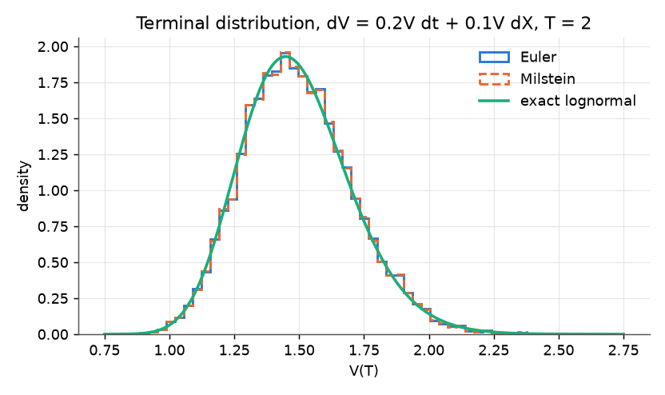

图：Euler（蓝）和 Milstein（橙虚线）的直方图几乎重合，和精确的对数正态密度（绿）一致；分布右偏。

💡📎 **强收敛阶的实验**：同一组布朗增量下，比较模拟终值和精确终值的平均绝对误差（20,000 条路径，$T=2$）：

| 每年步数 | Euler 强误差 | Milstein 强误差 |
|---|---|---|
| 4 | 0.01506 | 0.01516 |
| 16 | 0.00456 | 0.00389 |
| 64 | 0.00171 | 0.00098 |
| 256 | 0.00078 | 0.00024 |

步数 ×4 时，Euler 误差约 ÷2（$4^{1/2}$，阶 1/2），Milstein 约 ÷4（$4^1$，阶 1）。课件参数（500 步）下：Euler $5.4\times10^{-4}$，Milstein $1.3\times10^{-4}$。**逐条路径 Milstein 好 4 倍，但均值/方差几乎一样**，因为这里的误差远小于 MC 噪声（0.002）。

🛠️ **作业/项目提示**：验证模拟器的标准做法：(1) 找一个有精确解的情形（GBM、Vasicek）；(2) 比较均值、方差，看差距是否在几个标准误之内；(3) 加倍路径数，看误差是否按 $1/\sqrt N$ 缩小；(4) 加倍步数，看离散化误差是否按理论阶缩小。GBM 其实可以用精确解一步模拟，不需要 Euler；Euler 的意义在于没有精确解的模型。

### 5.10 离散时间、离散状态近似：树

- 用离散分布代替连续分布：
  - 不再用连续的高斯增量 $\Delta X\sim N(0,\Delta t)$，而让 $\Delta X$ 只能取有限个值；
  - 例如 $\Delta X$ 以概率 $p$ 取 $+A$，以 $1-p$ 取 $-B$。
- 常常不是用在布朗运动 $X$ 本身，而是用在扩散过程 $y$ 上。
  - 主要例子：股票期权定价。股价 $S_{t+\Delta t}=uS_t$ 或 $S_{t+\Delta t}=dS_t$（$u>1$，$d<1$），生成一棵未来价格的树。
- 这就是 **Cox–Ross–Rubinstein 二叉树**：随机性被事先排列好的蒙特卡洛。

🔗 **金工概**：CRR 取 $u=e^{\sigma\sqrt{\Delta t}}$，$d=1/u$，风险中性概率 $p=\frac{e^{r\Delta t}-d}{u-d}$。注意 $\log u=\sigma\sqrt{\Delta t}$：又是 $\sqrt{\Delta t}$，和 5.1 的“硬币版布朗运动”是同一个构造。

📎 💡 $\Delta X=\pm\sqrt{\Delta t}$ 各 50%：均值 0、方差 $\Delta t$，匹配了布朗增量的前两阶矩。由 5.1 的 CLT，步数足够多时，树上的分布收敛到正态。

### 5.11 应用：在险价值（VaR）

- **在险价值（Value at Risk, VaR）** 是度量公司、组合或头寸在特定时间段内金融风险水平的统计量。
- 投资银行和商业银行最常用它衡量机构组合潜在损失的程度和可能性。
- 用文字说：“**我们有 X% 的把握，未来 N 天的损失不会超过 V 美元。**” V 就是组合的 VaR，它是两个参数的函数：时间跨度（N 天）和置信水平（X%）。
- 一般地，VaR 是未来 N 天组合价值变化分布的第 $(100-X)$ 百分位数对应的损失。

**监管用途**

- 例：银行监管者（巴塞尔委员会，Basel Committee）要求银行用 $N=10$、$X=99$ 计算 VaR。
- 关注的是 10 天内的重估损失，只有 1% 的时间会超过。
- 银行必须持有的资本是这个 VaR 的 $k$ 倍；乘数逐家银行设定，**至少 3.0**。一个损失分布的分位数，悄悄决定了数百亿美元的银行资本。

**计算**

- 假设组合波动率为每天 2%，头寸 1,000 万美元。
- 习惯上假设市场变量在这段时间内的期望变化为零（Hull）。但用模拟时这个假设不必要；而且组合分布**非正态**（厚尾、拐点、混合分布）时，模拟特别有用：直接模拟过程，读出最差的 $(100-X)\%$ 即可。
- 1 天 99% VaR：

$$
2.33\times2\%\times\$10{,}000{,}000=\$466{,}000
$$

- 10 天 99% VaR（方差与 N 成正比）：

$$
2.33\times2\%\times\sqrt{10}\times\$10{,}000{,}000=\$1{,}473{,}621
$$

  其中 $N(-2.33)=1\%$：我们有 99% 的把握，一个正态变量不会下跌超过 2.33 个标准差。

⚠️ $\sqrt{10}$ 规则依赖**日收益独立同分布**（5.4：方差 ∝ 时间）。如果收益有自相关或波动率聚集，$\sqrt N$ 缩放会低估或高估。

**用模拟算 VaR**

💻 课件代码：

```python
from scipy import stats

z = stats.norm.ppf(0.99)                  # 2.3263：标准正态的 99% 分位数
var_1d = z * 0.02 * 10e6                  # $465,270
var_10d = z * 0.02 * np.sqrt(10) * 10e6   # $1,471,312

pnl = 10e6 * (np.exp(
    0.02 * np.sqrt(10) * rng.normal(size=10**6)) - 1)   # 10 天对数收益 ~ N(0, (2%√10)²)
var_sim = -np.percentile(pnl, 1)          # $1,366,827
```

- `stats.norm.ppf` 是正态分布的**分位数函数**（percent point function，CDF 的反函数）：`ppf(0.99)` = 2.3263。课件文字里的 2.33 是四舍五入，所以公式版是 \$466,000 / \$1,473,621，代码版是 \$465,270 / \$1,471,312。
- ⚠️ `10e6` 是 $10\times10^6=10^7$（一千万），不是 $10^6$。科学计数法 `1e7` 更不容易看错。
- `pnl`：假设 10 天**对数收益**正态，那么价值变化 $=10^7(e^{R}-1)$，是对数正态的，有下界（最多亏光 1,000 万）。
- `np.percentile(pnl, 1)`：第 1 百分位数（参数是 0–100 的百分数，不是 0.01！`np.quantile(pnl, 0.01)` 才用小数）。取负号把“损失”表示为正数。
- 我用 `default_rng(123)` 得到 **\$1,366,827**，和课件完全一致。

📎 **精确值**：对数正态时 1% 分位数可以直接算：$-10^7\left(e^{-2.3263\times0.02\sqrt{10}}-1\right)=\$1{,}368{,}192$。模拟值 \$1,366,827 误差 0.1%。

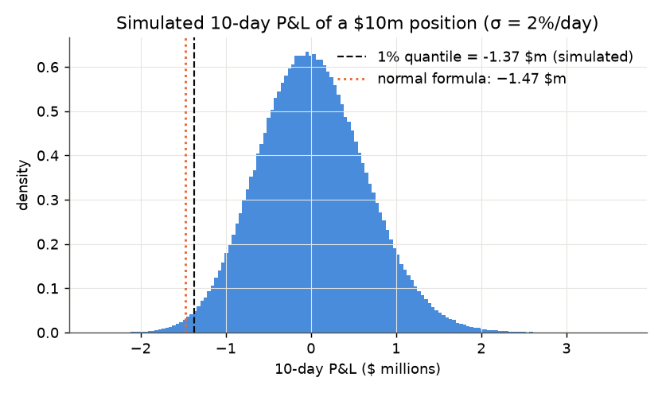

**模拟给出的 VaR 比正态公式小**：对数正态的 P&L 右偏，所以它的左尾比相应的正态分布薄（跌幅有限、涨幅无限）。

💡📎 **厚尾时反过来**：同样 2% 日波动，但日收益服从自由度 4 的 t 分布（标准化到方差 1）：1 天 99% VaR $=\$529{,}898$，比正态的 \$465,270 **大 14%**。这就是课件说的“分布非正态时模拟特别有用”：正态公式在厚尾时**低估**风险。

📎 **VaR 的局限与预期损失（Expected Shortfall, ES）**：VaR 只说“1% 的情况下至少亏多少”，不说“那 1% 里平均亏多少”。ES（也叫 CVaR）$=E[\text{损失}\mid\text{损失}\ge\text{VaR}]$。上面的例子：正态 10 天 99% ES = \$1,685,629；对数正态模拟 ES = \$1,549,893（`-pnl[pnl <= np.percentile(pnl, 1)].mean()`）。巴塞尔 III（FRTB）已把市场风险资本的度量从 99% VaR 改为 97.5% ES。

### 5.12 例子：用回归估计 Vasicek 模型

- 从美联储下载一个月期国库券利率的日度数据（https://www.federalreserve.gov/releases/h15/），估计 $\gamma$、$\bar r$、$\sigma$。把 $dt=1/252$（一天）当真，“离散化”：

$$
r_{t+dt}-r_t=\gamma(\bar r-r_t)\,dt+\epsilon_t,\qquad\epsilon_t\sim N(0,\sigma^2dt)
$$

- 这看起来就是线性回归：

$$
(r_{t+dt}-r_t)=\alpha+\beta r_t+\epsilon_t
$$

💻 课件代码：

```python
dr = np.diff(r)                                 # 日变化 r_{t+1} - r_t，长度 T-1
X = np.column_stack([np.ones(len(dr)), r[:-1]]) # 设计矩阵：[常数, r_t]
b = np.linalg.lstsq(X, dr, rcond=None)[0]       # [alpha, beta]

gamma = -b[1] / dt                              # dt = 1/252
rbar = -b[0] / b[1]
sigma = (dr - X @ b).std(ddof=2) / np.sqrt(dt)
```

逐行：
- `np.diff(r)` 比 `r` 少一个元素；回归元用 `r[:-1]`（去掉最后一个），保证 $r_t$ 和 $r_{t+1}-r_t$ 对齐。⚠️ 写成 `r[1:]` 就用了“未来”的利率做解释变量，属于前视偏差。
- `np.column_stack([np.ones(...), r[:-1]])`：加一列 1 作为截距。
- `np.linalg.lstsq(X, dr, rcond=None)` 解最小二乘，返回元组，`[0]` 是系数。`rcond=None` 是为了消除旧版本的警告（🔗 附录 E：内部用 SVD）。
- `std(ddof=2)`：残差的标准差，自由度扣掉 2 个估计参数（$\alpha$、$\beta$）。
- `/ np.sqrt(dt)`：残差方差是 $\sigma^2dt$，所以 $\sigma=\text{sd}/\sqrt{dt}$，**年化**。

**问题**

(a) 用 $\gamma$、$\bar r$ 表示 $\alpha$ 和 $\beta$。怎么估计 $\sigma$？注意年化（日度数据、年度参数）；回忆 Vasicek 中 $r_t$ 是连续复利利率。

→ 展开 $\gamma(\bar r-r_t)dt=\gamma\bar r\,dt-\gamma\,dt\,r_t$：

$$
\alpha=\gamma\bar r\,dt,\qquad\beta=-\gamma\,dt\quad\Longrightarrow\quad\gamma=-\frac{\beta}{dt},\quad\bar r=-\frac\alpha\beta,\quad\sigma=\frac{\text{sd}(\hat\epsilon)}{\sqrt{dt}}
$$

  这正是代码里的三行。⚠️ H.15 公布的国库券利率是**贴现率/债券等价收益率**（年化、百分数），用之前要除以 100 并转成连续复利（第 2 讲 2.3）。

(b) 用估计值和今天的利率，预测未来 5 年的利率。均值路径：$E[r_{t+\tau}]=\bar r+(r_0-\bar r)e^{-\gamma\tau}$。

(c) 用模拟做情景分析：画出 1、3、5 年后模拟利率的直方图，和预测比较。

💡📎 **没有真实数据时，先用模拟数据检验代码**（参数已知，看能否估回来）：$\gamma=0.25$，$\bar r=4\%$，$\sigma=1\%$，$r_0=2\%$，模拟 20 年日度数据（用 F.6 的精确离散化，种子 2026）。

| | $\gamma$ | $\bar r$ | $\sigma$ |
|---|---|---|---|
| 真实值 | 0.25 | 4.00% | 1.000% |
| 一次 20 年样本的估计 | 0.155 | 3.97% | 1.003% |
| 300 次重复：估计的均值 | **0.50** | 4.00% | 1.000% |
| 300 次重复：估计的标准差 | 0.29 | 0.87% | 0.010% |

- **$\sigma$ 估得极准**，$\bar r$ 还行，**$\gamma$ 非常不准而且向上偏**（均值是真实值的 2 倍）。
- 原因：$\sigma$ 由**高频**的日变化决定，5000 个观测都有贡献；$\gamma$ 由**慢速**的均值回归决定，半衰期 $\ln2/0.25=2.8$ 年，20 年里只有约 7 个“回归周期”，信息很少。$\hat\beta$ 接近 0（$-0.001$），它的小样本偏误（Kendall/Hurwicz 偏误：自回归系数向下偏，即回归速度向上偏）被 $1/dt=252$ 放大。
- 🛠️ **教训**：数据频率越高，波动率估得越准；但**均值回归速度只取决于样本的时间跨度**，不取决于频率。用日度数据不会让 $\gamma$ 变准。做项目时报告 $\gamma$ 要附上标准误或 bootstrap 区间。

**预测与模拟**（用真实参数，$r_0=2\%$）

| $\tau$（年） | $E[r_{t+\tau}]$ | 标准差 | 90% 区间 | 模拟均值 / 标准差（10,000 条 Euler 路径） | $P(r<0)$ |
|---|---|---|---|---|---|
| 1 | 2.44% | 0.89% | [0.98%, 3.90%] | 2.44% / 0.88% | 0.30% |
| 3 | 3.06% | 1.25% | [1.00%, 5.11%] | 3.05% / 1.25% | 0.71% |
| 5 | 3.43% | 1.35% | [1.20%, 5.66%] | 3.41% / 1.35% | 0.57% |

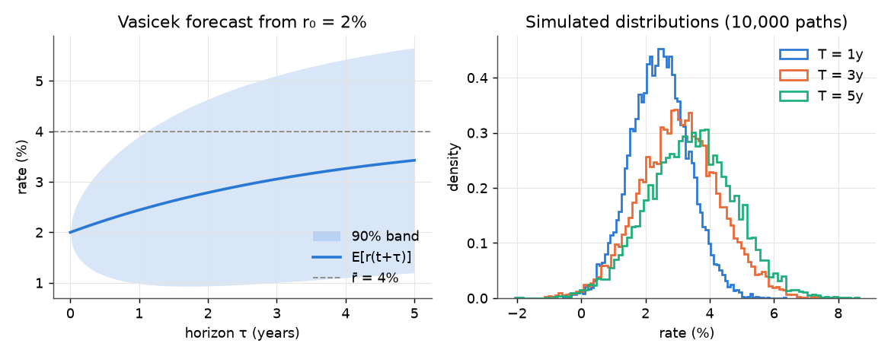

- 均值以半衰期 2.8 年向 4% 回归；标准差趋于平稳值 $\sigma/\sqrt{2\gamma}=1.41\%$，所以 90% 区间先张开后变平（不像布朗运动那样无限变宽）。
- 模拟和解析公式吻合：这就是验证模拟器的方式。
- 利率有小概率为负，Vasicek 的已知缺陷（📎 CIR 模型 $dr=\gamma(\bar r-r)dt+\sigma\sqrt r\,dX$ 可以避免）。

💻📎 **预测与模拟代码**：

```python
gam, rbar, sig, r0 = 0.25, 0.04, 0.01, 0.02
tau = np.array([1, 3, 5])
mean = rbar + (r0 - rbar) * np.exp(-gam * tau)                  # 条件均值
sd = sig * np.sqrt((1 - np.exp(-2 * gam * tau)) / (2 * gam))     # 条件标准差

dt, M = 1 / 252, 10_000
rs = np.full(M, r0)
for i in range(1, 5 * 252 + 1):                                  # Euler，10,000 条路径并行
    rs = rs + gam * (rbar - rs) * dt + sig * np.sqrt(dt) * rng.normal(size=M)
    if i % 252 == 0 and i // 252 in (1, 3, 5):
        print(i // 252, rs.mean(), rs.std())
```

### 5.13 留给后面课程的问题

- 如果投资者**风险中性**，任何资产的价值都是未来期望收益的贴现值。
- 对任何收益结构：向前模拟过程，再贴现回来计算期望值：**蒙特卡洛定价**。
- 如果投资者**不是**风险中性的呢？合适的贴现率是什么？
- 现代金融建立在**一价定律（law of one price）** 上：

$$
p=E(mX)
$$

  $X$ 是资产未来的收益，$m$ 是**随机贴现因子（stochastic discount factor, SDF）**。
- 这个原理推动了蒙特卡洛方法在金融、特别是金融工程中的广泛使用。**模拟 + 定价核 = 通用定价机器**，这是后面几讲的主题。

🔗 例 3 的“投资者风险中性”就是 $m=e^{-\int r\,dt}$ 的特例：在风险中性测度下，$dP/P$ 的漂移恰好是 $r$。🔗 金工概的风险中性定价 $C_0=e^{-rT}E^Q[\text{payoff}]$ 也是 $p=E(mX)$ 换测度后的写法。

### 第 5 讲小结

```
随机游走 ΔXᵢ = √Δt εᵢ  ──n→∞, CLT──►  布朗运动 X(t) ~ N(0, t)
                                        独立增量、连续、处处不可导、鞅、马尔可夫
                                        (dX)² = dt，dX·dt = 0，(dt)² = 0
                     │
ODE dB = rB dt  ──+ σ dX──►  SDE  dX = μ(X,t) dt + σ(X,t) dB
                                  漂移 O(dt)，扩散 O(√dt)
                     │
伊藤引理  dF = (F_r m + F_t + ½ F_rr s²) dt + F_r s dX
          ½F_rr s² = 凸性 × 方差（Jensen）
     例：d log V = (μ − ½σ²)dt + σdX ⟹ GBM 对数正态
         ZCB：dP/P = r dt − (T−t) σ dX（暴露 ∝ 久期）
                     │
模拟：Euler（强阶 ½）· Milstein（+½ s s' Δt (ε²−1)，强阶 1）· 二叉树
                     │
应用：VaR = 损失分布的分位数（Basel：10 天 99%，资本 ≥ 3×VaR）
      Vasicek 估计：回归 Δr = α + β r，γ = −β/dt，r̄ = −α/β，σ = sd/√dt
      → 预测、情景模拟；γ 估计偏误大
                     │
下一步：p = E(mX)，模拟 + 定价核 = 通用定价机器
```

编程要点：`np.random.default_rng(seed)`（按顺序取数）；`rng.normal(0, sd)` 第二参数是标准差；`np.cumsum(axis=1)`；向量化路径；`scipy.stats.norm.ppf`；`np.percentile(x, 1)` 用百分数；`np.linalg.lstsq`；`std(ddof=2)`；`sympy.Rational(1, 2)`。

<details>
<summary>✅ 自测题</summary>

1. 为什么布朗运动的单步增量是 $\sqrt{\Delta t}\epsilon$ 而不是 $\Delta t\,\epsilon$？
   → 要让 $n$ 步的总方差 $n\cdot\mathrm{Var}$ 有限且非零，单步方差必须是 $\Delta t$；用 $\Delta t\,\epsilon$ 时总方差 $t\Delta t\to0$。
2. 计算 $(dX)^2$、$dX\,dt$、$(dt)^2$、$dX_1dX_2$（相关系数 $\rho$）。
   → $dt$、0、0、$\rho\,dt$。
3. $X$ 是布朗运动，求 $d(X^3)$。
   → $F_X=3X^2$，$F_{XX}=6X$：$d(X^3)=3X\,dt+3X^2dX$。
4. 股价服从 GBM，$\mu=10\%$，$\sigma=30\%$。$\log S$ 的漂移是多少？中位数增长率是多少？
   → $\mu-\frac12\sigma^2=5.5\%$；中位数 $S_0e^{0.055T}$，均值 $S_0e^{0.1T}$。
5. Vasicek 模型中 Milstein 和 Euler 有区别吗？
   → 没有。扩散系数 $\sigma$ 不依赖 $r$，$s'=0$，修正项为 0。
6. 头寸 500 万，日波动 1.5%，正态。1 天和 10 天 99% VaR？
   → $2.3263\times1.5\%\times5\times10^6=\$174{,}476$；$\times\sqrt{10}=\$551{,}742$。
7. 日度回归得 $\hat\alpha=2\times10^{-5}$、$\hat\beta=-8\times10^{-4}$、残差标准差 $6\times10^{-4}$，$dt=1/252$。求 $\gamma$、$\bar r$、$\sigma$。
   → $\gamma=0.0008\times252=0.2016$；$\bar r=2\times10^{-5}/8\times10^{-4}=2.5\%$；$\sigma=0.0006\times\sqrt{252}=0.95\%$。
8. 为什么用更高频率（比如分钟）数据不能让 $\gamma$ 估得更准？
   → 均值回归的信息取决于样本覆盖的总时间（有几个回归周期），而不是观测次数；频率只提高波动率的估计精度。

</details>

---

## 附录 A 公式速查

**贴现与利率（第 2 讲）**

| 内容 | 公式 |
|---|---|
| 现值 / 终值 | $PV=F\,Z(t,t+k)$，$FV=C/Z(t,t+k)$ |
| EAR | $Z(t,T)=(1+\text{EAR})^{-(T-t)}$，$\text{EAR}=Z^{-1/(T-t)}-1$ |
| APR 与 EAR | $1+\text{EAR}=(1+\text{APR}/n)^n$，$\text{APR}=n[(1+\text{EAR})^{1/n}-1]$ |
| $n$ 次复利即期利率 | $Z=(1+r_n/n)^{-n(T-t)}$，$r_n=n\left[Z^{-1/[n(T-t)]}-1\right]$ |
| 连续复利 | $Z=e^{-r(T-t)}$，$r=-\dfrac{\log Z}{T-t}$；一年期 $\text{EAR}=e^r-1$ |
| 多笔现金流 | $PV=\sum_j C_j Z(t,T_j)$ |
| 等额本息月供 | $C=\dfrac{P r_m}{1-(1+r_m)^{-N}}$（$r_m=0$ 时 $C=P/N$） |
| 余额递推 | $I_j=r_mB_{j-1}$，$A_j=C-I_j$，$B_j=(1+r_m)B_{j-1}-C$，$B_0=P$，$B_N=0$ |
| 等额本金总利息 | $r_mP(N+1)/2$ |
| 借款人 NPV | $P-\sum_{j=1}^N C/(1+d_m)^j$；$d_m=(1+d)^{1/12}-1$ |
| 附息债券 | $P=\sum_{j=1}^{mk}\frac{cF}{m}Z(t,t+j/m)+F\,Z(t,t+k)$ |
| YTM（半年付息） | $P=\sum_{j=1}^{2k}\frac{cF/2}{(1+y/2)^j}+\frac{F}{(1+y/2)^{2k}}$ |
| 远期贴现因子 | $F(t,T_1,T_2)=Z(t,T_2)/Z(t,T_1)$ |
| 连续复利远期利率 | $f=\dfrac{(T_2-t)r(t,T_2)-(T_1-t)r(t,T_1)}{T_2-T_1}=\dfrac{\log Z(t,T_1)-\log Z(t,T_2)}{T_2-T_1}$ |
| 远期利率（EAR） | $(1+r_{T_1})^{T_1}(1+f)^{T_2-T_1}=(1+r_{T_2})^{T_2}$ |

**PCA（第 3 讲）**

| 内容 | 公式 |
|---|---|
| 因子构造 | $P_t=Y_tB$，$P=YB$；$B$ 第 $k$ 列 = $\beta_k$ |
| 最大化问题 | $\max\beta'M\beta$ s.t. $\beta'\beta=1$ ⟹ $M\beta=\lambda\beta$ |
| 谱分解 | $M=B\Lambda B'$，$B'B=BB'=I$，$\mathrm{Var}(P_t)=\Lambda$ |
| 解释方差比例 | $\lambda_k/\sum_j\lambda_j$，$\sum_j\lambda_j=\mathrm{tr}(M)$ |
| 因子到利率 | $Y=PB'$，即 $G=B'$，$\gamma_{ik}=\beta_{ki}$ |
| 蝶式价差 | $-y_S+2y_M-y_L$ |

**久期、凸性与数值求导（第 4 讲）**

| 内容 | 公式 |
|---|---|
| 对数收益率 | $d\log P=dP/P$ |
| 久期（c-c） | $D=-\frac1P\frac{dP}{dy}=-\frac{d\log P}{dy}=\sum_iw_iT_i$，$w_i=CF_ie^{-T_iy}/P$；ZCB：$D=M$ |
| 麦考利 / 修正久期 | $D=-(1+y_1)\frac1P\frac{dP}{dy_1}$；$D_M=-\frac1P\frac{dP}{dy_n}$；$D=(1+y_n/n)D_M$ |
| 凸性（c-c） | $C=\frac1P\frac{d^2P}{dy^2}=\sum_iw_iT_i^2=D^2+\sum_iw_i(T_i-D)^2$；ZCB：$C=M^2$ |
| 半年复利 ZCB | $D_M=\frac{T}{1+y/2}$，$C=\frac{T(T+0.5)}{(1+y/2)^2}$ |
| 二阶近似 | $\Delta P\approx-PD\Delta y+\frac12PC(\Delta y)^2$ |
| 组合 | 久期、凸性 = 成分的市值加权平均 |
| 有限差分 | 前向 $\frac{f(x+h)-f(x)}{h}$，$O(h)$；中心 $\frac{f(x+h)-f(x-h)}{2h}$，$O(h^2)$；二阶 $\frac{f(x+h)-2f(x)+f(x-h)}{h^2}$ |
| 最优步长 | 前向 $h^*\approx\sqrt\varepsilon\approx10^{-8}$；中心 $h^*\approx\varepsilon^{1/3}\approx5\times10^{-6}$；$\varepsilon=2.2\times10^{-16}$ |

**布朗运动、伊藤引理与模拟（第 5 讲）**

| 内容 | 公式 |
|---|---|
| 布朗增量 | $\Delta X=\sqrt{\Delta t}\,\epsilon$；$X_t-X_s\sim N(0,t-s)$ |
| 乘法规则 | $(dX)^2=dt$，$dX\,dt=0$，$(dt)^2=0$，$dX_1dX_2=\rho\,dt$ |
| SDE | $dX=\mu(X,t)dt+\sigma(X,t)dB$；$E_t(dX)=\mu dt$，$\mathrm{Var}_t(dX)=\sigma^2dt$ |
| 均值回归 ODE | $\frac{dr}{dt}=\gamma(\bar r-r)$ ⟹ $r(t)=\bar r-(\bar r-r(0))e^{-\gamma t}$；半衰期 $\ln2/\gamma$ |
| 伊藤引理 | $dF=\left(F_rm+F_t+\frac12F_{rr}s^2\right)dt+F_rs\,dX$ |
| 例 | $d(r^2)=(2\gamma r(\bar r-r)+\sigma^2)dt+2\sigma r\,dX$；$d(e^{A-Br})=\left(-B\gamma(\bar r-r)+\frac12B^2\sigma^2\right)F\,dt-B\sigma F\,dX$ |
| 债券（$dr=\sigma dX$） | $P=e^{\frac{\sigma^2}{6}(T-t)^3-(T-t)r}$，$\frac{dP}{P}=r\,dt-(T-t)\sigma\,dX$ |
| GBM | $d\log V=(\mu-\frac12\sigma^2)dt+\sigma dX$；$V_T=V_0e^{(\mu-\frac12\sigma^2)T+\sigma X_T}$；$E V_T=V_0e^{\mu T}$，$\mathrm{Var}V_T=V_0^2e^{2\mu T}(e^{\sigma^2T}-1)$ |
| Vasicek 条件分布 | $r_{t+\tau}\sim N\left(\bar r+(r_t-\bar r)e^{-\gamma\tau},\frac{\sigma^2}{2\gamma}(1-e^{-2\gamma\tau})\right)$ |
| Euler | $y_{t+\Delta t}=y_t+m\Delta t+s\sqrt{\Delta t}\,\epsilon$（强阶 ½） |
| Milstein | Euler $+\frac12ss'\Delta t(\epsilon^2-1)$（强阶 1）；GBM：$ss'=\sigma^2y$ |
| VaR（正态，均值 0） | $z_{X}\cdot\sigma_{\text{日}}\sqrt N\cdot W$；$z_{0.99}=2.3263$ |
| ES（正态） | $\sigma\sqrt N W\,\varphi(z_X)/(1-X)$ |
| Vasicek 回归 | $\Delta r=\alpha+\beta r_t+\epsilon$；$\alpha=\gamma\bar r\,dt$，$\beta=-\gamma\,dt$；$\sigma=\mathrm{sd}(\hat\epsilon)/\sqrt{dt}$ |
| 一价定律 | $p=E(mX)$ |

**第 1 讲（syllabus）**

| 内容 | 公式 |
|---|---|
| 欧式看涨期权风险中性定价 | $C_0=e^{-rT}\mathbb E^Q[\max(S_T-K,0)]$ |
| GBM 下 $S_T$ | $S_T=S_0\exp[(r-\tfrac12\sigma^2)T+\sigma\sqrt T Z]$ |
| 蒙特卡洛估计与标准误 | $\widehat C_N=\frac1N\sum X_i$，$\widehat{SE}=s_X/\sqrt N$ |
| P/E 与 PEG | $P/E=\text{价格}/\text{EPS}$；$\text{PEG}=(P/E)/(g\times100)$ |

---

## 附录 B Python 工具速查

| 工具 | 用途 | 要点 / 坑 | 出处 |
|---|---|---|---|
| `x**n` | 求幂 | 不是 `^`（按位异或） | L2 |
| `math.isclose(a, b, rel_tol=, abs_tol=)` | 浮点比较 | 与 0 比较必须给 `abs_tol` | L2 |
| `math.log1p(x)` / `math.expm1(x)` | 精确计算 $\log(1+x)$、$e^x-1$ | $x$ 很小时避免精度损失 | L2 |
| `f"{x:.2f}"`、`{x:,.2f}`、`{x:.4%}`、`{s:<8}`、`{x:>12.2f}` | 格式化输出 | `%` 会自动 ×100 | L2 |
| `np.empty(n)` / `np.full(n, v)` / `np.arange(a, b)` | 创建数组 | `arange` 不含终点 | L2 |
| `cf @ disc` | 向量内积（加权求和） | 替代循环 | L2 |
| `np.diff(x)` | 相邻差分 | 长度减 1 | L2 |
| `np.r_[a, b]` | 拼接标量与数组 | | L2 |
| `np.allclose(a, b)` | 数组近似相等 | | L2 |
| `scipy.optimize.brentq(f, lo, hi, xtol=)` | 有区间的求根 | 必须 `f(lo)*f(hi) < 0` | L2 |
| `numpy_financial.irr(cfs)` | 内部收益率 | 第 0 期是负的买价；返回**每期**利率 | L2 |
| `matplotlib`：`fig, ax = plt.subplots()`、`ax.plot`、`ax.set(...)`、`fig.savefig(..., dpi=)`、`plt.close(fig)` | 画图 | 循环画图要 `close` | L2 |
| `pathlib.Path(...).write_text / read_text(encoding="utf-8")` | 读写文本 | | L2 |
| `csv.writer(f).writerow([...])` | 写 CSV | `open(..., "w", newline="")` | L2 |
| `pd.read_excel(path, header=3)` | 读 Excel | `header` 是表头行的 0 起索引 | L3 |
| `pd.to_datetime(df[["year","month","day"]])` | 由年月日列拼日期 | 列名需为小写 year/month/day | L3 |
| `df.iloc[:, 3:].to_numpy(float)` | 按位置切片转数组 | | L3 |
| `dates.dt.month`、`pd.date_range(..., freq="ME")` | 日历特征、月末网格 | `"ME"` 为 pandas ≥ 2.2 写法 | L3 |
| `np.cov(X, rowvar=False)` | 协方差矩阵（列为变量） | 默认 `rowvar=True` 把行当变量 | L3 |
| `np.linalg.eigvalsh(M)` / `np.linalg.eigh(M)` | 对称矩阵特征值 / 特征向量 | **升序**；特征向量符号任意 | L3 |
| `sklearn.decomposition.PCA().fit(X)` | PCA | `components_` = $B'$；自动去均值 | L3  📎 |
| `w @ t`、`w @ t**2` | 久期、凸性（现值加权和） | | L4 |
| `sympy.symbols(..., positive=True)`、`sp.diff(f, x, k)`、`sp.simplify`、`.subs(x, v)` | 符号求导 | 系数写 `sp.Rational(1, 2)`，不要 `1/2` | L4、L5 |
| 中心差分 `(f(x+h)-f(x-h))/(2*h)` | 数值求导 | 一阶 $h\sim10^{-6}$，二阶 $h\sim10^{-4}$；MC 定价要用共同随机数 | L4 |
| `np.finfo(float).eps` | 机器精度 $2.2\times10^{-16}$ | | L4 📎 |
| `jax.grad(f)`、`jax.grad(jax.grad(f))` | 自动微分（反向模式） | 用 `jax.numpy`；输入为浮点、输出为标量 | L4 |
| `rng.normal()`、`rng.uniform()`、`rng.integers(lo, hi, size=)` | 随机数 | 同一 `rng` 按顺序取数；`integers` 不含 `hi` | L5 |
| `rng.normal(0, np.sqrt(dt), size=(m, n))` | 布朗增量 | 第二个参数是**标准差** | L5 |
| `np.cumsum(dW, axis=1)`、`np.hstack([np.zeros((m,1)), ...])` | 累加成路径 | | L5 |
| `scipy.stats.norm.ppf(q)` / `.cdf` / `.pdf` | 正态分位数 / 分布函数 / 密度 | `ppf(0.99)=2.3263` | L5 |
| `np.percentile(x, 1)` / `np.quantile(x, 0.01)` | 分位数 | `percentile` 用 0–100 | L5 |
| `np.column_stack([np.ones(n), x])` | 加截距的设计矩阵 | | L5 |
| `np.linalg.lstsq(X, y, rcond=None)[0]` | 最小二乘系数 | 返回元组，取 `[0]` | L5 |
| `x.std(ddof=k)` | 样本标准差 | 回归残差用 `ddof=参数个数` | L5 |
| `np.random.default_rng(seed)` | 可复现随机数 | 新式 API，替代 `np.random.seed` | L1 📎 |

---

## 附录 C 术语中英对照

| 中文 | English | 出处 |
|---|---|---|
| 智能体系统 | agent system | L1 |
| 因子动物园 | factor zoo | L1 |
| 多重检验 / 假发现 | multiple testing / false discovery | L1 |
| 幸存者偏差 / 选择偏差 | survivorship bias / selection bias | L1 |
| 样本外检验 | out-of-sample test | L1 |
| 风险中性测度 | risk-neutral (pricing) measure $Q$ | L1 |
| 几何布朗运动 | geometric Brownian motion (GBM) | L1 |
| 标准误 | standard error (SE) | L1 |
| 时间步长偏差 | time-step bias | L1 |
| 路径依赖期权 | path-dependent option | L1 |
| 市盈率 / 市盈增长比 | P/E ratio / PEG ratio | L1 |
| 一致预期 | consensus (estimate) | L1 |
| 公司自由现金流 / 股权自由现金流 | FCFF / FCFE | L1 |
| 加权平均资本成本 | WACC | L1 |
| 融资应收款 | financing receivables | L1 |
| 回测 / 回撤 / 换手率 | backtest / drawdown / turnover | L1 |
| 信息泄露 / 过拟合 | information leakage / overfitting | L1 |
| 验收标准 | acceptance criteria | L1 |
| 现值 / 终值 | present value / future value | L2 |
| 贴现函数 / 贴现因子 | discount function / discount factor | L2 |
| 零息债券 | zero-coupon bond (ZCB) / discount bond | L2 |
| 有效年利率 | effective annual rate (EAR) | L2 |
| 名义年利率 / 年百分率 | annual percentage rate (APR), nominal annual rate | L2 |
| 连续复利 | continuous compounding | L2 |
| 计息天数约定 | day-count convention | L2 |
| 即期利率 / 零息收益率 | spot rate / zero-coupon yield | L2 |
| 等额本息 / 等额本金 | equal installment (level payment) / equal amortization | L2 |
| 摊还 / 摊还表 | amortization / amortization schedule | L2 |
| 净现值 / 机会成本 | net present value (NPV) / opportunity cost | L2 |
| 利率期限结构 / 收益率曲线 | term structure of interest rates / yield curve | L2 |
| 附息债券 / 普通债券 | coupon bond / straight (bullet) bond | L2 |
| 票面利率 / 面值 | coupon rate / face (par) value | L2 |
| 应计利息 | accrued interest | L2 |
| 到期收益率 | yield to maturity (YTM) | L2 |
| 内部收益率 | internal rate of return (IRR) | L2 |
| 平价债券 | par bond | L2 |
| 半年复利等价收益率 | bond equivalent yield (BEY) | L2 |
| 再投资风险 | reinvestment risk | L2 |
| 票息效应 | coupon effect | L2 📎 |
| 静态复制 / 合成工具 | static replication / synthetic instrument | L2 |
| 卖空 | short selling | L2 |
| 远期利率 / 远期贴现因子 | forward rate / forward discount factor | L2 |
| 息票剥离法 | bootstrapping | L2 📎 |
| 主成分分析 | principal component analysis (PCA) | L3 |
| 协方差矩阵 | covariance matrix | L3 |
| 特征值 / 特征向量 | eigenvalue / eigenvector | L3 |
| 半正定 | positive semi-definite | L3 |
| 载荷 | loading | L3 |
| 解释方差比例 | explained variance (share) | L3 |
| 因子分析 | factor analysis | L3 |
| 水平 / 斜率 / 曲率 | level / slope / curvature | L3 |
| 基点 | basis point (bp) = 0.01% | L3 |
| 百分点 | percentage point (pp) | L3 |
| 蝶式交易 / 蝶式价差 | butterfly trade / butterfly spread | L3 |
| 扭转 | twist | L3 |
| 收益率曲线套利 | yield curve arbitrage | L3 |
| 简单收益率 / 对数收益率 | simple return / log return | L4 |
| 久期 / 麦考利久期 / 修正久期 | duration / Macaulay duration / modified duration | L4 |
| 凸性 | convexity | L4 |
| 希腊字母 | the Greeks (Delta, Gamma, Theta, Vega, Rho) | L4 |
| 动态对冲 / 市场中性 | dynamic hedging / market-neutral | L4 |
| 符号求导 | symbolic differentiation | L4 |
| 有限差分（前向 / 后向 / 中心） | finite difference (forward / backward / central) | L4 |
| 截断误差 / 舍入误差 | truncation error / roundoff error | L4 |
| 机器精度 | machine epsilon $\varepsilon_{mach}$ | L4 |
| 灾难性抵消 | catastrophic cancellation | L4 📎 |
| 自动微分 / 反向传播 | automatic differentiation (AD) / backpropagation | L4 |
| 对偶数 | dual number | L4 📎 |
| 路径希腊字母 | pathwise Greeks | L4 |
| 杠铃 / 子弹 | barbell / bullet | L4 |
| 随机过程 / 随机游走 | stochastic process / random walk | L5 |
| 布朗运动 / 维纳过程 | Brownian motion / Wiener process | L5 |
| 中心极限定理 | central limit theorem (CLT) | L5 |
| 伪随机数 / 种子 | pseudo-random number / seed | L5 |
| 平方变差 | quadratic variation | L5 |
| 马尔可夫性 / 鞅 | Markov property / martingale | L5 |
| 随机微分方程 | stochastic differential equation (SDE) | L5 |
| 漂移 / 扩散 / 扩散过程 | drift / diffusion / diffusion process | L5 |
| 均值回归 / 半衰期 | mean reversion / half-life | L5 |
| OU 过程 / Vasicek 模型 | Ornstein–Uhlenbeck process / Vasicek model | L5 |
| 伊藤引理 | Itô's lemma | L5 |
| 几何布朗运动 / 对数正态 | geometric Brownian motion (GBM) / lognormal | L5 |
| Euler 格式 / Milstein 格式 | Euler(–Maruyama) scheme / Milstein scheme | L5 |
| 强收敛 / 弱收敛 | strong / weak convergence | L5 📎 |
| 二叉树 | binomial tree (Cox–Ross–Rubinstein) | L5 |
| 在险价值 | Value at Risk (VaR) | L5 |
| 预期损失 | expected shortfall (ES) / CVaR | L5 📎 |
| 巴塞尔委员会 | Basel Committee | L5 |
| 一价定律 / 随机贴现因子 | law of one price / stochastic discount factor (SDF) | L5 |
| 峰度 / 厚尾 | kurtosis / fat tails | L5、附录 F |
| 伊藤等距 | Itô isometry | 附录 F 📎 |

---

## 附录 D 课件勘误与版本差异

**第 2 讲新旧版差异**（`lecture2.pdf` 旧版 45 页 MATLAB ↔ `lecture2（1）.pdf` 新版 56 页 Python）

| 位置 | 旧版 | 新版 | 说明 |
|---|---|---|---|
| 编程语言 | MATLAB（`fzero`/`fsolve`、`sprintf`/`fprintf`） | Python（`brentq`、`npf.irr`、f-string、`csv`） | 以新版为准 |
| 房贷例子 | 只有通用公式，“See code” | 给出 $P=2{,}000{,}000$、6%、25 年，月供 12,886.03；期限比较 | 新版更完整 |
| 两年期债券、三只债券 | 只提问，无答案 | 给出价格和 YTM，并给出 A/2+C/2 复制 B 的套利 | 新版补全 |
| 远期利率玩具例子 | 只提问 | 给出全部答案表 | 新版补全 |
| 复利约定表 | 列了 BEY、“信用卡” | 增加连续复利一行 | 旧版补充了 BEY 的名字 |
| 期限比较 | 旧版提到可对比招商银行房贷计算器 | 无 | 笔记 2.4 补了等额本金对比 |

**旧版课件笔误**（新版已改正）

| 位置 | 问题 | 正确 |
|---|---|---|
| 旧版 p.15，EAR = 11% 表 | 把 10.713% 写在“Quarterly”行，“Semi-annual”留空 | 10.713% 是半年复利；季复利应为 10.573% |
| 旧版 p.26，附息债券的即期利率公式 | 面值项贴现用 $r_2(t,t+0.5)$ | 应为 $r_2(t,t+k)$ |
| 旧版 p.41 | “Can invest \$1 at t in bond maturing at $T-2$” | 应为 $T_2$ |

**第 3 讲**

| 位置 | 问题 | 说明 |
|---|---|---|
| p.21 vs p.17/19 | 文字说“第二因子正冲击使短端下降、长端上升；第三因子正冲击使两端上升、中间下降”，但 p.17/19 的 Python 载荷图符号正好相反 | 特征向量符号任意，不算错误，但要说清约定（见 3.7） |
| p.20 | “using the property $B'B=I$ gives $G=B'$” | 由 $P=YB$ 推 $Y=PB'$ 用的是 $BB'=I$；对正交方阵两者等价（见 3.6） |
| p.8 | 称因子“相互独立” | 严格说是不相关（正态时才等价于独立） |
| p.23 | “profits during a positive butterfly spread” | 做多中期、做空两翼的组合在按 $-y_S+2y_M-y_L$ 定义的价差**下降**时获利；“positive”应按 Veronesi 的因子符号理解（见 3.8） |

**第 4 讲**（`slides4.pdf`，18 页）

| 位置 | 问题 | 说明 |
|---|---|---|
| p.16 | 没说明复利约定 | 数字对应**半年复利**：$100000/1.0325^{40}=27{,}822.59$，修正久期 $T/(1+y/2)$，凸性 $T(T+0.5)/(1+y/2)^2$（见 4.10） |
| p.16 | 先写子弹凸性 384.60，后面又写 385 | 同一个数的四舍五入 |
| p.17 | “the bullet earns 6.5%; the barbell earns about 6.2%” | 6.5%、6.2% 是半年复利的年化收益率（APR）；按一年持有期收益率算是 6.61% vs 6.30%（见 4.11） |
| p.13 | 前向差分最优误差 “≈ 3 × 10⁻¹⁰”；中心差分 $h^*\approx\varepsilon^{1/3}\approx4\times10^{-6}$ | 我实测前向差分最小误差约 $4.5\times10^{-9}$（理论量级 $\sqrt\varepsilon\sim10^{-8}$）；$\varepsilon=2.2\times10^{-16}$ 时 $\varepsilon^{1/3}=6\times10^{-6}$，用单位舍入 $\varepsilon/2$ 时是 $4.8\times10^{-6}$，量级一致（见 4.8） |
| p.10 | 凸性写成 $\frac1P\frac{d^2P}{dr^2}$，而 p.6–9 用 $y$ | 对 ZCB，$r$ 就是它的收益率；对附息债券应理解为对收益率 $y$ 求导 |
| p.14 | JAX 代码 | 本机未安装 JAX 未直接运行；用 SymPy、中心差分和自写的对偶数 AD 验证了 4.2904 / 20.0950 |

**第 5 讲**（`lecture5.pdf`，50 页）

| 位置 | 问题 | 说明 |
|---|---|---|
| p.8 | `rng.integers(0, 10, size=5) -> [9 2 2 1 3]` | 只有在同一个 `rng` 先调用过 `normal()`、`uniform()` 之后才是这个结果；新建 `default_rng(123)` 直接调用得 `[0 6 5 0 9]` |
| p.9 | 20,000 条路径方差 0.997 | 我用 `default_rng(123)` 得 0.995（均值 +0.0049 一致）；差别来自随机数流的位置，均在抽样误差内 |
| p.13–14 | $\mathrm{Var}(\epsilon_i^2)=2$、$E(dX)^4=3dt^2$ | 默认 $\epsilon$ 为正态；一般分布是 $E\epsilon^4-1$，所以 p.5 要求 $E\epsilon^4<\infty$（见 5.3） |
| p.24 | “a stationary Gaussian Markov diffusion process” | 只有初值取自平稳分布 $N(\bar r,\sigma^2/2\gamma)$ 时才严格平稳 |
| p.40 | `simulate(..., steps=500)` 中 `dt = 1/steps` | `steps` 是**每年**步数，总步数 `T*steps`；参数名易误解 |
| p.41 | Euler / Milstein：1.4939 / 0.0439 | 按课件代码、种子 123321 我得到 1.4943 / 0.0449，无法逐位复现；两者都在 MC 误差内（见 5.9） |
| p.46–47 | 公式用 2.33（\$466,000、\$1,473,621），代码用 `ppf(0.99)=2.3263`（\$465,270、\$1,471,312） | 四舍五入差异；模拟 VaR \$1,366,827 用 `default_rng(123)` 可**精确复现** |
| p.48 | 用 H.15 国库券利率 | H.15 公布的是年化百分数（贴现率/债券等价收益率），使用前要 /100 并转成连续复利 |

---

## 附录 E 线性代数补充：特征值、对称矩阵、PCA 与 SVD

> **为什么有这个附录**：第 3 讲的 PCA 用到了“对称矩阵的特征向量两两正交”“$B'B=I$”“半正定”等结论，课件直接拿来用。这些结论在一般的特征值课程里常常没讲透，而 SVD（奇异值分解）是 PCA 在软件里的实际算法，后面的回归、因子模型、机器学习也会反复出现。
>
> 前提：你会求特征值和特征向量（$\det(A-\lambda I)=0$）。本附录从这里出发，一步步走到 SVD。所有例子都是能手算的小矩阵，数字都用 NumPy 验证过。

**全景图**

```
            特征值/特征向量  A q = λ q          （只对方阵；可能是复数、可能不够多）
                     │
                     │  加条件：A 对称（A = A'）
                     ▼
   谱定理  M = Q Λ Q'    特征值全是实数，特征向量两两正交（Q'Q = I）
                     │
                     │  加条件：M = 协方差矩阵 = X'X/(n−1)  → 半正定，λ ≥ 0
                     ▼
   PCA  = 协方差矩阵的谱分解：Q 就是载荷 B，λ 就是因子方差
                     ▲
                     │  σ² / (n−1) = λ，V = B，UΣ = 因子得分 P
                     │
   SVD   X = U Σ V'     对任意 n×d 矩阵都存在（不必是方阵、不必对称）
                     │
                     ▼
   低秩近似：只保留前 K 个 σ → 最好的秩 K 近似（Eckart–Young）= “用 K 个因子还原数据”
```

### E.1 特征值回顾：矩阵在某些方向上只“拉伸”

一个方阵 $A$ 作用在向量上，一般会同时**改变方向和长度**。特征向量是那些**方向不变、只被拉伸**的特殊方向，拉伸倍数就是特征值：

$$
Aq=\lambda q
$$

💡 **贯穿本附录的例子**：

$$
A=\begin{pmatrix}2&1\\1&2\end{pmatrix}
$$

- 取 $x=(1,0)'$：$Ax=(2,1)'$，方向变了。
- 取 $q=(1,1)'$：$Aq=(3,3)'=3q$，方向不变、拉长 3 倍 → 特征值 3。
- 取 $q=(1,-1)'$：$Aq=(1,-1)'=1\cdot q$ → 特征值 1。

手算：$\det\begin{pmatrix}2-\lambda&1\\1&2-\lambda\end{pmatrix}=(2-\lambda)^2-1=0\Rightarrow\lambda=3,1$。

**归一化**：特征向量乘任意非零常数仍是特征向量，所以习惯把长度缩放为 1：

$$
q_1=\tfrac{1}{\sqrt2}(1,1)',\qquad q_2=\tfrac{1}{\sqrt2}(1,-1)'
$$

⚠️ 就算归一化了，$-q$ 也还是长度为 1 的特征向量。**符号不唯一**，这就是第 3 讲 PC2、PC3 符号前后不一致的根源。

**一般方阵的特征值可能“不好用”**：

| 矩阵 | 几何意义 | 特征值 | 问题 |
|---|---|---|---|
| $\begin{pmatrix}0&-1\\1&0\end{pmatrix}$ | 旋转 90° | $\pm i$ | 没有实方向保持不变 → 复数特征值 |
| $\begin{pmatrix}1&1\\0&1\end{pmatrix}$ | 剪切 | 1, 1（重根） | 只有一个特征方向 $(1,0)'$，凑不齐一组基 |
| $\begin{pmatrix}3&0\\4&5\end{pmatrix}$ | 一般矩阵 | 5, 3 | 特征向量 $(0,1)'$ 和 $(1,-2)'$ **不垂直** |

所以对一般方阵，特征分解要么不存在，要么特征向量是“斜”的，用起来不方便。**对称矩阵没有这些问题**，这是下一节的内容。

### E.2 对称矩阵与谱定理

**谱定理（spectral theorem）**：如果 $M$ 是实对称矩阵（$M=M'$），那么
1. 所有特征值都是**实数**；
2. 可以选出 $d$ 个**两两正交、长度为 1** 的特征向量（即使有重根也能选出来）；
3. 于是

$$
\boxed{M=Q\Lambda Q'},\qquad Q=(q_1,\dots,q_d),\quad Q'Q=QQ'=I,\quad \Lambda=\mathrm{diag}(\lambda_1,\dots,\lambda_d)
$$

**为什么对称就能保证正交**（只需要一行）：设 $Mq_1=\lambda_1q_1$，$Mq_2=\lambda_2q_2$，$\lambda_1\ne\lambda_2$。计算 $q_1'Mq_2$ 两种方式：

$$
q_1'(Mq_2)=\lambda_2\,q_1'q_2,\qquad (Mq_1)'q_2=q_1'M'q_2=q_1'Mq_2=\lambda_1\,q_1'q_2
$$

第二个等式用到了 $M'=M$。两式相等：$(\lambda_1-\lambda_2)q_1'q_2=0$，而 $\lambda_1\ne\lambda_2$，所以 $q_1'q_2=0$。

**正交矩阵 $Q$ 是什么**：列向量两两垂直、长度为 1 的方阵。它满足 $Q'Q=I$，即 $Q^{-1}=Q'$（求逆只要转置）。几何上它是**旋转（或旋转加镜像）**，不改变长度和夹角。

💡 验证 $A=Q\Lambda Q'$：

$$
Q=\frac{1}{\sqrt2}\begin{pmatrix}1&1\\1&-1\end{pmatrix},\quad
\Lambda=\begin{pmatrix}3&0\\0&1\end{pmatrix},\quad
Q\Lambda Q'=\frac12\begin{pmatrix}1&1\\1&-1\end{pmatrix}\begin{pmatrix}3&3\\1&-1\end{pmatrix}=\frac12\begin{pmatrix}4&2\\2&4\end{pmatrix}=A\ \checkmark
$$

**几何解读**：$Mx=Q\Lambda Q'x$ 分三步：
1. $Q'x$：把 $x$ 转到“特征坐标系”里（算出 $x$ 在每个 $q_k$ 方向上的分量 $q_k'x$）；
2. $\Lambda$：在每个方向上分别拉伸 $\lambda_k$ 倍；
3. $Q$：再转回原来的坐标系。

**对称矩阵 = 在一组互相垂直的方向上分别拉伸。** 没有剪切、没有旋转。

**另一种写法：秩 1 矩阵之和**

$$
M=\sum_{k=1}^d\lambda_k\,q_kq_k'
$$

$q_kq_k'$ 是把向量投影到 $q_k$ 方向的矩阵。例：$A=3\cdot\frac12\begin{pmatrix}1&1\\1&1\end{pmatrix}+1\cdot\frac12\begin{pmatrix}1&-1\\-1&1\end{pmatrix}$。这个写法在 E.7（低秩近似）里很关键：**特征值大的项“分量重”，去掉特征值小的项，矩阵变化不大。**

### E.3 二次型、半正定，以及“为什么 PCA 取最大特征值”

**二次型（quadratic form）**：$\beta'M\beta$，结果是一个数。在第 3 讲里它就是**组合的方差**：$\mathrm{Var}(Y_t\beta)=\beta'M\beta$。

把 $\beta$ 用特征向量展开，令 $c_k=q_k'\beta$（$\beta$ 在第 $k$ 个特征方向上的分量），利用 $M=\sum\lambda_kq_kq_k'$：

$$
\boxed{\beta'M\beta=\sum_{k=1}^d\lambda_k\,c_k^2},\qquad \beta'\beta=\sum_{k=1}^d c_k^2
$$

（第二个式子成立是因为 $Q$ 是旋转，不改变长度。）

**这一个式子解释了第 3 讲的所有结论：**

1. **半正定（positive semi-definite, PSD）**：协方差矩阵满足 $\beta'M\beta=\mathrm{Var}(\cdot)\ge0$ 对所有 $\beta$ 成立。取 $\beta=q_k$ 得 $\lambda_k\ge0$。所以**协方差矩阵的特征值都非负**。
2. **最大化方差 = 取最大特征值**：在 $\sum c_k^2=1$ 的约束下最大化 $\sum\lambda_kc_k^2$，就是给 $\lambda_k$ 做加权平均，权重 $c_k^2$ 加起来为 1。加权平均最大不超过最大的 $\lambda_1$，当且仅当全部权重放在 $k=1$ 上（$\beta=\pm q_1$）时取到。**不用拉格朗日乘子也能得到第 3 讲的结论**，而且能直观看出为什么。
3. **第二主成分**：要求 $\beta\perp q_1$，就是强制 $c_1=0$，剩下的最大值是 $\lambda_2$，取 $\beta=q_2$。依此类推。

💡 用 $A$ 验证：$\beta=(0.6,0.8)'$（长度 1）。分量 $c_1=q_1'\beta=0.990$，$c_2=q_2'\beta=-0.141$。

$$
\beta'A\beta=3(0.990)^2+1(0.141)^2=2.94+0.02=2.96
$$

直接算：$0.6\cdot(2\cdot0.6+0.8)+0.8\cdot(0.6+2\cdot0.8)=1.2+1.76=2.96$ ✓。这个 $\beta$ 已经很接近 $q_1$ 方向，所以“方差”2.96 接近最大值 3。任何单位向量都只能在 1 到 3 之间。

📎 $\beta'M\beta/\beta'\beta$ 叫**瑞利商（Rayleigh quotient）**，它的最大值和最小值分别是最大和最小特征值。🔗 以后讲组合优化时，最小方差组合就对应最小特征值方向。

### E.4 协方差矩阵 = 数据矩阵的“平方”

设数据矩阵 $Y$ 为 $n\times d$（$n$ 个观测，$d$ 个变量），每列减去均值得到**中心化**矩阵 $X$。则

$$
\boxed{M=\frac{1}{n-1}X'X}
$$

第 $(i,j)$ 个元素 $=\frac{1}{n-1}\sum_{t}x_{t,i}x_{t,j}$，正好是第 $i$、$j$ 列的样本协方差（`np.cov` 默认除以 $n-1$）。

- $X'X$ 天然对称：$(X'X)'=X'X$。
- $X'X$ 天然半正定：$\beta'X'X\beta=(X\beta)'(X\beta)=\|X\beta\|^2\ge0$。

所以**任何协方差矩阵都满足谱定理，而且特征值非负。** 这就是为什么 PCA 总能做，而且结果总是好的：实数、正交、非负。

### E.5 PCA = 协方差矩阵的谱分解

把以上拼起来，第 3 讲的 PCA 就是：

| 第 3 讲的记号 | 线性代数 |
|---|---|
| 载荷矩阵 $B=(\beta_1,\dots,\beta_d)$ | 特征向量矩阵 $Q$（正交矩阵） |
| 因子方差 / `latent` | 特征值 $\lambda_k$ |
| 因子 $P=XB$ | 把数据旋转到特征坐标系 |
| 因子两两不相关 | $\mathrm{Var}(P)=B'MB=B'(B\Lambda B')B=\Lambda$，对角矩阵 |
| $G=B'$（回归系数 = 载荷） | 旋转的逆就是转置：$X=PB'$ |
| 解释方差比例 $\lambda_k/\sum\lambda_j$ | $\sum\lambda_j=\mathrm{tr}(M)$ = 各变量方差之和 |

**一句话：PCA 就是找一个旋转，让旋转后的坐标轴彼此不相关，并按方差从大到小排好。**

💡 二维图像：两个高度相关的利率（比如 2 年和 5 年），散点图是一个沿 45° 方向拉长的椭圆。PC1 是椭圆的长轴方向（约 $(1,1)/\sqrt2$，两个利率一起动 = 水平），PC2 是短轴方向（约 $(1,-1)/\sqrt2$，一个动另一个反向 = 斜率）。特征值就是椭圆在两个轴上的方差。E.1 的矩阵 $A$ 可以看作这样一个协方差矩阵（两个方差 2、协方差 1，相关系数 0.5）：长轴方差 3，短轴方差 1。

### E.6 SVD：任何矩阵都能“旋转—拉伸—旋转”

谱定理只对**对称方阵**成立。数据矩阵 $X$ 是 $n\times d$（第 3 讲是 643×12），连方阵都不是。**奇异值分解（singular value decomposition, SVD）**把“旋转—拉伸—旋转”推广到**任意**矩阵：

$$
\boxed{X=U\Sigma V'}
$$

| 组成 | 尺寸（经济型，$n\ge d$） | 性质 |
|---|---|---|
| $U$ | $n\times d$ | 列两两正交、长度 1（$U'U=I$）：**左奇异向量** |
| $\Sigma$ | $d\times d$ | 对角，$\sigma_1\ge\sigma_2\ge\dots\ge0$：**奇异值** |
| $V$ | $d\times d$ | 正交矩阵（$V'V=VV'=I$）：**右奇异向量** |

和谱分解 $Q\Lambda Q'$ 的区别：两边的旋转**不必相同**（$U\ne V$），拉伸倍数**永远非负**。

**SVD 和特征值的关系**（最重要的两行）：

$$
X'X=(U\Sigma V')'(U\Sigma V')=V\Sigma U'U\Sigma V'=V\Sigma^2V'
$$

$$
XX'=U\Sigma V'V\Sigma U'=U\Sigma^2U'
$$

这两个式子正好是**谱分解**的形式。所以：
- $V$ 的列 = $X'X$ 的特征向量；
- $U$ 的列 = $XX'$ 的特征向量；
- 奇异值的平方 $\sigma_k^2$ = $X'X$（也是 $XX'$）的非零特征值。

**奇异值不是特征值**。对一般方阵两者不同：

💡 $C=\begin{pmatrix}3&0\\4&5\end{pmatrix}$：特征值是 5 和 3（下三角矩阵，对角线就是特征值）。但

$$
C'C=\begin{pmatrix}25&20\\20&25\end{pmatrix},\quad\text{特征值 }45,\ 5\quad\Longrightarrow\quad\sigma_1=\sqrt{45}=6.708,\ \sigma_2=\sqrt5=2.236
$$

奇异值是“矩阵最多能把单位向量拉长多少倍”（$\sigma_1=\max_{\|x\|=1}\|Cx\|$）。特征值只看方向不变的特殊向量。例如 $x=(1,1)'/\sqrt2$ 被拉长到 $\|Cx\|=\|(3,9)\|/\sqrt2=6.708$ 倍，超过了最大特征值 5。

⚠️ 对**对称半正定**矩阵（比如协方差矩阵），SVD 和谱分解**是同一个东西**：$U=V=Q$，$\sigma_k=\lambda_k$。

### E.7 PCA 用 SVD 来算

把 E.4 和 E.6 连起来：$M=\frac{1}{n-1}X'X=V\,\frac{\Sigma^2}{n-1}\,V'$。和 $M=B\Lambda B'$ 对照：

$$
\boxed{B=V,\qquad \lambda_k=\frac{\sigma_k^2}{n-1},\qquad P=XB=XV=U\Sigma}
$$

**不用算协方差矩阵，直接对中心化数据做 SVD，就同时得到载荷（$V$）、因子方差（$\sigma^2/(n-1)$）和因子得分（$U\Sigma$）。**

💡 **用第 3 讲的玩具数据验证**（6 个月 × 3 个期限，见 3.5）：

```python
Y = np.array([[2.0, 3.0, 3.5], [2.5, 3.4, 3.8], [3.0, 3.7, 4.0],
              [2.8, 3.6, 4.0], [3.5, 4.0, 4.2], [4.0, 4.3, 4.4]])
X = Y - Y.mean(axis=0)                            # 中心化
U, s, Vt = np.linalg.svd(X, full_matrices=False)  # 经济型 SVD；返回的是 V' 而不是 V
```

| | SVD 结果 | 与 3.5 的特征分解对照 |
|---|---|---|
| 奇异值 $\sigma$ | (2.0103, 0.1137, 0.0240) | |
| $\sigma^2/(n-1)=\sigma^2/5$ | (0.8083, 0.0026, 0.0001) | = 特征值 ✓ |
| `Vt` 第 1 行 | (0.7911, 0.5053, 0.3447) | = PC1 载荷 ✓ |
| `Vt` 第 2 行 | (−0.5355, 0.3000, 0.7894) | = PC2 载荷 ✓ |
| `Vt` 第 3 行 | (0.2955, −0.8091, 0.5079) | = PC3 载荷 × (−1)：符号又翻了 |
| `U * s` 第 1 行 | (−1.2682, −0.0639, 0.0083) | = 第 1 个月的因子得分 ✓（第 3 列符号相反） |

⚠️ 第 3 个奇异向量的符号和 `eigh` 给的相反，这又是符号任意性。SVD 里 $u_k$ 和 $v_k$ **同时**取反，$X=U\Sigma V'$ 不变，所以 SVD 自己内部是一致的。

⚠️ NumPy 的 `svd` 返回 `Vt`（即 $V'$），载荷在它的**行**里，不是列。`sklearn` 的 `pca.components_` 也是每行一个主成分，同样的约定。

**为什么软件用 SVD 而不是先算 $X'X$ 再求特征值**（🔗 CSAPP 浮点数）：计算 $X'X$ 会把数据“平方”，小的奇异值 $\sigma$ 变成 $\sigma^2$，可能小到被舍入误差吞掉。

💡 经典例子（Läuchli 矩阵），$\varepsilon=10^{-8}$：

$$
X=\begin{pmatrix}1&1\\\varepsilon&0\\0&\varepsilon\end{pmatrix},\qquad
X'X=\begin{pmatrix}1+\varepsilon^2&1\\1&1+\varepsilon^2\end{pmatrix}
$$

真实奇异值是 $\sqrt{2+\varepsilon^2}\approx1.414$ 和 $\varepsilon=10^{-8}$。但 $\varepsilon^2=10^{-16}$ 小于双精度在 1 附近的分辨率（约 $2.2\times10^{-16}$），`1 + 1e-16` 在计算机里就等于 1。所以算出来的 $X'X$ 是 $\begin{pmatrix}1&1\\1&1\end{pmatrix}$，特征值 (2, 0)，**第二个方向的信息完全丢了**。直接 `np.linalg.svd(X)` 能正确给出 $1.0\times10^{-8}$。

这就是 `sklearn.decomposition.PCA` 内部用 SVD 的原因。第 3 讲用 `np.cov` + `eigh` 也没问题，因为利率数据的条件很好（最小特征值也不会接近机器精度）。

### E.8 低秩近似：“用 K 个因子还原数据”

SVD 也能写成秩 1 矩阵之和（对应 E.2 的 $\sum\lambda_kq_kq_k'$）：

$$
X=\sum_{k=1}^d\sigma_k\,u_kv_k'
$$

只保留前 $K$ 项：

$$
X_K=\sum_{k=1}^K\sigma_k\,u_kv_k'
$$

**Eckart–Young 定理**：在所有秩不超过 $K$ 的矩阵中，$X_K$ 离 $X$ 最近（按元素平方和衡量），误差是

$$
\|X-X_K\|^2=\sum_{k>K}\sigma_k^2
$$

翻译成第 3 讲的语言：
- $X_K$ = 用前 $K$ 个主成分还原的利率（$\sigma_ku_k$ 是第 $k$ 个因子得分，$v_k'$ 是载荷）；
- $X-X_K$ = 回归残差 $e_{i,t}$；
- 总方差 $\sum_k\sigma_k^2$ 中，前 $K$ 个占的比例 = 累计解释方差比例；
- **PCA 给出的是“用 K 个线性因子描述数据”的最优解**：没有别的 $K$ 因子线性模型能让残差平方和更小。

💡 玩具数据只用 PC1 还原（秩 1 近似），再加回均值：

| 月 | 真实 1 年 / 5 年 / 10 年 | 秩 1 还原 | 残差 |
|---|---|---|---|
| 1 | 2.00 / 3.00 / 3.50 | 1.96 / 3.03 / 3.55 | +0.04 / −0.03 / −0.05 |
| 4 | 2.80 / 3.60 / 4.00 | 2.84 / 3.59 / 3.93 | −0.04 / +0.01 / +0.07 |
| 6 | 4.00 / 4.30 / 4.40 | 3.98 / 4.31 / 4.42 | +0.02 / −0.01 / −0.02 |

- 残差平方和 = 0.01351 = $\sigma_2^2+\sigma_3^2=0.1137^2+0.0240^2$ ✓；总平方和 = 4.055 = $\sum\sigma_k^2$。一个因子解释了 $1-0.0135/4.055=99.67\%$。
- 残差都在几个基点量级（0.01 个百分点 = 1bp）。和第 3 讲“3 因子残差 6–12bp”是同一回事。

🔗 **机器学习概论**：低秩近似也是推荐系统（矩阵分解）、图像压缩、LSA 文本主题模型的基础；最小二乘 `np.linalg.lstsq` 内部也用 SVD 求解。

### E.9 速查对照

| | 特征分解 $A=Q\Lambda Q^{-1}$ | 谱分解 $M=Q\Lambda Q'$ | SVD $X=U\Sigma V'$ |
|---|---|---|---|
| 适用 | 方阵（不一定存在） | 实对称方阵（一定存在） | **任意**矩阵（一定存在） |
| 值 | 可能是复数 | 实数；协方差矩阵时 ≥ 0 | 奇异值 ≥ 0 |
| 向量 | 可能不正交 | 正交 | $U$、$V$ 各自正交 |
| 几何 | — | 同一组正交方向上拉伸 | 旋转 → 拉伸 → 另一个旋转 |
| NumPy | `np.linalg.eig` | `np.linalg.eigh` / `eigvalsh`（升序） | `np.linalg.svd`（降序，返回 `Vt`） |
| 在 PCA 中 | 不用 | 对协方差矩阵 $M$ | 对中心化数据 $X$；$\lambda=\sigma^2/(n-1)$ |

**几个关键等式**：
- $M=\frac{1}{n-1}X'X$（中心化数据）
- $\beta'M\beta=\sum_k\lambda_k(q_k'\beta)^2$ ⟹ 单位向量上最大值是 $\lambda_1$
- $X'X=V\Sigma^2V'$ ⟹ 载荷 $B=V$，$\lambda_k=\sigma_k^2/(n-1)$，因子得分 $P=U\Sigma$
- $\|X-X_K\|^2=\sum_{k>K}\sigma_k^2$ ⟹ 解释方差比例 $=\sum_{k\le K}\sigma_k^2/\sum_k\sigma_k^2$

<details>
<summary>✅ 自测题</summary>

1. 两个利率的协方差矩阵是 $\begin{pmatrix}4&3\\3&4\end{pmatrix}$（单位 bp²/100）。求 PC1、PC2 的载荷和解释方差比例。
   → 特征值 7、1，载荷 $(1,1)/\sqrt2$、$(1,-1)/\sqrt2$；PC1 解释 7/8 = 87.5%。
2. 为什么协方差矩阵的特征向量一定两两垂直，而 $\begin{pmatrix}3&0\\4&5\end{pmatrix}$ 的特征向量不垂直？
   → 协方差矩阵对称，由 E.2 的一行证明可知不同特征值的特征向量正交；后者不对称。
3. 对 643×12 的中心化利率矩阵做 SVD，最大奇异值为 $\sigma_1$。PC1 的方差是多少？
   → $\sigma_1^2/642$。
4. 组合权重 $\beta$ 满足 $\beta'\beta=1$，协方差矩阵特征值为 (5, 2, 0.5)。组合方差可能是 6 吗？可能是 0.3 吗？
   → 都不可能。方差是特征值的加权平均，只能在 [0.5, 5] 之间。
5. 同学用 `np.linalg.svd` 得到 PC1 载荷全为负，你用 `eigh` 得到全为正，谁对？
   → 都对，符号任意；通常约定让 PC1 载荷之和为正（`B * np.sign(B.sum(0))`）。
6. 为什么 `sklearn` 的 PCA 不先计算协方差矩阵？
   → 计算 $X'X$ 会把奇异值平方，很小的奇异值可能被浮点舍入吞掉（Läuchli 例子）；直接 SVD 更稳。

</details>

---

## 附录 F 概率与随机微积分补充

> **为什么有这个附录**：第 4 讲的有限差分误差分析用到泰勒展开和 $O(h)$ 记号；第 5 讲的 $(dX)^2=dt$、伊藤引理、GBM 的对数正态解、Vasicek 的条件分布，课件都直接给结论或“维基百科知道”。本附录把这些工具补齐，每条都配一个能手算的数字例子。

### F.1 正态分布的矩

$Z\sim N(0,1)$：

| | $E Z$ | $E Z^2$ | $E Z^3$ | $E Z^4$ |
|---|---|---|---|---|
| 值 | 0 | 1 | 0 | 3 |

- 奇数阶矩为 0（对称）；$EZ^4=3$ 叫**峰度（kurtosis）为 3**。厚尾分布的峰度 > 3（“超额峰度” = 峰度 − 3）。
- $Z^2\sim\chi^2(1)$：均值 1，方差 $EZ^4-(EZ^2)^2=3-1=2$。
- 第 5 讲用到：$dX=\sqrt{dt}Z$，所以 $E(dX)^2=dt$，$E(dX)^4=3dt^2$，$\mathrm{Var}[(dX)^2]=2dt^2$。$dt^2$ 比 $dt$ 高一阶，取极限时消失，这就是“$(dX)^2$ 是确定的”。
- 💡 $Y\sim N(\mu,\sigma^2)$ 时 $Y=\mu+\sigma Z$，所以 $E(Y-\mu)^4=3\sigma^4$。

### F.2 对数正态分布

若 $Y\sim N(m,s^2)$，$V=e^Y$ 服从**对数正态分布（lognormal）**：

$$
E[V]=e^{m+\frac12s^2},\qquad\mathrm{Var}(V)=\left(e^{s^2}-1\right)e^{2m+s^2},\qquad\text{中位数}=e^m
$$

**推导** $E[e^Y]$（配方）：

$$
E[e^{m+sZ}]=e^m\int\frac{1}{\sqrt{2\pi}}e^{sz-z^2/2}dz=e^{m+s^2/2}\int\frac{1}{\sqrt{2\pi}}e^{-(z-s)^2/2}dz=e^{m+s^2/2}
$$

方差：$E[V^2]=E[e^{2Y}]=e^{2m+2s^2}$（把 $m,s$ 换成 $2m,2s$），$\mathrm{Var}=E[V^2]-(EV)^2=e^{2m+2s^2}-e^{2m+s^2}$。

- **均值 > 中位数**：$e^{s^2/2}>1$，右偏。这就是 5.11 里对数正态 P&L 左尾较薄的原因。
- 💡 第 5 讲 GBM：$\log V_2=\log1+(0.2-\frac12\cdot0.01)\cdot2+0.1X_2$，即 $m=0.39$，$s^2=0.02$。
  - $E[V_2]=e^{0.39+0.01}=e^{0.4}=1.4918$ ✓
  - $\mathrm{Var}(V_2)=(e^{0.02}-1)e^{0.78+0.02}=(e^{0.02}-1)e^{0.8}=0.0450$ ✓
  - 中位数 $e^{0.39}=1.477<1.4918$
- 🔗 伊藤修正 $-\frac12\sigma^2$ 和这里的 $+\frac12s^2$ 正好抵消，所以 $E[V_T]=V_0e^{\mu T}$：**期望按 $\mu$ 增长，典型路径（中位数）按 $\mu-\frac12\sigma^2$ 增长。**

### F.3 中心极限定理与蒙特卡洛标准误

- **中心极限定理（CLT）**：$\epsilon_i$ i.i.d.，均值 $\mu$、方差 $\sigma^2<\infty$，则 $\sqrt n(\bar\epsilon-\mu)\xrightarrow{d}N(0,\sigma^2)$。**不需要知道 $\epsilon$ 的分布**。
- 第 5 讲用了两次：
  1. 构造布朗运动：$\sum_{i=1}^n\sqrt{t/n}\,\epsilon_i=\sqrt t\cdot\frac{1}{\sqrt n}\sum\epsilon_i\to N(0,t)$。
  2. 蒙特卡洛估计的误差：$N$ 条路径的样本均值 $\bar V$ 近似服从 $N(E V,\mathrm{Var}(V)/N)$，**标准误** $=s_V/\sqrt N$。
- 💡 5.9 的 GBM：$s_V=\sqrt{0.045}=0.212$，$N=10{,}000$，标准误 0.0021。95% 置信区间 $1.4943\pm1.96\times0.0021=[1.490,1.498]$，包含真值 1.4918 ✓。
- 精度要提高 10 倍，路径数要增加 100 倍（$1/\sqrt N$）。🔗 第 1 讲蒙特卡洛期权定价的标准误。

### F.4 泰勒展开与大 O 记号

**一元**：

$$
f(x+h)=f(x)+hf'(x)+\frac{h^2}{2}f''(x)+\frac{h^3}{6}f'''(x)+O(h^4)
$$

**二元**（伊藤引理用的就是这个，$F(r,t)$ 在 $(r,t)$ 处展开到二阶）：

$$
dF=F_r\,dr+F_t\,dt+\frac12F_{rr}(dr)^2+F_{rt}\,dr\,dt+\frac12F_{tt}(dt)^2+\dots
$$

**$O(h^p)$ 的含义**：当 $h\to0$ 时，误差 $\le Ch^p$。在对数–对数图上是斜率 $p$ 的直线：$h$ 缩小 10 倍，误差缩小 $10^p$ 倍。

| 量 | 阶 | 第 4/5 讲中的出处 |
|---|---|---|
| 前向差分误差 | $O(h)$ | 4.7 |
| 中心差分误差 | $O(h^2)$ | 4.7 |
| 舍入误差 | $O(\varepsilon/h)$ | 4.8 |
| $dX$ | $O(\sqrt{dt})$ | 5.3 |
| $(dX)^2$、$dt$ | $O(dt)$，保留 | 5.3、5.7 |
| $dX\,dt$、$(dt)^2$ | $O(dt^{3/2})$、$O(dt^2)$，丢掉 | 5.3、5.7 |
| Euler 强误差 | $O(\Delta t^{1/2})$ | 5.9 |
| Milstein 强误差 | $O(\Delta t)$ | 5.9 |
| MC 标准误 | $O(N^{-1/2})$ | F.3 |

**为什么伊藤引理“截在二阶”**：普通微积分里 $(dr)^2\sim dt^2$，所以只保留一阶；随机微积分里 $(dr)^2\sim dt$，和一阶项同阶，必须保留；三阶 $(dr)^3\sim dt^{3/2}$ 才丢掉。

### F.5 伊藤微积分 vs 普通微积分

| | 普通 | 伊藤 |
|---|---|---|
| 链式法则 | $dF=F'(x)dx$ | $dF=F'(X)dX+\frac12F''(X)(dX)^2$ |
| 乘积法则 | $d(xy)=x\,dy+y\,dx$ | $d(XY)=X\,dY+Y\,dX+dX\,dY$ |
| $d(x^2)$ | $2x\,dx$ | $2X\,dX+dt$ |
| $d(e^x)$ | $e^xdx$ | $e^X dX+\frac12e^Xdt$ |
| $d\log x$ | $dx/x$ | $dX/X-\frac12(dX)^2/X^2$ |
| $\int_0^TX\,dX$ | $\frac12X_T^2$ | $\frac12X_T^2-\frac12T$ |

💡 最后一行：取 $F=X^2$，$d(X^2)=2X\,dX+dt$，积分得 $X_T^2=2\int_0^TX\,dX+T$。验证：两边取期望，$E[X_T^2]=T$，而 $E\int X\,dX=0$（伊藤积分是鞅，均值为 0），对得上 ✓。用普通微积分的答案 $\frac12X_T^2$，期望是 $T/2\ne0$，矛盾。

💡 $d\log V$ 那一行：若 $dV/V=\mu dt+\sigma dX$，则 $d\log V=dV/V-\frac12\sigma^2dt$。**“对数收益率 = 简单收益率 − ½ 方差”**。数字：年化 $\mu=10\%$、$\sigma=20\%$，对数收益率期望 $10\%-2\%=8\%$。🔗 第 4 讲 4.1“对数收益率 ≈ 简单收益率”，差别就在这个二阶项。

### F.6 OU / Vasicek 过程的精确解

$dr=\gamma(\bar r-r)dt+\sigma dX$。技巧：乘一个积分因子 $e^{\gamma t}$，令 $F=e^{\gamma t}r$。由伊藤引理（$F_t=\gamma e^{\gamma t}r$，$F_r=e^{\gamma t}$，$F_{rr}=0$）：

$$
dF=\gamma e^{\gamma t}r\,dt+e^{\gamma t}\left[\gamma(\bar r-r)dt+\sigma dX\right]=\gamma\bar re^{\gamma t}dt+\sigma e^{\gamma t}dX
$$

$r$ 从右边消失了，直接积分（从 $t$ 到 $t+\tau$）再除以 $e^{\gamma(t+\tau)}$：

$$
r_{t+\tau}=\bar r+(r_t-\bar r)e^{-\gamma\tau}+\sigma\int_t^{t+\tau}e^{-\gamma(t+\tau-u)}dX_u
$$

- 随机项是独立正态增量的加权和，所以是**正态**的，均值 0。
- 方差（**伊藤等距**：$\mathrm{Var}\int g(u)dX_u=\int g(u)^2du$，因为每个 $dX_u$ 方差 $du$ 且独立）：

$$
\sigma^2\int_0^\tau e^{-2\gamma s}ds=\frac{\sigma^2}{2\gamma}\left(1-e^{-2\gamma\tau}\right)
$$

- 所以 $r_{t+\tau}\mid r_t\sim N\left(\bar r+(r_t-\bar r)e^{-\gamma\tau},\ \frac{\sigma^2}{2\gamma}(1-e^{-2\gamma\tau})\right)$。

**与 AR(1) 的对应**：取 $\tau=\Delta$，

$$
r_{t+\Delta}=\underbrace{\bar r(1-e^{-\gamma\Delta})}_{c}+\underbrace{e^{-\gamma\Delta}}_{\phi}r_t+\eta_t,\qquad\eta_t\sim N\left(0,\tfrac{\sigma^2}{2\gamma}(1-e^{-2\gamma\Delta})\right)
$$

**Vasicek 的精确离散化就是 AR(1)**，自回归系数 $\phi=e^{-\gamma\Delta}$。

- 5.12 的回归 $\Delta r=\alpha+\beta r_t$ 中 $\beta=\phi-1=e^{-\gamma\Delta}-1\approx-\gamma\Delta$（一阶泰勒）。日度数据下 $\gamma\Delta=0.25/252=0.001$，近似误差可以忽略；但月度/年度数据要用精确式 $\gamma=-\log(1+\beta)/\Delta$。
- 💡 $\gamma=0.25$，$\Delta=1$ 年：$\phi=e^{-0.25}=0.779$，精确 $\beta=-0.221$；用 $-\gamma\Delta=-0.25$ 会差 13%。
- 🛠️ 模拟 Vasicek 时可以直接用这个精确递推（任意步长都没有离散化误差），5.12 的“模拟数据检验”就是这样生成的：

```python
a = np.exp(-gam * dt)
sd = sig * np.sqrt((1 - a**2) / (2 * gam))
for i in range(N):
    r[i + 1] = rbar + (r[i] - rbar) * a + sd * rng.normal()
```

**速查**

| 过程 | SDE | 解 / 条件分布 |
|---|---|---|
| 布朗运动 | $dX$ | $X_t-X_s\sim N(0,t-s)$ |
| 带漂移的 BM | $\mu dt+\sigma dX$ | $N(\mu\tau,\sigma^2\tau)$ |
| GBM | $\mu V dt+\sigma V dX$ | $\log V_{t+\tau}\sim N(\log V_t+(\mu-\frac12\sigma^2)\tau,\sigma^2\tau)$ |
| OU / Vasicek | $\gamma(\bar r-r)dt+\sigma dX$ | $N\left(\bar r+(r_t-\bar r)e^{-\gamma\tau},\frac{\sigma^2}{2\gamma}(1-e^{-2\gamma\tau})\right)$ |
